So far in this course, when we've been writing Python code, we've either been using the Python interpreter in the terminal or saving a Python script. However, there's a third way to write Python code that's very popular: that is with Jupyter notebooks [https://jupyter.org/](https://jupyter.org/){target="_blank"}. While many of you are familiar with Jupyter notebooks, this lesson will serve as a refresher and introduction to some of the features of Jupyter notebooks, as well as how to use them with the Pandas library.

---

*So what is a Jupyter notebook?*

Jupyter notebooks are a type of computational notebook, which is a type of document that can contain both code and rich text elements, such as figures, images, links, equations, and more. When you run code in a Jupyter notebook, the results appear directly beneath the code, which differs from running scripts where we need to print the output to see it.


*A Brief History of Jupyter Notebooks*

The software we now call Jupyter notebooks developed in stages. Recall that Guido van Rossum began developing Python around 1989 and released it publicly in 1991. From the beginning, Python could be used interactively: instead of saving and running an entire script, a programmer could open the Python interpreter, enter one expression or statement at a time, and immediately inspect the result. That read-evaluate-print loop, or **REPL**, made Python useful for experimentation as well as for writing complete programs.

[Fernando Perez](https://en.wikipedia.org/wiki/Fernando_P%C3%A9rez_(software_developer)){target="_blank"} began [IPython](https://en.wikipedia.org/wiki/IPython){target="_blank"} in 2001 by building a more powerful interactive environment around Python. IPython did not create a new programming language or replace Python. But instead, extended the experience of working in Python's interpreter with features designed for exploratory work, including richer output, command history, tab completion, and tools for inspecting objects and running shell commands. This helps explain the name: **IPython originally meant Interactive Python**. It also built upon a feature that was already important to Python while making that interactive workflow better suited to scientific computing and data analysis.


The first IPython Notebook appeared in 2011, moving this interactive workflow into a browser-based document that combined executable code, saved outputs, and explanatory text. In 2014, [Project Jupyter](https://en.wikipedia.org/wiki/Project_Jupyter){target="_blank"} grew out of IPython as the notebook architecture expanded beyond Python to support many programming languages. IPython continued as both an interactive Python shell and the Python **kernel** commonly used by Jupyter notebooks: Jupyter provides the notebook interface, while the kernel executes the code and returns its results. The idea of code notebooks, however, goes back much further. I can't cover all the details here, but there's a great YouTube talk about this history if you want a deeper dive: William Horton, "A Brief History of Jupyter Notebooks" (2020), [https://www.youtube.com/watch?v=NuRiz8CbvBg](https://www.youtube.com/watch?v=NuRiz8CbvBg){target="_blank"}.


The idea for Jupyter notebooks draws heavily from *literate programming*, which [Donald Knuth](https://en.wikipedia.org/wiki/Donald_Knuth){target="_blank"} introduced in the 1980s. Knuth also created the [TeX typesetting system](https://en.wikipedia.org/wiki/TeX){target="_blank"}; [Leslie Lamport](https://en.wikipedia.org/wiki/Leslie_Lamport){target="_blank"} later built [LaTeX](https://en.wikipedia.org/wiki/LaTeX){target="_blank"} on top of TeX. Knuth argued that programs should be written to communicate with human readers and that code and documentation should be intertwined. While developers debate whether Jupyter notebooks fulfill this vision, they provide at least a partial way to combine code and documentation in a single document.

[](https://www.wolfram.com/mathematica/){target="_blank"}

This idea was also important to the development of [*Wolfram Mathematica*](https://en.wikipedia.org/wiki/Wolfram_Mathematica){target="_blank"} by [*Wolfram Research*](https://en.wikipedia.org/wiki/Wolfram_Research){target="_blank"}. Mathematica is a computational system for symbolic and numerical calculations, and its notebook interface combines code, text, and visualizations. Wolfram Research was founded by [Stephen Wolfram](https://en.wikipedia.org/wiki/Stephen_Wolfram){target="_blank"} in Champaign in 1987 and you have likely seen the headquarters in South Champaign.

Mathematica also helped establish an architecture that would matter for later computational notebooks: the visible notebook acts as a **front end**, while a separate computational **kernel** executes the code. IPython initially brought a similarly interactive style of work to Python through the terminal. Jupyter extended this approach by making the notebook interface, document format, and communication protocols open source and independent of any single programming language. The visual notebook could remain largely the same while different kernels performed the underlying computation.


This move beyond a single language is reflected in the name **Jupyter**, which combines the names of three languages that shaped its early development: **Ju**lia, **Pyt**hon, and **R**. The name also invokes Galileo's notebooks and his observations of the moons of Jupiter, connecting computational notebooks to a longer history of recording observations, calculations, and discoveries.


Jupyter also became part of a larger community built around using Python for scientific computing, data analysis, research, and education. You do not need to know tools such as NumPy or SciPy yet, but we will encounter parts of this broader **scientific Python ecosystem** as the course continues. That community shares new tools and research through gatherings such as [PyCon US](https://us.pycon.org/){target="_blank"}, which covers the wider Python community, and the [SciPy Conference](https://conference.scipy.org/){target="_blank"}, which focuses more specifically on scientific computing and data-intensive research. Both conferences publish many of their talks online, making them useful places to explore how people are using and developing Python beyond this course.


Jupyter notebooks since their release have become enormously popular and a key infrastructure for the growth of data science since the mid-2010s. One of the things that made them so useful is that you could use them not just for Python, but also for R and Julia. For those unfamiliar, [R is a programming language](https://en.wikipedia.org/wiki/R_(programming_language)){target="_blank"} that is particularly popular in statistics and data science, while [Julia is a newer programming language](https://en.wikipedia.org/wiki/Julia_(programming_language)){target="_blank"} that is designed for high-performance numerical and scientific computing. R developed largely at the same time as Python, and Julia was created in 2012.


One important recent development has been the creation of tools that work across programming-language ecosystems. [RStudio](https://en.wikipedia.org/wiki/RStudio){target="_blank"} was founded in 2009 and renamed [**Posit**](https://en.wikipedia.org/wiki/Posit_(company)){target="_blank"} in 2022 as its work expanded beyond R. Posit also developed Quarto, which can publish documents that execute code through either Jupyter kernels or R's Knitr system. This does not mean that Jupyter and RStudio merged; rather, it shows how publishing tools increasingly connect workflows that were once treated as competitors. This might be surprising if you've heard people debate Python versus R or encountered the "notebook wars" of the late 2010s (you can read more about that history here: [https://yihui.org/en/2018/09/notebook-war/](https://yihui.org/en/2018/09/notebook-war/){target="_blank"}).


While developers are still debating which programming language is better, there have also been some new developments, specifically the creation and release of *Quarto*, which is like Jupyter on steroids. You can learn more about Quarto here [https://quarto.org/](https://quarto.org/){target="_blank"} and you've already come across examples of Quarto: *The Responsible Datasets in Context Project* uses it to create their website and interactive documents. Even more relevant to you all is **this course website** is built in Quarto!

While there's more to this history of Jupyter notebooks and the rise of modern data science, I want to flag that Jupyter notebooks didn't emerge out of thin air, and it is likely that in a decade we'll be using something else entirely. For instance, already there is a new notebook called *Marimo* that is increasingly popular, and it is possible that it will become more widely used in the future (you can learn more about Marimo here [https://marimo.io/](https://marimo.io/){target="_blank"}).


*Why Use Jupyter Notebooks?*

While this history might make you hesitant to use or learn Jupyter notebooks, they are incredibly useful for a number of reasons. For example, rather than writing an entire script before running it, you can execute one *cell* at a time and inspect the result. This is particularly useful for exploratory data analysis and debugging.


Some people even use Jupyter notebooks to publish books and articles. For example, Melanie Walsh's textbook *Introduction to Cultural Analytics & Python* is a collection of Jupyter notebooks, combined into a Jupyter book (you can explore the code in this GitHub repository: [https://github.com/melaniewalsh/Intro-Cultural-Analytics](https://github.com/melaniewalsh/Intro-Cultural-Analytics){target="_blank"}).


Another great example is the *Journal of Digital History*, which publishes Jupyter notebooks as articles (you can explore their articles here: [https://journalofdigitalhistory.org/](https://journalofdigitalhistory.org/){target="_blank"}).

## Getting Started with Jupyter Notebooks

::: {.callout-tip}
## What to follow along interactively?

Download the Jupyter notebook version of this lesson: <a href="../../assets/files/01-intro-notebooks.ipynb" download target="_blank">01-intro-notebooks.ipynb</a>

Open it in Jupyter and run the code examples as you read through the lesson. You can experiment, modify examples, and practice everything in real time!
:::

The first step is to install the notebook software, Python kernel, and pandas inside your course virtual environment. Activate the environment, then run the following command in macOS, Linux, or PowerShell:

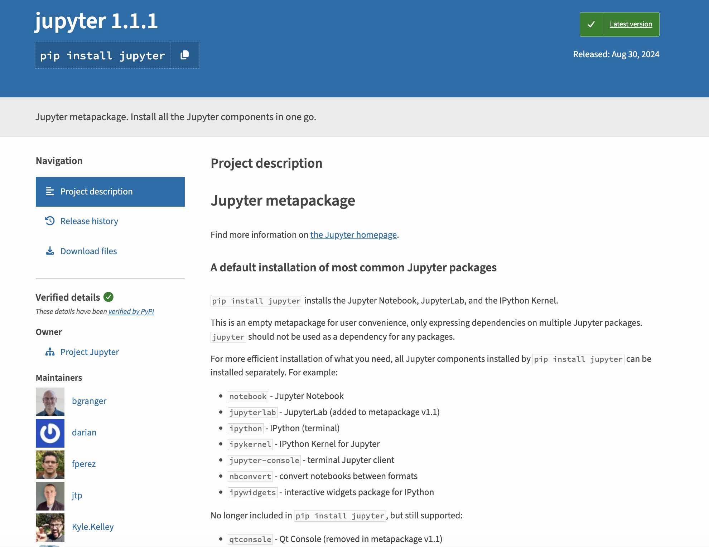

```sh
python -m pip install notebook ipykernel pandas
```

Using `python -m pip` makes it explicit that the packages should be installed for the same Python interpreter that will run the notebook. The official Jupyter installation page distinguishes between the classic-compatible Notebook application and JupyterLab; this lesson uses notebooks primarily through VS Code, although either browser interface can open the same `.ipynb` files. You can review the current options at [https://jupyter.org/install](https://jupyter.org/install){target="_blank"}.

### Jupyter Notebooks in VS Code (Recommended)

Open your `is310-coding-assignments` folder in VS Code. Make sure that you have installed both the **Python** and **Jupyter** extensions. You can open the downloaded notebook or create a new `.ipynb` file from the Explorer. You can also open the Command Palette with `Cmd+Shift+P` on macOS or `Ctrl+Shift+P` on Windows and select `Create: New Jupyter Notebook`.

Once the notebook is open, use **Select Kernel** in the upper-right corner and choose the Python interpreter from your course virtual environment. The kernel is the running Python process that executes cells and holds variables in memory. The notebook file stores the code, Markdown, metadata, and saved outputs, but it does not preserve the live Python process after you close or restart it.

You can save with `Cmd+S` on macOS or `Ctrl+S` on Windows. VS Code autosaves only if you have enabled autosave in your settings.


Useful VS Code notebook shortcuts include:

| macOS | Windows | Action |
|:---:|:---:|---|
| `Shift+Return` | `Shift+Enter` | Run the selected cell and move to the next cell |
| `Control+Return` | `Ctrl+Enter` | Run the selected cell and keep it selected |
| `Option+Return` | `Alt+Enter` | Run the selected cell and insert a cell below |
| `A` | `A` | Add a cell above in command mode |
| `B` | `B` | Add a cell below in command mode |
| `D`, `D` | `D`, `D` | Delete the selected cell in command mode |
| `M` | `M` | Change the selected cell to Markdown in command mode |
| `Y` | `Y` | Change the selected cell to code in command mode |
| `Z` | `Z` | Undo the last cell operation in command mode |

Press `Esc` to enter command mode and `Enter` to edit a cell. You can also use the buttons in the notebook toolbar rather than memorizing shortcuts.

::: {.callout-warning}
## Only Run Notebooks You Trust

Notebook cells can run arbitrary code, including code that changes or deletes files or sends data over the internet. Read unfamiliar code before running it and only enable a downloaded notebook in a trusted VS Code workspace when you understand its source.
:::

### Jupyter Notebooks in the Browser (Optional)

You can also run the Notebook application in a browser. Activate your virtual environment, move into your `is310-coding-assignments` directory, and run:

```sh
jupyter notebook
```

This starts a local Jupyter server and normally opens its interface in your browser. The terminal will display the exact `localhost` address and access token if the browser does not open automatically. Keep that terminal running while you use the browser interface, and press `Ctrl+C` in the terminal when you are finished.

`localhost` refers to your own computer. The browser, Jupyter server, notebook file, and kernel communicate with one another locally. Another person cannot open your running notebook merely from a `localhost` link, but you can share the `.ipynb` file through GitHub.

Notebook files use the `.ipynb` extension and are structured as JSON. They can store source cells, metadata, and cell outputs. This makes notebooks portable, but also means that generated outputs can make Git changes large or difficult to review. Commit meaningful outputs when they help readers understand the analysis, but avoid leaving enormous tables or accidental debugging output in the final notebook.

## Writing Code & Markdown in Jupyter Notebooks

Now that we have our notebook, we can start writing some code. Jupyter notebooks have two types of cells: code cells and markdown cells.

Initially, the notebook will create a code cell, which is where we can write Python code. We can also change the type of cell by clicking on the cell and then selecting the type from the dropdown menu in the toolbar. We can also hover at the top or bottom of the cell and that will display a `+ Code` or `+ Markdown` button.


Let's first add our title to the notebook, by hovering at the top and selecting `+ Markdown` cell. That will create a new cell above the existing one Then type `# Introduction to Jupyter Notebooks` and press `Shift` + `Return` on a Mac or  `Shift` + `Enter` on Windows to run the cell.

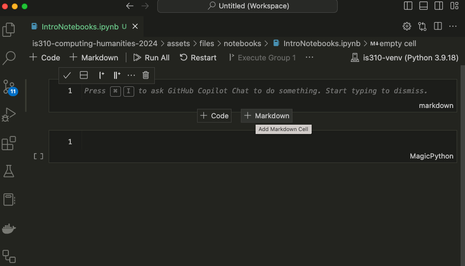

Now we should see the title at the top. We can use any of the Markdown syntax we have learned so far to format our text. For example, we can use `##` for a subheading, `*` for italics, `**` for bold, and `---` for a horizontal line, etc.

Now in a Jupyter notebook, we can still use much of the same Python syntax as our scripts. For example, going back to our [Python Refresher II: Advanced Python](../creating-curating-cad/02-python-refresher-advanced){target="_blank"}, we could reuse some of the same code in this notebook (though I did add a few tweaks).

Try pasting the following within the first cell of the Jupyter notebook:

```python
def check_movie_release(movie):
    if movie['release_year'] < 2000:
        print(f"{movie['name']} was released before 2000")
    else:
        print(f"{movie['name']} was released in or after 2000")
        return movie['name']

recent_movies = []

favorite_movies =[
    {
        "name": "The Matrix IV",
        "release_year": 2022,
        "sequels": ["The Matrix I", "The Matrix II", "The Matrix III"]
    },
    {
        "name": "Star Wars IV",
        "release_year": 1977,
        "sequels": ["Star Wars V", "Star Wars VI", "Star Wars VII", "Star Wars VIII", "Star Wars IX"],
        "prequels": ["Star Wars I", "Star Wars II", "Star Wars III"]
    },
    {
        "name": "The Lord of the Rings: The Fellowship of the Ring",
        "release_year": 2001,
        "sequels": ["The Two Towers", "The Return of the King"]
    }
]

for movie in favorite_movies:
    result = check_movie_release(movie)
    if result is not None:
        recent_movies.append(result)

print(recent_movies)
```

Unlike with our scripts where we would need to save our file and then type `python3 script.py`, we can just click on the cell and either press `Shift` + `Return` on a Mac or  `Shift` + `Enter` on Windows to run the cell.

Once you run the cell, you should see the following:

```python
['The Matrix IV', 'The Lord of the Rings: The Fellowship of the Ring']
```

You'll notice that now there's a number next to the cell. That indicates the order in which the cells were run. If you run a cell again, the number will increase. This is useful for keeping track of the order in which cells were run, especially if you have a large notebook.

Unlike with scripts, the notebook's running kernel holds variables in memory, which means that our function now exists in the Python session and we can call it in a new cell.

To test this out, add a new cell below our function one by pressing the `+ Code` symbol when you hover. Then paste the following code and run it.

```python
def updated_check_movie_release(movie, released_after_year, released_before_year=2024):
    if released_after_year < movie['release_year'] and movie['release_year'] < released_before_year:
        movie['recent'] = True
    else:
        movie['recent'] = False
    return movie
```

Now we can call this function in our for-loop by updating the original code:

```python
recent_movies = []

for movie in favorite_movies:
    updated_movie = updated_check_movie_release(movie, 2020)
    if updated_movie['recent']:
        recent_movies.append(updated_movie['name'])

recent_movies
```

Now we should see just the `The Matrix IV` in our list of recent movies. You'll notice I didn't have to move the new function above our for-loop. But what happens if I save and close, then reopen the notebook?


You'll notice that we get a `NameError` when we try to run the cell. This is because the new kernel session has not yet executed the cell that defines `updated_check_movie_release`. This is one of the things that makes Jupyter notebooks useful but easy to misread: cells can be run in an order that differs from their order on the page. Move definitions before the cells that use them, then use **Restart Kernel and Run All Cells** to confirm that the notebook works from top to bottom in a clean session.

## Pandas Library & Working with DataFrames


Jupyter notebooks are particularly useful for working with tabular data (that is data in spreadsheets), especially with the Python Library `pandas` [https://pandas.pydata.org/docs/index.html](https://pandas.pydata.org/docs/index.html){target="_blank"}.


The library was started by Wes McKinney in 2008 as a tool for working with financial data, but has since become one of the most popular libraries for data analysis in Python. We can see the growth in the number of contributors to the library over the years by going to the GitHub repository [https://github.com/pandas-dev/pandas](https://github.com/pandas-dev/pandas){target="_blank"}.


The library also has very active documentation and we can see more about the team behind it here [https://pandas.pydata.org/about/team.html](https://pandas.pydata.org/about/team.html){target="_blank"}.

Wes McKinney is no longer an active maintainer, and pandas now uses a community governance model supported by a large group of volunteer contributors. I recommend the open-source version of McKinney's book *Python for Data Analysis* if you want to learn more about using pandas: [https://wesmckinney.com/book/](https://wesmckinney.com/book/){target="_blank"}.

### Pandas Basics

Now that we have some background, we can start to try out `pandas` in our Jupyter notebook.

First we need to install `pandas`, which we can do by visiting the documentation and following the steps under the `Getting Started` and `Installation` [https://pandas.pydata.org/docs/getting_started/install.html](https://pandas.pydata.org/docs/getting_started/install.html){target="_blank"}. You're welcome to use any installation method, but I highly recommend installing into a virtual environment, and using `pip` to install [https://pandas.pydata.org/docs/getting_started/install.html#installing-from-pypi](https://pandas.pydata.org/docs/getting_started/install.html#installing-from-pypi){target="_blank"}.

```sh
python -m pip install pandas
```

Now if we start to go through the tutorials in the `Getting Started` section, we can start to learn how to work with `pandas`. Specifically, this tutorial on reading and writing data with `pandas`: [https://pandas.pydata.org/docs/getting_started/intro_tutorials/02_read_write.html](https://pandas.pydata.org/docs/getting_started/intro_tutorials/02_read_write.html){target="_blank"}.

You'll notice the first line of the tutorial is the following syntax:

```python
import pandas as pd
```

Remember the `as` keyword is used to give a library an alias, so that we don't have to type `pandas` each time we want to use a feature of the library. We can check that this worked, by outputting the version of Pandas, with the following:

```python
pd.__version__
```

Now rather than using their `Titanic data` example, we're going to try reading in some tabular data (aka a spreadsheet) into our notebook. In this course, we've been reading the data essays behind *The Responsible Datasets in Context Project* and now it is time to start working with some of that data.

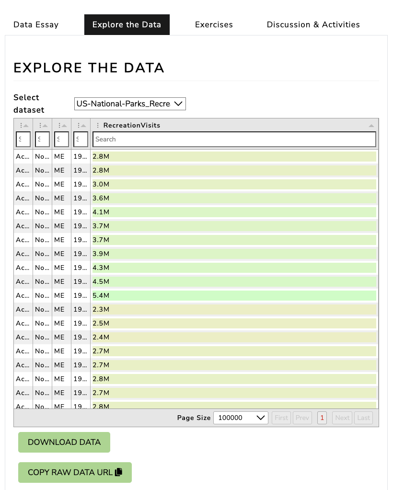

For today's lesson, we will use the US National Parks Visit dataset. You can download the dataset from here [https://www.responsible-datasets-in-context.com/posts/np-data/?tab=explore-the-data](https://www.responsible-datasets-in-context.com/posts/np-data/?tab=explore-the-data){target="_blank"}. You'll notice you can either download the data as a `.csv` file or use the copy url option to get the remote data.

`pandas` is particularly powerful for reading in data from a variety of sources, including local files, remote files, and databases. It also can read in a variety of file types, including `.csv`, `.json`, `.xlsx`, and more.


We can use either a downloaded local copy or the remote url to read the data into our notebook so that we can access the data using the built-in method from `pandas` called `read_csv()`, which we can read about here [https://pandas.pydata.org/docs/reference/api/pandas.read_csv.html#pandas-read-csv](https://pandas.pydata.org/docs/reference/api/pandas.read_csv.html#pandas-read-csv){target="_blank"}.

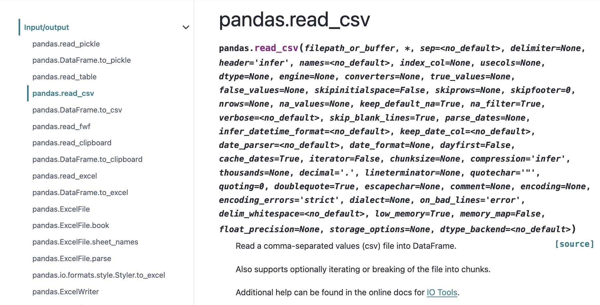

In the tutorial, we can see they have the following code `titanic = pd.read_csv("data/titanic.csv")` and in the `read_csv` documentation, we can learn that the first argument to the method is the file path to the data we want to read in, specifically:

> Any valid string path is acceptable. The string could be a URL. Valid URL schemes include http, ftp, s3, gs, and file. For file URLs, a host is expected.

So, if we want to use the remote URL, we can do the following:

```python
parks_data_df = pd.read_csv('https://raw.githubusercontent.com/melaniewalsh/responsible-datasets-in-context/main/datasets/national-parks/US-National-Parks_RecreationVisits_1979-2023.csv') # or use the local path pd.read_csv('US-National-Parks_RecreationVisits_1979-2023.csv')
```

I named the variable holding the data `parks_data_df`, which is a common convention in data science to use the `_df` suffix to indicate that the variable is a DataFrame. I could've been a bit more expressive and named it `national_parks_visits_df`, but I wanted to keep it short for typing. You're welcome to use any naming convention you prefer, but I would recommend being consistent and using the `_df` suffix for DataFrames.

So now let's explore `parks_data_df`.

First, we can test what the variable contains by using `type(parks_data_df)`, which tells us that it is a `pandas.core.frame.DataFrame`. Notice how we aren't using the `print()` method here, but rather just typing the variable name and running the cell. That's because Jupyter notebooks will automatically print the output of the last line of a cell.

```python
type(parks_data_df)
```

DataFrames are the primary data structures or Classes in `pandas` and are defined as:

> A DataFrame is a 2-dimensional data structure that can store data of different types (including characters, integers, floating point values, categorical data and more) in columns. It is similar to a spreadsheet, a SQL table or the data.frame in R.


We can either visit the documentation for `DataFrame` directly here [https://pandas.pydata.org/docs/reference/api/pandas.DataFrame.html#pandas.DataFrame](https://pandas.pydata.org/docs/reference/api/pandas.DataFrame.html#pandas.DataFrame){target="_blank"} or we can also use the Python built-in `help()` function to learn more about the DataFrame class.

```python
help(pd.DataFrame)
```

This should show the following in your notebook:

```bash
Help on class DataFrame in module pandas.core.frame:

class DataFrame(pandas.core.generic.NDFrame, pandas.core.arraylike.OpsMixin)
 |  DataFrame(data=None, index: 'Axes | None' = None, columns: 'Axes | None' = None, dtype: 'Dtype | None' = None, copy: 'bool | None' = None) -> 'None'
 |
 |  Two-dimensional, size-mutable, potentially heterogeneous tabular data.
 |
 |  Data structure also contains labeled axes (rows and columns).
 |  Arithmetic operations align on both row and column labels. Can be
 |  thought of as a dict-like container for Series objects. The primary
 |  pandas data structure.
 |
 |  Parameters
 |  ----------
 |  data : ndarray (structured or homogeneous), Iterable, dict, or DataFrame
 |      Dict can contain Series, arrays, constants, dataclass or list-like objects. If
 |      data is a dict, column order follows insertion-order. If a dict contains Series
 |      which have an index defined, it is aligned by its index.
 |
 |      .. versionchanged:: 0.25.0
 |         If data is a list of dicts, column order follows insertion-order.
 |
 |  index : Index or array-like
 |      Index to use for resulting frame. Will default to RangeIndex if
 |      no indexing information part of input data and no index provided.
 ```

These details are very technical but we can start to get a sense that DataFrames are powerful data structures, containing both rows and columns, and that they can hold different types of data.

We can also start to understand these concepts by exploring our dataset.  First, we can type the variable `parks_data_df` into a cell, which shows us the columns and a few rows, though much of the DataFrame is truncated.

We can also type `parks_data_df.head()`, which displays the first five rows, or `parks_data_df.sample(random_state=42)`, which displays one reproducible random row. Setting `random_state` means that everyone running the example will see the same sample.

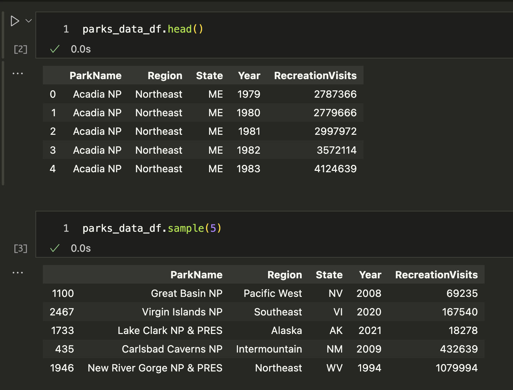

We might also want to explore the size of our dataset, as well as the types of data it contains.

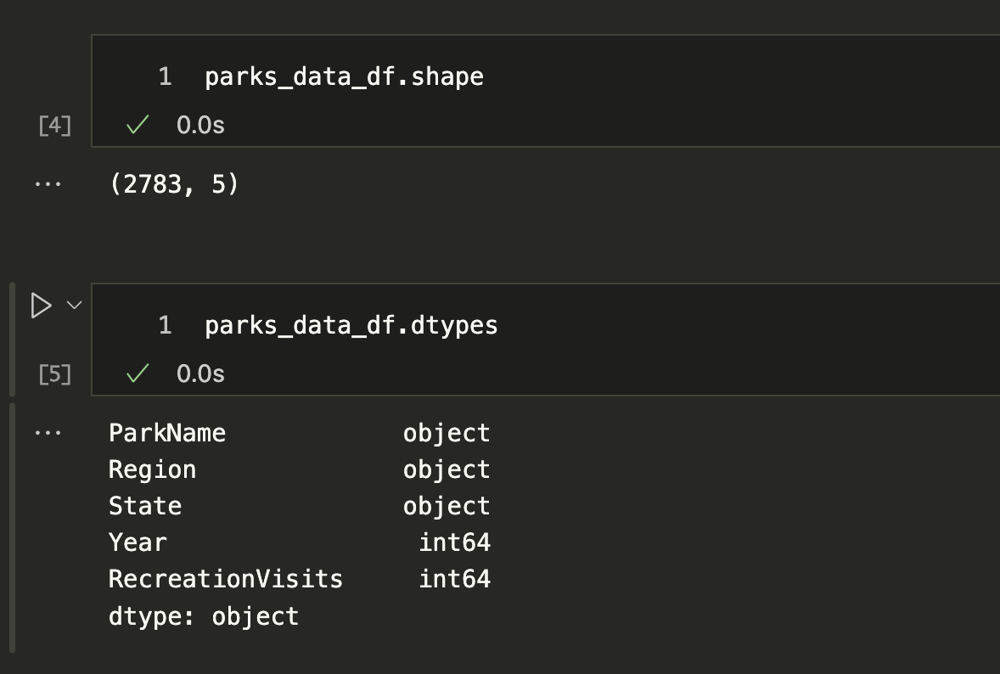

We can use the `shape` and `dtypes` attributes that are built-in on the DataFrame Class. `shape` tells us that we have a certain number of rows and columns, while `dtypes` tells us the data types of each of those columns.

Pandas data types build on Python and NumPy types while also adding types designed for tabular data. Starting with pandas 3.0, text read from a file is normally represented with the dedicated `str` dtype rather than the older general-purpose `object` dtype. You can read more about current pandas data types here: [https://pandas.pydata.org/docs/reference/arrays.html#pandas-arrays-scalars-and-data-types](https://pandas.pydata.org/docs/reference/arrays.html#pandas-arrays-scalars-and-data-types){target="_blank"}.

| Pandas dtype | Python type | NumPy type | Usage|
|:----------:|:----------:|:----------:|:----------:|
| `str` or `string` | `str` | String array | Text values |
| `object` | Any Python object | `object_` | Mixed or arbitrary Python objects |
| `int64` | `int` | `int64` | Integer numbers |
| `float64` | `float` | `float64` | Floating-point numbers |
| `bool` | `bool` | `bool_` | True/False values |
| `datetime64` | `datetime` | `datetime64` | Date and time values |
| `timedelta64` | `timedelta` | `timedelta64` | Differences between datetimes |
| `category` | No direct equivalent | No direct equivalent | A finite set of repeated values |

You'll notice that some of the data types are only available in Pandas. It's important to check what data types exist in your columns, since it informs the types of data manipulation you can do with your dataset.

We can get an overview of our data using two additional methods: `info()` and `describe()`. The `info()` method gives us a summary of the DataFrame, including the number of non-null values in each column, while the `describe()` method gives us summary statistics for the numeric columns.

```python
parks_data_df.info()
```

```python
parks_data_df.describe()
```

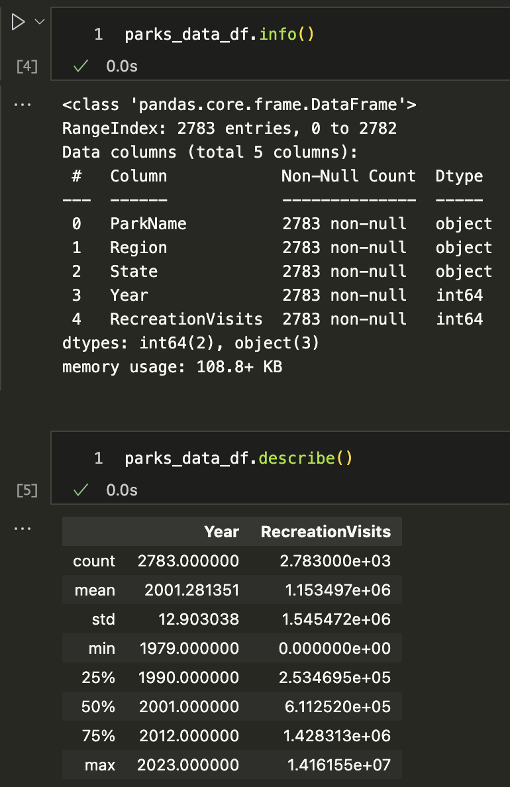

We can see that the `info()` method gives us a lot of useful information about our DataFrame, including the number of entries, the number of columns, the names of the columns, the number of non-null values, and the data types of each column.

We can also see that the `describe()` method gives us summary statistics for the numeric columns, including the count, mean, standard deviation, minimum, maximum, and quartiles. In the current dataset, both `Year` and `RecreationVisits` are stored as integers. Because these are the only two numeric columns, they are the only ones included in the default summary statistics.

Before analyzing a dataset, we should also check for missing values and exact duplicate rows:

```python
parks_data_df.isna().sum()
```

```python
parks_data_df.duplicated().sum()
```

`isna()` creates a table of `True` and `False` values indicating whether each value is missing, and `sum()` counts the `True` values in each column. `duplicated()` identifies rows that repeat all the same values. A result of zero does not prove that the dataset is correct, but these checks help us identify two common data-quality problems before continuing.

Finally, we can also see in this tutorial "10 minutes to pandas" that there are a few more methods for viewing data [https://pandas.pydata.org/docs/user_guide/10min.html#viewing-data](https://pandas.pydata.org/docs/user_guide/10min.html#viewing-data){target="_blank"}, including `sort_values()`:

```python
parks_data_df.sort_values(by='RecreationVisits', ascending=False)
```

This will sort the DataFrame by the `RecreationVisits` column in descending order. We could also sort multiple columns by passing a list of column names.

```python
parks_data_df.sort_values(by=['Year', 'RecreationVisits'], ascending=[True, False]).head(10)
```

In this case, we would sort by `Year` in ascending order and then by `RecreationVisits` in descending order. We are also using the `head()` method to limit the output to the first 10 rows.

### Indexing & Selecting Data with Pandas

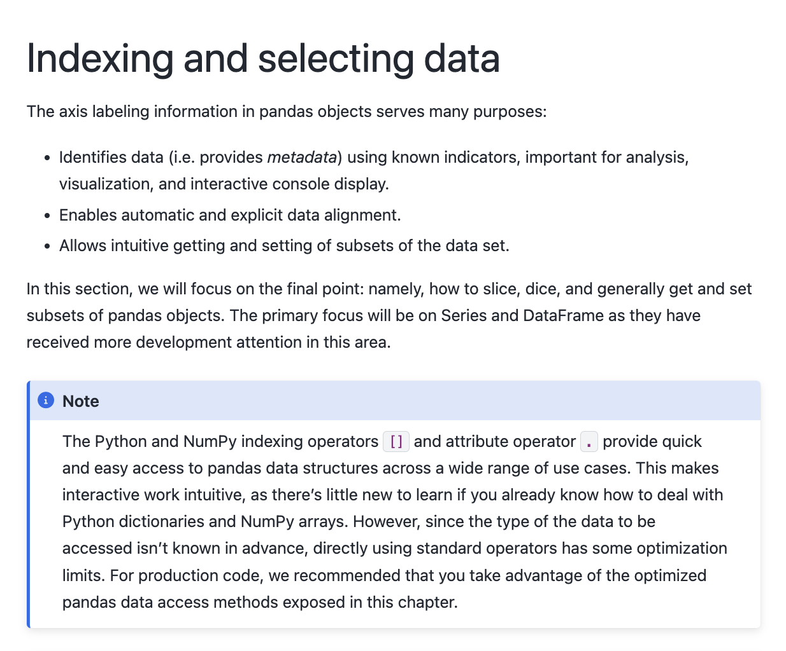

Pandas has a number of methods for selecting data, which we can read about in the documentation [https://pandas.pydata.org/pandas-docs/stable/user_guide/indexing.html](https://pandas.pydata.org/pandas-docs/stable/user_guide/indexing.html){target="_blank"}. At a high level, we can select data using the following methods:

- **Selecting columns**: We can select a single column using a single bracket, or multiple columns using double brackets.
- **Selecting rows**: We can select rows using the `loc[]` and `iloc[]` methods.
- **Boolean indexing**: We can filter data based on conditions.
- **Setting values**: We can set values in the DataFrame using the `loc[]` method.
- **Using the `query()` method**: We can filter data using a query string.
- **Using the `filter()` method**: We can filter data based on labels.
- **Using the `at[]` and `iat[]` methods**: We can access a single value for a row/column label pair or by integer position.

Let's start by trying to select columns and explore the `Year` column. Try typing in one cell `parks_data_df['Year']` and then in the following cell `parks_data_df[['Year']]`. What differences do you notice?

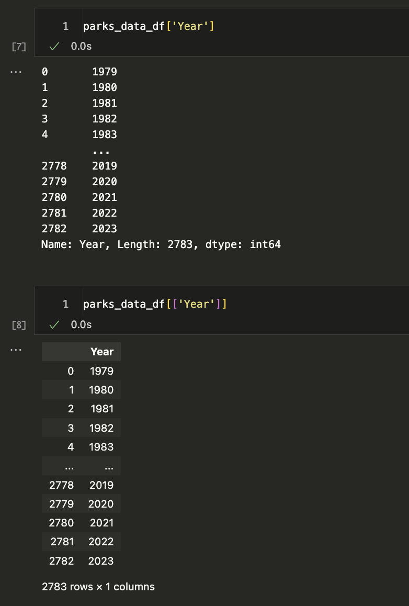

The difference in the output for each of these syntaxes has to do with how Pandas handles `indexing` (as a refresher, we index in Python using single square brackets).

In Pandas, using a single bracket is used to index either a single column or selected rows, and essentially refers to one dimension of the DataFrame (rather than two). Whereas two square brackets allows us to both index for a column, but then also potentially request a list of columns.

Let's try out some examples:

- Type `parks_data_df[0:5]` in a cell and run it. What results do you get?
- Type `parks_data_df[['Year', 'Region']]` in a cell and run it. What results do you get?

For the first example, you should see the first five rows of the DataFrame, while the second example should show you the data in the columns `Year` and `Region`.

To understand the difference between these types of indexing, we can type following:

```python
print(type(parks_data_df['Year']))
print(type(parks_data_df[['Year']]))
```

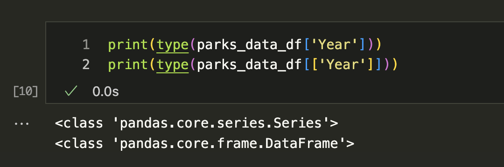

The output here tells us that the first example is returning a class type `Series`, while the second example is returning a class type `DataFrame`. While DataFrames are two-dimensional data structures, in Pandas, Series are used to store one-dimensional data (like a column), and we can read more about them here [https://pandas.pydata.org/docs/reference/api/pandas.Series.html#pandas-series](https://pandas.pydata.org/docs/reference/api/pandas.Series.html#pandas-series){target="_blank"}.


We can see the methods that exist for `Series` are similar to those for `DataFrame`, but since Series deal with one dimension of data, some methods work slightly differently or return different types of output.

Let's try the `to_list()` method, which we can read about here [https://pandas.pydata.org/docs/reference/api/pandas.Series.to_list.html](https://pandas.pydata.org/docs/reference/api/pandas.Series.to_list.html){target="_blank"}, on the `Year` column:

```python
parks_data_df['Year'].to_list()
```

You should get a long list of all the values in the column as your output. However, it might be hard to tell if we have unique values. We can use the `unique()` method to see just the unique values in the column, [https://pandas.pydata.org/docs/reference/api/pandas.Series.unique.html](https://pandas.pydata.org/docs/reference/api/pandas.Series.unique.html){target="_blank"}.

```python
parks_data_df['Year'].unique()
```

Which gives us the following list `[1979, 1980, 1981, 1982, 1983, 1984, 1985, 1986, 1987, 1988, 1989, 1990, 1991, 1992, 1993, 1994, 1995, 1996, 1997, 1998, 1999, 2000, 2001, 2002, 2003, 2004, 2005, 2006, 2007, 2008, 2009, 2010, 2011, 2012, 2013, 2014, 2015, 2016, 2017, 2018, 2019, 2020, 2021, 2022, 2023]`.

While the columns in the `parks_data_df` are capitalized, usually we try to keep column names lowercase and use underscores instead of spaces for ease of typing. So let's try renaming all of the columns programmatically. First, we need to get all the column names using the `columns` attribute of the `DataFrame`, which can see is an attribute in the documentation [https://pandas.pydata.org/docs/reference/api/pandas.DataFrame.columns.html](https://pandas.pydata.org/docs/reference/api/pandas.DataFrame.columns.html){target="_blank"}.

```python
parks_data_df.columns
```

Then we can use a list comprehension to create a new list of column names that are all lowercase and have underscores instead of spaces.

```python
new_column_names = [col.lower().replace(' ', '_') for col in parks_data_df.columns]
```

Finally, we can assign this new list to the `columns` attribute of the DataFrame.

```python
parks_data_df.columns = new_column_names
parks_data_df.columns
```

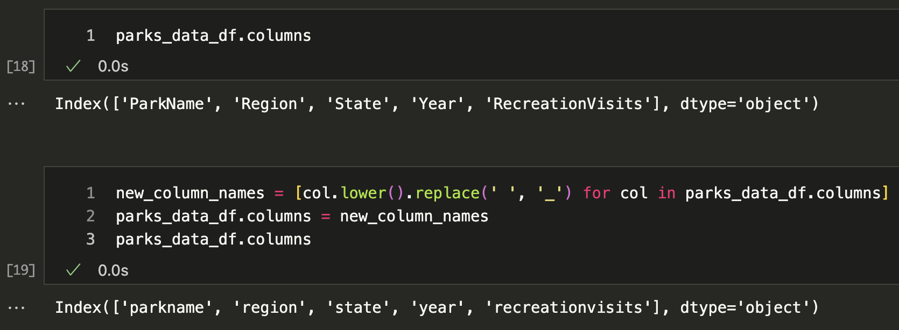

You'll notice that column names like `RecreationVisits` are now `recreationvisits`, which is much easier to work with but still a bit hard to read. We could use the following code

```python
import re

# We need to reload the data to reset the column names back to their original state
parks_data_df = pd.read_csv('https://raw.githubusercontent.com/melaniewalsh/responsible-datasets-in-context/main/datasets/national-parks/US-National-Parks_RecreationVisits_1979-2023.csv') # or use the local path pd.read_csv('US-National-Parks_RecreationVisits_1979-2023.csv')

# Function to split on uppercase letters and insert underscores
def split_on_uppercase(name):
    return re.sub(r'(?<!^)(?=[A-Z])', '_', name).lower()

# Apply the function to each column name
new_column_names = [split_on_uppercase(col) for col in parks_data_df.columns]
parks_data_df.columns = new_column_names
```

Now if we check the column names again, we should see that they are all lowercase and have underscores instead of spaces. However, we will only see that if we reload the original dataset, otherwise it will not work. Why is that? **Hint: Remember Jupyter Notebooks are not Python scripts!**

### Filtering & Grouping Data with Pandas

One of the things that makes Pandas so powerful is that it allows us to filter data easily. We can filter data using boolean indexing, which allows us to select rows based on conditions, just like `if` statements in Python.

For example, if we want to filter the DataFrame to only include rows for visits to Illinois, we could select the `state` column and see how many rows have the value `IL`, we can do the following:

```python
parks_data_df[parks_data_df['state'] == 'IL']
```

Now we'll see that this gives us zero values because this dataset is only for "the current 63 National Parks administered by the United States National Park Service (NPS), from 1979 to 2023."


While we could've checked this map prior to filtering, we can also check the unique values in the `state` column to see what values exist.

```python
parks_data_df['state'].unique()
```

However, `unique()` only gives us the unique values in the column, but it doesn't tell us how many times each value appears. For that, we can use the `value_counts()` method, which counts the number of occurrences of each unique value in a column. We can read more about the method here [https://pandas.pydata.org/pandas-docs/stable/reference/api/pandas.DataFrame.value_counts.html#pandas-dataframe-value-counts](https://pandas.pydata.org/pandas-docs/stable/reference/api/pandas.DataFrame.value_counts.html#pandas-dataframe-value-counts){target="_blank"}.

```python
parks_data_df['state'].value_counts()
```

This will give us a count of how many times each state appears in the dataset. We could subset our `parks_data_df` DataFrame to only include rows for a specific state, like `California` which is the highest frequency state, using the following code:

```python
parks_data_df[parks_data_df['state'] == 'CA']
```

We could also filter for multiple states using the `isin()` method, which checks if a value is in a list of values (more info here [https://pandas.pydata.org/pandas-docs/stable/reference/api/pandas.DataFrame.isin.html#pandas.DataFrame.isin](https://pandas.pydata.org/pandas-docs/stable/reference/api/pandas.DataFrame.isin.html#pandas.DataFrame.isin){target="_blank"}). For example, if we want to filter for both `California` and `Alaska`, we could do the following:

```python
parks_data_df[parks_data_df['state'].isin(['CA', 'AK'])]
```

Now we can see the rows for both states. However, that doesn't tell us how many parks exist in each state. To get that information, we can use the `groupby()` method, which allows us to group rows by a specific column and then perform an aggregation function on the grouped data. There's detailed documentation available here [https://pandas.pydata.org/docs/user_guide/groupby.html#group-by-split-apply-combine](https://pandas.pydata.org/docs/user_guide/groupby.html#group-by-split-apply-combine){target="_blank"}.

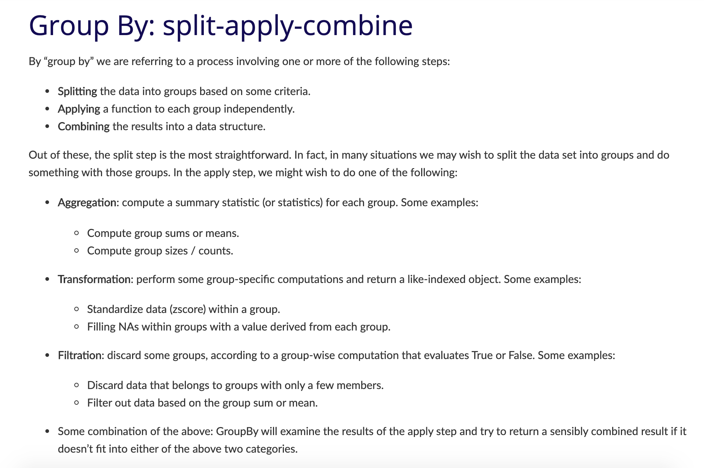


The above figures start to explain the logic of `groupby()`, but let's break it down further.

First, we select one or more columns by which we want to group our data. In our case, we can group by `state`. Grouping alone does not tell us how many parks exist there; it creates a `DataFrameGroupBy` object that is ready for a subsequent aggregation.

```python
parks_data_df.groupby('state')
```

While this code works, we'll see that it only returns a `DataFrameGroupBy` object, which is not very useful on its own. To see the actual data, we could use the `get_group()` method to see the data for a specific state.

```python
parks_data_df.groupby('state').get_group('CA')
```

Now we see that we are getting a subset of our data! However, where `groupby()` really shines is when we aggregate the grouped data. For example, the following counts the number of **rows** for each state:

```python
parks_data_df.groupby('state').size()
```

This code uses the `size()` method to count the number of rows in each group. Because this dataset contains one row per park and year, the result is the number of park-year observations in each state, **not** the number of distinct parks. If we want the number of unique parks, we can select `park_name` and use `nunique()` instead.

```python
parks_data_df.groupby('state')['park_name'].nunique()
```

Which begins with the following output (the complete result includes all states represented in the dataset):

```bash
state
AK    8
AR    1
AS    1
AZ    3
CA    9
CO    4
FL    3
HI    2
IN    1
KY    1
ME    1
MI    1
MN    1
MO    1
MT    1
```

Both `size()` and this use of `nunique()` return a Series because each state is associated with one aggregated value. When we use `groupby()`, we can specify both the columns that define the groups and the columns that should be aggregated. Here, `state` defines the groups and `park_name` supplies the values whose unique count we want.

Because we are getting a Series, we can also convert it back to a DataFrame using the `reset_index()` method, which will turn the Series back into a DataFrame.

```python
parks_data_df.groupby('state')['park_name'].nunique().reset_index()
```


You'll often see `reset_index()` being used in Pandas. But what is the index? The index is a special column in Pandas that is used to identify rows. By default, Pandas assigns a unique index to each row, but we can also set our own index using the `set_index()` method. You can read more about `reset_index()` here [https://pandas.pydata.org/pandas-docs/stable/reference/api/pandas.DataFrame.reset_index.html#pandas-dataframe-reset-index](https://pandas.pydata.org/pandas-docs/stable/reference/api/pandas.DataFrame.reset_index.html#pandas-dataframe-reset-index){target="_blank"}  and `set_index()` here [https://pandas.pydata.org/pandas-docs/stable/reference/api/pandas.DataFrame.set_index.html#pandas.DataFrame.set_index](https://pandas.pydata.org/pandas-docs/stable/reference/api/pandas.DataFrame.set_index.html#pandas.DataFrame.set_index){target="_blank"}.

Now we have an actual DataFrame that we can save to a new variable, which we can call `parks_per_state_df`.

```python
parks_per_state_df = parks_data_df.groupby('state')['park_name'].nunique().reset_index()
```

`nunique()` is just one of many methods we could use with `groupby()`. We could also use `sum()`, `mean()`, `min()`, `max()`, and more. Here's a short summary table of some of the built-in methods we can use with both Series, DataFrames, and GroupBy objects, and you can see more in the user guide here: [https://pandas.pydata.org/pandas-docs/stable/user_guide/basics.html#descriptive-statistics](https://pandas.pydata.org/pandas-docs/stable/user_guide/basics.html#descriptive-statistics){target="_blank"}.

| Pandas method | Explanation |
|:----------:|:----------:|
|`.count()`| Number of non-null observations|
|`.sum()`| Sum of values|
|`.mean()`| Mean of values|
|`.median()`| Median of values|
| `.min()` | Minimum value|
| `.max()`| Maximum value|
| `.mode()`| Mode|
| `.std()`| Sample standard deviation of values |
| `.describe()` | Compute set of summary statistics for Series or each DataFrame column|
| `.value_counts()` | Count unique values in a Series|
| `.nunique()` | Count unique values in a Series|
| `.size()` | Count number of rows in each group|

Now we have a new DataFrame that contains the number of parks in each state, but you'll notice that the column names are identical to the original `parks_data_df`. That's because `groupby()` does not automatically rename the columns. So we can rename the columns to something more descriptive using the `rename()` method (more info available here [https://pandas.pydata.org/pandas-docs/stable/reference/api/pandas.DataFrame.rename.html#pandas-dataframe-rename](https://pandas.pydata.org/pandas-docs/stable/reference/api/pandas.DataFrame.rename.html#pandas-dataframe-rename){target="_blank"}).

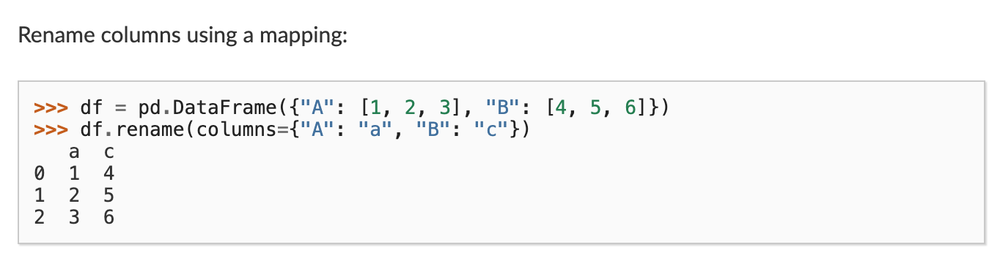

As you can see in this figure, we can use the `rename()` method, which requires passing a dictionary to the `columns` parameter, where the keys are the old column names and the values are the new column names.

```python
parks_per_state_df.rename(columns={'park_name': 'num_parks'})
```

However, this method returns a new DataFrame. If we want to keep the renamed result, we should assign it back to our variable:

```python
parks_per_state_df = parks_per_state_df.rename(columns={'park_name': 'num_parks'})
```

We can use the same assignment pattern when sorting. This makes it visible that the operation produces an updated DataFrame:

```python
parks_per_state_df = parks_per_state_df.sort_values(by='num_parks', ascending=False)
```

Now when we run this cell, `parks_per_state_df` will have the new column, and be sorted by the number of parks in descending order.

Finally, so far we have been using only data from the `parks_data_df` DataFrame, but we can also add new data. For example, if we deliberately wanted to add Illinois to our summary, we could do the following:

```python
new_state = pd.DataFrame({'state': ['IL'], 'num_parks': [0]})
combined_parks_per_state_df = pd.concat(
    [parks_per_state_df, new_state],
    ignore_index=True
)
```

Let's break this down. First, we create a new DataFrame called `new_state` that contains the new data we want to add. There are many ways we could create this DataFrame, but we used a dictionary where the keys are the column names and the values are lists of the data we want to add. Alternatively, we could also use a list of dictionaries, like the following:

```python
new_state = pd.DataFrame([{'state': 'IL', 'num_parks': 0}])
```

The core thing is that we are using the `DataFrame` class to create a new DataFrame and passing in data with the same column names as the summary. We assign `num_parks` as `0` because we have established that the dataset's definition of a national park produces a known count of zero for Illinois. A missing value would mean that the count is unknown or unavailable, which is a different claim.

Pandas can represent missing data with several markers depending on the column's dtype, including `NaN`, `None`, `NaT`, and `pd.NA`. For a simple explicit missing value, we can use `pd.NA` without importing another library:

```python
unknown_state = pd.DataFrame({'state': ['XX'], 'num_parks': [pd.NA]})
```

The choice between zero and a missing value requires a substantive decision about what the data means. In our Illinois example, zero is appropriate because it represents a known absence according to this dataset's scope. `pd.concat()` combines the summary and new row, while `ignore_index=True` creates a new sequential index for the combined DataFrame. We'll get more into merging and joining DataFrames in the next lesson.

We can save the resulting table as a new CSV file:

```python
combined_parks_per_state_df.to_csv('parks_per_state.csv', index=False)
```

The `index=False` argument prevents pandas from saving the DataFrame's index as an extra CSV column. Before exporting, always check the variable you are saving and consider whether the new filename clearly distinguishes your transformed data from the original source.

## Quick Exercise: Answering Questions with Pandas

In the documentation for the National Parks Dataset, Walsh and Keyes have an `Exercises` page that you can find here: [https://www.responsible-datasets-in-context.com/posts/np-data/exercises-python/NP-Data-Groupby-Pandas.html](https://www.responsible-datasets-in-context.com/posts/np-data/exercises-python/NP-Data-Groupby-Pandas.html){target="_blank"}.

In that exercise, they have three questions:

1. What is the average number of visits for each state?
2. What is the average number of visits for each National Park?
3. How many National Parks are there in each state?

Before writing code, pause over the first question: **What does “the average number of visits for each state” mean?** Averaging every park-year row gives equal weight to each park-year observation. Summing visits by state and year and then averaging those annual state totals answers a different question. Neither calculation is automatically correct; the method should match the unit of analysis and claim you intend to make.

Let's try and answer them together with what we have learned so far! In your `is310-coding-assignments` repository, create a new folder called `pandas-eda` and in that folder create a new Jupyter Notebook called `NationalParksEDA.ipynb`. Feel free to also move your `IntroNotebooks.ipynb` into that folder as well.

In the Notebook, you should start by adding a title in Markdown and a brief description of what you are doing. Then, you can import the necessary libraries and read in the dataset.

Then create a section for each question and write the code needed to answer it. Use methods such as `groupby()`, `mean()`, `sum()`, and `nunique()`, but explain what one row represents before choosing an aggregation.

To create a section, you can use the `#` symbol in Markdown to create a header. For example, you could use `## Average Number of Visits for Each State` for the first question, which would create a second-level header.

When you finish, save the notebook and use **Restart Kernel and Run All Cells**. This final check confirms that a reader can reproduce your results from a clean session without depending on variables created by an earlier, out-of-order execution. Review the outputs for unexpectedly large tables or debugging text before committing the notebook to GitHub.
