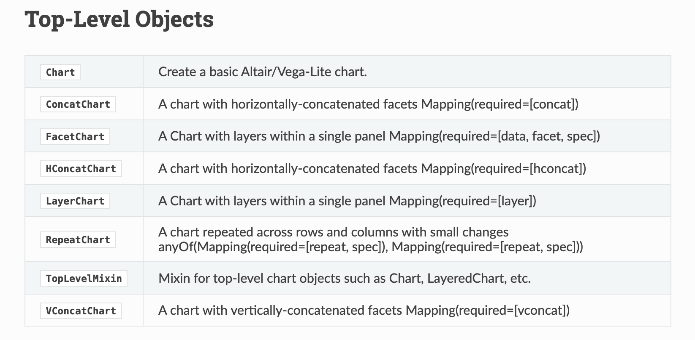
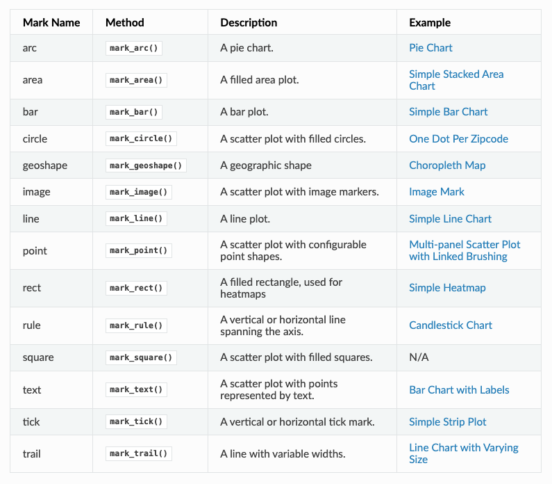
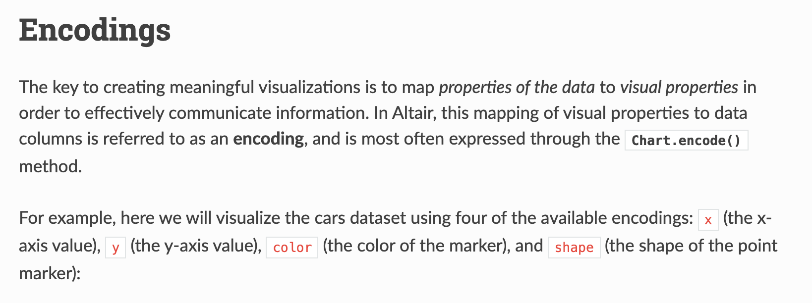
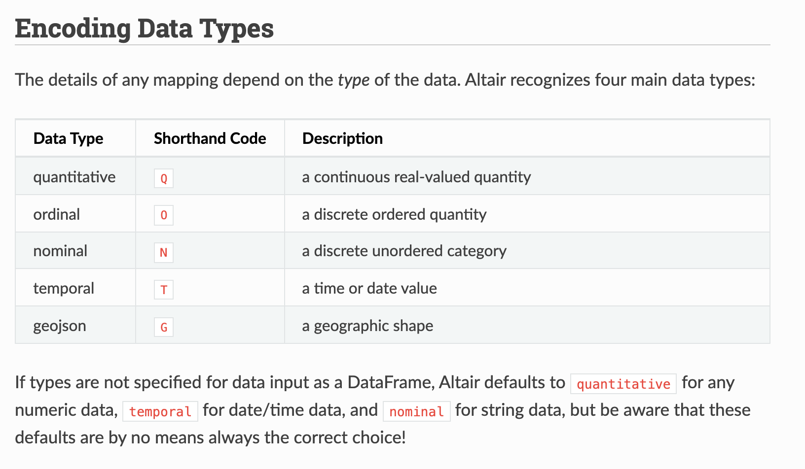
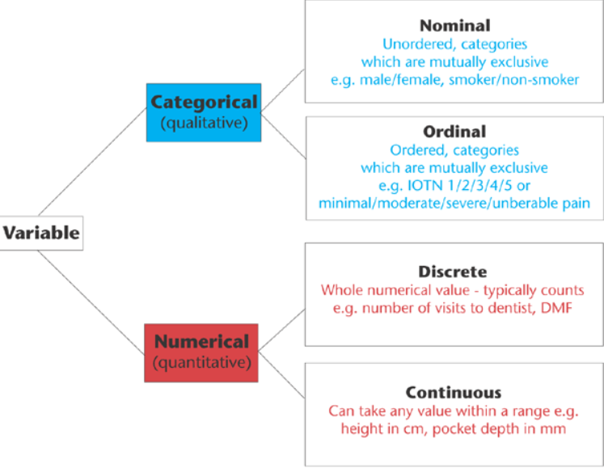
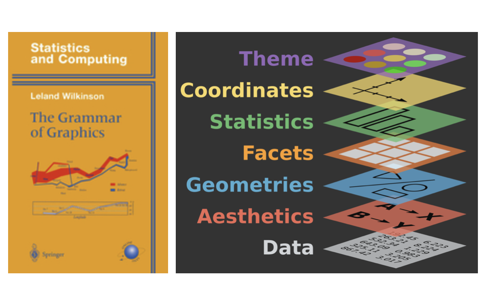

::: {.callout-note}
## Revised Lesson

If you read our previous lesson on EDA and data visualization, you may notice that this version has been substantially revised. The content is largely the same, but the examples have been updated to use a different dataset and question. Please follow this version for your homework assignment!

If you attended Section B on November 3, you can skim this lesson because we covered the majority of this material in class. Professor LeBlanc will also try to post a video covering the revised lesson on Canvas soon.
:::

::: {.callout-tip}
## Want to follow along interactively?

Download the Jupyter notebook version of this lesson: <a href="../../assets/files/Top500NovelsEDA.ipynb" download target="_blank">Top500NovelsEDA.ipynb</a>

Open it in VS Code or Jupyter, select your course virtual environment as the kernel, and run the cells as you work through the lesson. The notebook begins without saved outputs so that you can produce and inspect each result yourself.
:::


In our last lesson, we tried to answer the following questions:

1. What is the average number of visits for each state?
2. What is the average number of visits for each National Park?
3. How many National Parks are there in each state?

Here are my solutions to these questions:

```python
# Load library
import pandas as pd

# Load the data
parks_data_df = pd.read_csv('https://raw.githubusercontent.com/melaniewalsh/responsible-datasets-in-context/main/datasets/national-parks/US-National-Parks_RecreationVisits_1979-2023.csv')

# 1. What is the average number of visits for each state?
print(parks_data_df.groupby(['State'])['RecreationVisits'].mean().reset_index())
# 2. What is the average number of visits for each National Park?
print(parks_data_df.groupby(['ParkName'])['RecreationVisits'].mean().reset_index())
# 3. How many National Parks are there in each state?
print(parks_data_df.groupby(['State'])['ParkName'].nunique().reset_index())
```


We could store each of these in new variables but we also want to visualize this data to help us better understand it. That's what we'll be exploring further in this next lesson through undertaking the steps of *exploratory data analysis*.

---

## Reading & Encoding Data

Rather than working with only the National Parks data, we can also explore other datasets from the *Responsible Datasets in Context Project*. For example, let's take a look at the "Top 500 Greatest Novels" dataset by Anna Preus and Aashna Sheth [https://www.responsible-datasets-in-context.com/posts/top-500-novels/top-500-novels.html](https://www.responsible-datasets-in-context.com/posts/top-500-novels/top-500-novels.html){target="_blank"}.

First, we need to create a new Jupyter notebook in our `pandas-eda` folder called `Top500NovelsEDA.ipynb` and then load in the data. As a reminder, how can we **read** data in Pandas?


::: {.callout-tip collapse="true"}
## Need a reminder about `pd.read_csv()`?

While this cat is adorable, we can also use the `pd.read_csv()` method to read in our data.

```python
# Import data
novels_df = pd.read_csv("https://raw.githubusercontent.com/melaniewalsh/responsible-datasets-in-context/main/datasets/top-500-novels/final_merged_dataset_no_full_text.tsv", sep="\t")
```

:::

Notice that I am adding an argument to the `read_csv()` method: `sep="\t"`. This tells Pandas to expect a tab-separated values file.

If we did not include this argument, we would likely see the following error in our Notebook:

```bash
ParserError: Error tokenizing data. C error: Expected 1 fields in line 163, saw 3
```

This error is telling us that there is an issue with the way the data is formatted. In this case, the dataset is actually a tab-separated values (TSV) file, which means that we need to specify the `sep` parameter when we read it in. Encoding errors are another common problem when working with data produced by other people or systems.


A computer stores numbers rather than letters. A **character encoding** supplies an agreed mapping between the numerical values stored in memory or a file and the abstract characters we understand as text. Unicode assigns each character a stable number called a **code point**; an encoding specifies how those code points become bytes; and a font determines the visible **glyphs** displayed on screen. If software reads a file using a different encoding from the one used to save it, the same bytes can be mapped to the wrong characters, producing garbled text sometimes called *mojibake*.

`ISO-8859-1`, also known as `Latin-1`, is part of a family of encodings standardized by the [**International Organization for Standardization (ISO)**](https://www.iso.org/home.html){target="_blank"} and the [**International Electrotechnical Commission (IEC)**](https://www.iec.ch/){target="_blank"}. This standard uses one byte per character, which provides 256 possible numerical values, and primarily supports Latin-script Western European languages. `utf-8`, by contrast, uses between one and four bytes to encode Unicode code points and preserves compatibility with ASCII while supporting the much larger multilingual Unicode character set.

In “Encoding Multilingualism: Technical Affordances of Multilingual Publication from Manuscripts to Unicode and OpenType,” Quinn Dombrowski, Manish Goregaokar, Ben Joeng (Yang), and Abeera Kamran detail how the rise of digital computing led to a proliferation of encodings, especially for non-European languages in the 1980s. But with the rise of the web, there was an increasing need for a unified encoding standard that could support multiple languages simultaneously, which led to the creation of Unicode and these newer standards. While Unicode greatly expanded multilingual computing, it did not succeed in making every language equally well supported.[^1]

In our case, we didn't need to specify the encoding, but if we did, we could have added the `encoding` parameter to our `read_csv()` method.

```{python}
# Import libraries
import pandas as pd
import matplotlib.pyplot as plt
import altair as alt

# Import data
novels_df = pd.read_csv(
    "https://raw.githubusercontent.com/melaniewalsh/responsible-datasets-in-context/main/datasets/top-500-novels/final_merged_dataset_no_full_text.tsv",
    sep="\t",
    encoding="utf-8"
)
```

Now we can start to explore this dataset. What methods could we use to get a sense of the data?


There are many answers to this question, but suppose we use `novels_df.info()`. We would see the following output:

```bash
<class 'pandas.DataFrame'>
RangeIndex: 500 entries, 0 to 499
Data columns (total 29 columns):
 #   Column                    Non-Null Count  Dtype  
---  ------                    --------------  -----  
 0   top_500_rank              500 non-null    int64  
 1   title                     500 non-null    str    
 2   author                    500 non-null    str    
 3   pub_year                  500 non-null    int64  
 4   orig_lang                 500 non-null    str    
 5   genre                     500 non-null    str    
 6   author_birth              499 non-null    str    
 7   author_death              496 non-null    str    
 8   author_gender             500 non-null    str    
 9   author_primary_lang       500 non-null    str    
 10  author_nationality        500 non-null    str    
 11  author_field_of_activity  329 non-null    str    
 12  author_occupation         459 non-null    str    
 13  oclc_holdings             495 non-null    float64
 14  oclc_eholdings            495 non-null    float64
 15  oclc_total_editions       495 non-null    float64
 16  oclc_holdings_rank        495 non-null    float64
 17  oclc_editions_rank        495 non-null    float64
 18  gr_avg_rating             500 non-null    float64
 19  gr_num_ratings            500 non-null    str    
 20  gr_num_reviews            500 non-null    str    
 21  gr_avg_rating_rank        500 non-null    int64  
 22  gr_num_ratings_rank       500 non-null    int64  
 23  oclc_owi                  495 non-null    float64
 24  author_viaf               500 non-null    object 
 25  gr_url                    480 non-null    str    
 26  wiki_url                  500 non-null    str    
 27  pg_eng_url                500 non-null    str    
 28  pg_orig_url               64 non-null     str    
dtypes: float64(7), int64(4), object(1), str(17)
memory usage: 258.2+ KB
```

This overview tells us that this dataset has many columns. It lists each column's name and data type, as well as the number of **non-null values** in each column.

We could also use `describe()` to get a summary of the numeric columns in the dataset:

```python
novels_df.describe()
```

This should give us the following output:

::: {.table-responsive}
| Statistic | top_500_rank | pub_year | oclc_holdings | oclc_eholdings | oclc_total_editions | oclc_holdings_rank | oclc_editions_rank | gr_avg_rating | gr_avg_rating_rank | gr_num_ratings_rank | oclc_owi |
|---|---:|---:|---:|---:|---:|---:|---:|---:|---:|---:|---:|
| count | 500.0 | 500.0 | 495.0 | 495.0 | 495.0 | 495.0 | 495.0 | 500.0 | 500.0 | 500.0 | 495.0 |
| mean | 250.5 | 1932.132 | 10401.438383838384 | 2218.5939393939393 | 896.6424242424242 | 248.0 | 248.0 | 3.97144 | 250.5 | 250.5 | 1602208445.3272727 |
| std | 144.4818327679989 | 84.30654638595425 | 5694.5090033480465 | 3084.5957147485274 | 1019.0155721348034 | 143.03845636750978 | 143.03845636750978 | 0.22768752627062921 | 144.4818327679989 | 144.4818327679989 | 2675299121.6826034 |
| min | 1.0 | 1021.0 | 996.0 | 25.0 | 21.0 | 1.0 | 1.0 | 3.29 | 1.0 | 1.0 | 1040.0 |
| 25% | 125.75 | 1900.0 | 6800.0 | 352.0 | 241.0 | 124.5 | 124.5 | 3.83 | 125.75 | 125.75 | 397287.5 |
| 50% | 250.5 | 1948.0 | 8318.0 | 558.0 | 485.0 | 248.0 | 248.0 | 3.98 | 250.5 | 250.5 | 16756029.0 |
| 75% | 375.25 | 1989.0 | 12184.0 | 3223.0 | 1207.5 | 371.5 | 371.5 | 4.12 | 375.25 | 375.25 | 2830458773.5 |
| max | 500.0 | 2015.0 | 37702.0 | 15545.0 | 9017.0 | 495.0 | 495.0 | 4.62 | 500.0 | 500.0 | 12392760730.0 |
:::

By default, `describe()` summarizes only numeric columns. We can ask Pandas to include every column by passing `include="all"`:

```python
novels_df.describe(include="all")
```

For readability, the categorical and identifier portion of that wide output is transposed below. Each row now represents one field:

::: {.table-responsive}
| Field | Count | Unique | Most Frequent Value | Frequency |
|---|---:|---:|---|---:|
| title | 500 | 500 | Don Quixote | 1 |
| author | 500 | 279 | John Grisham | 19 |
| orig_lang | 500 | 12 | English | 430 |
| genre | 500 | 14 | na | 221 |
| author_birth | 499 | 152 | 1955 | 21 |
| author_death | 496 | 134 | ALIVE | 144 |
| author_gender | 500 | 2 | male | 355 |
| author_primary_lang | 500 | 11 | eng | 427 |
| author_nationality | 500 | 23 | US | 257 |
| author_field_of_activity | 329 | 121 | english literature | 28 |
| author_occupation | 459 | 148 | authors | 57 |
| gr_num_ratings | 500 | 500 | 269,435 | 1 |
| gr_num_reviews | 500 | 497 | 4,209 | 2 |
| author_viaf | 500 | 279 | 7449742 | 19 |
| gr_url | 480 | 479 | https://www.goodreads.com/book/show/11991.The_Fall?ref=nav_sb_ss_4_8 | 2 |
| wiki_url | 500 | 499 | https://en.wikipedia.org/wiki/In_Search_of_Lost_Time | 2 |
| pg_eng_url | 500 | 182 | NA_not-pub-domain | 310 |
| pg_orig_url | 64 | 32 | unavailable | 32 |
:::

These summaries do more than describe the dataset. They help us begin to **audit** it by giving us a bird's-eye view of its structure and content. This perspective helps us consider how the dataset was assembled, what its fields represent, and which limitations might shape our interpretation.

The `count` row immediately raises questions about coverage:

- Why does `author_field_of_activity` contain only 329 recorded values?
- Why does `author_occupation` contain 459?
- Why are OCLC fields present for 495 novels rather than all 500?
- Why does `gr_url` contain 480 links?
- Why does `pg_orig_url` contain only 64 recorded values?

But `count` does not reveal every kind of missing data. Pandas counts any string as a recorded value, including placeholders such as:

- `na`, the most frequent value in `genre`.
- `NA_not-pub-domain`, the most frequent value in `pg_eng_url`.
- `unavailable`, the most frequent value in `pg_orig_url`.
- `ALIVE`, a value in `author_death` that records a status rather than a death year.

This means a field can be **technically non-null while still lacking the information we expected it to contain**. Auditing therefore requires us to inspect the values and think carefully about what constitutes **missing data** in the context of the dataset. This includes both **formal null values** and the conventions used to represent unavailable, inapplicable, unknown, or withheld information.

## Exploring Missing Data

Our initial description has already shown us **where** values are absent. The next question is not simply how to remove those rows, but **why a field might be missing and whether that missingness is patterned**.

For example, `author_field_of_activity` has 329 non-null values, which means that there are 171 missing values. We can start to get a sense of what that column contains if we return to the dataset documentation, specifically the section "What's in the Data" [https://www.responsible-datasets-in-context.com/posts/top-500-novels/top-500-novels.html?tab=data-essay#whats-in-the-data](https://www.responsible-datasets-in-context.com/posts/top-500-novels/top-500-novels.html?tab=data-essay#whats-in-the-data){target="_blank"}. From there we can learn the following about this column:

> AUTHOR_FIELD_OF_ACTIVITY: Author's primary fields of activity, according to VIAF. VIAF includes data from multiple global partner institutions, but we only collect VIAF data associated with the Library of Congress (LOC).


For those unfamiliar, [VIAF](https://viaf.org/){target="_blank"} stands for the Virtual International Authority File, which is a service that provides a way to link and share information about authors and their works across different libraries and institutions. The idea for VIAF originated in 1998 as an experiment in trying to link authority records. As a reminder, authority records are standardized records that provide information about a specific entity, such as an author or a work, like MARC records. VIAF was officially launched in 2003 and is operated by the Online Computer Library Center (OCLC) in partnership with various national libraries and institutions.


The impetus for the creation of VIAF was not just sharing information, but what LIS scholar Christine L. Borgman calls the "scaling problem in name disambiguation" in her book [*Big Data, Little Data, No Data: Scholarship in the Networked World*](https://direct.mit.edu/books/monograph/3085/Big-Data-Little-Data-No-DataScholarship-in-the){target="_blank"}. We've already talked about this briefly in discussing the challenges of "cleaning data", but the rise of multiple digital libraries and archives has made it increasingly difficult to accurately identify and attribute works to their correct authors, which is where projects like VIAF come in. However, as we discussed in class, there are still challenges with this system. For example, authors are not the ones who enter data into VIAF. Instead, it is often librarians or archivists who are responsible for creating and maintaining these records. This means that there can be discrepancies in how authors are represented, and it can be difficult to ensure that all works by a particular author are accurately attributed to them. 

The `author_field_of_activity` field therefore reflects cataloguing practices, available source records, institutional priorities, and the choices made when Preus and Sheth constructed this dataset.

A null could therefore indicate several different things:

- The relevant Library of Congress authority record lacks a field of activity.
- VIAF's contributing records disagree or provide uneven descriptions.
- Some languages, regions, periods, or literary traditions received different cataloguing attention.
- The dataset's collection process did not retrieve or preserve a value.

We can see what a field of activity looks like in VIAF by examining [Mark Twain's VIAF record](https://viaf.org/en/processed/LC%257Cn%20%2079021164){target="_blank"}.

One easy solution might be to simply filter out these rows. In the last lesson, we covered how we could add null values to a DataFrame, but now we want to explore how we can work with them. Pandas has a lot of documentation for handling **missing data** that you can read here [https://pandas.pydata.org/docs/user_guide/missing_data.html](https://pandas.pydata.org/docs/user_guide/missing_data.html){target="_blank"}. For our purposes, we're mostly concerned with the `isna()` and `notna()` methods.

But instead of using these to remove rows, we can start to use them to consider why there might be patterns around which authors have a recorded field of activity and which do not.

Pandas usually displays an absent value as `NaN`, which means **Not a Number**. The name comes from numerical computing, but Pandas also uses `NaN` to represent missing text and other unavailable values. It does not mean that the original author or cataloguer literally entered the letters `NaN`.

These two methods let us test for that missingness:

| Method | Returns `True` when... | Typical use |
|---|---|---|
| `.isna()` | the value is missing | Find or count absent values |
| `.notna()` | the value is recorded | Keep records available for a particular analysis |

Both methods return Boolean values: `True` or `False` for every row. We can place that Boolean Series inside square brackets to filter the DataFrame. First, let us inspect the authors whose field of activity is missing:

```{python}
missing_activity_df = novels_df[
    novels_df['author_field_of_activity'].isna()
]

missing_activity_df.head(10)
```

Then we can use `notna()` to inspect the rows where VIAF and the Library of Congress supplied a value:

```{python}
recorded_activity_df = novels_df[
    novels_df['author_field_of_activity'].notna()
]

recorded_activity_df.head(10)
```

The original `novels_df` still contains all 500 novels. We have not established that the missing rows are errors, and we have not deleted anything.

::: {.callout-tip collapse="true"}
## Other Ways to Work With Missing Values

We could use the `~` operator to negate the Boolean values returned by `isna()` instead of using `notna()`. This gives us the same result as the previous code snippet:

```{python}
recorded_activity_df = novels_df[
	~novels_df['author_field_of_activity'].isna()
]
recorded_activity_df.head(10)
```

We haven't seen the `~` operator before, but Pandas uses it to reverse every value in a Boolean Series: `True` becomes `False`, and `False` becomes `True`. In addition, Pandas also has `isnull()` and `notnull()` methods that can be used interchangeably with `isna()` and `notna()`.

Finally, if we wanted to get rid of all rows in the `novels_df` DataFrame that have missing values in the `author_field_of_activity` column, we could either use our filtering logic to assign the result to a new variable or we could use the `dropna()` method.

```python
dropped_authors_df = novels_df.dropna(subset=['author_field_of_activity'])
dropped_authors_df.head(10)
```
`dropna()` is a powerful method that can be used to remove missing values from a DataFrame. The `subset` parameter allows us to specify which columns we want to check for missing values. If we don't specify a subset, `dropna()` will remove any row that has a missing value in any column.

Here's a quick overview of the most common methods for handling missing values in Pandas:

| Pandas Method for Missing Values | Description | Usage |
|----------------------------------|-------------|-----|
| `isna()`                         | Returns a boolean DataFrame indicating whether each value is missing (NaN) | Can be used to filter DataFrames, Series, GroupBy objects, etc. or to identify the amount of missing data (`df.isna().sum()`) |
| `notna()`                        | Returns a boolean DataFrame indicating whether each value is not missing | Used similar to `isna()` |
| `isnull()`                      | Alias for `isna()` | Used interchangeably with `isna()` |
| `notnull()`                     | Alias for `notna()` | Used interchangeably with `notna()` |
| `dropna()`                      | Removes missing values from a DataFrame or Series | Can be used to drop rows or columns with missing values |
| `fillna()`                      | Fills missing values with a specified value or method | Can be used to replace NaN values with a specific value or interpolate missing values |

:::

Before dropping rows, we need to consider how that decision would change the shape of the dataset and whether any patterns might explain why some authors have fields of activity recorded while others do not. For example, we can explore the `author_gender` field to see whether missing activity metadata is distributed unevenly.

```{python}
missing_activity_df['author_gender'].value_counts()
```

How does that compare with the rows where a field of activity was recorded?

```{python}
recorded_activity_df['author_gender'].value_counts()
```

We can use the same approach to explore other fields. Original language may help us ask whether cataloguing coverage varies across linguistic traditions:

```{python}
missing_activity_df['orig_lang'].value_counts()
```

```{python}
recorded_activity_df['orig_lang'].value_counts()
```

The [`value_counts()` method](https://pandas.pydata.org/docs/reference/api/pandas.Series.value_counts.html){target="_blank"} counts how often each distinct value appears in a Series. By default, it sorts the results from most to least frequent and leaves out null values. Adding `dropna=False` includes missing values as their own category.

Our earlier `describe(include='all')` output helps us decide which columns might be useful for comparison. A column with a relatively small number of repeated categories is easier to inspect than a column containing hundreds of unique URLs or identifiers. For example:

- `author_gender` has 2 distinct recorded values.
- `orig_lang` has 12.
- `author_nationality` has 23.
- `pub_year` is numeric and ranges from 1021 to 2015.

We can inspect the distribution of each categorical field before deciding which relationship to explore:

```{python}
novels_df['author_gender'].value_counts(dropna=False)
```

```{python}
novels_df['orig_lang'].value_counts(dropna=False)
```

```{python}
novels_df['author_nationality'].value_counts(dropna=False)
```

These tables let us see which categories are common, rare, or missing. We can also run the same method on `missing_activity_df` and `recorded_activity_df`, as we did above. But once we begin comparing several categories across two subsets, it becomes difficult to identify a distribution by reading lists of numbers. This is where exploratory data analysis and visualization become useful.

## What Is Exploratory Data Analysis?

Since we are working with a well-documented dataset, we have a fairly good sense of what it contains. However, you will often work with datasets that are far less documented, so it is important to understand how to explore them, especially for your audits.

[{target="_blank"}](https://programminghistorian.org/en/lessons/sentiment-analysis){target="_blank"}

*Exploratory Data Analysis* (EDA) is an approach to analyzing data sets to summarize their main characteristics, often with visual methods. It is a crucial step in the data analysis process, as it allows us to understand the data we are working with and identify any patterns, trends, or anomalies that may be present.

You've likely heard this term before, but let's historically contextualize this idea. The term *Exploratory Data Analysis* (EDA) was popularized by [John W. Tukey](https://en.wikipedia.org/wiki/John_Tukey){target="_blank"}, one of the most famous statisticians and mathematicians of the 20th century. Tukey was one of the first to formally define the concept of data analysis in 1962 paper titled "The Future of Data Analysis."


In the paper, Tukey writes:

> For a long time I have thought I was a statistician, interested in inferences from the particular to the general. But as I have watched mathematical statistics evolve, I have had cause to wonder and to doubt. [...] All in all, I have come to feel that my central interest is in *data analysis*, which I take to include, among other things: procedures for analyzing data, techniques for interpreting the results of such procedures, ways of planning the gathering of data to make its analysis easier, more precise or more accurate, and all the machinery and results of (mathematical) statistics which apply to analyzing data.

Such a framing might seem straightforward today in the age of Data Science, but at the time it was a radical shift for how we thought about working with data. You'll notice in that image from the paper, which you can download [here](https://projecteuclid.org/download/pdf_1/euclid.aoms/1177704711){target="_blank"} if you're curious, that Tukey was affiliated with Princeton University and Bell Telephone Laboratories when he published the paper. Both of these were key institutions in the development of modern computing and statistics. For example, if you've heard of Alan Turing or Claude Shannon, they were also affiliated with Bell Labs, and Tukey worked with both of them, especially during World War II.


This infographic gives a sense of some of the inventions and discoveries that emerged from Bell Labs, one of the most important research and development organizations of the 20th century. Tukey is credited not only with exploratory data analysis but also with coining `bit`, a portmanteau of binary digit, and with an early published use of `software` in 1958. He was also crucial in popularizing the Fourier transform for digital signal processing, which we learned about with the Syuzhet package.

Tukey was a very eclectic scholar, and worked on everything from developing better sampling methods after reviewing the [Kinsey report](https://en.wikipedia.org/wiki/Kinsey_Reports){target="_blank"}, which was a landmark study of human sexuality released in two books in 1948 and 1953, to developing better methods for election polling. His central thoughts on EDA became the basis for his 1977 [book *Exploratory Data Analysis*](https://archive.org/details/exploratorydataa0000tuke_7616){target="_blank"}, where he argued that EDA could help suggest hypotheses that could be then tested statistically.


Such a shift might again seem obvious today, but at the time most statisticians focused on "confirmatory data analysis", that is testing a hypothesis statistically rather than exploring the data first to see what might be possible. Tukey's innovation helped set the groundwork for a lot of modern data science, where we tend to be closer to detectives trying to look for clues rather than approaching data with firm assumptions about what it represents.

While there are not firm principles for EDA, Tukey argued that it should cover the following concepts:

- understanding the data's underlying structure and extracting important variables
- detecting outliers and anomalies
- testing underlying assumptions through visualizations, statistics, and other methods without initially focusing on formal modeling or hypothesis testing. This approach differs from traditional hypothesis-driven analysis by promoting a more flexible and intuitive investigation of the data.

With Pandas we have already started to do some EDA, but let's review our methods:

1. We want to explore the data, so we could use `head()`, `tail()`, or `sample()` methods to display a subset of the dataset. We could also use `.shape` or `.dtypes` to see the shape of the DataFrame and the data types of each column.

2. Next we might use the `describe()` method to summarize a dataset's central tendency, dispersion, and distribution. By default, it excludes `NaN` values. [(Read the documentation here.)](https://pandas.pydata.org/pandas-docs/stable/reference/api/pandas.DataFrame.describe.html){target="_blank"}

3. After getting this bird's eye view of the distribution of the data, we could use `sort_values()` or `nsmallest()` / `nlargest()` to either organize the dataset or return the rows with maximum or minimum of values in a certain column.

4. We can use the `isna()` to see what values might be missing in the dataset. Remember that `isna()` can be run on either individual columns or the entire DataFrame, and that you can chain it with other methods `any()` to check if there are *any* null values in the data.

5. Finally we would use the `plot()` method to do some initial graphing of the trends in our data to fully help explore its distribution and potential correlations.

Like many of the methods above, `plot` is built into Pandas and is a wrapper around the `matplotlib` library [https://matplotlib.org/](https://matplotlib.org/){target="_blank"}, one of the most popular Python libraries for data visualization. This means that we can use the `plot()` method to create a variety of different plots. We can read more about the `plot()` method in the Pandas documentation here [https://pandas.pydata.org/pandas-docs/stable/reference/api/pandas.DataFrame.plot.html](https://pandas.pydata.org/pandas-docs/stable/reference/api/pandas.DataFrame.plot.html){target="_blank"}, where it lists the kinds of plots we can create:

- 'line' : line plot (default)
- 'bar' : vertical bar plot
- 'barh' : horizontal bar plot
- 'hist' : histogram
- 'box' : boxplot
- 'kde' : Kernel Density Estimation plot
- 'density' : same as 'kde'
- 'area' : area plot
- 'pie' : pie plot
- 'scatter' : scatter plot (DataFrame only)
- 'hexbin' : hexbin plot (DataFrame only)

Pandas also has a robust User Guide on how to plot here [https://pandas.pydata.org/pandas-docs/stable/user_guide/visualization.html](https://pandas.pydata.org/pandas-docs/stable/user_guide/visualization.html){target="_blank"}.

To get a sense of how `plot` works we can try visualizing the distribution of `genre` values across the dataset. We can use the `value_counts()` method to count the number of novels in each genre, and then use the `plot()` method to create a bar chart of those counts. We can also specify the figure size and color of the bars:

```{python}
genre_counts = novels_df['genre'].value_counts()
genre_counts.plot(
	kind='bar',
	figsize=(10, 5),
	color='#4c78a8'
)
```

In this code, we are first using the `value_counts()` method to count the number of novels in each genre, and then we are using the `plot()` method, passing the arguments of `kind='bar'` to create a bar chart, `figsize=(10, 5)` to set the size of the figure, and `color='#4c78a8'` to set the color of the bars.

We could also look at the distribution of OCLC rank over time by plotting the `pub_year` against the `oclc_holdings_rank`. This would give us a sense of how the popularity of novels has changed over time, and whether there are any trends or patterns in the data.

```{python}
novels_df.plot(
	x='pub_year',
	y='oclc_holdings_rank',
	kind='scatter',
	figsize=(10, 5),
	color='#4c78a8'
)
```

In this code, we are using the `plot()` method to create a scatter plot of `pub_year` against `oclc_holdings_rank`, passing the arguments of `x='pub_year'` and `y='oclc_holdings_rank'` to specify the columns to plot, `kind='scatter'` to create a scatter plot, `figsize=(10, 5)` to set the size of the figure, and `color='#4c78a8'` to set the color of the points.

Now one issue with this graph is that we can see the distribution but it is impossible to know which points correspond to which novels. Often times in data visualization, we want to be able to see the data points and also have some way of identifying them, and that's why we are going to start exploring some alternatives to `matplotlib` and `plot`.

## Data Visualization With Altair

Up to now we've been using Pandas built in `plot` methods to display our data. While this is helpful for quick analyses, you'll likely want more options for both how you visualize the data and interact with it.


As you can see in these graphics, in Python, there are a number of visualization libraries, including `Matplotlib`, `Seaborn`, and `Plotly` that have extensive communities and documentation. You can see more options in the [Python Graph Gallery](https://www.python-graph-gallery.com/){target="_blank"} as well.


Today we're going to focus on [Vega-Altair](https://altair-viz.github.io/index.html){target="_blank"}, a Python library built on top of Vega and Vega-Lite, two visualization systems for JavaScript. Previously, this library was known simply as `Altair`, so we will use that shorter name throughout the lesson.

Altair was initiated in 2016 by [Jake VanderPlas](https://vanderplas.com/){target="_blank"} and developed with collaborators from the Python, Jupyter, and Vega-Lite communities. VanderPlas is an astronomer and scientific-software developer who has contributed to projects including SciPy, scikit-learn, Matplotlib, and Astropy, and is also the author of the [*Python Data Science Handbook*](https://jakevdp.github.io/PythonDataScienceHandbook/){target="_blank"}. His experience working with researchers and the scientific Python ecosystem helped shape Altair around exploratory analysis in notebooks and data stored in Pandas DataFrames. The project was formally described by VanderPlas and his collaborators in their 2018 article, [“Altair: Interactive Statistical Visualizations for Python”](https://doi.org/10.21105/joss.01057){target="_blank"}.

The central rationale for Altair is that people exploring data should spend less time writing instructions for every incidental feature of a chart. Altair therefore uses a **declarative** approach: we describe which data fields should map to visual channels such as position, color, size, and shape, while Vega-Lite determines many of the lower-level rendering details. Underneath, Altair translates the Python code into a JSON Vega-Lite specification that JavaScript renders as a chart. As the project's [design philosophy](https://altair-viz.github.io/getting_started/project_philosophy.html){target="_blank"} explains, this constrained grammar is a deliberate tradeoff. It offers less low-level control than some plotting libraries, but provides a more consistent way to explore data and makes the relationship between the data and the resulting visual argument easier to inspect.

That tradeoff is particularly useful for us. Rather than treating a visualization as decoration added after analysis, Altair asks us to state explicitly which columns become marks and encodings. This makes it easier to discuss why a bar, point, color, aggregation, or scale supports one interpretation of cultural data rather than another.

*Let's install Altair*

Remember to activate your virtual environment!

```sh
pip install "altair[all]"
```

Notice that this time when installing we have a slightly new syntax: `[all]`. This syntax just means that we will be installing all of Altair's dependencies **and** optional dependencies.

*Now let's try it out in our Jupyter Notebook*

```python
import altair as alt
```


Current versions of Jupyter and the VS Code Jupyter extension normally display Altair charts without additional renderer configuration. If a chart does not appear, first confirm that the notebook is using the Python interpreter from the virtual environment where you installed Altair. The [Altair display documentation](https://altair-viz.github.io/user_guide/display_frontends.html){target="_blank"} lists troubleshooting options for different notebook interfaces.

Now we can try out Altair with one of the built-in datasets

```{python}
import altair as alt
from altair.datasets import data

source = data.cars()

alt.Chart(source).mark_circle(size=60).encode(
    x='Horsepower',
    y='Miles_per_Gallon',
    color='Origin',
    tooltip=['Name', 'Origin', 'Horsepower', 'Miles_per_Gallon']
)
```


If you do not see the graph, use the notebook's kernel selector to choose your course virtual environment, restart the kernel, and rerun the import and chart cells.

*So let's breakdown what we're doing here*

First we are specifying a new [`Chart` class](https://altair-viz.github.io/user_guide/generated/toplevel/altair.Chart.html#altair.Chart){target="_blank"}. In Altair, there are a number of Chart types that we'll delve into later but it essentially is the basic class we'll be working with (more information here [https://altair-viz.github.io/user_guide/api.html#top-level-objects](https://altair-viz.github.io/user_guide/api.html#top-level-objects){target="_blank"}).



We pass our data to the `Chart` and then specify the type of `mark` we are using (in our case we are using `mark_point()` to make points). In Altair, we can use all types of marks to represent our data [https://altair-viz.github.io/user_guide/marks/index.html](https://altair-viz.github.io/user_guide/marks/index.html){target="_blank"}.



Finally we are calling encoding to specify what variable we want to represent on the `x` and `y` axis, as well as through the `color` encoding. Altair has many fields for encoding [https://altair-viz.github.io/user_guide/encodings/index.html](https://altair-viz.github.io/user_guide/encodings/index.html){target="_blank"}





Now that we understand a bit of Altair's syntax, let's try to recreate our `pub_year` by `top_500_rank` plot, but this time add a hover effect to see which novel is which data point.

```{python}
alt.Chart(novels_df).mark_circle(size=60).encode(
	x='pub_year',
	y='top_500_rank',
	tooltip=['title', 'author', 'pub_year', 'top_500_rank']
)
```

We can see that we are using much of the same syntax from the Altair example. We are specifying the `Chart` class and passing our data via the `novels_df` DataFrame, then we are selecting the `mark_circle()` as our mark, and then calling the `encode()` method where we specify the `x`, `y`, and `tooltip` encodings.

Now part of the power of Altair is that we can be intentional in specifying the data types of our encodings. For example, we can specify that the `pub_year` is a temporal variable and that the `top_500_rank` is a quantitative variable. This will help Altair to better understand how to visualize our data.

```{python}
alt.Chart(novels_df).mark_circle(size=60).encode(
	x='pub_year:T',
	y='top_500_rank:Q',
	tooltip=['title', 'author', 'pub_year', 'top_500_rank']
)
```

Now notice when we set the temporal encoding, our chart no longer displays years on the x-axis, but instead as a weird number. That is because we need to **cast** our `pub_year` column as a datetime object. We can do this using the `pd.to_datetime()` method.

```{python}
novels_df['pub_year'] = pd.to_datetime(novels_df['pub_year'], errors='coerce', format='%Y')
novels_df['pub_year'].head()
```

Now if we remake our Altair chart, we can see that the x-axis is now displaying years as we would expect.

```{python}
alt.Chart(novels_df).mark_circle(size=60).encode(
	x='pub_year:T',
	y='top_500_rank:Q',
	tooltip=['title', 'author', 'pub_year', 'top_500_rank']
)
```

Now our graph is rendering properly, but more than simply showing us how to add encodings or interactivity, the value of Altair is that it forces us to be intentional about the data types of our columns. This is important because it helps us to better understand our data and how to visualize it.



This graph outlines the main types of data you might encounter, which largely breaks down between qualitative (categorical) or quantitative (numerical). Now these data types somewhat overlap with our `.dtypes` in Pandas, but they also go beyond. For example, what in our dataset might be `Nominal` versus `Ordinal`, or `Discrete` versus `Continuous`? 

If we come back to our original question around what might explain why some authors have a recorded field of activity and others do not, we can start to think of making a new column that will help us explore this question. We can create a new column called `has_field_of_activity` that will be a Boolean column that records whether each novel has a field of activity. This will allow us to compare the two subsets of novels with and without recorded fields of activity.

```{python}
novels_df['has_field_of_activity'] = (
    novels_df['author_field_of_activity'].notna()
)
novels_df['has_field_of_activity'].value_counts()
```

Now we could update our chart to color the points by whether or not the novel has a recorded field of activity. This will allow us to see if there are any patterns in the data that might explain why some authors have a recorded field of activity and others do not.

```{python}
alt.Chart(novels_df).mark_circle(size=60).encode(
	x='pub_year:T',
	y='top_500_rank:Q',
	color='has_field_of_activity:N',
	tooltip=['title', 'author', 'pub_year', 'top_500_rank']
)
```


Notice here I updated the encoding for `has_field_of_activity` to be `:N` for nominal, since it is a categorical variable. This will help Altair to better understand how to visualize our data.

The value of using a library like Altair is that it is built to implement the idea of a `Grammar of Graphics`.



[*The Grammar of Graphics*](https://en.wikipedia.org/wiki/Wilkinson%27s_Grammar_of_Graphics){target="_blank"} is both a concept and book published in 1999 by Leland Wilkinson, a statistician and computer scientist. Wilkinson developed this idea from his experience in developing SYSTAT, a statistical software package he founded in 1983, where he saw the need for a more structured and flexible framework for data visualization.

Wilkinson's grammar aimed to define a set of rules or components that could describe any kind of statistical graphic, from simple bar charts to complex scatter plots and heatmaps. By breaking down graphics into fundamental elements (like data, geometries, and scales), his grammar provides a way to think of visualizations as composable and modular—allowing users to understand and generate diverse charts based on clear principles. Wilkinson's ideas have influenced many modern visualization tools and libraries like [`ggplot2`](https://ggplot2.tidyverse.org/){target="_blank"} in R, as well as Altair.

In *The Grammar of Graphics*, every visualization is built using the following core components:

1. Data: The dataset that you want to visualize.
2. Mappings: How the data variables map to visual properties like axes, colors, or sizes.
3. Geometries (Marks): The basic shapes used to represent the data, such as points, lines, bars, etc.
4. Statistical transformations: Aggregations or transformations applied to the data, such as grouping, counting, or averaging.
5. Scales: How data values are translated into visual values, like positioning on the x- or y-axis.
6. Coordinates: The coordinate system used, such as Cartesian or polar coordinates.
7. Faceting: How the data is split into different panels or sections to show comparisons.

Altair is built around these principles, making it easier to create clear and interpretable visualizations by specifying each component in your code. This approach is not only flexible but also emphasizes transparency, helping you understand how your data is represented visually. It's also more extensible, allowing for more complex and interactive visualizations, such as linked plots or selections, which would be difficult to achieve with simpler plotting libraries.

By embracing the Grammar of Graphics, Altair enables you to think more abstractly about the relationship between data and visualization, offering a consistent, rule-based system to produce a wide variety of visual outputs.

::: {.callout-tip collapse="true"}
## Optional: Compare Several Categories With a Loop

We could use a `for` loop to visualize several categorical columns and compare each one with whether the novel has a recorded field of activity. This offers a faster way to look for possible patterns across multiple fields, but it uses more advanced Python and Altair syntax than the rest of this lesson.

```{python}
categorical_columns = [
	'genre',
	'author_gender',
	'orig_lang',
	'author_nationality'
]
charts = []
for column in categorical_columns:
	chart = alt.Chart(novels_df).mark_bar().encode(
		y=f'{column}:N',
		x='count()',
		color='has_field_of_activity:N',
		tooltip=[column, 'count()', 'has_field_of_activity']
	).properties(
		title=f'Distribution of {column} by Field of Activity'
	)
	
	charts.append(chart)
alt.vconcat(*charts)
```

Here we are doing slightly more advanced Altair work, but the basic idea is the same. We are creating a bar chart for each categorical column, but using Altair's built-in `count()` method to count the number of novels in each category. We are then saving our chart variable to a list and then using the `vconcat()` method to vertically concatenate the charts into a single visualization. You can read about Altair aggregation methods here [https://altair-viz.github.io/user_guide/transform/aggregate.html#aggregation-functions](https://altair-viz.github.io/user_guide/transform/aggregate.html#aggregation-functions){target="_blank"} and the `vconcat()` method here [https://altair-viz.github.io/user_guide/compound_charts.html#vertical-concatenation](https://altair-viz.github.io/user_guide/compound_charts.html#vertical-concatenation){target="_blank"}.

:::

While one next step might be to calculate this relationship statistically, our visualizations do not reveal a clear or meaningful pattern that explains why some authors have a recorded field of activity and others do not. This is still an important finding. It suggests that the explanation may involve information that is not captured in the dataset itself.

If we return to Heather Krause’s discussion of **data biographies**, she warns against taking data “at face value” and assuming that the first pattern we see is the only story the data can tell. Instead, she recommends treating a dataset like a human source whose background and motivations must be investigated. We should ask:

- Where did the data come from?
- Who collected it?
- How was it collected?
- Why was it collected?

For `author_field_of_activity`, this means returning to the chain of institutions and transformations behind the column. The values originated in authority records, were contributed to VIAF by multiple institutions, were limited here to Library of Congress-associated records, and were then incorporated into the Top 500 Novels dataset by Preus and Sheth. A missing value could have emerged at any point in that process. It might reflect cataloguing priorities, uneven institutional coverage, disagreement among records, or a decision made while constructing this dataset.

Krause’s example also demonstrates that an apparent trend can actually reflect changes or inconsistencies in data collection. Our lack of a clear visual pattern therefore does not prove that the missing values are random or insignificant. Instead, it tells us that the dataset alone may not contain enough evidence to explain its own gaps. EDA has helped us identify the question, but answering it requires a data biography: documentation, provenance research, and potentially comparison with the underlying authority records.

## "Cleaning" Data

So far we have asked whether field-of-activity metadata is available. A more substantive cultural question would compare the contents of that metadata with genre:

> What relationships appear between a novel's genre and its author's recorded fields of activity?

Let's first inspect the activity field:

```{python}
novels_df['author_field_of_activity'].value_counts().head(20)
```

There are 121 distinct recorded values, and many cells contain several comma-separated activities. For example, `novels,fiction` is currently one string rather than two activities. We cannot responsibly compare individual activities with genre until we split those strings and reshape the resulting lists into separate rows.

The [`str.split()` method](https://pandas.pydata.org/docs/reference/api/pandas.Series.str.split.html){target="_blank"} separates each string wherever it finds a comma. Each cell in the new column becomes a Python list:

```{python}
novels_df['individual_author_activity'] = (
    novels_df['author_field_of_activity'].str.split(',')
)

novels_df[[
    'author_field_of_activity',
    'individual_author_activity'
]].head(10)
```

We can then use [`explode()`](https://pandas.pydata.org/docs/reference/api/pandas.DataFrame.explode.html){target="_blank"} to give every item in each list its own row:

```{python}
exploded_novels_df = novels_df.explode(
    'individual_author_activity'
).copy()

print(f"Rows before exploding: {len(novels_df)}")
print(f"Rows after exploding: {len(exploded_novels_df)}")
```

This operation changes the DataFrame's **unit of observation**. Before exploding, each row represented one novel. After exploding, each row represents one novel–activity relationship. A novel associated with four activities now appears in four rows, while its title, author, and genre are repeated.

Use `unique()` to retrieve each distinct individual activity, then convert the result to a Python list:

```{python}
exploded_novels_df['individual_author_activity'].unique().tolist()[0:10]
```

Now Altair can count how often each genre and individual activity occur together. This first chart deliberately includes every individual activity so that we can see what happens when a categorical field contains many distinct values:

```{python}
alt.Chart(exploded_novels_df).mark_rect().encode(
    x='genre:N',
    y='individual_author_activity:N',
    color='count():Q',
    tooltip=[
        'genre:N',
        'individual_author_activity:N',
        'count():Q'
    ]
)
```

The chart helps us look for concentrations, but it also shows the limits of displaying every category at once. Most importantly, the counts are not counts of unique novels. They are counts of novel–activity relationships created through `explode()`. That distinction must remain visible in any interpretation.

For a more focused comparison, we will create a filtered view containing rows that have both values needed by the heatmap. A row without a genre cannot be placed on the x-axis, and a row without an individual activity cannot be placed on the y-axis. We also exclude the textual genre category `"na"`. Unlike an actual null, `"na"` is a recorded string, so leaving it out is an interpretive choice rather than a technical requirement.

```{python}
genre_activity_chart_df = exploded_novels_df[
    exploded_novels_df['genre'].notna()
    & (exploded_novels_df['genre'] != 'na')
    & exploded_novels_df['individual_author_activity'].notna()
].copy()
```

This filtering does not delete rows from `exploded_novels_df`. It creates a separate DataFrame designed for a chart that compares recorded genres with recorded activities. We should document how many relationships were excluded:

```{python}
print(f"All exploded rows: {len(exploded_novels_df)}")
print(f"Rows used in the final chart: {len(genre_activity_chart_df)}")
```

Now we can use the same Altair syntax with the filtered DataFrame:

```{python}
alt.Chart(genre_activity_chart_df).mark_rect().encode(
    x='genre:N',
    y='individual_author_activity:N',
    color='count():Q',
    tooltip=[
        'genre:N',
        'individual_author_activity:N',
        'count():Q'
    ]
)
```

However, before interpreting those counts, we need to ask whether every author contributes equally to the dataset. `value_counts()` shows how many novels are associated with each author. We can filter that Series to authors who appear more than once and turn it into a DataFrame for visualization:

```{python}
repeated_authors_df = novels_df['author'].value_counts().reset_index()
repeated_authors_df = repeated_authors_df[
    repeated_authors_df['count'] > 1
]
repeated_authors_df = repeated_authors_df.rename(
	columns={
		'index': 'author',
		'count': 'count'
	}
)
repeated_authors_df = repeated_authors_df.sort_values(
	by='count',
	ascending=False
)
repeated_authors_df.head(10)
```

In this code, we are using the `value_counts()` method to count the number of novels associated with each author, and then we are using the `reset_index()` method to turn the resulting Series into a DataFrame. We are then filtering the DataFrame to only include authors who have more than one novel, and renaming the columns to be more descriptive. Finally, we are sorting the DataFrame by the `count` column in descending order.

```{python}
alt.Chart(repeated_authors_df).mark_bar().encode(
    x='count:Q',
    y=alt.Y('author:N', sort='-x'),
    tooltip=[
        'author:N',
        'count:Q'
    ]
)
```

Notice in this code we are using the `mark_bar()` method to create a bar chart, and we are using the `encode()` method to specify the x and y encodings. We are also using the `sort='-x'` argument to sort the authors by their count in descending order. To use sort, we need to do a slightly different syntax than we have used before. We need to use the `alt.Y()` method to specify the y encoding, and then we can pass the `sort` argument to that method. In Altair, we can use either the name of our columns directly or we can use the classes `alt.X()` and `alt.Y()` to specify the encodings. The latter is useful when we want to pass additional arguments to the encoding, such as sorting.

This chart shows that some authors contribute several novels while others contribute only one. In our exploded heatmap, an author with many novels contributes their activity terms once for every novel. The apparent strength of a genre–activity relationship may therefore partly reflect which prolific authors appear repeatedly in the Top 500.

To reduce that effect, we can count each author only once for each genre and individual activity combination. The [`drop_duplicates()` method](https://pandas.pydata.org/docs/reference/api/pandas.DataFrame.drop_duplicates.html){target="_blank"} creates one row per unique author–genre–activity relationship:

```{python}
unique_author_activity_df = genre_activity_chart_df.drop_duplicates(
    subset=['author', 'genre', 'individual_author_activity']
)

print("Novel-activity relationships:", len(genre_activity_chart_df))
print("Unique author-genre-activity relationships:", len(unique_author_activity_df))
```

In this code, we are using the `drop_duplicates()` and are passing the `subset` argument to specify which columns to consider when determining duplicates. We are then printing the number of novel–activity relationships in the original DataFrame and the number of unique author–genre–activity relationships in the new DataFrame.

We can now recreate the heatmap with this more defensible unit of observation:

```{python}
alt.Chart(unique_author_activity_df).mark_rect().encode(
    x='genre:N',
    y='individual_author_activity:N',
    color='count():Q',
    tooltip=[
        'genre:N',
        'individual_author_activity:N',
        'count():Q'
    ]
)
```

In this chart, `count()` represents unique author–genre–activity relationships. An author can still appear in several cells if they have multiple activities or write in multiple genres, but publishing several novels in the same genre no longer gives that author additional weight in the same cell.

This changes how we should read the color of each cell. In the first heatmap, a darker cell could result from several different situations: many authors might share that genre–activity relationship, one prolific author might contribute several novels to it, or both might be true. The second heatmap uses the same unit of observation but removes rows that cannot support the comparison, including missing values and the textual genre category `"na"`. It produces a more focused chart, but it still counts novels rather than authors.

The third heatmap reduces the influence of prolific authors. A darker cell now indicates that more distinct authors are associated with that particular combination of genre and activity. If a cell becomes noticeably lighter after deduplication, its earlier prominence was partly produced by authors who had multiple novels in the dataset. If a pattern remains relatively strong, it is shared across more authors and is therefore a more defensible description of this dataset.

We can see both outcomes in the actual data. The fantasy–novels cell initially contains 20 novel–activity relationships, but those relationships come from only four authors: J. K. Rowling, C. S. Lewis, J. R. R. Tolkien, and Stephen King. The thrillers–law cell falls from 11 relationships to only two authors because John Grisham accounts for ten of those novels. Even more strikingly, all ten relationships between thrillers and acting come from Grisham alone. These cells tell us more about which prolific authors the Top 500 contains than about fantasy or thriller writers generally.

Other patterns survive deduplication more successfully. Science fiction paired with the activity `science fiction` includes 12 novels by seven authors, while history paired with `literature` includes six novels by six different authors. Romance paired with `fiction` remains relatively common, although its 16 novel-level relationships become six unique authors because Nicholas Sparks and Jane Austen account for many of the novels. Comparing the charts therefore helps us distinguish relationships distributed across several authors from relationships amplified by a small number of prolific authors.

However, this is still not a count of entirely independent authors. The same author may contribute to several cells because an author can have multiple recorded activities or novels in multiple genres. Nor does the chart show that an activity caused an author to write in a genre. It visualizes associations among categories created by the dataset's compilers and its external authority sources. Our strongest claim is therefore descriptive: some recorded genre–activity relationships are more common across the represented authors than others.

Ultimately, comparing fields of activity with book genres does not simply reveal which activities correspond to which genres. Rather, this EDA exploration reveals what happens when person-level authority metadata from VIAF and its Library of Congress-associated records is combined with work-level genre metadata from OCLC's original Top 500 list. The patterns we see are jointly produced by authors’ careers, the books selected for the dataset, repeated authors, and the different purposes for which these two forms of metadata were created.

Part of the value of exploring this data is that it helps us start to see how uncovering the biography of a dataset requires more than simply counting or visualizing its contents. We must also consider how the dataset was constructed, what it can and cannot tell us, and how our own decisions about cleaning and reshaping the data affect the patterns we observe. We also started to do some **data cleaning** by not only exploding rows but also by filtering out rows that could not support the comparison. We also used `drop_duplicates()` to reduce the influence of prolific authors. These are all interpretive decisions that we made in order to better understand the data and its limitations.

As we discussed in class, a lot of what motivates this "cleaning", whether that means normalizing distributions, removing null values, and even transforming some of the data to standardize it, is the concept of **GIGO**.


GIGO stands for "Garbage In, Garbage Out," and the term has been used for decades in computing to describe how faulty inputs can produce faulty results. Rob Stenson has a useful post exploring the history of the term all the way back to Charles Babbage, one of the first inventors of the computer: [https://www.atlasobscura.com/articles/is-this-the-first-time-anyone-printed-garbage-in-garbage-out](https://www.atlasobscura.com/articles/is-this-the-first-time-anyone-printed-garbage-in-garbage-out){target="_blank"}.

GIGO is important because it essentially means that the quality of your data analysis is always dependent on the quality of your data.

However, for as much as we want to prioritize quality, what are some of the downsides or tradeoffs of cleaning data? Some potential considerations include:

- losing the specificity of the original data (especially a danger for historic data but also for data collected by certain institutions)
- privileging computational power over data quality or accuracy
- releasing datasets publicly without documenting these changes

This list is by no means exhaustive. The most important point to remember is that **the act of collecting data is itself an interpretation**. Cleaning adds another layer of interpretation, and sometimes many layers, which is why it is crucial to keep a record of how you transform your data.

It is also important to realize that even with cleaning, you will never have a *perfect* dataset. Cleaning is often an *iterative process*, not a one-time task. You will likely need to transform your data again as your questions and methods change.

One best practice is to save multiple versions of your dataset as `csv` files, so that you don't either overwrite your original data or have to rerun previous transformations. Remember that with Pandas we can read and write `csv` files using `pd.read_csv()` and `{name of your dataframe}.to_csv()`.

## Exploring and Visualizing Culture Homework

Create a Jupyter notebook in the `pandas-eda` folder of your `is310-coding-assignments` repository. Give it a descriptive filename without spaces.

Choose any dataset from [Responsible Datasets in Context](https://www.responsible-datasets-in-context.com/){target="_blank"}. Your goal is to explore the dataset's shape and contents and then create at least one Altair chart that helps you understand something in the data. You do not need to reproduce the field-of-activity example or use every method covered in this lesson.

::: {.callout-important}
## Assignment checklist

Your notebook should include:

- [ ] Load one dataset into a Pandas DataFrame.
- [ ] Use methods such as `head()`, `shape`, `info()`, `describe()`, or `value_counts()` to explore its shape and contents.
- [ ] Create at least one Altair chart using the dataset.
- [ ] Include tooltips or another interactive feature that helps a reader inspect the chart.
- [ ] Add a short Markdown explanation of what you notice in the dataset and visualization.
- [ ] A `README.md` explaining the notebook and how to run it.
:::

The goal is not to use the largest number of methods or produce the most complicated chart. Focus on becoming comfortable inspecting a dataset and mapping its columns to marks and encodings in Altair.

Push the `pandas-eda` folder to GitHub and post a link in the [Fall 2026 GitHub discussion](https://github.com/CultureAsData-UIUC/is310-fall-2026/discussions/9){target="_blank"}. Do not commit your virtual environment. You may use AI tools according to the course policy, but you must understand and be able to explain every operation in the submitted notebook.

[^1]: Quinn Dombrowski, Manish Goregaokar, Ben Joeng (Yang), and Abeera Kamran, “Encoding Multilingualism: Technical Affordances of Multilingual Publication from Manuscripts to Unicode and OpenType,” *Journal of Electronic Publishing* 27, no. 1 (2024): 309–329, [https://doi.org/10.3998/jep.5528](https://doi.org/10.3998/jep.5528){target="_blank"}.

