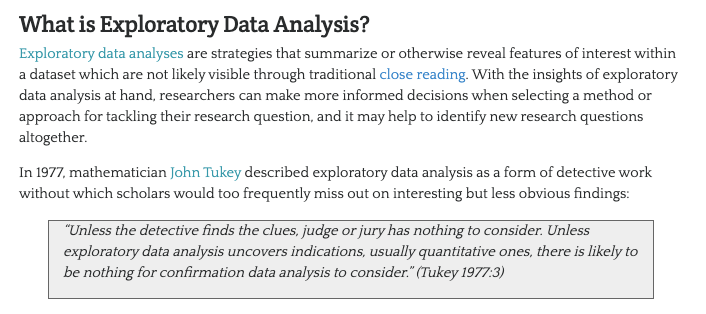
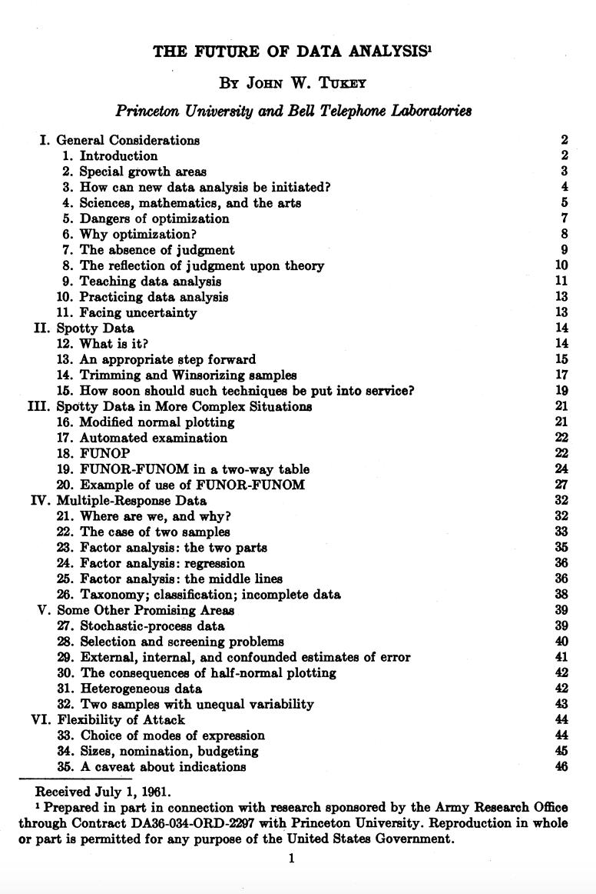

::: {.callout-note}
## Revised Lesson

If you read our previous lesson on EDA and data visualization, you may notice that this version has been substantially revised. The content is largely the same, but the examples have been updated to use a different dataset and question. Please follow this version for your homework assignment!
:::


In our last lesson, we tried to answer the following questions:

1. What is the average number of visits for each state?
2. What is the average number of visits for each National Park?
3. How many National Parks are there in each state?

Here's my solutions to these questions:

```python
# Load library
import pandas as pd

# Load the data
parks_data_df = pd.read_csv('https://raw.githubusercontent.com/melaniewalsh/responsible-datasets-in-context/main/datasets/national-parks/US-National-Parks_RecreationVisits_1979-2023.csv')

# 1. What is the average number of visits for each state?
print(parks_data_df.groupby(['State'])['RecreationVisits'].mean().reset_index())
# 2. What is the average number of visits for each National Park?
print(parks_data_df.groupby(['ParkName'])['RecreationVisits'].mean().reset_index())
# 3. How many National Parks are there in each state?
print(parks_data_df.groupby(['State'])['ParkName'].nunique().reset_index())
```


We could store each of these in new variables but we also want to visualize this data to help us better understand it. That's what we'll be exploring further in this next lesson through undertaking the steps of *exploratory data analysis*.

---

## Reading & Encoding Data

Rather than working with just the National Parks Data, we can also start to explore the remainder of the datasets from the *Responsible Datasets in Context Project*. For example, let's take a look at the "Top 500 Greatest Novels" dataset by Anna Preus and Aashna Sheth [https://www.responsible-datasets-in-context.com/posts/top-500-novels/top-500-novels.html](https://www.responsible-datasets-in-context.com/posts/top-500-novels/top-500-novels.html){target="_blank"}.

First, we need to create a new Jupyter notebook in our `pandas-eda` folder called `Top500NovelsEDA.ipynb` and then load in the data. As a reminder, how can we **read** data in Pandas?


::: {.callout-tip collapse="true"}
## Need a reminder about `pd.read_csv()`?

While this cat is adorable, we can also use the `pd.read_csv()` method to read in our data.

```python
# Import data
novels_df = pd.read_csv("https://raw.githubusercontent.com/melaniewalsh/responsible-datasets-in-context/main/datasets/top-500-novels/final_merged_dataset_no_full_text.tsv", sep="\t")
```

:::

Notice that I am adding an argument to the `read_csv()` method: `sep="\t"`. This tells Pandas to expect a tab-separated values file.

If we did not include this argument, we would likely see the following error in our Notebook:

```bash
ParserError: Error tokenizing data. C error: Expected 1 fields in line 163, saw 3
```

This error is telling us that there is an issue with the way the data is formatted. In this case, the dataset is actually a tab-separated values (TSV) file, which means that we need to specify the `sep` parameter when we read it in. Encoding errors are another common problem when working with data produced by other people or systems.


A computer stores numbers rather than letters. A **character encoding** supplies an agreed mapping between the numerical values stored in memory or a file and the abstract characters we understand as text. Unicode assigns each character a stable number called a **code point**; an encoding specifies how those code points become bytes; and a font determines the visible **glyphs** displayed on screen. If software reads a file using a different encoding from the one used to save it, the same bytes can be mapped to the wrong characters, producing garbled text sometimes called *mojibake*.

`ISO-8859-1`, also known as `Latin-1`, is part of a family of encodings standardized by the [**International Organization for Standardization (ISO)**](https://www.iso.org/home.html){target="_blank"} and the [**International Electrotechnical Commission (IEC)**](https://www.iec.ch/){target="_blank"}. This standard uses one byte per character, which provides 256 possible numerical values, and primarily supports Latin-script Western European languages. `utf-8`, by contrast, uses between one and four bytes to encode Unicode code points and preserves compatibility with ASCII while supporting the much larger multilingual Unicode character set.

In “Encoding Multilingualism: Technical Affordances of Multilingual Publication from Manuscripts to Unicode and OpenType”, Quinn Dombrowski, Manish Goregaokar, Ben Joeng (Yang), and Abeera Kamran detail how the rise of digital computing led to a proliferation of encodings, especially for non-European languages in the 1980s. But with the rise of the web, there was increasingly a need for a unified encoding standard that could support multiple languages simultaneously, which lead to the creation of Unicode and these newer standards. While Unicode greatly expanded multilingual computing, it did not succeed in making every language equally well supported.[^1]

In our case, we didn't need to specify the encoding, but if we did, we could have added the `encoding` parameter to our `read_csv()` method.

```{python}
# Import libraries
import pandas as pd
import matplotlib.pyplot as plt
import altair as alt

# Import data
novels_df = pd.read_csv(
    "https://raw.githubusercontent.com/melaniewalsh/responsible-datasets-in-context/main/datasets/top-500-novels/final_merged_dataset_no_full_text.tsv",
    sep="\t",
    encoding="utf-8"
)
```

Now we can start to explore this dataset. What methods could we use to get a sense of the data?


There's many answers to this question, but say we use `novels_df.info()`. We would see the following output:

```bash
<class 'pandas.DataFrame'>
RangeIndex: 500 entries, 0 to 499
Data columns (total 29 columns):
 #   Column                    Non-Null Count  Dtype  
---  ------                    --------------  -----  
 0   top_500_rank              500 non-null    int64  
 1   title                     500 non-null    str    
 2   author                    500 non-null    str    
 3   pub_year                  500 non-null    int64  
 4   orig_lang                 500 non-null    str    
 5   genre                     500 non-null    str    
 6   author_birth              499 non-null    str    
 7   author_death              496 non-null    str    
 8   author_gender             500 non-null    str    
 9   author_primary_lang       500 non-null    str    
 10  author_nationality        500 non-null    str    
 11  author_field_of_activity  329 non-null    str    
 12  author_occupation         459 non-null    str    
 13  oclc_holdings             495 non-null    float64
 14  oclc_eholdings            495 non-null    float64
 15  oclc_total_editions       495 non-null    float64
 16  oclc_holdings_rank        495 non-null    float64
 17  oclc_editions_rank        495 non-null    float64
 18  gr_avg_rating             500 non-null    float64
 19  gr_num_ratings            500 non-null    str    
 20  gr_num_reviews            500 non-null    str    
 21  gr_avg_rating_rank        500 non-null    int64  
 22  gr_num_ratings_rank       500 non-null    int64  
 23  oclc_owi                  495 non-null    float64
 24  author_viaf               500 non-null    object 
 25  gr_url                    480 non-null    str    
 26  wiki_url                  500 non-null    str    
 27  pg_eng_url                500 non-null    str    
 28  pg_orig_url               64 non-null     str    
dtypes: float64(7), int64(4), object(1), str(17)
memory usage: 258.2+ KB
```

This overview is telling us that we have far more columns in this datasets, each column's name and data type, and specifically the number of **non-null values** in each column.

We could also use `describe()` to get a summary of the numeric columns in the dataset:

```python
novels_df.describe()
```

This should give us the following output:

::: {.table-responsive}
| Statistic | top_500_rank | pub_year | oclc_holdings | oclc_eholdings | oclc_total_editions | oclc_holdings_rank | oclc_editions_rank | gr_avg_rating | gr_avg_rating_rank | gr_num_ratings_rank | oclc_owi |
|---|---:|---:|---:|---:|---:|---:|---:|---:|---:|---:|---:|
| count | 500.0 | 500.0 | 495.0 | 495.0 | 495.0 | 495.0 | 495.0 | 500.0 | 500.0 | 500.0 | 495.0 |
| mean | 250.5 | 1932.132 | 10401.438383838384 | 2218.5939393939393 | 896.6424242424242 | 248.0 | 248.0 | 3.97144 | 250.5 | 250.5 | 1602208445.3272727 |
| std | 144.4818327679989 | 84.30654638595425 | 5694.5090033480465 | 3084.5957147485274 | 1019.0155721348034 | 143.03845636750978 | 143.03845636750978 | 0.22768752627062921 | 144.4818327679989 | 144.4818327679989 | 2675299121.6826034 |
| min | 1.0 | 1021.0 | 996.0 | 25.0 | 21.0 | 1.0 | 1.0 | 3.29 | 1.0 | 1.0 | 1040.0 |
| 25% | 125.75 | 1900.0 | 6800.0 | 352.0 | 241.0 | 124.5 | 124.5 | 3.83 | 125.75 | 125.75 | 397287.5 |
| 50% | 250.5 | 1948.0 | 8318.0 | 558.0 | 485.0 | 248.0 | 248.0 | 3.98 | 250.5 | 250.5 | 16756029.0 |
| 75% | 375.25 | 1989.0 | 12184.0 | 3223.0 | 1207.5 | 371.5 | 371.5 | 4.12 | 375.25 | 375.25 | 2830458773.5 |
| max | 500.0 | 2015.0 | 37702.0 | 15545.0 | 9017.0 | 495.0 | 495.0 | 4.62 | 500.0 | 500.0 | 12392760730.0 |
:::

By default, `describe()` summarizes only numeric columns. We can ask Pandas to include every column by passing `include="all"`:

```python
novels_df.describe(include="all")
```

For readability, the categorical and identifier portion of that wide output is transposed below. Each row now represents one field:

::: {.table-responsive}
| Field | Count | Unique | Most Frequent Value | Frequency |
|---|---:|---:|---|---:|
| title | 500 | 500 | Don Quixote | 1 |
| author | 500 | 279 | John Grisham | 19 |
| orig_lang | 500 | 12 | English | 430 |
| genre | 500 | 14 | na | 221 |
| author_birth | 499 | 152 | 1955 | 21 |
| author_death | 496 | 134 | ALIVE | 144 |
| author_gender | 500 | 2 | male | 355 |
| author_primary_lang | 500 | 11 | eng | 427 |
| author_nationality | 500 | 23 | US | 257 |
| author_field_of_activity | 329 | 121 | english literature | 28 |
| author_occupation | 459 | 148 | authors | 57 |
| gr_num_ratings | 500 | 500 | 269,435 | 1 |
| gr_num_reviews | 500 | 497 | 4,209 | 2 |
| author_viaf | 500 | 279 | 7449742 | 19 |
| gr_url | 480 | 479 | https://www.goodreads.com/book/show/11991.The_Fall?ref=nav_sb_ss_4_8 | 2 |
| wiki_url | 500 | 499 | https://en.wikipedia.org/wiki/In_Search_of_Lost_Time | 2 |
| pg_eng_url | 500 | 182 | NA_not-pub-domain | 310 |
| pg_orig_url | 64 | 32 | unavailable | 32 |
:::

These summaries do more than describe the dataset. They help us begin to an **audit** this dataset, speficially giving us a bird's-eye view of its structure and content. This perspective helps us start to cinsider how the dataset was assembled, what its fields represent, and which limitations might shape our interpretation.

The `count` row immediately raises questions about coverage:

- Why does `author_field_of_activity` contain only 329 recorded values?
- Why does `author_occupation` contain 459?
- Why are OCLC fields present for 495 novels rather than all 500?
- Why does `gr_url` contain 480 links?
- Why does `pg_orig_url` contain only 64 recorded values?

But `count` does not reveal every kind of missing data. Pandas counts any string as a recorded value, including placeholders such as:

- `na`, the most frequent value in `genre`.
- `NA_not-pub-domain`, the most frequent value in `pg_eng_url`.
- `unavailable`, the most frequent value in `pg_orig_url`.
- `ALIVE`, a value in `author_death` that records a status rather than a death year.

This means a field can be **technically non-null while still lacking the information we expected it to contain**. Auditing therefore requires us to inspect  and think carefully about what constitutes **missing data** in the context of the dataset. This includes both **formal null values** and the conventions used to represent unavailable, inapplicable, unknown, or withheld information.

## Exploring Missing Data

Our initial description has already shown us **where** values are absent. The next question is not simply how to remove those rows, but **why a field might be missing and whether that missingness is patterned**.

For example, `author_field_of_activity` has 329 non-null values, which means that there are 171 missing values. We can start to get a sense of what that column contains if we return to the dataset documentation, specifically the section "What's in the Data" [https://www.responsible-datasets-in-context.com/posts/top-500-novels/top-500-novels.html?tab=data-essay#whats-in-the-data](https://www.responsible-datasets-in-context.com/posts/top-500-novels/top-500-novels.html?tab=data-essay#whats-in-the-data){target="_blank"}. From there we can learn the following about this column:

> AUTHOR_FIELD_OF_ACTIVITY: Author's primary fields of activity, according to VIAF. VIAF includes data from multiple global partner institutions, but we only collect VIAF data associated with the Library of Congress (LOC).


For those unfamiliar, [VIAF](https://viaf.org/){target="_blank"} stands for the Virtual International Authority File, which is a service that provides a way to link and share information about authors and their works across different libraries and institutions. The idea for VIAF originated in 1998 as an experiment in trying to link authority records. As a reminder, authority records are standardized records that provide information about a specific entity, such as an author or a work, like MARC records. VIAF was officially launched in 2003 and is operated by the Online Computer Library Center (OCLC) in partnership with various national libraries and institutions.


The impetus for the creation of VIAF was not just sharing information, but what LIS scholar Christine L. Borgman calls the "scaling problem in name disambiguation" in her book [*Big Data, Little Data, No Data: Scholarship in the Networked World*](https://direct.mit.edu/books/monograph/3085/Big-Data-Little-Data-No-DataScholarship-in-the){target="_blank"}. We've already talked about this briefly in discussing the challenges of "cleaning data", but the rise of multiple digital libraries and archives has made it increasingly difficult to accurately identify and attribute works to their correct authors, which is where projects like VIAF come in. However, as we discussed in class, there are still challenges with this system. For example, authors are not the ones who enter data into VIAF. Instead, it is often librarians or archivists who are responsible for creating and maintaining these records. This means that there can be discrepancies in how authors are represented, and it can be difficult to ensure that all works by a particular author are accurately attributed to them. 

This `author_field_of_activity` field  therefore reflects cataloguing practices, available source records, institutional priorities, and the choices made when Preus and Sheth constructed this dataset.

A null could therefore indicate several different things:

- The relevant Library of Congress authority record lacks a field of activity.
- VIAF's contributing records disagree or provide uneven descriptions.
- Some languages, regions, periods, or literary traditions received different cataloguing attention.
- The dataset's collection process did not retrieve or preserve a value.

We can also start to see where this author field of activity looks like on VIAF, like for Mark Twain's VIAF file here [https://viaf.org/en/processed/LC%257Cn%20%2079021164](https://viaf.org/en/processed/LC%257Cn%20%2079021164){target="_blank"}.

One easy solution might be to simply filter out these rows. In the last lesson, we covered how we could add null values to a DataFrame, but now we want to explore how we can work with them. Pandas has a lot of documentation for handling **missing data** that you can read here [https://pandas.pydata.org/docs/user_guide/missing_data.html](https://pandas.pydata.org/docs/user_guide/missing_data.html){target="_blank"}. For our purposes, we're mostly concerned with the `isna()` and `notna()` methods.

But instead of using these to remove rows, we can start to use them to consider why there might be patterns around which authors have a recorded field of activity and which do not.

Pandas usually displays an absent value as `NaN`, which means **Not a Number**. The name comes from numerical computing, but Pandas also uses `NaN` to represent missing text and other unavailable values. It does not mean that the original author or cataloguer literally entered the letters `NaN`.

These two methods let us test for that missingness:

| Method | Returns `True` when... | Typical use |
|---|---|---|
| `.isna()` | the value is missing | Find or count absent values |
| `.notna()` | the value is recorded | Keep records available for a particular analysis |

Both methods return Boolean values: `True` or `False` for every row. We can place that Boolean Series inside square brackets to filter the DataFrame. First, let us inspect the authors whose field of activity is missing:

```{python}
missing_activity_df = novels_df[
    novels_df['author_field_of_activity'].isna()
]

missing_activity_df.head(10)
```

Then we can use `notna()` to inspect the rows where VIAF and the Library of Congress supplied a value:

```{python}
recorded_activity_df = novels_df[
    novels_df['author_field_of_activity'].notna()
]

recorded_activity_df.head(10)
```

The original `novels_df` still contains all 500 novels. We have not established that the missing rows are errors, and we have not deleted anything. We could also use the `~` operator to negate the boolean values returned by `isna()` instead of using `notna()`. This will give us the same result as the previous code snippet:

```{python}
recorded_activity_df = novels_df[
	~novels_df['author_field_of_activity'].isna()
]
recorded_activity_df.head(10)
```

We haven't seen the `~` operator before, but Pandas uses it to reverse every value in a Boolean Series: `True` becomes `False`, and `False` becomes `True`. In addition, Pandas also has `isnull()` and `notnull()` methods that can be used interchangeably with `isna()` and `notna()`.

Finally, if we wanted to get rid of all rows in the `novels_df` DataFrame that have missing values in the `author_field_of_activity` column, we could either use our filtering logic to assign the result to a new variable or we could use the `dropna()` method.

```python
dropped_authors_df = novels_df.dropna(subset=['author_field_of_activity'])
dropped_authors_df.head(10)
```
`dropna()` is a powerful method that can be used to remove missing values from a DataFrame. The `subset` parameter allows us to specify which columns we want to check for missing values. If we don't specify a subset, `dropna()` will remove any row that has a missing value in any column.

Here's a quick overview of the most common methods for handling missing values in Pandas:

| Pandas Method for Missing Values | Description | Usage |
|----------------------------------|-------------|-----|
| `isna()`                         | Returns a boolean DataFrame indicating whether each value is missing (NaN) | Can be used to filter DataFrames, Series, GroupBy objects, etc. or to identify the amount of missing data (`df.isna().sum()`) |
| `notna()`                        | Returns a boolean DataFrame indicating whether each value is not missing | Used similar to `isna()` |
| `isnull()`                      | Alias for `isna()` | Used interchangeably with `isna()` |
| `notnull()`                     | Alias for `notna()` | Used interchangeably with `notna()` |
| `dropna()`                      | Removes missing values from a DataFrame or Series | Can be used to drop rows or columns with missing values |
| `fillna()`                      | Fills missing values with a specified value or method | Can be used to replace NaN values with a specific value or interpolate missing values |

However, before we can drop rows we need to also start to consider how that might impact the shape of the dataset and also what patterns if any might explain why some authors have fields of activity recorded and others do not. For example, we can start to explore the `author_gender` field to see if there are any patterns in the missing data.

```{python}
missing_activity_df['author_gender'].value_counts()
```

How does that compare with the rows where a field of activity was recorded?

```{python}
recorded_activity_df['author_gender'].value_counts()
```

We can use the same approach to explore other fields. Original language may help us ask whether cataloguing coverage varies across linguistic traditions:

```{python}
missing_activity_df['orig_lang'].value_counts()
```

```{python}
recorded_activity_df['orig_lang'].value_counts()
```

The [`value_counts()` method](https://pandas.pydata.org/docs/reference/api/pandas.Series.value_counts.html){target="_blank"} counts how often each distinct value appears in a Series. By default, it sorts the results from most to least frequent and leaves out null values. Adding `dropna=False` includes missing values as their own category.

Our earlier `describe(include='all')` output helps us decide which columns might be useful for comparison. A column with a relatively small number of repeated categories is easier to inspect than a column containing hundreds of unique URLs or identifiers. For example:

- `author_gender` has 2 distinct recorded values.
- `orig_lang` has 12.
- `author_nationality` has 23.
- `pub_year` is numeric and ranges from 1021 to 2015.

We can inspect the distribution of each categorical field before deciding which relationship to explore:

```{python}
novels_df['author_gender'].value_counts(dropna=False)
```

```{python}
novels_df['orig_lang'].value_counts(dropna=False)
```

```{python}
novels_df['author_nationality'].value_counts(dropna=False)
```

These tables let us see which categories are common, rare, or missing. We can also run the same method on `missing_activity_df` and `recorded_activity_df`, as we did above. But once we begin comparing several categories across two subsets, it becomes difficult to identify a distribution by reading lists of numbers. This is where exploratory data analysis and visualization become useful.

## What Is Exploratory Data Analysis?

Since we are working with a dataset with significant documentation, we have a fairly good sense of what is in these datasets. However, often you will be working with datasets that are far less documented, and so it is important to understand how to explore them, especially for your audits.

[{target="_blank"}](https://programminghistorian.org/en/lessons/sentiment-analysis){target="_blank"}

*Exploratory Data Analysis* (EDA) is an approach to analyzing data sets to summarize their main characteristics, often with visual methods. It is a crucial step in the data analysis process, as it allows us to understand the data we are working with and identify any patterns, trends, or anomalies that may be present.

You've likely heard this term before, but let's historically contextualize this idea. The term *Exploratory Data Analysis* (EDA) was popularized by [John W. Tukey](https://en.wikipedia.org/wiki/John_Tukey){target="_blank"}, one of the most famous statisticians and mathematicians of the 20th century. Tukey was one of the first to formally define the concept of data analysis in 1962 paper titled "The Future of Data Analysis."



In the paper, Tukey writes:

> For a long time I have thought I was a statistician, interested in inferences from the particular to the general. But as I have watched mathematical statistics evolve, I have had cause to wonder and to doubt. [...] All in all, I have come to feel that my central interest is in *data analysis*, which I take to include, among other things: procedures for analyzing data, techniques for interpreting the results of such procedures, ways of planning the gathering of data to make its analysis easier, more precise or more accurate, and all the machinery and results of (mathematical) statistics which apply to analyzing data.

Such a framing might seem straightforward today in the age of Data Science, but at the time it was a radical shift for how we thought about working with data. You'll notice in that image from the paper, which you can download [here](https://projecteuclid.org/download/pdf_1/euclid.aoms/1177704711){target="_blank"} if you're curious, that Tukey was affiliated with Princeton University and Bell Telephone Laboratories when he published the paper. Both of these were key institutions in the development of modern computing and statistics. For example, if you've heard of Alan Turing or Claude Shannon, they were also affiliated with Bell Labs, and Tukey worked with both of them, especially during World War II.


This infographic gives a sense of some of the inventions and discoveries that happened at Bell Labs, which was one of the most important research and development organizations in the 20th century. In the case of Tukey, he's credited not just with exploratory data analysis but also coining both the terms `bit`, a portmanteau of binary digit, and `software` in 1958, and he was also crucial in popularizing the fourier transform for digital signal processing, which we learned about with the Syuzhet package.

Tukey was a very eclectic scholar, and worked on everything from developing better sampling methods after reviewing the [Kinsey report](https://en.wikipedia.org/wiki/Kinsey_Reports){target="_blank"}, which was a landmark study of human sexuality released in two books in 1948 and 1953, to developing better methods for election polling. His central thoughts on EDA became the basis for his 1977 [book *Exploratory Data Analysis*](https://archive.org/details/exploratorydataa0000tuke_7616){target="_blank"}, where he argued that EDA could help suggest hypotheses that could be then tested statistically.


Such a shift might again seem obvious today, but at the time most statisticians focused on "confirmatory data analysis", that is testing a hypothesis statistically rather than exploring the data first to see what might be possible. Tukey's innovation helped set the groundwork for a lot of modern data science, where we tend to be closer to detectives trying to look for clues rather than approaching data with firm assumptions about what it represents.

While there are not firm principles for EDA, Tukey argued that it should cover the following concepts:

- understanding the data's underlying structure and extracting important variables
- detecting outliers and anomalies
- and testing underlying assumptions through visualizations, statistics, and other methods, without initially focusing on formal modeling or hypothesis testing. This approach differs with traditional hypothesis-driven analyses, promoting a more flexible and intuitive investigation into the data.

With Pandas we have already started to do some EDA, but let's review our methods:

1. We want to explore the data, so we could use `head()`, `tail()`, or `sample()` methods to display a subset of the dataset. We could also use `.shape` or `.dtypes` to see the shape of the DataFrame and the data types of each column.

2. Next we might use the `describe()` method to output a summary of our dataset. According to the documentation for this method, it provides "descriptive statistics include those that summarize the central tendency, dispersion and shape of a dataset's distribution, excluding NaN values." [(Read the docs here)](https://pandas.pydata.org/pandas-docs/stable/reference/api/pandas.DataFrame.describe.html){target="_blank"}.

3. After getting this bird's eye view of the distribution of the data, we could use `sort_values()` or `nsmallest()` / `nlargest()` to either organize the dataset or return the rows with maximum or minimum of values in a certain column.

4. We can use the `isna()` to see what values might be missing in the dataset. Remember that `isna()` can be run on either individual columns or the entire DataFrame, and that you can chain it with other methods `any()` to check if there are *any* null values in the data.

5. Finally we would use the `plot()` method to do some initial graphing of the trends in our data to fully help explore its distribution and potential correlations.

Like many of the methods above, `plot` is built into Pandas and is a wrapper around the `matplotlib` library [https://matplotlib.org/](https://matplotlib.org/){target="_blank"}, one of the most popular Python libraries for data visualization. This means that we can use the `plot()` method to create a variety of different plots. We can read more about the `plot()` method in the Pandas documentation here [https://pandas.pydata.org/pandas-docs/stable/reference/api/pandas.DataFrame.plot.html](https://pandas.pydata.org/pandas-docs/stable/reference/api/pandas.DataFrame.plot.html){target="_blank"}, where it lists the kinds of plots we can create:

- 'line' : line plot (default)
- 'bar' : vertical bar plot
- 'barh' : horizontal bar plot
- 'hist' : histogram
- 'box' : boxplot
- 'kde' : Kernel Density Estimation plot
- 'density' : same as 'kde'
- 'area' : area plot
- 'pie' : pie plot
- 'scatter' : scatter plot (DataFrame only)
- 'hexbin' : hexbin plot (DataFrame only)

Pandas also has a robust User Guide on how to plot here [https://pandas.pydata.org/pandas-docs/stable/user_guide/visualization.html](https://pandas.pydata.org/pandas-docs/stable/user_guide/visualization.html){target="_blank"}.

Before plotting, we need to decide what question we want to explore. We have seen missing values in `author_field_of_activity`, while `genre` contains a small set of repeated categories. This gives us one focused question:

> How are novels distributed across genres, and does the availability of author field-of-activity metadata vary across those genres?

To compare the categories, we need one Boolean column that records whether each novel has a field of activity. Unlike our earlier filters, this column remains attached to every row in the full dataset:

```{python}
novels_df['has_field_of_activity'] = (
    novels_df['author_field_of_activity'].notna()
)
```

Before plotting, inspect the genre values, including placeholders and missing values:

```{python}
novels_df['genre'].value_counts(dropna=False)
```

The string `na` is currently counted as a genre. In this dataset it functions as a placeholder for unavailable information, so we will replace it with Pandas's explicit missing-value marker, `pd.NA`. This is an interpretive cleaning decision that we should verify against the documentation and record.

```{python}
novels_df['genre'] = novels_df['genre'].replace('na', pd.NA)
genre_counts = novels_df['genre'].value_counts()
genre_counts
```

We can plot that Series directly. Pandas sends the plotting instructions to Matplotlib:

```{python}
genre_counts.plot(
    kind='bar',
    figsize=(10, 5),
    color='#4c78a8'
)

plt.title('Novels by Genre')
plt.xlabel('Genre')
plt.ylabel('Number of Novels')
plt.xticks(rotation=45)
plt.show()
```

## What Does Altair Add?

[Vega-Altair](https://altair-viz.github.io/){target="_blank"} is a Python visualization library built on Vega-Lite. Matplotlib asks us to construct and style a figure. Altair is **declarative**: we describe how fields in our data should map to visual properties, and Altair constructs the chart.

An Altair chart usually has three parts:

1. `alt.Chart(data)` identifies the DataFrame.
2. A mark such as `.mark_bar()` identifies the graphical form.
3. `.encode()` maps columns to visual channels such as `x`, `y`, `color`, and `tooltip`.

We can use the original filtered DataFrame directly. Genre controls the x-axis, Altair counts the rows for us, and the Boolean `has_field_of_activity` column controls color. Tooltips add the interactive detail that our Matplotlib chart lacked:

```{python}
genre_df = novels_df[
    novels_df['genre'].notna()
].copy()

genre_activity_chart = alt.Chart(
    genre_df
).mark_bar().encode(
    x=alt.X(
        'genre:N',
        title='Genre',
        sort='-y'
    ),
    y=alt.Y('count():Q', title='Number of Novels'),
    color=alt.Color(
        'has_field_of_activity:N',
        title='Field of Activity Recorded'
    ),
    tooltip=[
        alt.Tooltip('genre:N', title='Genre'),
        alt.Tooltip(
            'has_field_of_activity:N',
            title='Field Recorded'
        ),
        alt.Tooltip('count():Q', title='Novels')
    ]
).properties(
    title='Genre and the Availability of Author Field Metadata',
    width=650,
    height=400
)

genre_activity_chart
```

Hover over each segment to see the genre, metadata status, and count. The chart adds a second dimension to the Matplotlib distribution without requiring us to reshape several unrelated categorical fields.

## What Question Comes Next?

So far we have asked whether field-of-activity metadata is available. A more substantive cultural question would compare the contents of that metadata with genre:

> What relationships appear between a novel's genre and its author's recorded fields of activity?

Now inspect the activity field:

```{python}
novels_df['author_field_of_activity'].value_counts().head(20)
```

There are 121 distinct recorded values, and many cells contain several comma-separated activities. For example, `novels,fiction` is currently one string rather than two activities. We cannot responsibly compare individual activities with genre until we split those strings and reshape the resulting lists into separate rows.

That is a useful EDA result: exploration has identified the next methodological problem. We will answer the fuller genre-and-activity question in the next lesson on string methods, `explode()`, and reshaping.

## What Signal Can We Defend?

The Altair chart may show differences in metadata availability, but it does not explain why those differences exist. The genre categories are broad, uneven, and supplied by this dataset. The activity values come from Library of Congress data gathered through VIAF. Before making stronger claims, we would need to investigate how genre was assigned, split the compound activity strings, and inspect the underlying authority records.

The phrase **“garbage in, garbage out”** is often used to suggest that poor inputs inevitably create poor outputs. Its early history, however, also reminds us that people have long debated where responsibility lies when computational results are misleading. Read more in [“Is This the First Time Anyone Printed ‘Garbage In, Garbage Out’?”](https://www.atlasobscura.com/articles/is-this-the-first-time-anyone-printed-garbage-in-garbage-out){target="_blank"}.

[](https://www.atlasobscura.com/articles/is-this-the-first-time-anyone-printed-garbage-in-garbage-out){fig-align="center" target="_blank" width="400"}

In cultural data, unclear categories and missing provenance are not necessarily garbage that we can simply delete. They may be evidence of how institutions described culture, whose records were prioritized, and what the dataset cannot tell us. Sometimes EDA finds a strong signal. Sometimes it reveals that we do not yet know enough to explain one responsibly.

::: {.callout-warning}
## Cleaning is an interpretive decision

Preserve the original data, give transformed subsets descriptive names, and document every replacement or exclusion. There is no universally clean dataset—only data prepared for a particular question.
:::

## What Did We Learn?

In this lesson, we:

- Identified the dataset’s unit of observation and provenance.
- Inspected its shape, columns, data types, and samples.
- Audited missing metadata with `isna()` and `notna()`.
- Converted missingness into an analytical Boolean variable.
- Used `value_counts()` to inspect categorical distributions.
- Used Pandas and Matplotlib to create initial count visualizations.
- Recreated a question in Altair to add interactive tooltips.
- Replaced a textual missing-value placeholder with `pd.NA`.
- Identified why comparing genre with individual activity terms requires further string processing and reshaping.
- Considered how unequal category sizes limit comparisons.
- Used an unclear result to identify the next data problem rather than forcing a claim.

## Exploring and Visualizing Culture Homework

Create a Jupyter notebook in the `pandas-eda` folder of your `is310-coding-assignments` repository. Give it a descriptive filename without spaces.

Use the Top 500 Novels dataset to investigate **one** question about its categories, coverage, rankings, or missing data. You may build directly from the field-of-activity example, but your final notebook should investigate a different column, comparison, or hypothesis.

::: {.callout-important}
## Assignment checklist

Your notebook should include:

- [ ] One clear exploratory question.
- [ ] A short explanation of the dataset’s provenance and unit of observation.
- [ ] An initial inspection using `head()`, `shape`, `info()`, or `sample()`.
- [ ] At least one missingness, category, coverage, or sample-size check.
- [ ] A summary table created with a method such as `value_counts()` to address your question.
- [ ] One purposeful Altair visualization with a title, axis labels, and tooltips.
- [ ] A Markdown interpretation explaining what the visualization shows.
- [ ] At least one limitation or alternative explanation.
- [ ] A conclusion identifying what you would investigate next.
- [ ] A `README.md` explaining the notebook and how to run it.
:::

The goal is not to use the largest number of methods or produce the most complicated chart. The goal is to make one defensible exploratory claim while remaining explicit about how the data and your decisions shaped it.

Push the `pandas-eda` folder to GitHub and post a link in the [Fall 2026 GitHub discussion](https://github.com/CultureAsData-UIUC/is310-fall-2026/discussions/9){target="_blank"}. Do not commit your virtual environment. You may use AI tools according to the course policy, but you must understand and be able to explain every operation in the submitted notebook.

[^1]: Quinn Dombrowski, Manish Goregaokar, Ben Joeng (Yang), and Abeera Kamran, “Encoding Multilingualism: Technical Affordances of Multilingual Publication from Manuscripts to Unicode and OpenType,” *Journal of Electronic Publishing* 27, no. 1 (2024): 309–329, [https://doi.org/10.3998/jep.5528](https://doi.org/10.3998/jep.5528){target="_blank"}.
