::: {.callout-note}
## Download the Section A notebook

You can download the student version of our in-class notebook here: <a href="../../assets/files/SectionA_EDANotebook_student.ipynb" download target="_blank">SectionA_EDANotebook_student.ipynb</a>.
:::

In the last lesson, we used exploratory data analysis to investigate the shape, categories, missing values, and provenance of an existing dataset. We also saw that changing the **unit of observation** could change the patterns we found.

In this lesson, we will focus on two related ways of structuring data:

1. **Merging datasets** requires us to decide when records from different sources represent the same cultural object.
2. **Augmenting data** requires us to decide what new structured information can responsibly be inferred from existing fields.

Neither process is automatic. Both depend on choices about representation, comparison, and which relationships or predictions we are willing to treat as evidence.

```{python}
import pandas as pd
```

## Merging Cultural Datasets

Data about one cultural object is often distributed across several datasets. One source might describe a book's library holdings, another its bestseller history, and another its publication history or reception. Merging can bring those sources together, but only after we identify fields that can connect their records.

We will continue working with the [Top 500 "Greatest" Novels dataset](https://www.responsible-datasets-in-context.com/posts/top-500-novels/top-500-novels.html){target="_blank"} created by Anna Preus and Aashna Sheth. This dataset begins with OCLC's list of widely held novels and adds metadata from VIAF, Goodreads, Wikipedia, Project Gutenberg, and other sources.

```{python}
novels_url = "https://raw.githubusercontent.com/melaniewalsh/responsible-datasets-in-context/refs/heads/main/datasets/top-500-novels/top-500-novels-metadata_2025-01-11.tsv"

novels_df = pd.read_csv(
    novels_url,
    sep="\t",
    encoding="utf-8"
)

novels_df.shape
```

Now that we are understanding how to work with missing data, we can also start to explore how to augment our dataset in various ways. One of the most common ways to do this is through **merging** datasets together.

First though we need another dataset to merge with our `novels_df`. We could take a look at sites like Kaggle to find more datasets, or more specific ones like the *Post45 Data Collective*, which "peer reviews and houses literary and cultural data from 1945 to the present" [https://data.post45.org/](https://data.post45.org/){target="_blank"}.


By treating datasets as scholarly publications, the *Post45 Data Collective* asks us to consider who created a dataset, how it was documented, what it covers, and how it should be cited rather than treating a downloadable file as context-free evidence. 
While there's a number of relevant datasets in the *Post45 Data Collective*, we could use the one about *New York Times* Hardcover Fiction Bestsellers, 1931–2020, created by Jordan Pruett [https://data.post45.org/nyt-fiction-bestsellers-data/](https://data.post45.org/nyt-fiction-bestsellers-data/). According to the documentation, this dataset contains the following:

> The New York Times Hardcover Fiction Bestsellers (1931–2020) contains three related datasets. The first dataset provides a tabular representation of the hardcover fiction bestseller list of The New York Times every week between 1931 and 2020. The second dataset provides title-level data for every unique title that appeared on the hardcover fiction bestseller list during this time period. The third dataset provides HathiTrust Digital Library identifiers for every unique title that appeared on the hardcover fiction bestseller list and that also has a corresponding volume in the HathiTrust Digital Library.

> Previous research using similar data has been limited to partial segments of the list, such as the top 200 longest-running bestsellers since a certain date (Piper and Portelance, 2016) or bestsellers from only particular years (Sorenson, 2007). By contrast, this dataset covers the full list since its inception in 1931, along with each reported work's title, author(s), date of appearance, and rank.

Getting this additional dataset will allow us to explore the relationship between the *New York Times* bestsellers and the top 500 novels as recorded by OCLC.

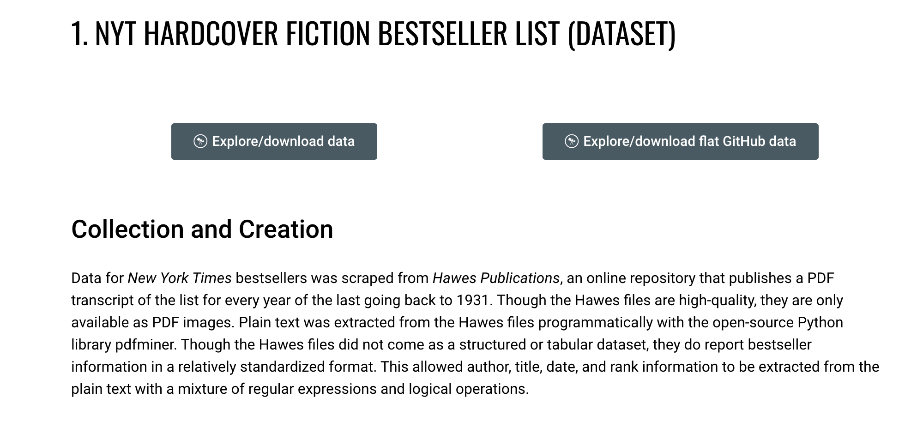

It actually constitutes three related datasets:

- weekly appearances on the bestseller list;
- title-level information about unique books;
- HathiTrust identifiers for titles that could be matched to digitized volumes.

The weekly dataset lets us ask which novels in OCLC's Top 500 also appeared on the *New York Times* list, how often they appeared, and what their best recorded rank was.

If we click on the `Explore/download data` for the first dataset, we see a new page that has the remote url for the dataset: [https://raw.githubusercontent.com/Post45-Data-Collective/data/refs/heads/main/nyt_hardcover_fiction_bestsellers/nyt_hardcover_fiction_bestsellers-lists.csv](https://raw.githubusercontent.com/Post45-Data-Collective/data/refs/heads/main/nyt_hardcover_fiction_bestsellers/nyt_hardcover_fiction_bestsellers-lists.csv). 

Notice the `raw.githubusercontent.com` in the URL. This tells us that this is a raw file from a GitHub repository, which is a common way to share datasets, and we can even see the actual file here [https://github.com/Post45-Data-Collective/data/tree/main/nyt_hardcover_fiction_bestsellers](https://github.com/Post45-Data-Collective/data/tree/main/nyt_hardcover_fiction_bestsellers).

We can copy that and load it into a new DataFrame.

```{python}
nyt_url = "https://raw.githubusercontent.com/Post45-Data-Collective/data/refs/heads/main/nyt_hardcover_fiction_bestsellers/nyt_hardcover_fiction_bestsellers-lists.csv"

nyt_bestsellers_df = pd.read_csv(
    nyt_url,
    encoding="utf-8"
)

nyt_bestsellers_df.shape
```

Now that we have both datasets loaded, we can start to explore them. Let's take a look at the columns in the `nyt_bestsellers_df.info()` DataFrame.

Which gives us the following output:

```{python}
nyt_bestsellers_df.info()
```

We can see that this dataset has 60386 rows and 14 columns. Notice that one of the columns is `Unnamed: 0`, which is a default index column created by pandas if we don't save our csv with the `index=False` parameter. The remaining columns are `author`, `author_authorized_heading`, `author_lccn`, `author_viaf`, `author_wikidata`, `oclc_eholdings`, `oclc_holdings`, `oclc_isbn`, `oclc_owi`, `rank`, `title`, `title_id`, `week`, and `year`. We can also see that the `author` column has ten missing values, but that other columns like `author_authorized_heading`, `author_lccn`, and `author_viaf` have more missing values. The `oclc_isbn` column has the most missing values, with 33723 non-null values. That tells us that this dataset is missing a lot of information about the books but missing less information about the authors, which is something we will need to keep in mind as we work with it.

Now we can start to merge the two DataFrames together. We've mentioned merging datasets a bit when we discussed joining data in class and SQL, but now we want to dig into details. Often times when we're working with datasets, we will have our data split into multiple `csv` files or have differently shaped datasets (i.e. some of them will have more rows or columns than other datasets). Pandas has built in functionality that let's us merge together DataFrames so that we can perform analysis on the combined dataset, which you can read about in the very extensive documentation here [https://pandas.pydata.org/docs/user_guide/merging.html](https://pandas.pydata.org/docs/user_guide/merging.html).

While this documentation shows a number of ways to combined datasets (`concat` let's you combine datasets by stacking them on top of each other, `join` let's you combine datasets by joining them on a common index, and `merge` let's you combine datasets by joining them on a common column), we will focus on the `merge` method.

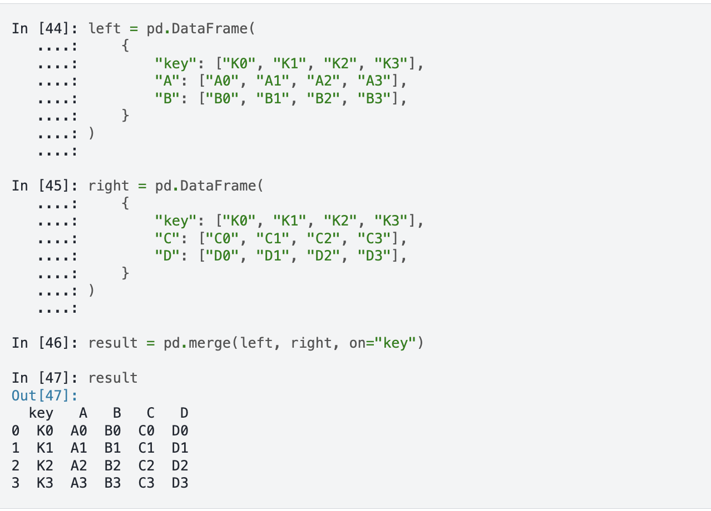

If we take a look at the documentation, we see the syntax above, which shows us that in Pandas we use the `merge()` function to combine datasets. The `merge()` function takes in a number of parameters, but the most important ones are `left`, `right`, `how`, and `on`. The `left` and `right` parameters are the DataFrames we want to merge, the `how` parameter is the type of join we want to undertake, and the `on` parameter is the column we want to join the DataFrames on.

We can also see an example of how this works in the figure below.

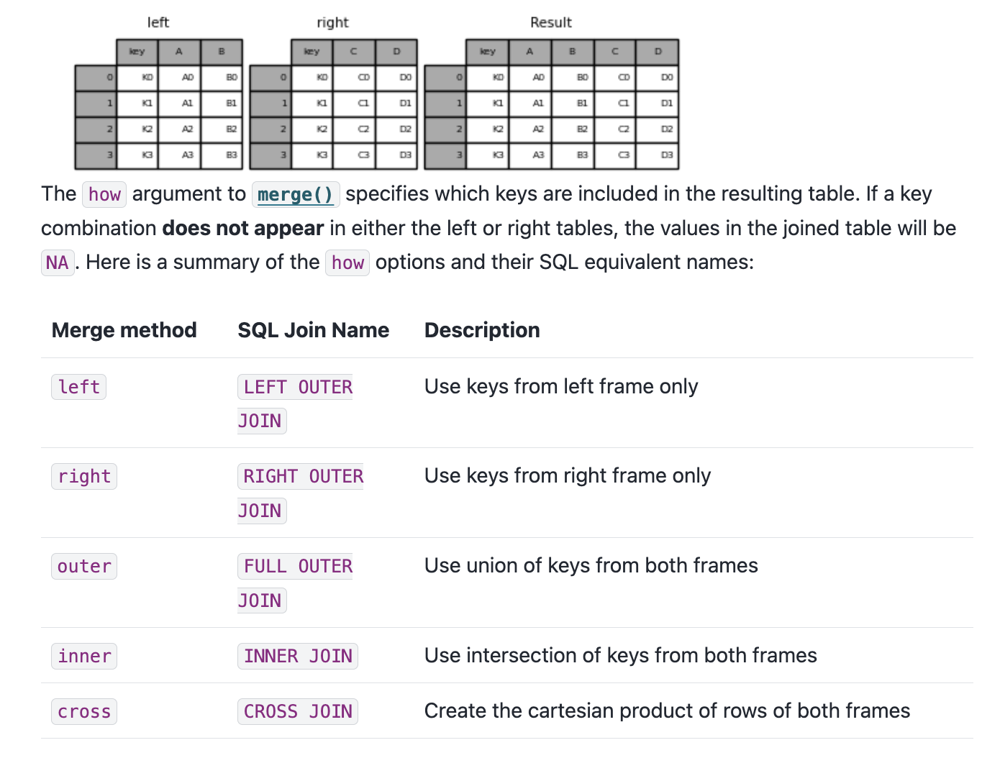

You'll notice that we can see a description of the types of `how` parameters we can use. These are the same types of joins that we discussed in class and in SQL. The `how` parameter can be set to `left`, `right`, `outer`, or `inner`. The `left` join will return all the rows from the left DataFrame and the matching rows from the right DataFrame. The `right` join will return all the rows from the right DataFrame and the matching rows from the left DataFrame. The `outer` join will return all the rows from the left DataFrame and the right DataFrame. The `inner` join will return only the rows that match in both DataFrames.


Now that we are starting to understand this logic, we can consider how we might merge our datasets. First, we can double check the columns in our `novels_df` and `nyt_bestsellers_df` DataFrames to see if there are any common columns we can use to merge them.

```{python}
novels_df.columns, nyt_bestsellers_df.columns
```


We could eyeball the likely similar columns, but we can also use the `intersection()` method to find the common columns.

```{python}
set(novels_df.columns).intersection(set(nyt_bestsellers_df.columns))
```


`intersection()` returns the values shared by two sets. A set is an unordered collection that stores each value only once. Here, we convert both lists of column names into sets and ask for the names they share.

Now that we know we have two columns we can use to merge the DataFrames, we can start to do that. Let's say we want to do a left join, which will return all the rows from the `novels_df` DataFrame and the matching rows from the `nyt_bestsellers_df` DataFrame.

```{python}
merged_df = novels_df.merge(nyt_bestsellers_df, how='left', on=['author',
 'author_viaf',
 'oclc_eholdings',
 'oclc_holdings',
 'oclc_owi',
 'title'])
merged_df.head()
```

While this code should work, you'll notice if you print out the `merged_df` DataFrame that while there are new columns from the `nyt_bestsellers_df` in our `merged_df` there only `NaN` values in those columns. *Why is that?*

To figure out where we went wrong, we need to check the values in the `author` and `title` columns in both DataFrames, and specifically see if any of them exist in both DataFrames. We can do this by using the `isin()` and `nunique()` method to get the unique values in each column.

```{python}
author_is_shared = novels_df['author'].isin(nyt_bestsellers_df['author'])
title_is_shared = novels_df['title'].isin(nyt_bestsellers_df['title'])

shared_author_rows = novels_df[author_is_shared]
shared_title_rows = novels_df[title_is_shared]

shared_authors = shared_author_rows['author'].nunique()
shared_titles = shared_title_rows['title'].nunique()

print(f"Number of shared authors: {shared_authors}")
print(f"Number of shared titles: {shared_titles}")
```


This output tells us that while there are 122 shared authors, there are no shared titles. This is surprising, so let's investigate further. There's a number of ways we could solve this mystery, but let's first try seeing what the most prolific authors are in both datasets.

```{python}
shared_author_rows['author'].value_counts().head(5)
```

And now let's do the same for the `nyt_bestsellers_df` DataFrame.

```{python}
nyt_author_is_shared = nyt_bestsellers_df['author'].isin(novels_df['author'])
nyt_shared_author_rows = nyt_bestsellers_df[nyt_author_is_shared]
nyt_shared_author_rows['author'].value_counts()
```

We can see that across both datasets `Stephen King` and `John Grisham` are the most prolific authors, but we still don't know why there are no shared titles. Let's try filtering for the titles in the `novels_df` and `nyt_bestsellers_df` DataFrames.

```{python}
novel_titles = novels_df[novels_df.author == "Stephen King"].title.unique()
nyt_titles = nyt_bestsellers_df[nyt_bestsellers_df.author == "Stephen King"].title.unique()

print(f"Stephen King's novels: {novel_titles}")
print(f"Stephen King's NYT bestsellers: {nyt_titles}")
```

We can see that King has had many bestsellers and that there is overlap in the titles. However, the titles in the `nyt_bestsellers_df` DataFrame are all uppercase, while the titles in the `novels_df` DataFrame are capitalized. This is the reason why there are no shared titles in the two DataFrames — and it's a perfect segue into talking about Pandas' built-in string methods.

### String Methods in Pandas

Part of what makes Pandas so powerful is that it has a number of built-in methods for working with `string` data, accessible through the `.str` accessor. An in-depth discussion of these methods is available in the Pandas documentation [https://pandas.pydata.org/docs/user_guide/text.html](https://pandas.pydata.org/docs/user_guide/text.html), but here is a summary of the most useful ones:

| Pandas String Method | Explanation |
|---------------------|-------------|
| `df['column'].str.lower()` | lowercase all the values in a column |
| `df['column'].str.upper()` | uppercase all the values in a column |
| `df['column'].str.capitalize()` | capitalize the first letter of each value |
| `df['column'].str.replace('old', 'new')` | replace all instances of one string with another |
| `df['column'].str.split('delimiter')` | split a column by a delimiter like a comma or space |
| `df['column'].str.strip()` | remove leading and trailing whitespace |
| `df['column'].str.len()` | count the number of characters in each value |
| `df['column'].str.contains('pattern')` | check if a column contains a particular pattern |
| `df['column'].str.startswith('pattern')` | check if a column starts with a particular pattern |
| `df['column'].str.endswith('pattern')` | check if a column ends with a particular pattern |
| `df['column'].str.count('pattern')` | count occurrences of a pattern in each value |
| `df['column'].str.extract('pattern')` | extract the first regex match in each value |
| `df['column'].str.findall('pattern')` | find all regex matches in each value |

In our case, we can use `str.capitalize()` to address the title casing problem in `nyt_bestsellers_df`. Notice how we first rename the original column so we don't lose it, then create a new `title` column for comparison:

```{python}
nyt_bestsellers_df = nyt_bestsellers_df.rename(columns={'title': 'nyt_title'})
nyt_bestsellers_df['title'] = nyt_bestsellers_df['nyt_title'].str.capitalize()
```

In this code, we first rename the `title` column in `nyt_bestsellers_df` to `nyt_title` so that we don't lose the original values. Then we create a new `title` column by capitalizing the values in the `nyt_title` column using the `str.capitalize()` method.

If we rerun our shared titles check, we should now see some overlap:

```{python}
title_is_shared = novels_df['title'].isin(nyt_bestsellers_df['title'])
shared_title_rows = novels_df[title_is_shared]
shared_titles = shared_title_rows['title'].nunique()
print(f"Number of shared titles: {shared_titles}")
```

However, what happens for titles like `Alice's Adventures in Wonderland`?

```{python}
test_title = "Alice's Adventures in Wonderland"
print(f"Is '{test_title}' in novels_df? {test_title in novels_df['title'].values}")
print(f"Is '{test_title}' in nyt_bestsellers_df? {test_title in nyt_bestsellers_df['nyt_title'].values}")
```

The reason that we are not seeing Alice's Adventures in Wonderland in the `nyt_bestsellers_df` DataFrame is because the `nyt_title` is actually stored as `Alice'S Adventures In Wonderland`. This is a problem because the `str.capitalize()` method only capitalizes the first letter of the string, but often times in titles we do not capitalize words like `in` or `of` or `and`. 

Rather than trying to fix the capitalization, we should preserve the original titles and create separate **merge keys** for comparison. Lowercasing and stripping whitespace are reasonable here because capitalization and surrounding spaces do not distinguish these books.

```{python}
novels_df['title_key'] = novels_df['title'].str.lower().str.strip()
novels_df['author_key'] = novels_df['author'].str.lower().str.strip()

nyt_bestsellers_df['title_key'] = (
    nyt_bestsellers_df['title'].str.lower().str.strip()
)
nyt_bestsellers_df['author_key'] = (
    nyt_bestsellers_df['author'].str.lower().str.strip()
)
```

Notice that we did not overwrite `title` or `author`. The original values remain available for display, provenance, and future comparison, while the new key columns record the lowercase, whitespace-trimmed text used for this particular merge.

Now the keys share values:

```{python}
title_key_is_shared = novels_df['title_key'].isin(
    nyt_bestsellers_df['title_key']
)
shared_title_key_rows = novels_df[title_key_is_shared]
shared_title_keys = shared_title_key_rows['title_key'].nunique()

print("Shared titles after creating comparison keys:", shared_title_keys)
```

To be clear, this approach might enable more comparisons but it is also an interpretative choice. We are assuming that capitalization and whitespace do not distinguish different books, but that may not always be true. For example, *The Great Gatsby* and *The Great gatsby* might be different editions or translations. Similarly, author names might be spelled differently in different languages or scripts. In this case, we are willing to make that assumption because we are trying to find matches across two datasets that were created by different organizations with different conventions.

### How Does a Merge Work?

Now we can experiment with merging the two datasets. The `how` parameter in the `merge()` function determines which rows are preserved in the merged DataFrame.

First, let's create a variable to store our shared columns:

```{python}
shared_columns = list(
    set(novels_df.columns).intersection(set(nyt_bestsellers_df.columns))
)
shared_columns
```

The `intersection()` method returns a set containing the values shared by both sets of column names. We then use `list()` to convert that set into a list that we can modify with list methods.

Notice that we still have our original `author` and `title` columns in the shared columns, but we also have our new `author_key` and `title_key` columns. If we merge with the `author` and `title` columns, we will not find any matches, so we next need to remove those from our shared columns. The list method `.remove()` removes the first matching value from the existing list.

```{python}
shared_columns.remove('author')
shared_columns.remove('title')
shared_columns
```

Now we can experiment with different types of merges. The `indicator=True` parameter adds a new column to the merged DataFrame that indicates whether each row came from the left DataFrame, the right DataFrame, or both.

```{python}
inner_merge_df = novels_df.merge(
	nyt_bestsellers_df,
	how='inner',
	on=shared_columns,
	indicator=True
)
outer_merge_df = novels_df.merge(
	nyt_bestsellers_df,
	how='outer',
	on=shared_columns,
	indicator=True
)
right_merge_df = novels_df.merge(
	nyt_bestsellers_df,
	how='right',
	on=shared_columns,
	indicator=True
)
left_merge_df = novels_df.merge(
	nyt_bestsellers_df,
	how='left',
	on=shared_columns,
	indicator=True
)
print("Inner merge shape:", inner_merge_df.shape)
print("Outer merge shape:", outer_merge_df.shape)
print("Right merge shape:", right_merge_df.shape)
print("Left merge shape:", left_merge_df.shape)
```

Notice that for all four merges then number of columns stays the same, but the number of rows changes. 

Because we used the indicator parameter, we can also see how many rows came from each DataFrame:

```{python}
print("Inner merge value counts:")
print(inner_merge_df['_merge'].value_counts())
print("****")
print("Outer merge value counts:")
print(outer_merge_df['_merge'].value_counts())
print("****")
print("Right merge value counts:")
print(right_merge_df['_merge'].value_counts())
print("****")
print("Left merge value counts:")
print(left_merge_df['_merge'].value_counts())
```

The inner merge has the fewest rows because it only keeps rows that match in both DataFrames, which is why we see zero values for `left_only` and `right_only`. The outer merge has the most rows because it keeps all rows from both DataFrames, whether they match or not, which is why we see values for `left_only`, `both`, and `right_only`. The right merge has more rows than the left merge because it keeps all rows from the NYT bestsellers DataFrame and only matching rows from the left DataFrame, which is why we see values for `right_only` and `both` but not `left_only`. The left merge has more rows than the inner merge because it keeps all rows from the novels DataFrame and only matching rows from the right DataFrame, which is why we see values for `left_only` and `both` but not `right_only`.

Deciding which merge to use depends on the research question. If we want to know which novels in OCLC's Top 500 also appeared on the *New York Times* list, we should use a left merge. If we want to know which novels in the *New York Times* list also appeared in OCLC's Top 500, we should use a right merge. If we want to know which novels appeared in both datasets, we should use an inner merge. If we want to know which novels appeared in either dataset, we should use an outer merge.

For our exploration, we want to know which novels in OCLC's Top 500 also appeared on the *New York Times* list, so we will use a left merge:

```{python}
merged_df = novels_df.merge(
	nyt_bestsellers_df,
	how='left',
	on=shared_columns,
	suffixes=('_oclc', '_nyt')

)
merged_df.head()
```

The `suffixes` argument preserves columns such as `title` and `author` from both sources by renaming them `title_oclc`, `title_nyt`, `author_oclc`, and `author_nyt`.

Now notice that in the first few rows we are still seeing `NaN` values in the NYT columns. This is because not all novels in OCLC's Top 500 appeared on the *New York Times* list, which is why we see `NaN` values in the `rank`, `week`, and `year` columns. For instance, the top OCLC novel, *Don Quixote*, was published in 1605 and could not have appeared on the *New York Times* list, which began in 1931. However, we do see that some novels, such as *The Great Gatsby*, have values in the NYT columns, indicating that they did appear on the list. So our next step is to filter our merged DataFrame to only include rows where the `title_nyt` column is not `NaN`, which will give us a DataFrame of novels that appeared on the *New York Times* list.

```{python}
nyt_novels_df = merged_df[merged_df['title_nyt'].notna()]
print("Rows in NYT novels dataset:", len(nyt_novels_df))
nyt_novels_df.head()
```

We could also do a quick check to see how many novels do not appear on the *New York Times* list by filtering for rows where the `title_nyt` column is `NaN`:

```{python}
non_nyt_novels_df = merged_df[merged_df['title_nyt'].isna()]
print("Rows in non-NYT novels dataset:", len(non_nyt_novels_df))
print("Non-NYT novels:", non_nyt_novels_df['title_oclc'].nunique())
print("Non-NYT authors:", non_nyt_novels_df['author_oclc'].nunique())
print("NYT & OCLC novels:", nyt_novels_df['title_oclc'].nunique())
print("NYT & OCLC authors:", nyt_novels_df['author_oclc'].nunique())
```

We can see that the majority of novels in OCLC's Top 500 did not appear on the *New York Times* list, with only 117 novels and 75 authors appearing on both lists. This is not surprising, as the *New York Times* list is a relatively recent phenomenon and many of the novels in OCLC's Top 500 were published long before the list began.

Before working with this merged and filtered DataFrame, we might visualize how this exclusion is affecting our dataset. For example, we could create a histogram of the publication decades of the novels in OCLC's Top 500 and color the bars by whether or not the novel appeared on the *New York Times* list using what we learned from Altair.

```{python}
import altair as alt

# Create a new column in the merged DataFrame to indicate whether or not the novel appeared on the NYT list
merged_df['has_title_nyt'] = merged_df['title_nyt'].notna().map({True: 'Yes', False: 'No'})
merged_df['oclc_pub_date'] = merged_df.pub_year.astype(str) + '-01-01'
merged_df['oclc_pub_date'] = pd.to_datetime(merged_df['oclc_pub_date'], format='%Y-%m-%d')

# Keep one row per OCLC novel before giving the data to Altair
oclc_publication_chart_df = merged_df[
    ['top_500_rank', 'oclc_pub_date', 'has_title_nyt']
].drop_duplicates()

alt.Chart(oclc_publication_chart_df).mark_bar().encode(
    x=alt.X(
        'oclc_pub_date:T',
        title='Publication Year'
    ),
    y=alt.Y(
        'count():Q',
        title='Unique OCLC Novels'
    ),
    color=alt.Color('has_title_nyt:N', legend=alt.Legend(title="NYT Appearance"))
)

```

In this code, we are first importing Altair and then doing a similar process to what we did in the last lesson by creating a new column in the merged DataFrame to indicate whether or not the novel appeared on the NYT list. We then create a publication date by converting `pub_year` to a string, adding `-01-01`, and casting the result with `pd.to_datetime()`.

The merge expanded some OCLC novels into multiple rows because one title can match many weekly NYT records. Before plotting, we select only the fields needed for the chart and use `drop_duplicates()` to return to one row per OCLC novel. Altair can then use `count()` because each row in `oclc_publication_chart_df` now represents one novel. This both clarifies the unit of observation and prevents the chart from embedding repeated rows that do not change the result.

We can also explore the distribution of NYT bestseller appearances over time, and how that distribution changes when we distinguish titles that also appear in OCLC's Top 500. Each row in the NYT dataset represents one title appearing on the list during one week, so here we use `count()` to preserve those repeated weekly appearances. A novel that remained on the list for many weeks will therefore contribute more records than a novel that appeared only once.

```{python}
right_merge_df['in_oclc_top_500'] = right_merge_df['_merge'].map({
    'both': 'Yes',
    'right_only': 'No'
})

# Count weekly appearances before passing the summarized data to Altair
nyt_appearance_chart_df = right_merge_df[
    ['year', 'in_oclc_top_500']
].value_counts().reset_index(name='weekly_appearances')

nyt_appearance_chart_df['nyt_year'] = pd.to_datetime(nyt_appearance_chart_df.year.astype(str) + "-01-01", errors="coerce")

alt.Chart(nyt_appearance_chart_df).mark_bar().encode(
    x=alt.X(
        'nyt_year:T',
        title='NYT Bestseller Year'
    ),
    y=alt.Y(
        'weekly_appearances:Q',
        title='Weekly Bestseller Appearances'
    ),
    color=alt.Color(
        'in_oclc_top_500:N',
        legend=alt.Legend(title='In OCLC Top 500')
    )
)
```

We first use the `_merge` column to record whether each weekly NYT appearance matched an OCLC novel. The NYT data already includes a `year` column, so we select that field alongside `in_oclc_top_500`. The `value_counts()` method counts every combination of year and OCLC status, while `reset_index(name='weekly_appearances')` turns those counts into a small DataFrame with three columns: `year`, `in_oclc_top_500`, and `weekly_appearances`.

The summarized `year` values are still stored as integers. To use Altair's temporal encoding, we convert each year into a complete date. `astype(str)` changes the integer year into text, adding `"-01-01"` supplies a month and day, and `pd.to_datetime()` casts the resulting value as a datetime. January 1 is only a placeholder that lets each year be represented on a temporal axis; it does not claim that the bestseller appearances happened on that specific date. If a value cannot be converted, `errors="coerce"` records it as a missing datetime rather than stopping the code.

The original rows still represent weekly bestseller appearances, so a book that remained on the list for many weeks still contributes multiple times. We have summarized those appearances by year and OCLC status, but we have not changed what they count.

::: {.callout-note collapse="true"}
## Why summarize before giving the data to Altair?

Altair normally raises a `MaxRowsError` when a chart receives more than 5,000 rows. This safeguard warns us that Altair ordinarily embeds its input data inside the chart specification and therefore inside the rendered HTML page. We can remove the safeguard with:

```python
alt.data_transformers.disable_max_rows()
```

However, disabling the limit and passing the full weekly dataset would make this lesson's HTML file tens of megabytes larger. It would also give the browser thousands of repeated rows even though the chart only needs one total for each year and OCLC status.

When a chart displays aggregate counts, it is usually clearer and more efficient to calculate those counts in Pandas first. The smaller `nyt_appearance_chart_df` makes the chart's unit of observation explicit and keeps the published lesson manageable. See Altair's [documentation on large datasets](https://altair-viz.github.io/user_guide/large_datasets.html){target="_blank"} for other approaches when a visualization genuinely needs row-level data.
:::

This chart therefore shows how much of the weekly bestseller record is represented by the OCLC collection while retaining differences in how long books remained on the list. In merging these datasets, we can see that we are only subsetting to a very small portion of the NYT dataset, but again that can be a useful perspective for understanding the relationship between these two cultural datasets, as well as how institutional popularity differs from popular bestsellers.

If we returned to our merged and filtered DataFrame, we can now understand that we changed the unit of observation from **one row per novel** to approximately **one row per novel-week appearance**, with unmatched novels removed. For example, *To Kill a Mockingbird* appeared on the list for 88 weeks, which is why it appears multiple times in our merged DataFrame.

We can summarize the weekly appearances into one row per title by grouping by author and title keys. The `groupby()` method creates a new DataFrame with one row per unique combination of author and title, while the `agg()` method allows us to calculate summary statistics for each group.

```{python}
title_groups = nyt_novels_df.groupby(
    ['author_key', 'title_key'],
    as_index=False
)

nyt_title_summary_df = title_groups.agg(
    best_nyt_rank=('rank', 'min'),
    nyt_list_appearances=('rank', 'size'),
    first_nyt_week=('week', 'min'),
    last_nyt_week=('week', 'max'),
	oclc_best_rank=('top_500_rank', 'min')
)

nyt_title_summary_df = nyt_title_summary_df.sort_values(
    by='nyt_list_appearances',
    ascending=False
)

nyt_title_summary_df
```

Here, `groupby()` gathers all weekly rows sharing an author and title key. The `agg()` method then creates five title-level values:

- the book's best numerical rank;
- its number of weekly appearances;
- its first recorded week;
- its last recorded week;
- its best OCLC rank.

Already we are seeing that there is a large divergence between what is a bestseller and what is popular in library collections. For example, *The Da Vinci Code* appeared on the list for 165 weeks, but it is ranked 88th in OCLC's Top 500. Understanding that these datasets capture different aspects of cultural popularity might make us question whether we should join them or not. To explore that overlap further, we can examine a textual field that both datasets consistently provide: the title.

## From Unstructured To Structured Data

So far, we have used string methods to create title and author comparison keys for record matching. We can also use computational methods to derive additional structured information from those same fields. But first, we need to confront the concept of **structured** versus **unstructured** data.


This graph is technically correct, but it is also a bit confusing when you think about it (even highly organized data can be difficult to analyze for example and why can't things like email be analyzed in spreadsheets?). In our last lesson, we explored how some of the values in these spreadsheets are **categorical** values and how some are **numerical** values. And finally how some are a bit in between, like `year` which is technically represented as a number and we could treat it as either a **continuous** or **discrete** value (so for example, if it is a date that is continuous, but if it is a year it is discrete), or we could treat it as a categorical value that is **ordinal** (i.e. is a category with an implied order).

The big thing though is that all these values are structured. We do not need to do any processes to turn these values into data to analyze. We might group them, we might filter them, we might fill in missing values, and we can plot them, but essentially this is a dataset ready to be analyzed. Conversely, when we work with text, we often have to do a lot of work to turn it into structured data.

This distinction might seem confusing since a title is already stored as one field with an expected function. A novel, review, annotation, or newspaper article are all usually stored as one long string too. But we often call this **unstructured data** because its internal words, sentences, people, places, and relationships are not yet represented as separate fields or records; that is, text that is not easily searchable or analyzable without additional processing.


The challenge of structuring cultural data like this sits at the heart of several overlapping fields:


Rather than trying to define all of text analysis at once, it's helpful to make a key distinction between two fundamental goals:

**Information Retrieval (IR)** first developed in the 1950s and 1960s (think Vannevar Bush and the Memex!) and its goal is to find relevant documents for a user's needs or queries. IR doesn't necessarily require *understanding* the content of documents, it can treat them as a "bag of words" and find patterns in word frequencies.

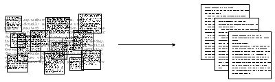

**Information Extraction (IE)** is different. Rather than finding documents, it extracts specific structured facts *from* documents. Things like who is mentioned, what organizations are named, what events are described. It requires understanding both syntax and semantics.

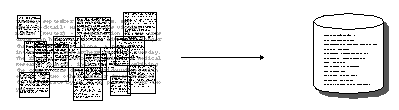

Today we are going to focus on a small part of information extraction: **part-of-speech tagging** and **named entity recognition**. Both methods augment the original data by creating new structured fields from existing strings.

### NER & POS Tagging

Our merge tells us which titles occur in OCLC, the *New York Times* bestseller data, or both. But matching records does not tell us whether the titles themselves differ or whether there are patterns in titles that might help us understand how bestsellers differ from academic holdings. To investigate that question, we need to start exploring the text of the titles themselves. 

One approach is **part-of-speech tagging**, which predicts how each word functions grammatically, such as whether it acts as a noun, proper noun, verb, or adjective. These labels let us compare patterns that are not represented in the original title field.


In the early 1960s, linguists W. Nelson Francis and Henry Kučera created the [Brown Corpus](https://icame.info/icame_static/manuals/BROWN/INDEX.HTM){target="_blank"}: 500 samples containing just over one million words of edited American English published in 1961. Its sources included fiction, newspapers, academic writing, and other prose categories. The project was designed as a stable, machine-readable body of language that researchers could count and compare.

[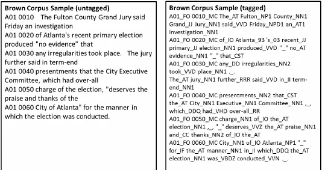](https://varieng.helsinki.fi/CoRD/corpora/BROWN/tags.html){target="_blank"}

During the 1970s, the corpus was augmented with grammatical labels. Greene and Rubin's `TAGGIT` program used word lists, suffixes, and contextual rules to assign word classes; unresolved ambiguities still required human correction. The resulting tagged corpus helped establish the idea that a body of text could become a dataset in which every word had an additional grammatical field. It also reminds us that categories such as “noun” and “verb,” the tag set used to represent them, and the texts selected for the corpus were all research decisions. For additional context, see the National Endowment for the Humanities' history of [the Brown Corpus and computational approaches to American English](https://www.neh.gov/humanities/2014/marchapril/feature/the-american-language-0){target="_blank"}.

Part-of-speech labels describe grammatical roles, but they do not tell us whether a phrase refers to a particular person, organization, or place. For that, we can use **named entity recognition (NER)**, a form of information extraction that predicts whether a span of text names a person, organization, geopolitical place, date, or another entity type. Together, POS tagging and NER create new structured fields from the title strings already present in our datasets.

Their accuracy depends on context, capitalization, language, genre, the categories defined by a model, and the data used to train it. Titles are especially challenging because they are short and often omit the sentence context that helps a model distinguish a person, place, organization, or ordinary noun.

From [Wikipedia](https://en.wikipedia.org/wiki/Named-entity_recognition){target="_blank"}:

> "Named-entity recognition (NER) is a subtask of information extraction that seeks to locate and classify named entities mentioned in unstructured text into pre-defined categories such as person names, organizations, locations, medical codes, time expressions, quantities, monetary values, percentages, etc."

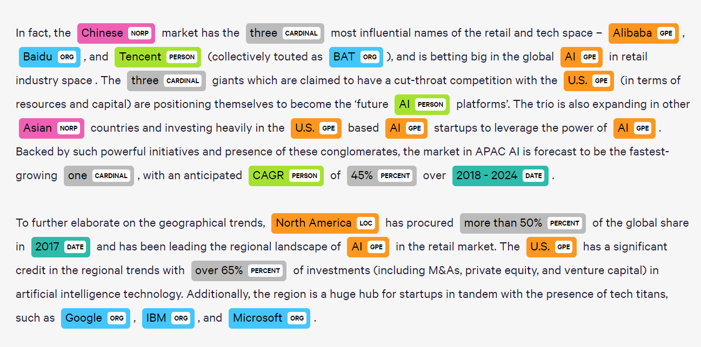


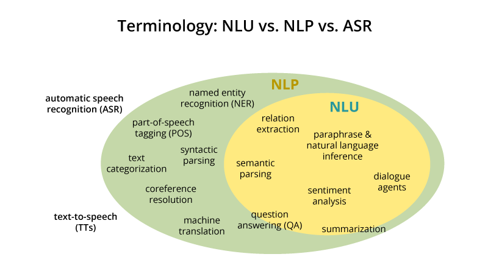

This graph represents a common typology of NLP tasks, comparing it to Natural Language Understanding and Automatic Speech Recognition.

While technically correct, I find this graph confusing 🤔. The exact definition of NER’s boundaries relative to other nlp/nlu tasks is very porous. For example, in addition to recognizing entities, NER can also include parts of text classification, entity disambiguation, relationship extraction all parts of NER (though they are separated in this chart).

*So if this is so porous how did NER first develop?*

[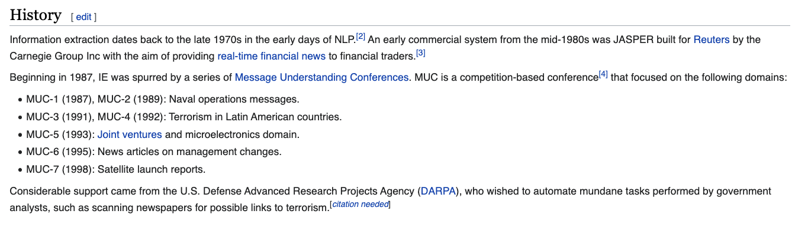](https://en.wikipedia.org/wiki/Information_extraction#History){target="_blank"}

From this Wiki page, we can see that the concept of “named entity” first developed at the Message Understanding Conference-6 in 1995. Here’s an example template given to participants from MUC-3 and you can even read the original MUC manual here <https://www-nlpir.nist.gov/related_projects/muc/muc_sw/muc_sw_manual.html>:

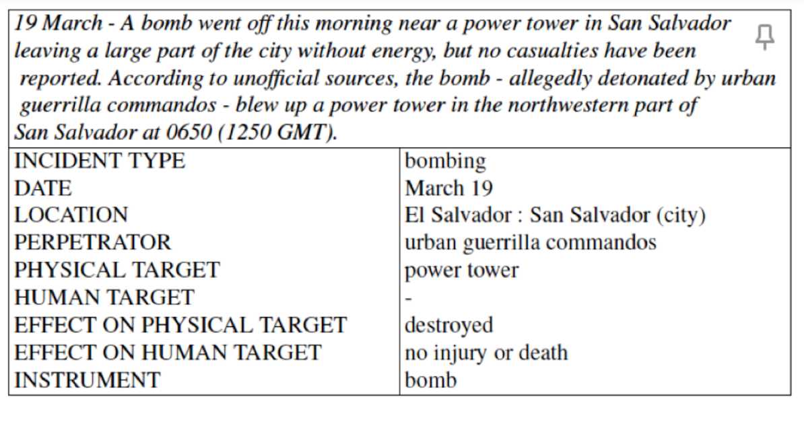

The big takeaway is that NER is relatively new. The field really takes off as a field with Text Analysis Conferences beginning in 2009 [https://tac.nist.gov/](https://tac.nist.gov/){target="_blank"} and it is also relatively recent in digital humanities.

The first DH conference presentation listing NER as a topic was in 2004:

[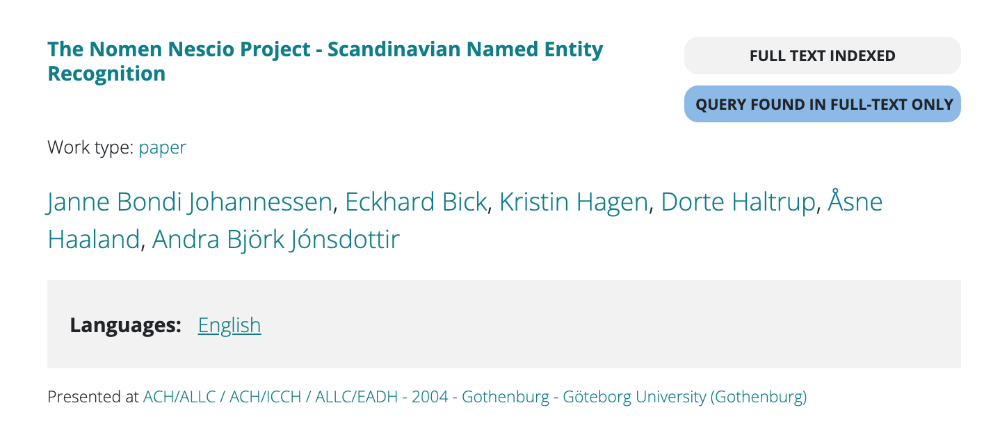](https://dh-abstracts.library.cmu.edu/works?ordering=year&text=%22named+entity+recognition%22&conference=&work_type=){target="_blank"}

Now that we have a sense of the origins of NER & POS tagging, we can explore how to use them with Python. 

### spaCy & Structuring Text

Today, we will use [spaCy](https://spacy.io/){target="_blank"}, an open-source natural-language-processing library for Python. Matthew Honnibal publicly introduced spaCy in 2015 as a library designed to make contemporary NLP research easier to use in working software. From the beginning, its design emphasized speed, a stable programming interface, and processing text through reusable pipelines rather than treating each linguistic task as an unrelated script. The project is now maintained by [Explosion](https://explosion.ai/){target="_blank"}, the company led by Honnibal and Ines Montani that develops spaCy and related annotation tools.


A spaCy **pipeline** passes text through a sequence of components. Depending on the trained pipeline we load, those components may assign sentence boundaries, grammatical labels, syntactic relationships, base word forms, or named entities. The library separates the reusable software from its trained pipelines: installing `spacy` gives us the library, while downloading `en_core_web_sm` gives us one particular English model package. Different model packages, languages, or training data can produce different predictions.

spaCy is not the only Python library we could use:

| Library | Particularly useful for |
|---|---|
| [NLTK](https://www.nltk.org/){target="_blank"} | Learning and experimenting with linguistic concepts, corpora, frequency distributions, and classic NLP algorithms. We will use parts of NLTK in the next lesson. |
| [Stanza](https://stanfordnlp.github.io/stanza/){target="_blank"} | Stanford's neural NLP pipelines, especially multilingual analysis using models available for more than seventy languages and Universal Dependencies annotations. |
| [Hugging Face Transformers](https://huggingface.co/docs/transformers/main_classes/pipelines){target="_blank"} | Selecting and running transformer models fine-tuned for tasks such as NER, classification, question answering, and generation. It offers much more model choice, but that also requires closer attention to model selection, computational cost, and training data. |

We are choosing spaCy here because one relatively lightweight pipeline gives us both POS and NER predictions, works efficiently on a regular laptop, and returns annotations in consistent Python objects that we can convert into Pandas DataFrames. That convenience does not make its labels authoritative; it makes them easier to generate and therefore especially important to audit.

Install the library and its small English model in your virtual environment before running this section:

```bash
pip install spacy
python -m spacy download en_core_web_sm
```

Then import spaCy and load the model:

```{python}
import spacy

nlp = spacy.load('en_core_web_sm')
```

Before analyzing thousands of titles, inspect one prediction:

```{python}
example_title = nlp("Harry Potter and the Philosopher's Stone")

for word in example_title:
    print(word.text, word.pos_)

for entity in example_title.ents:
    print(entity.text, entity.label_)
```


spaCy uses a pipeline of statistical models to process text:


The key thing to understand is that spaCy's NER is based on trained machine learning models; it makes predictions about which label most likely applies based on patterns learned from large annotated datasets. This means it can generalize well to new text, but it also inherits the biases and limitations of its training data. 

We can also visualize how spaCy is analyzing a sentence using its built-in `displacy` visualizer:

```{python}
from spacy import displacy

displacy.render(example_title, style="ent")
```

### What Can the Language of Titles Tell Us?

Normally we might explore the full text of our novels but only 2 of the books available between OCLC's Top 500 and the *New York Times* bestseller list have open access text on Project Gutenberg. Instead, we will be exploring the titles of these novels. This experiment asks whether the grammatical structure of titles differs among three groups:

- titles found only in OCLC's Top 500;
- titles found in both datasets;
- titles found only in the NYT bestseller data.

::: {.callout}
# Some Caveats With Titles

A title is a very short text, not a summary of an entire work. It may name a character or place, establish a mood, quote another text, describe a genre, or function primarily as marketing. We should therefore avoid treating patterns in titles as direct evidence about the language, plot, themes, or quality of the books themselves.

Title fields also contain several practical complications:

- The same work may have different titles across editions, translations, countries, or platforms.
- Subtitles, series names, volume numbers, punctuation, spelling, and capitalization may be recorded inconsistently.
- Different works can share the same title, so a title alone is not a reliable identifier.
- Very short or figurative titles provide little context for deciding whether a word names a person, place, organization, or ordinary concept.
- Models trained primarily on contemporary English prose may behave differently with historical titles, multilingual titles, transliterations, or unusual capitalization.
- Changing titles to create comparison keys can improve record matching while also removing distinctions that matter for interpretation.

Researchers commonly work with titles in several complementary ways:

- **Record linkage:** combine titles with authors, dates, publishers, ISBNs, OCLC identifiers, or authority records to determine whether records describe the same work.
- **Comparison keys:** create lowercase or punctuation-adjusted copies for matching while preserving the original title in a separate column.
- **Title and subtitle parsing:** separate components when the distinction is documented consistently enough to support the research question.
- **Keyword and phrase analysis:** count recurring words or phrases, usually while considering language, period, genre, and corpus size.
- **Classification or clustering:** group titles by manually defined categories or model-generated similarities, followed by close inspection of the resulting groups.
- **Manual validation:** inspect ambiguous matches and model predictions rather than treating automated output as ground truth.

Our POS and NER analysis is therefore an exploratory augmentation exercise, primarily to test whether model-generated grammatical and entity fields reveal patterns worth investigating, while preserving enough information to audit where those predictions fail.
:::

For the earlier analysis, we needed the weekly bestseller dataset because each row represented one title's appearance in one week. For this question, however, we need a title-level unit of observation. Jordan Pruett also provides a separate [NYT Hardcover Fiction Bestsellers title dataset](https://raw.githubusercontent.com/Post45-Data-Collective/data/refs/heads/main/nyt_hardcover_fiction_bestsellers/nyt_hardcover_fiction_bestsellers-titles.csv){target="_blank"} containing one intended row per bestseller title, along with summary fields such as its best rank, first week, and total weeks on the list.

We should use the source whose unit of observation fits our question rather than reconstructing title-level data from more than 60,000 weekly rows. Load that dataset here:

```{python}
nyt_titles_url = "https://raw.githubusercontent.com/Post45-Data-Collective/data/refs/heads/main/nyt_hardcover_fiction_bestsellers/nyt_hardcover_fiction_bestsellers-titles.csv"

nyt_titles_df = pd.read_csv(nyt_titles_url)
nyt_titles_df.shape
```

The OCLC-centered `novels_df` already contains one row per novel. The Post45 file is also designed to be title-level, but we still need to test whether its records remain unique after applying the same process used for matching:

```{python}
nyt_titles_df['title_key'] = (
    nyt_titles_df['title']
    .str.lower()
    .str.strip()
)

nyt_titles_df['author_key'] = (
    nyt_titles_df['author']
    .str.lower()
    .str.strip()
)
```

::: {.callout-note collapse="true"}
## Why do comparison keys reveal duplicate records?

Lowercasing and stripping whitespace do not remove rows. They reveal records whose title and author keys become identical. We can inspect those duplicate candidates before deciding to keep one record per repeated title-author key:

```{python}
# Select the two comparison-key columns that we need for matching records.
matching_keys = nyt_titles_df[
    ['title_key', 'author_key']
]

# isna() marks every missing value as True and every recorded value as False.
missing_keys = matching_keys.isna()

# any(axis=1) checks across each row. It returns True when either the title key or author key is missing. sum() counts the True values in that Boolean Series.
missing_key_count = missing_keys.any(axis=1).sum()

# duplicated() compares each row's title-author key combination with the combinations already encountered. By default, the first occurrence is False
# and each later occurrence of that same combination is True.
duplicate_record_count = nyt_titles_df.duplicated(
    subset=['title_key', 'author_key']
).sum()

# Print the two counts so we can explain why the cleaned DataFrame has fewer rows.
print('Records missing a title or author key:', missing_key_count)
print('Repeated title-author key records:', duplicate_record_count)

# Run duplicated() again with keep=False. This marks every member of a repeated group as True, including its first occurrence, so we can inspect both records.
nyt_title_duplicates_df = nyt_titles_df[
    nyt_titles_df.duplicated(
        subset=['title_key', 'author_key'],
        keep=False
    )
]

# Display only the columns useful for reviewing these duplicate candidates. Sorting by title and author places related records next to one another.
nyt_title_duplicates_df[
    ['title', 'author', 'year', 'best_rank', 'total_weeks']
].sort_values(['title', 'author'])
```

The difference consists of one record without an author key and thirteen repeated title-author key pairs. The repeated records include differences in capitalization, whitespace, and author-name formatting. The Post45 file also provides OCLC, OWI, ISBN, and VIAF fields that could support a more extensive record-linkage audit.
:::

For this title-language experiment, we only want each author-title comparison key represented once. We can create a cleaned DataFrame without changing the original `nyt_titles_df`:

```{python}
nyt_titles_with_keys_df = nyt_titles_df.dropna(
    subset=['title_key', 'author_key']
)

nyt_unique_titles_df = nyt_titles_with_keys_df.drop_duplicates(
    subset=['title_key', 'author_key']
)

nyt_unique_titles_df = nyt_unique_titles_df.copy()

print('OCLC novel records:', len(novels_df))
print('Published NYT title records:', len(nyt_titles_df))
print('Unique NYT title-author keys:', len(nyt_unique_titles_df))
```

An outer merge keeps unmatched titles from both sources. We can merge directly from `novels_df` because it is already title-level. The suffixes preserve both original title and author fields, while the merge indicator becomes the basis for our three comparison groups.

```{python}
oclc_title_columns_df = novels_df[
    ['title', 'author', 'genre', 'pub_year', 'title_key', 'author_key']
]

nyt_title_columns_df = nyt_unique_titles_df[
    ['title', 'author', 'first_week', 'title_key', 'author_key']
]

title_comparison_df = oclc_title_columns_df.merge(
    nyt_title_columns_df,
    how='outer',
    on=['title_key', 'author_key'],
    suffixes=('_oclc', '_nyt'),
    indicator=True
)

title_comparison_df['dataset_group'] = title_comparison_df['_merge'].map({
    'left_only': 'OCLC only',
    'both': 'OCLC and NYT',
    'right_only': 'NYT only'
})

title_comparison_df['title'] = (
    title_comparison_df['title_oclc']
    .fillna(title_comparison_df['title_nyt'])
)

oclc_publication_date = (
    title_comparison_df['pub_year'].astype('Int64').astype(str)
    + '-01-01'
)

oclc_publication_date = pd.to_datetime(
    oclc_publication_date,
    errors='coerce'
)

nyt_first_week = pd.to_datetime(
    title_comparison_df['first_week'],
    errors='coerce'
)

title_comparison_df['publication_year'] = (
    oclc_publication_date.fillna(nyt_first_week)
)

# Give titles consistent sentence-style capitalization for spaCy.
title_comparison_df['title_for_analysis'] = (
    title_comparison_df['title']
    .str.lower()
    .str.capitalize()
)

title_comparison_df['dataset_group'].value_counts()
```

The two sources contain dates that describe different events and initially use different structures. The OCLC `pub_year` contains only a year, while the NYT `first_week` contains a complete date. We first convert each OCLC year from a number such as `1932` into the string `1932-01-01`. January 1 is a placeholder because OCLC does not provide a month or day. The nullable `Int64` conversion removes the decimal point Pandas uses when a numeric column contains missing values, so we create `1932-01-01` rather than `1932.0-01-01`.

We then use `pd.to_datetime()` to parse both sources as datetime values. Finally, `fillna()` keeps the OCLC publication date whenever one exists and supplies the NYT `first_week` date for NYT-only titles. The resulting `publication_year` column therefore has one consistent datetime data type, but its meaning still differs by source: original publication for OCLC records and first bestseller appearance for NYT-only records.

This title-level merge may produce more matches than the earlier dataset merge because it uses only lowercase, whitespace-trimmed author and title keys. The earlier merge also required shared identifiers and holdings metadata to agree. The difference is evidence that a “match” depends on which fields we treat as authoritative, not a neutral property waiting to be discovered.

Next, process the titles with spaCy. For each title we count its words, nouns, proper nouns, verbs, adjectives, and named entities. We also retain the predicted entity text and label so that we can inspect whether those predictions make sense.

The source datasets use different capitalization conventions, and capitalization affects spaCy's predictions. We therefore lowercase every title and then capitalize its first character before comparison. This gives all three groups a consistent sentence-style input, but it may still make proper names harder for the model to recognize. We should treat differences in the resulting predictions as part of what we need to inspect.

The next block uses `iterrows()` to process one DataFrame row at a time. For each title, we ask spaCy to analyze the text, count the predicted grammatical categories, collect the named entities, and append one dictionary of results to a list. This is longer than more optimized spaCy code, but every step uses loops, conditionals, lists, and dictionaries that we have already encountered.

```{python}
title_analysis_rows = []

for index, row in title_comparison_df.iterrows():
    title = row['title_for_analysis']

    # spaCy needs a string, so replace a missing title with an empty string.
    if pd.isna(title):
        title = ''

    doc = nlp(title)

    # Start each count at zero, then update it as we inspect the words.
    word_count = 0
    noun_count = 0
    proper_noun_count = 0
    verb_count = 0
    adjective_count = 0

    for word in doc:
        if not word.is_space and not word.is_punct:
            word_count = word_count + 1

            if word.pos_ == 'NOUN':
                noun_count = noun_count + 1
            if word.pos_ == 'PROPN':
                proper_noun_count = proper_noun_count + 1
            if word.pos_ == 'VERB':
                verb_count = verb_count + 1
            if word.pos_ == 'ADJ':
                adjective_count = adjective_count + 1

    # Save each predicted entity as a pair containing its text and label.
    entities = []
    for entity in doc.ents:
        entity_information = (entity.text, entity.label_)
        entities.append(entity_information)

    title_analysis_rows.append({
        'title': title,
        'author_key': row['author_key'],
        'dataset_group': row['dataset_group'],
        'genre': row['genre'],
        'publication_year': row['publication_year'],
        'word_count': word_count,
        'noun_count': noun_count,
        'proper_noun_count': proper_noun_count,
        'verb_count': verb_count,
        'adjective_count': adjective_count,
        'entity_count': len(doc.ents),
        'entities': entities
    })

title_analysis_df = pd.DataFrame(title_analysis_rows)
title_analysis_df.head()
```

This code moves through the analysis in several stages:

1. `title_analysis_rows = []` creates an empty list where we will collect the results. Each item eventually added to this list will describe one title.

2. `title_comparison_df.iterrows()` lets the outer `for` loop visit one row of the DataFrame at a time. On each pass, `index` contains that row's index label and `row` contains its values. We do not need the index here, but `iterrows()` always provides both so we need to write both `index` and `row`. We select the title from the row with `row['title_for_analysis']`.

3. `pd.isna(title)` checks whether that title is missing. spaCy can process a string, but it cannot process Pandas' missing-value marker, so we substitute an empty string. This keeps the loop running while preserving a row for the record with the missing title.

4. `doc = nlp(title)` sends the title through the spaCy pipeline. The resulting `doc` is not merely the original string. It is a spaCy `Doc` object containing the words spaCy identified and the grammatical and entity predictions attached to them.

5. We set every counter to zero because each row represents a new title. The inner `for word in doc` loop then visits each spaCy word. Spaces and punctuation do not contribute to `word_count`. For every other word, we increase `word_count` and inspect its predicted `pos_` label. A word predicted to be a common noun increases `noun_count`; a proper noun, verb, or adjective increases its corresponding counter. These are separate `if` statements because we are checking each possible label explicitly.

6. Named entities are spans rather than necessarily single words. The second inner loop therefore visits `doc.ents` separately. For each predicted entity, we save a tuple containing its displayed text and label, such as `('London', 'GPE')`. We append every tuple to the `entities` list for that title.

7. Once both inner loops finish, we create one dictionary containing the original record information and all the values derived by spaCy. `title_analysis_rows.append(...)` adds that dictionary to our results list. The outer loop then repeats the same process for the next title.

8. Only after every title has been processed do we pass the complete list of dictionaries to `pd.DataFrame()`. Pandas uses the dictionary keys as column names and creates one row from each dictionary. This gives us `title_analysis_df`, an augmented version of our title data containing the new predicted measurements.

Overall, the loops calculate information about one title, the dictionary records that title's results, the list collects all records, and the final line turns those records into a DataFrame. It is also important to remember that the new columns contain spaCy's predictions. A value such as `proper_noun_count = 2` means that the model labeled two words as proper nouns; it does not guarantee that both labels are correct.

Because the three datasets contain very different numbers of titles, raw totals would mostly measure dataset size. Mean counts per title make the groups more comparable.

```{python}
title_measure_columns = [
    'word_count',
    'noun_count',
    'proper_noun_count',
    'verb_count',
    'adjective_count',
    'entity_count'
]

title_measure_groups = title_analysis_df.groupby('dataset_group')
title_measure_summary_df = title_measure_groups[title_measure_columns].mean()
title_measure_summary_df = title_measure_summary_df.round(2)
title_measure_summary_df = title_measure_summary_df.reset_index()

title_measure_summary_df.head()
```

Now we can see the average grammatical profile of titles in each dataset group. The next chart should show those averages as a set of bar charts, one for each measure. However, we have a slight problem: our summary DataFrame stores each measure in a separate column.

This is often called **wide data**. One row represents a dataset group, while `word_count`, `noun_count`, `proper_noun_count`, and the other measures spread horizontally across several columns. That shape is convenient for reading the summary as a table, but it is difficult to tell Altair that all six columns represent values of the same larger concept: a grammatical or entity **measure**.

To graph all the measures with one set of encoding rules, we need **long data**. In the long version:

- `dataset_group` will continue to identify the source group;
- a new `measure` column will identify whether a row represents `word_count`, `noun_count`, or another measure;
- a new `mean_count_per_title` column will contain the numerical value for that measure.

To do this, we can use Pandas' [`melt()` method](https://pandas.pydata.org/docs/reference/api/pandas.DataFrame.melt.html){target="_blank"} reshapes the DataFrame from wide to long. 


It does not calculate new averages or change their values. It reorganizes values that currently appear in several columns into additional rows. You can read more about reshaping data here [https://pandas.pydata.org/docs/user_guide/reshaping.html](https://pandas.pydata.org/docs/user_guide/reshaping.html){target="_blank"}.

```{python}
title_measure_long_df = title_measure_summary_df.melt(
    id_vars='dataset_group',
    var_name='measure',
    value_name='mean_count_per_title'
)

title_measure_long_df.head(12)
```

The arguments tell Pandas how the reshaped DataFrame should work:

- `id_vars='dataset_group'` keeps the identifying column attached to every resulting row.
- Because we omit `value_vars`, Pandas reshapes every other column in the DataFrame.
- `var_name='measure'` names the new column containing the former column names.
- `value_name='mean_count_per_title'` names the new column containing their values.

Now Altair can map `measure` to the chart's columns and `mean_count_per_title` to the y-axis. The same chart instructions work for all six measures because they now appear as values in shared columns rather than as six separate fields.

```{python}
alt.Chart(title_measure_long_df).mark_bar().encode(
    x='dataset_group:N',
    y='mean_count_per_title:Q',
    color='dataset_group:N',
    column='measure:N',
    tooltip=[
        'dataset_group:N',
        'measure:N',
        'mean_count_per_title:Q'
    ]
)
```

### How Do These Patterns Differ Across Genre?

While we are starting to see some interesting patterns, currently we are treating all novels as if they are identical. However, we know that there are differences across genres in our novel, so let's explore how title might reflect these differences. Genre metadata comes from the OCLC-centered novels dataset, so we cannot include NYT-only titles in this comparison. 

```{python}
genre_analysis_df = title_analysis_df[
    title_analysis_df['genre'].notna()
].copy()

genre_analysis_df['matched_nyt'] = (
    genre_analysis_df['dataset_group'] == 'OCLC and NYT'
).astype(int)

genre_analysis_df[
    ['title', 'dataset_group', 'genre', 'matched_nyt']
].head()
```

First, we count titles by genre and dataset group. This reveals both the original genre distribution and where the OCLC–NYT overlap occurs.

```{python}
alt.Chart(genre_analysis_df).mark_bar().encode(
    x='count():Q',
    y=alt.Y('genre:N', sort='-x'),
    color='dataset_group:N',
    tooltip=[
        'genre:N',
        'dataset_group:N',
        'count():Q'
    ]
)
```

Raw counts can be misleading because some genres contain many more OCLC titles than others. The mean of the zero-or-one `matched_nyt` column gives the proportion of titles in each genre that also matched the NYT data.

```{python}
genre_groups = genre_analysis_df.groupby('genre')

genre_match_summary_df = genre_groups.agg(
    title_count=('title', 'size'),
    nyt_match_rate=('matched_nyt', 'mean')
)
genre_match_summary_df = genre_match_summary_df.reset_index()

genre_match_summary_df.head()
```

```{python}
alt.Chart(genre_match_summary_df).mark_bar().encode(
    x='nyt_match_rate:Q',
    y=alt.Y('genre:N', sort='-x'),
    tooltip=[
        'genre:N',
        'title_count:Q',
        'nyt_match_rate:Q'
    ]
)
```

Finally, we compare the average grammatical profile of titles across genres and between OCLC-only titles and titles matched in both datasets. This heatmap is exploratory: cells based on very few titles should not be interpreted as stable genre conventions.

```{python}
genre_title_groups = genre_analysis_df.groupby(
    ['genre', 'dataset_group']
)

genre_title_means_df = genre_title_groups[title_measure_columns].mean()
genre_title_means_df = genre_title_means_df.reset_index()

genre_title_language_df = genre_title_means_df.melt(
    id_vars=['genre', 'dataset_group'],
    var_name='measure',
    value_name='mean_count_per_title'
)

genre_title_language_df.head()
```

This block changes the unit of observation in two stages.

First, `groupby(['genre', 'dataset_group'])` gathers together titles that share both values. A novel classified as `fiction` and found only in OCLC belongs to a different group from a `fiction` novel found in both OCLC and the NYT data. At this stage, `genre_title_groups` is a Pandas `GroupBy` object: it describes how the rows should be divided, but it is not yet the summary table we want to display.

Next, we select the columns listed in `title_measure_columns` and calculate their means:

```python
genre_title_means_df = genre_title_groups[title_measure_columns].mean()
```

Pandas calculates one average for every measure within every genre-and-dataset combination. For example, one result might represent the average number of predicted proper nouns among `fiction` titles in the `OCLC only` group. Missing numerical values are excluded from a mean rather than treated as zero.

The genre and dataset group initially become index levels in the summarized result. `reset_index()` turns them back into ordinary columns, giving us a wide DataFrame with one row per genre-and-dataset combination and a separate column for every measure.

Finally, `melt()` reshapes that wide summary into the long form introduced earlier:

- `id_vars=['genre', 'dataset_group']` preserves the two fields that identify each group;
- `var_name='measure'` places names such as `word_count` and `proper_noun_count` in one column;
- `value_name='mean_count_per_title'` stores the corresponding average in another column.

After reshaping, one row represents **one measure for one genre in one dataset group**. That structure allows Altair to map `measure` to the x-axis, `genre` to the y-axis, the average to color, and `dataset_group` to separate chart columns.

```{python}
alt.Chart(genre_title_language_df).mark_rect().encode(
    x='measure:N',
    y='genre:N',
    color='mean_count_per_title:Q',
    column='dataset_group:N',
    tooltip=[
        'genre:N',
        'dataset_group:N',
        'measure:N',
        'mean_count_per_title:Q'
    ]
)
```

These charts let us separate three possible observations: differences caused by dataset size, differences in which genres cross between institutional and commercial recognition, and differences in title language within those genres. They still do not establish why a title became a bestseller or entered OCLC's Top 500, but they provide some potential clues for us to explore.

The averages can indicate possible differences in title construction, but we still need to inspect spaCy's predictions. The next cells show which entity labels and entity texts occur most often in each group.

```{python}
title_entities_df = title_analysis_df[
    ['title', 'dataset_group', 'entities']
].copy()

title_entities_df = title_entities_df.explode('entities')
title_entities_df = title_entities_df.dropna(subset=['entities'])

title_entities_df['entity_text'] = title_entities_df['entities'].str[0]
title_entities_df['entity_label'] = title_entities_df['entities'].str[1]

entity_label_counts = title_entities_df[
    ['dataset_group', 'entity_label']
].value_counts()

entity_label_counts_df = entity_label_counts.reset_index(name='count')
entity_label_counts_df.head(20)
```

This code changes our unit of observation from **one row per title** to **one row per predicted entity** before counting the labels.

We begin by selecting only the three columns needed for this analysis and making a copy. In `title_analysis_df`, each value in the `entities` column is a list of tuples. For example, one title might contain:

```python
[('Elizabeth Bennet', 'PERSON'), ('Hertfordshire', 'GPE')]
```

The title still occupies one DataFrame row, while both entity predictions are stored together inside that row's list. That structure is useful for preserving all predictions associated with a title, but it is awkward for counting individual entities.

The [`explode()` method](https://pandas.pydata.org/docs/reference/api/pandas.DataFrame.explode.html){target="_blank"} creates a separate row for every item in the `entities` list. A title with two predicted entities therefore becomes two rows. Its `title` and `dataset_group` values are repeated so that each entity remains connected to its source record. A title with no predicted entities produces a row with a missing `entities` value, which we remove with `dropna()` because there is no entity to count.

After exploding, each value in `entities` is one tuple with two positions:

- position `0` contains the entity text, such as `Elizabeth Bennet`;
- position `1` contains spaCy's label, such as `PERSON`.

Pandas' `.str` accessor can select positions from list-like values as well as manipulate strings. Here, `.str[0]` and `.str[1]` select the two positions in each tuple; they are not selecting the first and second characters of the entity text. We save those values as separate `entity_text` and `entity_label` columns so that they can be counted and inspected independently.

Finally, `value_counts()` counts each distinct combination of `dataset_group` and `entity_label`. Its immediate result is a Series whose grouped values form the index. `reset_index(name='count')` converts that result into a regular DataFrame with three columns: `dataset_group`, `entity_label`, and `count`. Each resulting row therefore means: **spaCy predicted this entity label this many times in this dataset group**.

These are counts of entity predictions, not counts of unique titles. A title containing two predicted people contributes two `PERSON` records, and the same person appearing in several titles is counted each time. We will account for the difference between entity occurrences and titles containing an entity in the next section.

```{python}
entity_counts = title_entities_df[
    ['dataset_group', 'entity_text', 'entity_label']
].value_counts()

entity_counts_df = entity_counts.reset_index(name='count')
entity_count_groups = entity_counts_df.groupby('dataset_group')
top_entities_df = entity_count_groups.head(10)

top_entities_df
```

Because these entities are derived from spaCy's models, we should treat the results as probabilistic and contextual rather than as ground truth. Differences may reflect historical title conventions, the periods covered by each dataset, spaCy's training data, or errors caused by analyzing short phrases without context.

### Looking More Closely at People and Places in Titles

Rather than treating every named-entity category as equally meaningful, we can focus on two categories that might be the most telling in our data:

- `PERSON`: Does the title name a person or character?
- `GPE`: Does the title name a country, city, state, or other geopolitical place?

Because the dataset groups contain very different numbers of titles, raw entity counts would mostly reproduce those differences in size. Instead, we will calculate the percentage of titles in each group that contain at least one predicted `PERSON` or `GPE` entity.

```{python}
def has_entity_type(entities, entity_type):
    # Build a list containing only the label from each entity pair.
    entity_labels = []
    for entity_text, entity_label in entities:
        entity_labels.append(entity_label)

    # Return True when the requested label appears in the list.
    return entity_type in entity_labels

def has_person(entities):
    # Check this title's entities for a predicted person.
    return has_entity_type(entities, 'PERSON')

def has_gpe(entities):
    # Check this title's entities for a predicted geopolitical place.
    return has_entity_type(entities, 'GPE')

# Make a smaller DataFrame for this focused comparison.
focused_entity_df = title_analysis_df[
    ['title', 'dataset_group', 'genre', 'publication_year', 'entities']
].copy()

# Run each named function on every value in the entities column.
focused_entity_df['has_person'] = focused_entity_df['entities'].apply(has_person)
focused_entity_df['has_gpe'] = focused_entity_df['entities'].apply(has_gpe)

focused_entity_df[
    ['title', 'dataset_group', 'has_person', 'has_gpe']
].head()
```

This code is a bit more advanced but shows us a new way to work with Pandas. We have created three functions, two of which we are using directly with Pandas through the `apply()` syntax. 

Here we call [`Series.apply()`](https://pandas.pydata.org/docs/reference/api/pandas.Series.apply.html){target="_blank"} on the `entities` Series. Pandas sends each value in that Series to the named function and collects the returned values into a new Series. We then assign that result to a new column. We previously used `map()` with dictionaries to replace known values such as `True` and `False`; here, `apply()` is useful because we wrote our own checking functions.

The important syntax is:

```python
focused_entity_df['entities'].apply(has_person)
```

We pass the function name `has_person` without parentheses because we are asking Pandas to run it. If we wrote `has_person()`, Python would try to call the function immediately without supplying an `entities` value.

::: {.callout-note collapse="true"}
## How would this work with another `iterrows()` loop?

We could produce the same values with another `for` loop using [Pandas' `iterrows()` method](https://pandas.pydata.org/docs/reference/api/pandas.DataFrame.iterrows.html){target="_blank"}. As in the spaCy block above, `iterrows()` gives us each row one at a time, and we append each function result to a list:

```{python}
#| eval: false
person_results = []

for index, row in focused_entity_df.iterrows():
    entities = row['entities']
    result = has_person(entities)
    person_results.append(result)

focused_entity_df['has_person'] = person_results
```

The loop makes every step visible: select a row, get its `entities`, call the function, and save the result. `.apply(has_person)` expresses the same column operation more concisely and avoids manually maintaining a results list. For this small example either approach works, but `.apply()` more clearly communicates that we are transforming every value in one Series.


:::

Now that we have entities identified, we want to compare the results for `PERSON` and `GPE` across the three dataset groups in one graph. We have encountered this structural problem already: `has_person` and `has_gpe` are stored in separate columns, just as our earlier grammatical measures were.

For example, this chart can use `has_person` to show how many titles in each group do or do not contain a predicted person:

```{python}
person_chart_df = focused_entity_df[
    ['dataset_group', 'has_person']
].value_counts().reset_index(name='title_count')

alt.Chart(person_chart_df).mark_bar().encode(
    x='dataset_group:N',
    y='title_count:Q',
    color='has_person:N'
)
```

To visualize geopolitical places instead, we would have to replace `has_person` with `has_gpe`:

```{python}
gpe_chart_df = focused_entity_df[
    ['dataset_group', 'has_gpe']
].value_counts().reset_index(name='title_count')

alt.Chart(gpe_chart_df).mark_bar().encode(
    x='dataset_group:N',
    y='title_count:Q',
    color='has_gpe:N'
)
```

For each chart, `value_counts()` calculates the small set of grouped totals before Altair receives the data. This produces the same bars without embedding every title record in both charts.

These charts work separately, but the original DataFrame does not yet contain one field whose values are `PERSON` and `GPE`. We can use `melt()` again. This time, `value_vars` explicitly identifies the two columns we want to reshape. The resulting data will contain two rows per title: one for `PERSON` and one for `GPE`. The entity category will be stored in `entity_type`, and its Boolean result will be stored in `has_entity`.

```{python}
focused_entity_long_df = focused_entity_df.melt(
    id_vars=['title', 'dataset_group', 'genre', 'publication_year'],
    value_vars=['has_person', 'has_gpe'],
    var_name='entity_type',
    value_name='has_entity'
)

focused_entity_long_df['entity_type'] = (
    focused_entity_long_df['entity_type']
    .str.replace('has_', '', regex=False)
    .str.upper()
)

entity_groups = focused_entity_long_df.groupby(
    ['dataset_group', 'entity_type']
)

entity_group_summary_df = entity_groups.agg(
    title_count=('title', 'size'),
    titles_with_entity=('has_entity', 'sum'),
    title_share=('has_entity', 'mean')
)
entity_group_summary_df = entity_group_summary_df.reset_index()

entity_group_summary_df.head()
```

This block reshapes the two Boolean entity columns and then summarizes them by dataset group.

The `melt()` call keeps `title`, `dataset_group`, and `genre` as identifying columns. The `value_vars` argument tells Pandas to reshape only `has_person` and `has_gpe`. Each original title therefore becomes two rows:

| title | dataset_group | entity_type | has_entity |
|---|---|---|---|
| Example Title | OCLC only | has_person | True |
| Example Title | OCLC only | has_gpe | False |

The first row asks whether that title contains a predicted person; the second asks whether it contains a predicted geopolitical place. The `has_entity` value preserves the original `True` or `False` result.

Because `melt()` uses the original column names as values, the new `entity_type` column initially contains `has_person` and `has_gpe`. The string-method chain makes those labels easier to read:

- `.str.replace('has_', '', regex=False)` removes the shared `has_` prefix. Setting `regex=False` tells Pandas to treat `has_` as literal text rather than as a regular-expression pattern.
- `.str.upper()` changes the remaining values to `PERSON` and `GPE`, matching spaCy's entity labels.

We then group the long data by both `dataset_group` and `entity_type`. Every group now contains the title-level Boolean results for one question, such as “Does an OCLC-only title contain a predicted `PERSON`?”

The `agg()` call calculates three related summaries:

- `title_count=('title', 'size')` counts how many title rows belong to the group. Because each title appears once for each entity type, this is the number of titles considered for that particular group and entity type.
- `titles_with_entity=('has_entity', 'sum')` adds the Boolean values. Python and Pandas treat `True` as `1` and `False` as `0`, so the sum counts titles for which spaCy predicted at least one entity of that type.
- `title_share=('has_entity', 'mean')` calculates the average of those same zero-or-one values. The result is the proportion of titles containing that entity type. For example, `0.25` means that 25 percent of the titles in the group received `True`.

Finally, `reset_index()` turns `dataset_group` and `entity_type` from grouped index levels back into regular columns. Each row in `entity_group_summary_df` therefore summarizes **one entity type within one dataset group**.


```{python}
alt.Chart(entity_group_summary_df).mark_bar().encode(
    x='dataset_group:N',
    y='title_share:Q',
    color='dataset_group:N',
    column='entity_type:N',
    tooltip=[
        'dataset_group:N',
        'entity_type:N',
        'title_count:Q',
        'titles_with_entity:Q',
        'title_share:Q'
    ]
)
```

We can make the same comparison across genres for the OCLC titles with usable genre metadata. Before graphing percentages, however, we should inspect how many titles support each comparison.

```{python}
genre_entity_df = focused_entity_long_df[focused_entity_long_df['genre'].notna()].copy()

genre_entity_groups = genre_entity_df.groupby(
    ['genre', 'dataset_group', 'entity_type']
)

genre_entity_summary_df = genre_entity_groups.agg(
    title_count=('title', 'size'),
    titles_with_entity=('has_entity', 'sum'),
    title_share=('has_entity', 'mean')
)
genre_entity_summary_df = genre_entity_summary_df.reset_index()

genre_entity_summary_df.head()
```

The following bar chart shows the number of titles represented in each genre, dataset group, and entity-type comparison. It does **not** count the number of entities spaCy detected. Because every title receives one `PERSON` result and one `GPE` result after reshaping, the two entity-type panels repeat the same denominators. Showing both makes the relationship to the subsequent faceted heatmap explicit.

```{python}
alt.Chart(genre_entity_summary_df).mark_bar().encode(
    x='title_count:Q',
    y=alt.Y('genre:N', sort='-x'),
    color='dataset_group:N',
    column='entity_type:N',
    tooltip=[
        'genre:N',
        'dataset_group:N',
        'entity_type:N',
        'title_count:Q'
    ]
)
```

The chart reveals that some genre-and-dataset combinations contain only one or two titles. A percentage based on one title can be either zero or 100 percent, but neither result provides much evidence of a broader pattern. We therefore limit the heatmap to combinations containing at least five titles. Five is still a small denominator and does not make a result statistically reliable; it is a transparent exploratory threshold that removes the most extreme small-group percentages. The heatmap's tooltip retains `title_count` so we can continue to evaluate how much data supports each cell.

```{python}
genre_entity_chart_df = genre_entity_summary_df[
    genre_entity_summary_df['title_count'] >= 5
]

alt.Chart(genre_entity_chart_df).mark_rect().encode(
    x='entity_type:N',
    y='genre:N',
    color='title_share:Q',
    column='dataset_group:N',
    tooltip=[
        'genre:N',
        'dataset_group:N',
        'entity_type:N',
        'title_count:Q',
        'titles_with_entity:Q',
        'title_share:Q'
    ]
)
```

The graphs summarize spaCy's predictions, not verified facts about the titles. Before interpreting a high or low rate, return to `title_entities_df` and inspect examples. A name may be missed because we changed the original title casing, and an ordinary word may be misclassified because a short title provides little context. The useful methodological sequence is therefore **extract, summarize, visualize, and audit**.

```{python}
title_entities_df[
    title_entities_df['entity_label'].isin(['PERSON', 'GPE'])
][
    ['dataset_group', 'title', 'entity_text', 'entity_label']
].head(30)
```

Finally, we can make a quick exploratory chart asking whether predicted people and places appear differently across publication years. The chart continues to distinguish OCLC-only titles, NYT-only titles, and titles found in both sources. These groups describe the relationship between our two datasets rather than three independently collected datasets.

```{python}
temporal_entity_df = focused_entity_long_df.dropna(
    subset=['publication_year']
).copy()

temporal_entity_df['year'] = (
    temporal_entity_df['publication_year'].dt.year
)

temporal_entity_groups = temporal_entity_df.groupby(
    ['year', 'dataset_group', 'entity_type']
)

temporal_entity_summary_df = temporal_entity_groups.agg(
    titles_with_entity=('has_entity', 'sum')
)
temporal_entity_summary_df = temporal_entity_summary_df.reset_index()

alt.Chart(temporal_entity_summary_df).mark_bar().encode(
    y='year:O',
    x='titles_with_entity:Q',
    color='dataset_group:N',
    column='entity_type:N',
    tooltip=[
        'year:O',
        'dataset_group:N',
        'entity_type:N',
        'titles_with_entity:Q'
    ]
)
```

The code removes titles without a usable date and uses `.dt.year` to extract the calendar year from each datetime value. This places OCLC's January 1 placeholder dates and the NYT's weekly dates into comparable annual groups. We then group the titles by year, dataset group, and entity type. Because `has_entity` contains Boolean values, `sum()` counts the `True` values and tells us how many titles in each group contain that predicted entity type.

The bar chart uses `year:O` because we are comparing discrete annual groups rather than plotting each complete date on a continuous timeline. The height represents a raw count of titles containing an entity. Color stacks the mutually exclusive OCLC-only, OCLC-and-NYT, and NYT-only groups, while the two columns keep `PERSON` and `GPE` predictions separate.

This version makes both sources visible, but raw counts are affected by the very different sizes and historical coverage of the datasets. Remember also that year represents original publication for OCLC records but first bestseller appearance for NYT-only records. The chart is therefore useful for exploring the distribution of the predictions, not for claiming that one source or period uses more people or place names without further investigation.


# Quick Exercise: Try spaCy with your Exploring & Visualizing Culture Homework Dataset

Return to the dataset you used for the **Exploring and Visualizing Culture Homework**. Choose one column containing short text, such as a title, name, description, category, or review. The goal is not to process the entire dataset immediately. Begin by inspecting a small number of examples and deciding whether spaCy's predictions could create a useful new field.

1. Load your homework dataset and identify one text column.
2. Select the first ten recorded values from that column.
3. Process each value with the `nlp()` function.
4. Print the original text and the entity text and label predicted by spaCy.
5. Inspect the results. Which predictions appear useful, incorrect, or uncertain?
6. Write down one question that these predicted fields might help you explore and one limitation you would need to document.

Replace `your_text_column` with the name of a column in your dataset:

```{python}
#| eval: false
text_examples = homework_df['your_text_column'].dropna().head(10)

for text in text_examples:
    doc = nlp(str(text))
    print('TEXT:', text)

    for entity in doc.ents:
        print('ENTITY:', entity.text, '| LABEL:', entity.label_)

    print()
```

If spaCy finds no entities in a value, the inner loop will print nothing. That is still evidence: the model may not recognize entities in your text, the column may not contain the kinds of names represented by spaCy's labels, or the text may be too short or ambiguous. Do not treat an empty result as proof that the text contains no meaningful people, places, organizations, or dates.

**Bonus**: If you have time, try rewriting this code to use the `.apply()` method instead of a `for` loop. You can create a new column containing the predicted entities for every value in your text column. Then you can inspect the first ten rows of that new column to see how spaCy performed across multiple values.
