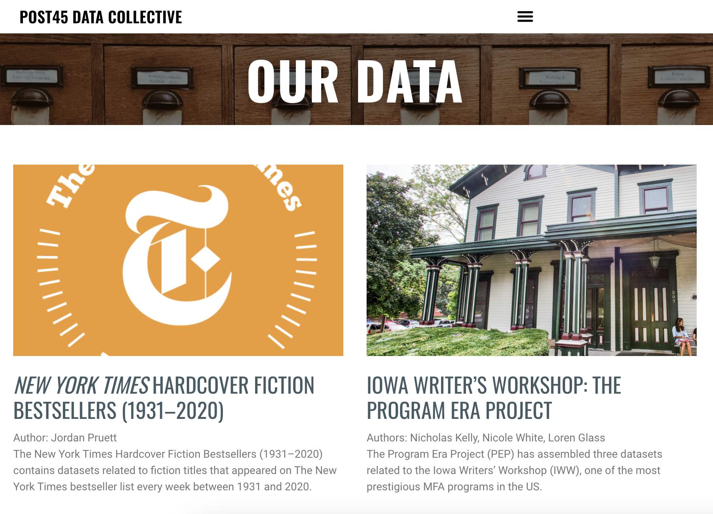
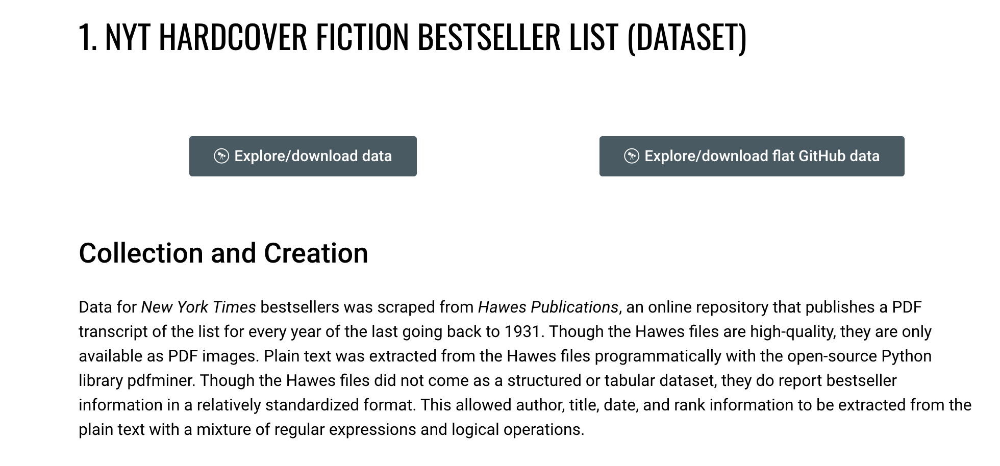
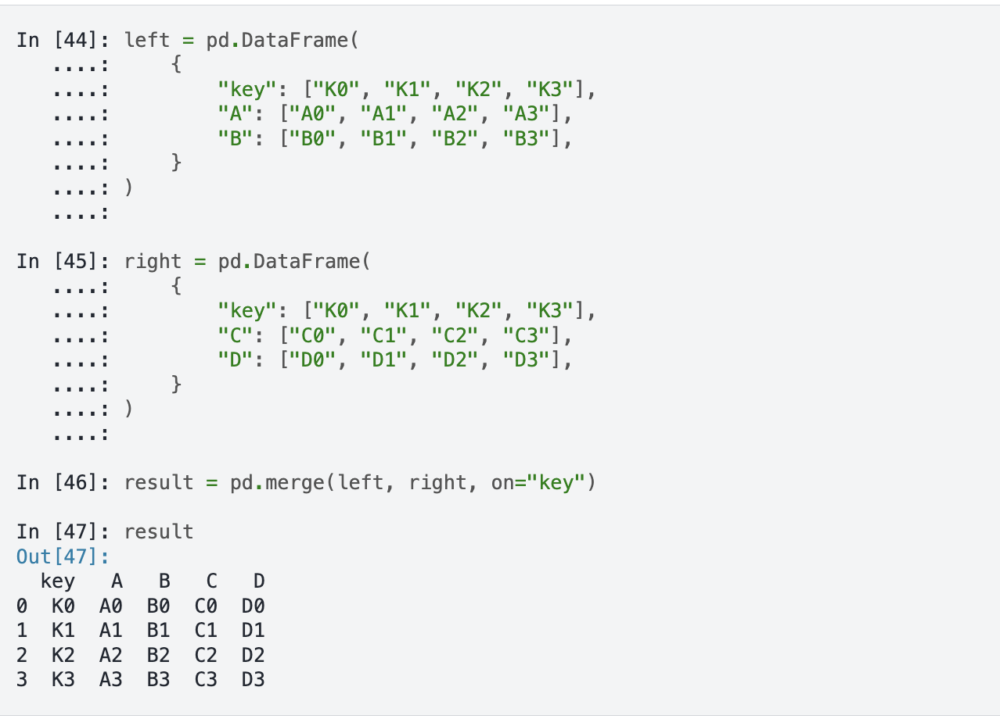
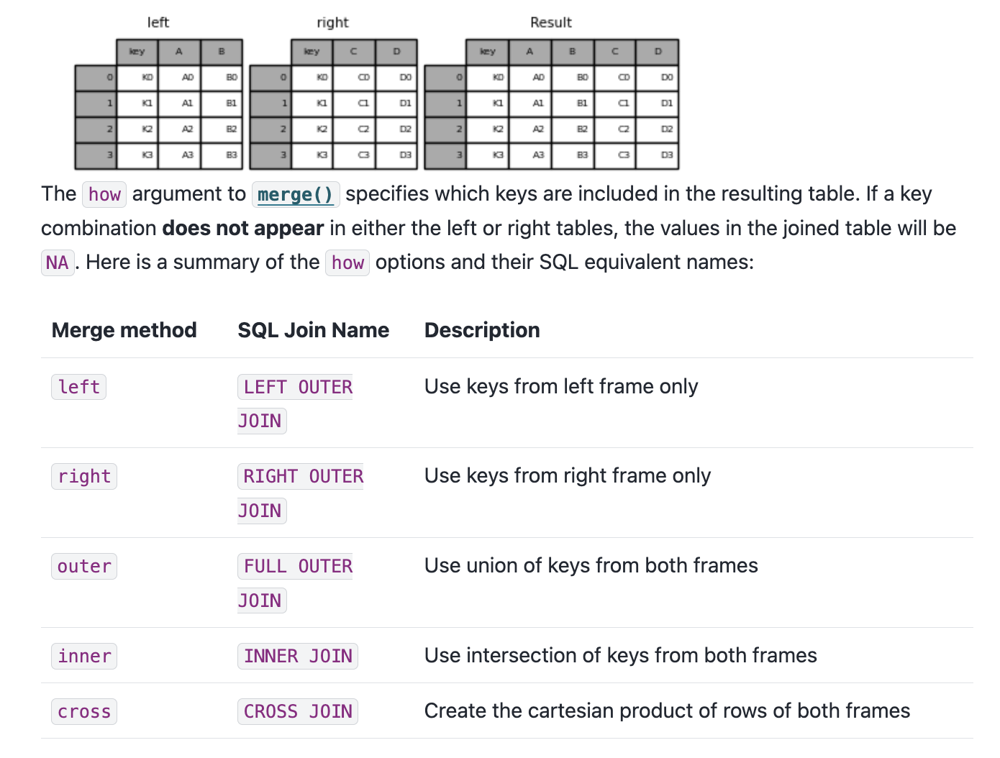
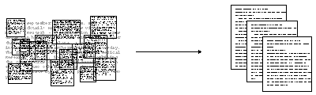
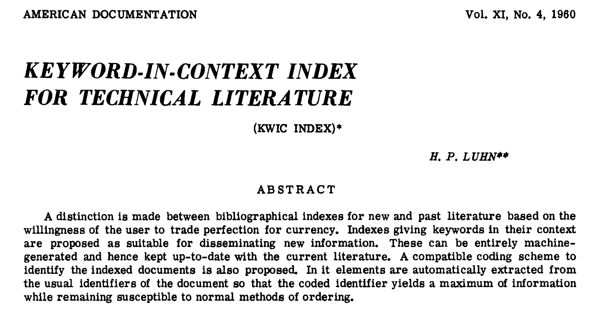
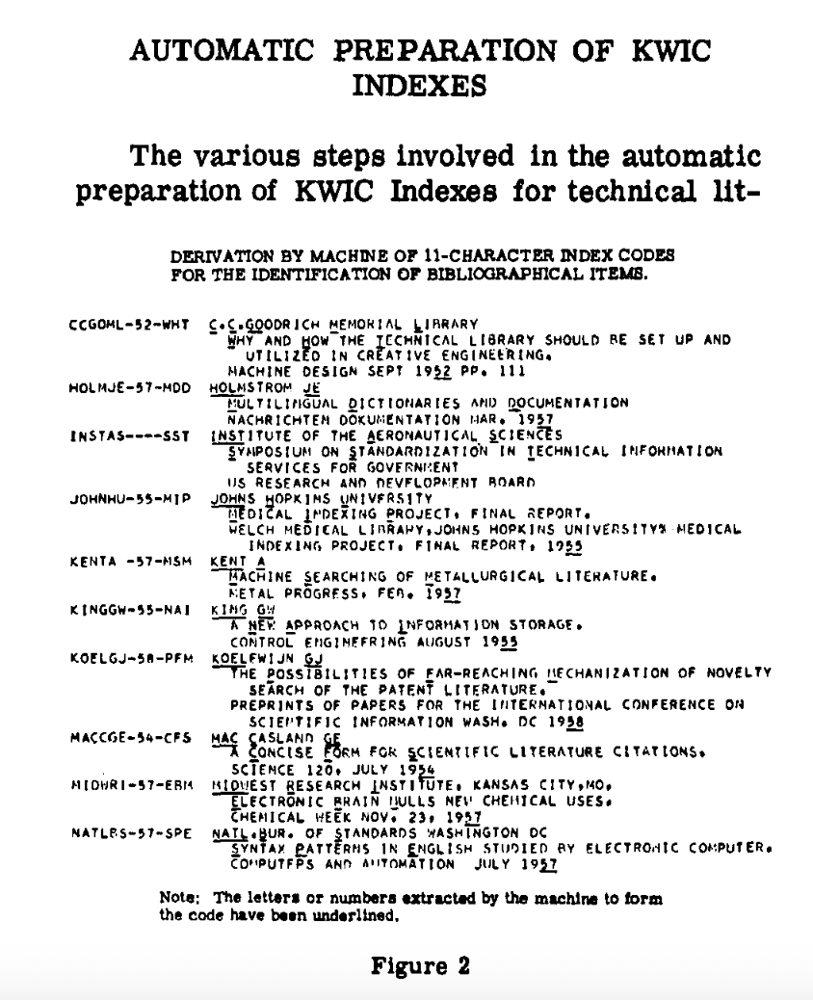

In the last lesson, we used exploratory data analysis to investigate the shape, categories, missing values, and provenance of an existing dataset. We also saw that changing the **unit of observation** could change the patterns we found.

In this lesson, we will focus on two related ways of structuring data:

1. **Merging datasets** requires us to decide when records from different sources represent the same cultural object.
2. **Tokenizing text** requires us to decide how an unstructured string becomes structured, countable units.

Neither process is automatic. Both depend on choices about representation, comparison, and what should count as the same thing.

```{python}
import pandas as pd
```

## Merging Cultural Datasets

Data about one cultural object is often distributed across several datasets. One source might describe a book's library holdings, another its bestseller history, and another its publication history or reception. Merging can bring those sources together, but only after we identify fields that can connect their records.

We will continue working with the [Top 500 "Greatest" Novels dataset](https://www.responsible-datasets-in-context.com/posts/top-500-novels/top-500-novels.html){target="_blank"} created by Anna Preus and Aashna Sheth. This dataset begins with OCLC's list of widely held novels and adds metadata from VIAF, Goodreads, Wikipedia, Project Gutenberg, and other sources.

```{python}
novels_url = "https://raw.githubusercontent.com/melaniewalsh/responsible-datasets-in-context/main/datasets/top-500-novels/final_merged_dataset_no_full_text.tsv"

novels_df = pd.read_csv(
    novels_url,
    sep="\t",
    encoding="utf-8"
)

novels_df.shape
```

To add another perspective on literary attention, we will use data from the [Post45 Data Collective](https://data.post45.org/){target="_blank"}.



The Post45 Data Collective "peer reviews and houses literary and cultural data from 1945 to the present." Treating datasets as scholarly publications matters: the collective asks us to consider who created a dataset, how it was documented, what it covers, and how it should be cited rather than treating a downloadable file as context-free evidence.

We will use Jordan Pruett's [*New York Times* Hardcover Fiction Bestsellers, 1931–2020](https://data.post45.org/nyt-fiction-bestsellers-data/){target="_blank"}. It includes three related datasets:

- weekly appearances on the bestseller list;
- title-level information about unique books;
- HathiTrust identifiers for titles that could be matched to digitized volumes.

The weekly dataset lets us ask which novels in OCLC's Top 500 also appeared on the *New York Times* list, how often they appeared, and what their best recorded rank was.



```{python}
nyt_url = "https://raw.githubusercontent.com/Post45-Data-Collective/data/refs/heads/main/nyt_hardcover_fiction_bestsellers/nyt_hardcover_fiction_bestsellers-lists.csv"

nyt_bestsellers_df = pd.read_csv(
    nyt_url,
    encoding="utf-8"
)

nyt_bestsellers_df.shape
```

Before combining anything, inspect both DataFrames:

```{python}
novels_df[['title', 'author', 'top_500_rank']].head()
```

```{python}
nyt_bestsellers_df[['title', 'author', 'rank', 'week']].head()
```

These DataFrames have different units of observation:

- Each row in `novels_df` represents one novel in OCLC's Top 500 list.
- Each row in `nyt_bestsellers_df` represents one title's appearance during one week on the bestseller list.

That difference will become important after the merge.

## How Does a Merge Work?

Pandas provides several ways to combine DataFrames. We previously encountered `concat()`, which can stack data vertically or horizontally. The [`merge()` method](https://pandas.pydata.org/docs/reference/api/pandas.DataFrame.merge.html){target="_blank"} instead connects rows using one or more shared keys, much like a database join.



The most important arguments are:

| Argument | Purpose |
|---|---|
| `right` | The second DataFrame to merge with the DataFrame before `.merge()` |
| `how` | Which records should remain: `left`, `right`, `inner`, or `outer` |
| `on` | The shared column or columns used as keys |
| `indicator` | Whether Pandas should report where each merged row came from |



A **left merge** keeps every row from the left DataFrame and adds matching information from the right DataFrame. An **inner merge** keeps only records that match in both. An **outer merge** preserves records from both DataFrames, whether they match or not.

The two datasets both have `author` and `title` columns, so we might begin with a left merge using those fields:

```{python}
first_merge_df = novels_df.merge(
    nyt_bestsellers_df,
    how='left',
    on=['author', 'title'],
    indicator=True
)

first_merge_df['_merge'].value_counts()
```

The code runs and returns a DataFrame, but every row is marked `left_only`. We can also inspect `rank`, which came from the bestseller data:

```{python}
first_merge_df['rank'].notna().sum()
```

The result is `0`. The **merge operation** succeeded, but the **record matching** failed. A left merge preserves every row from `novels_df` even when Pandas finds no matches, so a result with 500 rows can look successful while containing no new information.

## Why Did the Records Not Match?

Pandas compares string keys exactly. We can begin diagnosing the failure by counting shared author and title values:

```{python}
shared_authors = novels_df[
    novels_df['author'].isin(nyt_bestsellers_df['author'])
]['author'].nunique()

shared_titles = novels_df[
    novels_df['title'].isin(nyt_bestsellers_df['title'])
]['title'].nunique()

print("Shared authors:", shared_authors)
print("Shared titles:", shared_titles)
```

There are shared authors but no exact shared titles. Looking at one author represented in both datasets helps reveal why:

```{python}
novel_titles = novels_df[
    novels_df['author'] == 'Stephen King'
]['title'].unique()

nyt_titles = nyt_bestsellers_df[
    nyt_bestsellers_df['author'] == 'Stephen King'
]['title'].unique()

print("OCLC titles:", novel_titles)
print("NYT titles:", nyt_titles[:10])
```

The values refer to some of the same books, but the OCLC-derived titles use title case while the *New York Times* titles use uppercase. To Pandas, `The Shining` and `THE SHINING` are different strings.

This is not simply a formatting inconvenience. Each source preserves conventions created for a different purpose. Before merging them, we must decide which differences can be normalized without erasing meaningful distinctions.

## String Methods in Pandas

Pandas provides methods for working with text through the [`.str` accessor](https://pandas.pydata.org/docs/user_guide/text.html){target="_blank"}. We place `.str` after a Series and then select the operation we want to perform on every recorded string.

| String method | What it does |
|---|---|
| `.str.lower()` | Converts text to lowercase |
| `.str.upper()` | Converts text to uppercase |
| `.str.strip()` | Removes whitespace from the beginning and end |
| `.str.replace()` | Replaces one pattern with another |
| `.str.split()` | Divides each string into a list |
| `.str.len()` | Counts characters or items in a list |
| `.str.contains()` | Tests whether a string contains a pattern |
| `.str.count()` | Counts occurrences of a pattern |
| `.str.extract()` | Extracts part of a string using a pattern |
| `.str.findall()` | Returns every matching part of a string |

We should preserve the original titles and create separate **merge keys** for comparison. Lowercasing and stripping whitespace are reasonable here because capitalization and surrounding spaces do not distinguish these books.

```{python}
novels_df['title_key'] = novels_df['title'].str.lower().str.strip()
novels_df['author_key'] = novels_df['author'].str.lower().str.strip()

nyt_bestsellers_df['title_key'] = (
    nyt_bestsellers_df['title'].str.lower().str.strip()
)
nyt_bestsellers_df['author_key'] = (
    nyt_bestsellers_df['author'].str.lower().str.strip()
)
```

Notice that we did not overwrite `title` or `author`. The original values remain available for display, provenance, and future comparison, while the new columns record the normalization used for this particular merge.

Now the keys share values:

```{python}
shared_title_keys = novels_df[
    novels_df['title_key'].isin(nyt_bestsellers_df['title_key'])
]['title_key'].nunique()

print("Shared normalized titles:", shared_title_keys)
```

We can rerun the merge using the normalized author and title keys:

```{python}
weekly_merged_df = novels_df.merge(
    nyt_bestsellers_df,
    how='left',
    on=['author_key', 'title_key'],
    suffixes=('_oclc', '_nyt'),
    indicator=True
)

weekly_merged_df['_merge'].value_counts()
```

This time Pandas finds matches. The `suffixes` argument preserves columns such as `title` and `author` from both sources by renaming them `title_oclc`, `title_nyt`, `author_oclc`, and `author_nyt`.

## Why Did 500 Rows Become More Than 4,000?

Always check the shape after a merge:

```{python}
print("Rows before merging:", len(novels_df))
print("Rows after merging:", len(weekly_merged_df))
```

The merged DataFrame has more than 4,000 rows. This is not necessarily an error. One novel can match many weekly bestseller records. For example, *To Kill a Mockingbird* appears once in `novels_df` but many times in the Post45 data because it remained on the list across multiple weeks.

```{python}
weekly_merged_df[
    weekly_merged_df['title_oclc'] == 'To Kill a Mockingbird'
][['title_oclc', 'rank', 'week']].head(10)
```

The merge changed the unit of observation from **one row per novel** to approximately **one row per novel-week appearance**, with unmatched novels retained as single rows. This structure is useful for studying movement through the weekly list, but it would give frequently listed books more weight in a novel-level comparison.

If we want to preserve one row per novel, we should first summarize the weekly data at the title level:

```{python}
nyt_title_summary_df = nyt_bestsellers_df.groupby(
    ['author_key', 'title_key'],
    as_index=False
).agg(
    best_nyt_rank=('rank', 'min'),
    nyt_list_appearances=('rank', 'size'),
    first_nyt_week=('week', 'min'),
    last_nyt_week=('week', 'max')
)

nyt_title_summary_df.head()
```

Here, `groupby()` gathers all weekly rows sharing an author and title key. The `agg()` method then creates four title-level values:

- the book's best numerical rank;
- its number of weekly appearances;
- its first recorded week;
- its last recorded week.

Now we can merge one title-level table with another:

```{python}
combined_novels_df = novels_df.merge(
    nyt_title_summary_df,
    how='left',
    on=['author_key', 'title_key'],
    indicator=True
)

print("Rows in combined dataset:", len(combined_novels_df))
print("Matched novels:", combined_novels_df['best_nyt_rank'].notna().sum())
```

This result preserves all 500 OCLC novels while adding bestseller summaries where our normalized keys found matches. It also preserves unmatched novels as meaningful evidence: not every widely held library book appeared on this particular bestseller list, and not every record can necessarily be aligned through title and author alone.

::: {.callout-warning}
## Matching Is an Interpretation

Lowercasing and stripping whitespace solve one visible inconsistency, but they do not prove that every match is correct or that every non-match represents a different book. Titles may contain subtitles, punctuation, abbreviations, alternate spellings, translations, or edition statements. Authors may appear under pseudonyms or different authorized names. More advanced projects may require identifiers, documented crosswalks, or carefully reviewed fuzzy matching.
:::

## From String Methods to Text Analysis

So far, we have used string methods on short, structured fields such as titles and author names. The same methods can operate on longer text, but the questions become different.

A title is already stored as one field with an expected function. A novel, review, annotation, or newspaper article is usually stored as one long string. We often call this **unstructured data** because its internal words, sentences, people, places, and relationships are not yet represented as separate fields or records.

The distinction is relative rather than absolute. A text file has technical structure, and prose follows linguistic conventions. What it lacks is the specific tabular structure needed for a computational question.


Two overlapping fields approach this problem differently:

- **Information retrieval** focuses on finding documents relevant to a query. A search engine may locate documents using words and their frequencies without fully interpreting every sentence.
- **Information extraction** focuses on turning information within documents into structured data, such as names, places, dates, events, or relationships.



Both approaches commonly begin by breaking text into smaller units through **tokenization**.

## What Is Tokenization?

Tokenization is the process of dividing text into units called **tokens**. A token might be a word, punctuation mark, subword, character, or another unit selected for a particular method.

Corpus linguistics also distinguishes between a **token**, one occurrence in a text, and a **type**, a distinct form. In the sentence `data structures data`, there are three tokens but only two lowercase types: `data` and `structures`.

We can begin with a small DataFrame containing three short texts:

```{python}
text_df = pd.DataFrame({
    'document': ['review_1', 'review_2', 'review_3'],
    'text': [
        'The novel was strange, moving, and strange again.',
        'A moving story with an unforgettable ending!',
        'The ending was strange but memorable.'
    ]
})

text_df
```

The `text` column contains strings. We could count their characters with a Pandas string method:

```{python}
text_df['character_count'] = text_df['text'].str.len()
text_df[['document', 'character_count']]
```

Character counts give us one structured measurement, but they do not tell us which words appear. A simple first tokenization strategy is to lowercase each string and split it at whitespace:

```{python}
text_df['tokens'] = text_df['text'].str.lower().str.split()
text_df[['document', 'tokens']]
```

Each cell in `tokens` now contains a Python list. As with the author activities in the previous lesson, we can use `explode()` to create one row per document-token relationship:

```{python}
tokens_df = text_df.explode('tokens').copy()
tokens_df[['document', 'tokens']].head(10)
```

The DataFrame has changed from one row per document to one row per token occurrence. That new structure lets us count the tokens:

```{python}
token_counts_df = tokens_df['tokens'].value_counts().reset_index()
token_counts_df
```

However, the output exposes a problem: `strange,` and `strange` are treated as different tokens because the comma remains attached. `ending!` and `ending` also differ. Splitting at whitespace is a tokenization decision, not a neutral discovery of the text's natural units.

Pandas can use a regular-expression pattern with `str.findall()` to retrieve word-like sequences instead:

```{python}
text_df['word_tokens'] = (
    text_df['text']
    .str.lower()
    .str.findall(r"\b[\w']+\b")
)

word_tokens_df = text_df.explode('word_tokens').copy()
word_tokens_df[['document', 'word_tokens']].head(10)
```

The pattern asks for sequences of letters, numbers, underscores, or apostrophes between word boundaries. It separates punctuation from the words, but it also makes interpretive choices. Hyphenated words, multilingual scripts, emoji, abbreviations, and contractions may require different rules.

Now we can count token occurrences and distinct types:

```{python}
word_counts_df = (
    word_tokens_df['word_tokens']
    .value_counts()
    .reset_index()
)

print("Number of tokens:", len(word_tokens_df))
print("Number of types:", word_tokens_df['word_tokens'].nunique())
word_counts_df
```

## Tokenization Choices Are Interpretive Choices

There is no single correct tokenization for every question. Decisions may include:

- whether `The` and `the` should become the same type;
- whether punctuation should become tokens or be removed;
- whether `don't` should remain one token or become two;
- whether hyphenated expressions should remain together;
- how to segment languages that do not use spaces between every word;
- whether words should be reduced to stems or dictionary forms;
- whether common words should be retained or treated as stop words;
- whether meaningful phrases should be represented as multiword tokens.

These decisions turn qualitative language into structured representations. That structure enables counting and comparison, but it also determines which distinctions remain visible.

One reason these decisions matter is that word frequencies are highly uneven. Linguist George Kingsley Zipf showed that a small number of words occur extremely frequently while most words are comparatively rare, a pattern often called **Zipf's law**. Common function words such as `the`, `and`, and `of` will often dominate a frequency table.

Researchers sometimes remove common **stop words** to emphasize less frequent content words. Hans Peter Luhn helped popularize this approach while developing automatic indexing methods in the mid-20th century.

<table>
  <tr>
    <td></td>
    <td></td>
  </tr>
  <tr>
    <td colspan="2" style="text-align: center;">
      Images from H. P. Luhn, "Key Word-in-Context Index for Technical Literature (KWIC Index)," <em>American Documentation</em> 11, no. 4 (1960): 288–95.
    </td>
  </tr>
</table>

But removing frequent words is not automatically better. A word such as `not` may be common while remaining essential to meaning. Pronouns, articles, and punctuation can also be important evidence for style, characterization, narration, or identity. Any stop-word list should be inspected and documented rather than accepted as a neutral default.

## What Structure Did We Create?

Across this lesson, we made several transformations:

| Starting representation | Transformation | New representation |
|---|---|---|
| Two independent metadata tables | Normalize keys and merge | One table connecting library and bestseller evidence |
| Weekly bestseller appearances | Group and aggregate | One summary row per author-title pair |
| One text string per document | Tokenize and explode | One row per document-token occurrence |
| Repeated token rows | Count distinct values | A frequency table of token types |

Each transformation makes a new question possible. It also changes the unit of observation and introduces assumptions that should be recorded.

Merging asks: **When do two records describe the same object?**

Tokenization asks: **What should count as a meaningful unit of text?**

These are technical questions, but they are also interpretive questions about cultural data.

::: {.callout-note}
## Next Steps

This draft currently ends with tokenization. Named Entity Recognition and networks from the older lesson can remain in a later lesson on computational text analysis, where we can build from tokens toward extracting people, places, organizations, and relationships.
:::
