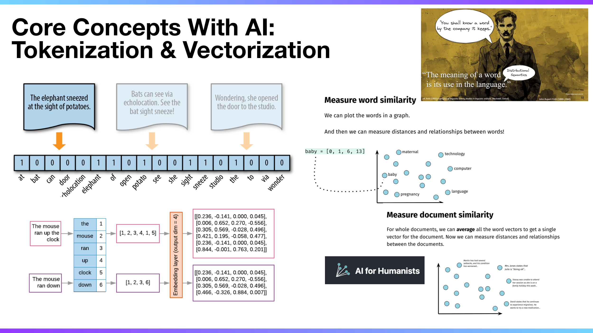
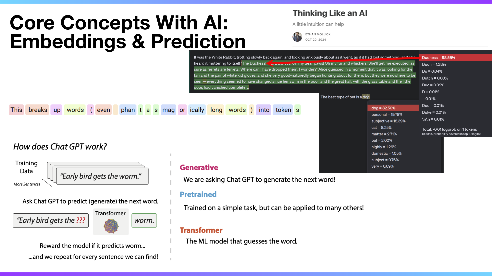
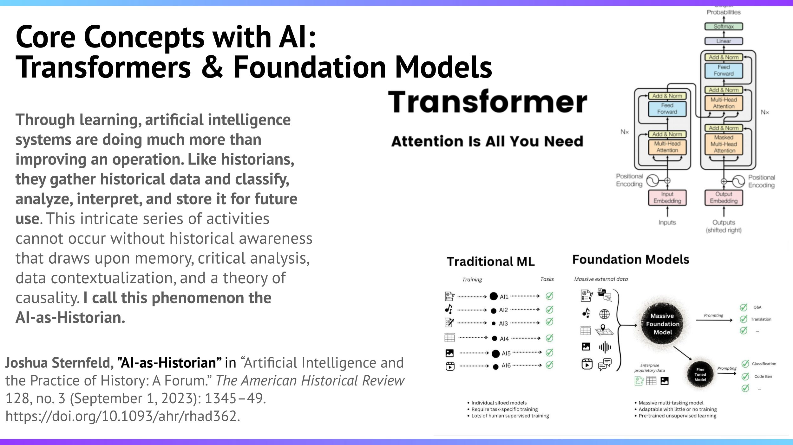
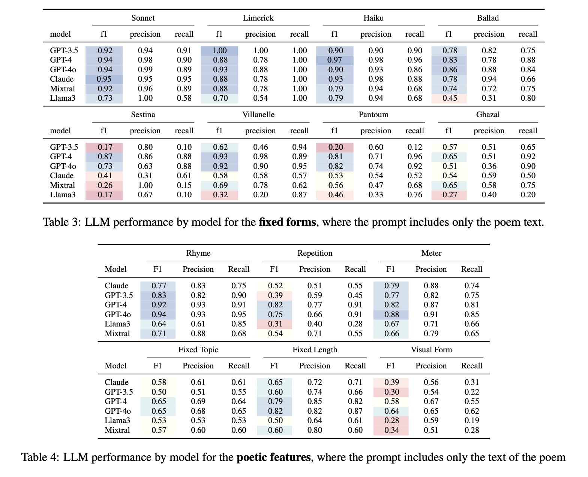
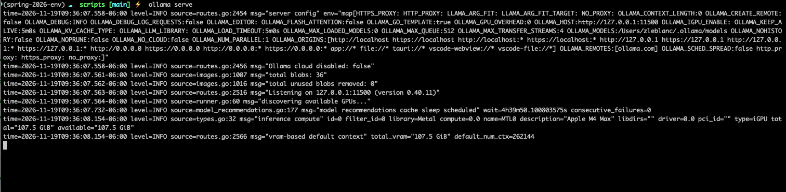
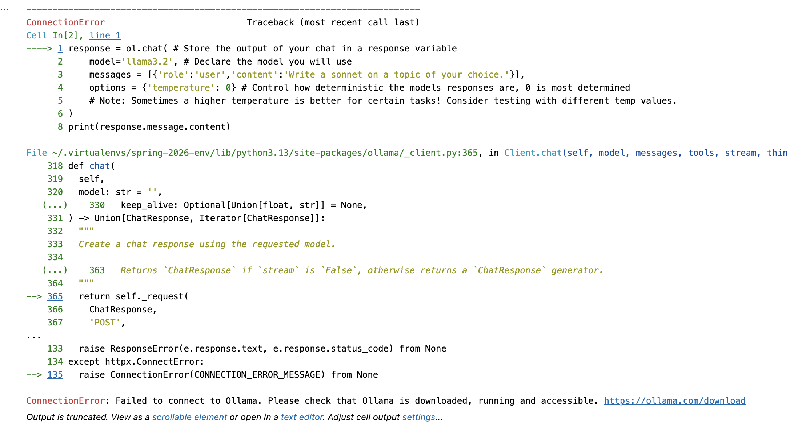

::: {.callout-note}
## Adapted from AI for Humanists


<a href="https://www.aiforhumanists.com/"> </a>

This lesson builds from [John R. Ladd](https://jrladd.com/){target="_blank"}, [Melanie Walsh](https://melaniewalsh.org/){target="_blank"}, and [The AI for Humanists](https://www.aiforhumanists.com/){target="_blank"} team's **AI for Humanists** notebook, *Working with Local LLMs (On Your Own Computer!): Ollama and Llama 3*. Their notebook moves from installing a local model to generating text, creating embeddings, extracting structured metadata with Pydantic, processing many records, and visualizing the results.

We will use the same central workflow, but adapt it to the OCLC and *New York Times* title data from our previous lesson. Local models can require substantial memory and storage. Model speed and availability will vary across computers, so use the model specified in class and work with a small sample before scaling up. You can find their tutorial here [https://aiforhumanists.com/tutorials/#local-llms](https://aiforhumanists.com/tutorials/#local-llms){target="_blank"}. While we will be working locally in this lesson, you can run Ollama in Google Colab if you have memory constraints by following this tutorial [https://colab.research.google.com/github/5aharsh/collama/blob/main/Ollama_Setup.ipynb](https://colab.research.google.com/github/5aharsh/collama/blob/main/Ollama_Setup.ipynb){target="_blank"} and asking the Instructors for assistance.
:::

In the last lesson, we used part-of-speech tagging and named entity recognition to augment book titles with predicted grammatical and entity labels. Today we will use a large language model to create structured fields from those same titles.

Our guiding question is:

> What would make an LLM's response usable as evidence in a cultural dataset?

## How do local language models work?

An LLM is a trained model that predicts sequences of **tokens**. Before a model can process language, a tokenizer divides text into computational units. Tokens may be complete words, punctuation, parts of words, or common combinations of characters. Each token receives a numerical ID, but that ID is only an identifier: token `42` is not inherently larger or more meaningful than token `17`.



The upper-left example shows a **bag-of-words** representation. It creates a vocabulary and records whether words appear in a document. This makes text countable, but it discards word order, grammar, and context. The lower-left diagram shows a more recent approach. After tokenization, an **embedding layer** replaces each token ID with a vector: a list of learned numerical values. Unlike the arbitrary ID, the vector represents patterns the model learned from training data.



During pretraining, an autoregressive language model repeatedly receives a partial sequence and predicts the token that follows it. Given “Early bird gets the,” the observed continuation is `worm`. The model produces probabilities for many possible next tokens, and training adjusts its parameters when the observed token receives too little probability.

Generation uses this learned process one step at a time. The model selects a possible next token, adds it to the context, and predicts again. It therefore does not retrieve one inevitable answer from a database. Its response is generated through a sequence of predictions, and settings such as temperature can affect which possible continuations are selected.



Most contemporary LLMs use a **transformer** architecture. We do not need to trace every box in the diagram, but three ideas matter:

1. **Input embeddings** turn token IDs into vectors.
2. **Positional information** helps the model represent the order of tokens.
3. **Attention** recalculates each token's representation in relation to other tokens in the context. This is one reason `bank` can be represented differently near `money` than near `river`.

The term **foundation model** describes a model pretrained on broad data and then adapted to many tasks through prompting, fine-tuning, or other post-training. Pretraining is often **self-supervised**: the text supplies the prediction target because the model learns from hidden or subsequent tokens. A prompt changes the immediate context used during inference; it does not retrain the model or permanently change its parameters.

The transformer diagram comes from Vaswani et al.'s 2017 paper [“Attention Is All You Need”](https://arxiv.org/abs/1706.03762){target="_blank"}. It depicts the original encoder-decoder architecture developed for translation, rather than an exact diagram of the model we will run. We use it to understand the broad relationship among tokens, embeddings, attention, and prediction.

## What is the difference between a hosted and a local model?

A **hosted model** runs on computing infrastructure operated by a company or another provider. We send a prompt through a website or API, and the provider sends back the response. ChatGPT, Claude, and many API-based services work this way. The provider manages the hardware and may update the model or service without distributing the model weights to users.

A **local model** runs through software and hardware we control. In this lesson, Ollama downloads model files and performs inference on your computer. The prompt and response do not need to be sent to a commercial model provider, although downloading the model and software still requires network access.

Several distinctions are easy to collapse here:

| Question | Possible distinction |
|---|---|
| Where does inference happen? | Hosted infrastructure or a local computer |
| Can we download the model weights? | Closed-weight or open-weight |
| Can we inspect the training data and code? | Different degrees of documentation and openness |
| How well does it perform? | Depends on the task, benchmark, prompt, and evaluation criteria |

An **open-weight** model makes trained parameters available for download, but that does not necessarily make its training data, source code, or complete development process open. An open-weight model can also be offered through a hosted service. Conversely, running a model locally improves control over where inference happens, but it does not automatically make the model accurate, unbiased, reproducible, or transparent.

### How can we compare models?

[](https://huggingface.co/collections/open-llm-leaderboard/the-big-benchmarks-collection){target="_blank"}

A **benchmark** combines a defined task, a dataset of test examples, expected labels or judgments, and a scoring procedure. Different models receive comparable inputs and are evaluated using the same rules. This is more informative than comparing a few impressive chatbot responses selected after the fact.

Benchmarks do not produce neutral or universal rankings. Their creators decide which examples matter, what labels count as correct, how errors are scored, and which cultural or linguistic contexts are represented. Test examples may also appear in model training data, producing **benchmark contamination**. We therefore need to audit benchmarks just as we audit other datasets: provenance, coverage, categories, exclusions, possible leakage, and scoring all shape the result.

### Does a hosted model necessarily perform better?



Walsh, Preus, and Antoniak's *Sonnet or Not, Bot?* study compares several hosted proprietary models with Llama 3, an open-weight model that can be run locally. Their benchmark asks models to classify poetic forms and formal features. The figure reports **precision**, **recall**, and **F1**:

- **Precision** asks how often a label is correct when the model predicts it.
- **Recall** asks how many of the dataset's labeled examples the model successfully finds.
- **F1** combines precision and recall, so it is high only when both are reasonably strong.

The results do not establish one model as universally best. Performance changes across poetic forms and features. For example, Llama 3's sonnet precision is `1.00`, but its recall is only `0.58`: when it predicts *sonnet*, it is correct, but it misses many sonnets. GPT-4 and GPT-4o perform strongly on several structural features, while no model dominates every category. Models generally perform better on legible textual patterns such as rhyme, meter, and fixed length than on visual form or categories requiring more semantic interpretation.

This comparison does not isolate hosting location as the cause of performance. The models differ in architecture, size, training data, post-training, prompts, and access conditions as well as where they can run. It instead shows why our choice should follow the research task:

| Consideration | Hosted model | Local model |
|---|---|---|
| Setup | Usually simpler to begin | Requires installation, storage, and adequate hardware |
| Data handling | Inputs are sent to a provider | Inputs can remain on the local machine during inference |
| Model access | Often proprietary and remotely updated | Downloaded weights can be retained and versioned |
| Scale and speed | Provider supplies substantial computing resources | Limited by the available computer |
| Cost | May require subscriptions or API charges | Usually no per-request fee after download, but uses local resources |
| Evaluation | Still requires a task-specific benchmark | Still requires a task-specific benchmark |

For cultural research, a local model may be preferable when source material should not be transmitted to a third-party service or when retaining a specific model version matters. A hosted model may be practical when the task needs more computational capacity. Neither choice removes the need to document prompts, versions, source data, failures, uncertainty, and evaluation criteria.

### How do we run a model locally?

[Ollama](https://ollama.com/){target="_blank"} is software that you can run on any operating system (i.e. Windows, Mac, or Linux) that provides an interface for downloading and running local LLMs.

Contrary to popular belief, Ollama was not developed by Meta, even though it focuses on Meta's open-source Llama series of models. But Ollama works for any publicly available LLMs, including very powerful ones like the new [Deepseek-R1](https://ollama.com/library/deepseek-r1){target="_blank"} "reasoning" model as well as models specialized to historical texts like [MonadGPT](https://ollama.com/brxce/monadgpt){target="_blank"}.

In many cases, the local versions of LLMs are "quantized"—made small enough to be run on consumer hardware like your laptop, which leads to modest decreases in performance in return for ease of use. Ollama provides a large library of LLMs that you can download easily, but you can also use Ollama with models you've downloaded from HuggingFace or another library.

For our purposes, we'll use [Llama3.2](https://ollama.com/library/llama3.2){target="_blank"}, which has good tradeoffs between file size, speed, and predictive accuracy. This is the AI for Humanists' official recommendation for the first LLM to try with any humanities task. The Python `ollama` package lets our notebook communicate with the Ollama application.

| Component | Role |
|---|---|
| Model | The trained system that generates a response |
| Ollama application | Downloads and runs the model locally |
| Python `ollama` package | Sends requests from Python to Ollama |
| Prompt | The instructions and source material sent to the model |
| Pydantic | Describes and checks the structure we expect back |

Running an open-weight model does not automatically mean that every workflow is local. In this lesson, Ollama runs inference on your computer. A hosted notebook or commercial chatbot would run the model somewhere else.

## How do we install Ollama and a model?

To get started, go to Ollama from [ollama.com](https://ollama.com/){target="_blank"} and click download to get the installer for your operating system. Follow the instructions to download the program, which should work like any other application on your computer. It will create an application icon you can click on to open and run. 


Next, you need open the Ollama desktop application. You can't use Ollama unless the application is running (even when you're working with Python). You will be prompted to install Ollama.


Once the application is installed and running, open a terminal and download the model we will use:

```bash
ollama pull llama3.2
```

You can check which models are installed with:

```bash
ollama list
```

If you want to remove a model, you can type `ollama rm [name-of-model]` anytime. Remember downloading models can take a while, and they may require several gigabytes of storage. You can check the size of your models with `ollama list --size`.

There are more Ollama commands listed in their [documentation on Github](https://github.com/ollama/ollama?tab=readme-ov-file#remove-a-model){target="_blank"}, but these are the basics. Ollama downloads the models to a default location on your computer, and if you have the space on your individual machine you won't need to worry about where they are. But if you'd like to change the download location (in case you wanted to save the models on an external hard drive, for instance), you can set the `OLLAMA_MODELS` environment variable for your system.

Once you've installed a model, you only need one more step to work with your model in Python. Just type in the Terminal window:

```bash
ollama serve
```



You should see something like the above, which means that the model is running and ready to receive requests. You can now run Python code that sends prompts to the model and receives responses.

You will need to keep both the Ollama application and the `ollama serve` command running while you are working with the model in Python. If you close either of them, Python will not be able to connect to the model and you will see an error like the following in your Jupyter notebook.



## How do we send one prompt from Python to Ollama?

To work with Ollama in Python, we first install the `ollama` package. You can do this in your terminal with:

```bash
pip install ollama
```

We then import the package and send a request to the model. The following code snippet is a simple example that asks the model to identify named people, fictional characters, and places in a book title. We begin with one request so that we can inspect the complete input and output before writing a loop.

```{python}
#| eval: false
import ollama as ol

response = ol.chat(
    model='llama3.2',
    messages=[
        {
            'role': 'user',
            'content': "Identify any people, fictional characters, and geographic places explicitly named in this book title: Harry Potter and the Sorcerer's Stone."
        }
    ]
)

print(response['message']['content'])
```

`ol.chat()` sends messages to a model. We identify the installed model with `model='llama3.2'`. The `messages` list contains one dictionary with two pieces of information: `role` identifies this as a user's message, while `content` contains the request itself.

The response includes metadata as well as the generated message, so we select `response['message']['content']` to print only the response text. For now, we are simply asking a question and inspecting the answer.

When I tried this out locally, I got the following response:

```bash
In the book title "Harry Potter and the Sorcerer's Stone," the following people and geographic places are explicitly named:

1. People:
   - Harry Potter
   - The Sorcerer (note: "Sorcerer" is a title, not a specific person, but it is likely referring to Albus Dumbledore or another wizard)

2. Geographic Places:
   - The title does not explicitly mention a specific geographic location in the classical sense. However, the story is set in a fictional version of the United Kingdom, with many locations being inspired by real-world locations in the UK.
```

What did you get? Each time we run a prompt, the model may produce a slightly different answer. This is because the model generates text probabilistically, and it may select different continuations each time. We can reduce this variation by setting `temperature=0` in the `options` argument, which makes the model more deterministic.

Try replacing the title inside `content` with `Home` or `The Lincoln Highway`. Does the model distinguish an ordinary place word from a named place? Does it use knowledge that is not present in the title?

## Why is a response not yet a dataset?

A conversational answer may change its wording or formatting from one request to another. Our first prompt did not explain how to organize the response or what to do when a title is ambiguous. We can start to play around with how might want the LLM to return a result:

```{python}
#| eval: false
title = "Harry Potter and the Sorcerer's Stone"

prompt = f"""
Identify any people and geographic places explicitly named in this book title:
{title}

Return the result using these fields:
Book title:
Person names:
Place names:
Uncertain:
Explanation:
"""

response = ol.chat(
    model='llama3.2',
    messages=[
        {
            'role': 'user',
            'content': prompt
        }
    ],
    options={'temperature': 0}
)

print(response['message']['content'])
```

We now store the title in a variable and use an f-string to insert it into a longer prompt. This makes it easier to reuse the same instructions with other titles. We also request five named fields and set the `temperature` to `0` to reduce variation between responses. A higher temperature can be useful for generative tasks, but consistent extraction is our priority here.

My output looked like the following:

```bash
Here is the analysis of the book title "Harry Potter and the Sorcerer's Stone":

Book title: Harry Potter and the Sorcerer's Stone

Person names: 
- Harry Potter

Place names: 
- None

Uncertain: 
- Sorcerer's Stone (the term "Sorcerer's Stone" is a translation of the original title "Philosopher's Stone" in the UK, but it is not a specific geographic location)

Explanation: The book title explicitly mentions the main character's name, Harry Potter, and the title of the book itself. The term "Sorcerer's Stone" is a translation of the original title and is not a specific geographic location, but rather a concept or object.
```

This is an improvement, but how exactly can we use this with all our titles and have it be in a structured format? After all, this result is still generated text rather than a dependable data record. The model might:

- add an introductory sentence before the requested fields;
- return `People` in one response and `Person or character names` in another;
- return a comma-separated sentence instead of a list;
- use the string `"None"`, an empty list, or a missing field to represent the same absence;
- invent a new certainty label instead of using our requested choices;
- include Markdown code fences around JSON;
- or produce malformed JSON with missing quotation marks, commas, or brackets.

Those differences may look minor to a person, but they matter when Python needs to combine hundreds of responses into columns. Before processing many records, we need to specify:

- what categories mean;
- what evidence the model may use;
- how it should express uncertainty;
- and what structure every response must follow.

This is why the AI for Humanists notebook introduces **Pydantic**. Pydantic lets us describe the required structure as Python classes. Ollama can use the resulting schema while generating its answer, and Pydantic can then validate whether the returned data contains the expected fields and types.

This gives us two related safeguards:

1. **Constrained generation:** the schema tells the model which keys and value types to return.
2. **Validation:** Pydantic checks the returned record before we add it to our dataset. A missing required field or incorrect type produces an error instead of silently becoming an inconsistent row.

Pydantic solves a structural problem, not an interpretive one. A response can contain perfectly valid JSON, use every required field, and still misidentify a person or place. We therefore need both schema validation and evaluation against the source title.

You may remember that we encountered Pydantic earlier when we investigated the LOTR Python wrapper and had to fix its code. To use Pydantic, we first need to install it with:

```bash
pip install pydantic
```

### How can a schema preserve which label belongs to each word?

Separate lists of nouns, verbs, and adjectives can tell us which words entered each category, but they make it harder to reconstruct the title in order or compare one word across methods. Instead, we want one small record for every word:

```json
{"word": "Lincoln", "pos_label": "PROPN"}
```

spaCy uses the [Universal POS tag set](https://universaldependencies.org/u/pos/){target="_blank"}, which includes labels such as `NOUN`, `PROPN`, `VERB`, `ADJ`, and `DET`. Giving the LLM the same allowed labels does not make the two models equivalent, but it gives their outputs a shared structure that we can compare.

We therefore define two connected Pydantic classes. `WordPOSLabel` describes one word-label pair. `ResponseFormatterTitle` describes the complete title response and contains a list of those pairs. This closely follows the nested structured-data approach used in the AI for Humanists notebook, while adapting it to our title question.

```{python}
#| eval: false
from typing import Literal
from pydantic import BaseModel, Field

class WordPOSLabel(BaseModel):
    """Store one word together with its predicted part-of-speech label."""

    word: str = Field(
        description="One word from the title."
    )

    pos_label: Literal[
        "ADJ", "ADP", "ADV", "AUX", "CCONJ", "DET", "INTJ",
        "NOUN", "NUM", "PART", "PRON", "PROPN", "PUNCT",
        "SCONJ", "SYM", "VERB", "X"
    ] = Field(
        description="The Universal POS label assigned to this word."
    )

class ResponseFormatterTitle(BaseModel):
    """Always use this tool to structure your response to the user."""

    book_title: str = Field(
        description="The complete book title supplied by the user."
    )

    person_or_character_names: list[str] = Field(
        description="People or fictional characters explicitly named in the title. Return an empty list when there are none."
    )

    place_names: list[str] = Field(
        description="Geographic places explicitly named in the title. Return an empty list when there are none."
    )

    pos_labels: list[WordPOSLabel] = Field(
        description="Every word in the title paired with one Universal POS label, in title order."
    )

    certainty: Literal[
        "certain",
        "somewhat certain",
        "uncertain"
    ] = Field(
        description="How certain the categorization is based only on the title."
    )

    rationale: str = Field(
        description="A brief rationale explaining each categorization and the certainty choice."
    )
```

`WordPOSLabel` defines the structure for one word-label pair. Its `Literal` lists the Universal POS labels that spaCy uses, so the LLM cannot invent a different label such as `NAME` or `ARTICLE`. `ResponseFormatterTitle` then uses `list[WordPOSLabel]` to require one of these records for every word in title order. This is a **nested data structure**: the title response contains a list of smaller structured records.

The name fields are required, but their descriptions tell the model to return an empty list when it finds no matching names. This gives every response the same structure and avoids mixing `None` with lists. A second `Literal` restricts `certainty` to the three choices we supplied. The `rationale` field is also required because we want a justification for every categorization. `Field(description=...)` adds instructions to the generated schema, but these descriptions do not guarantee that the model's predictions are correct.

For *The Lincoln Highway*, the structure should resemble this JSON record:

```json
{
  "book_title": "The Lincoln Highway",
  "person_or_character_names": [],
  "place_names": ["The Lincoln Highway"],
  "pos_labels": [
    {"word": "The", "pos_label": "DET"},
    {"word": "Lincoln", "pos_label": "PROPN"},
    {"word": "Highway", "pos_label": "NOUN"}
  ],
  "certainty": "somewhat certain",
  "rationale": "The full phrase names a highway, although Lincoln alone could be mistaken for a person's name."
}
```

The exact prediction remains open to evaluation, but the structure is explicit: field names are consistent, names are represented as lists, absence is represented by an empty list, certainty uses one of three allowed values, and the model must supply a rationale.

## How do we request structured output?

We can pass the Pydantic schema to Ollama as the requested response format.

```{python}
#| eval: false
import json

system_prompt = """
You are helping construct a dataset from book titles.
Use only the supplied title. Do not use outside knowledge about the book.

Assign one Universal POS label to every word in the title and preserve the
original word order in pos_labels.
Extract explicitly named people, fictional characters, and geographic places.
Put named human individuals and fictional characters in
person_or_character_names. Put named geographic locations in place_names.
Do not treat ordinary descriptions such as 'home' as named places.
Choose certain, somewhat certain, or uncertain based only on the title.
Explain the categorization and certainty choice in the rationale.
Return data that follows the supplied schema.
"""

title = "The Lincoln Highway"

response = ol.chat(
    model='llama3.2',
    messages=[
        {'role': 'system', 'content': system_prompt},
        {'role': 'user', 'content': title}
    ],
    format=ResponseFormatterTitle.model_json_schema(),
    options={'temperature': 0}
)

raw_output = response['message']['content']
print(raw_output)
```

The **system message** supplies instructions that should apply across records. The **user message** supplies the title currently being analyzed. `model_json_schema()` converts our Pydantic class into a JSON schema describing the required keys, types, and field descriptions. Passing that schema through Ollama's `format=` argument asks the model to generate a response that follows it.

This is stronger than merely writing “return JSON” in the prompt, but it is not infallible. We still validate the response and retain the original output rather than assuming that constrained generation always succeeds.

The result is still text containing JSON. We parse that text and then ask Pydantic to validate it:

```{python}
#| eval: false
parsed_json = json.loads(raw_output)
parsed_response = ResponseFormatterTitle.model_validate(parsed_json)

print(parsed_response)
print(parsed_response.person_or_character_names)
print(parsed_response.place_names)
print(parsed_response.pos_labels)
```

Keep `raw_output` even after parsing. If validation fails or a later interpretation looks suspicious, the raw response preserves what the model actually returned.

## How do we process several titles?

Start with a deliberately small and difficult sample. It is easier to inspect four records carefully than to discover after thousands of requests that the categories were unclear.

```{python}
#| eval: false
sample_titles = [
    "Harry Potter and the Sorcerer's Stone",
    "Bridges of Madison County",
    "The Lincoln Highway",
    "Home"
]

title_analysis_rows = []

for title in sample_titles:
    response = ol.chat(
        model='llama3.2',
        messages=[
            {'role': 'system', 'content': system_prompt},
            {'role': 'user', 'content': title}
        ],
        format=ResponseFormatterTitle.model_json_schema(),
        options={'temperature': 0}
    )

    raw_output = response['message']['content']
    parsed_json = json.loads(raw_output)
    parsed_response = ResponseFormatterTitle.model_validate(parsed_json)

    llm_pos_labels = []
    for word_label in parsed_response.pos_labels:
        llm_pos_labels.append(
            (word_label.word, word_label.pos_label)
        )

    title_analysis_rows.append({
        'source_title': title,
        'book_title': parsed_response.book_title,
        'person_or_character_names': parsed_response.person_or_character_names,
        'place_names': parsed_response.place_names,
        'llm_pos_labels': llm_pos_labels,
        'certainty': parsed_response.certainty,
        'rationale': parsed_response.rationale,
        'model': 'llama3.2',
        'prompt_version': 'title_entities_v1',
        'raw_output': raw_output
    })
```

This loop changes only the title. It saves both `source_title`, which is the exact input we supplied, and `book_title`, which is the title returned by the model. Keeping both lets us detect whether the model altered the source text. The remaining fields preserve the parsed predictions, certainty, rationale, model name, prompt version, and raw response. Those fields are part of the method's provenance.

## How do we turn the results into a DataFrame?

```{python}
#| eval: false
import pandas as pd

title_llm_df = pd.DataFrame(title_analysis_rows)
title_llm_df
```

Because each dictionary in `title_analysis_rows` uses the same field names, Pandas can turn the list directly into a DataFrame. The `person_or_character_names` and `place_names` columns contain names when the model found them and empty lists when it did not.

If we later want one row per predicted name, we can use the `explode()` method introduced in our EDA lesson. For example, this creates one row for each predicted person name:

```{python}
#| eval: false
title_people_df = title_llm_df.explode('person_or_character_names').copy()
title_people_df[
    ['source_title', 'person_or_character_names', 'certainty', 'rationale']
]
```

The original DataFrame has one row per title. The exploded DataFrame has one row per title-person relationship, so a title containing two predicted people appears twice. Keep the original DataFrame as the record of model responses and create exploded copies only for analyses that need them.

## How do we connect this to our title comparison?

The previous lesson compared titles appearing in OCLC only, NYT only, or both datasets. We also used spaCy for part-of-speech tagging and named entity recognition. We can rebuild that comparison as `merged_df` and bring spaCy back so that both spaCy and the LLM analyze the same titles.

If needed, install spaCy, its English model, and `tqdm`:

```bash
pip install spacy tqdm
python -m spacy download en_core_web_sm
```

Then we worked with our datasets:

```{python}
#| eval: false
import pandas as pd

# Read the tab-separated novel metadata and the weekly NYT bestseller records.
novels_df = pd.read_csv(
    "https://raw.githubusercontent.com/melaniewalsh/responsible-datasets-in-context/refs/heads/main/datasets/top-500-novels/top-500-novels-metadata_2025-01-11.tsv",
    sep="\t",
    encoding="utf-8"
)
nyt_bestsellers_df = pd.read_csv(
    "https://raw.githubusercontent.com/Post45-Data-Collective/data/refs/heads/main/nyt_hardcover_fiction_bestsellers/nyt_hardcover_fiction_bestsellers-lists.csv",
    encoding="utf-8"
)

# Create lowercase title keys while preserving the original title columns.
novels_df['title_key'] = novels_df['title'].str.lower().str.strip()
nyt_bestsellers_df['title_key'] = (
    nyt_bestsellers_df['title'].str.lower().str.strip()
)

# Summarize the weekly NYT records into one row per author-title combination.
nyt_titles_df = nyt_bestsellers_df.groupby(
    ['author', 'title_key']
).agg(
    publication_year=('year', 'min'),
    best_nyt_rank=('rank', 'min'),
    avg_nyt_rank=('rank', 'mean')
).reset_index()

# Find the columns shared by both title-level DataFrames.
shared_columns = list(
    set(nyt_titles_df.columns).intersection(set(novels_df.columns))
)
print(f"Shared columns: {shared_columns}")

# An outer merge keeps books found in either dataset. The indicator column records which dataset each row came from.
merged_df = novels_df.merge(
    nyt_titles_df, how='outer', on=shared_columns,
    suffixes=('_oclc', '_nyt'), indicator=True
)
# Now we can create a new column called dataset_group that maps the values in the _merge column to more descriptive labels. We use the map() method to create a dictionary that maps 'right_only' to 'NYT only', 'both' to 'OCLC and NYT', and 'left_only' to 'OCLC only'. This allows us to easily see which novels are found in both datasets, which are only found in the OCLC dataset, and which are only found in the NYT dataset.

merged_df['dataset_group'] = merged_df['_merge'].map({
	'right_only': 'NYT only',
	'both': 'OCLC and NYT',
	'left_only': 'OCLC only'
})

# Now we can create two new columns that calculate the length of each title in characters and the number of words in each title. We use the str.len() method to calculate the length of each title in characters, and we use the str.split() method to split each title into a list of words and then use the str.len() method again to count the number of words in each title.
merged_df['title_len'] = merged_df.title_key.str.len()
merged_df['title_word_count'] = merged_df.title_key.str.split(' ').str.len()

# Now we can create a new column called book_publication_year that combines the pub_year column from the OCLC dataset and the year column from the NYT dataset. We first fill in any missing values in the pub_year column with the corresponding values from the year column, and then we convert the resulting values to a datetime data type using the pd.to_datetime() function. We also specify errors="coerce" to handle any invalid date values by setting them to NaT (Not a Time).
merged_df['book_publication_year'] = merged_df['pub_year']
merged_df['book_publication_year'] = (
    merged_df['book_publication_year']
    .fillna(merged_df['publication_year'])
)
merged_df['book_publication_year'] = pd.to_datetime(
    merged_df['book_publication_year'].astype(int).astype(str) + '-01-01',
    errors='coerce'
)

print(f"Number of rows in merged_df: {len(merged_df)}")
merged_df.head()
```

This follows our classroom approach. We first turn the weekly bestseller observations into title-level records, then merge using the columns shared by both DataFrames. Printing `shared_columns` makes those matching fields visible before the merge.

```{python}
#| eval: false
import spacy
from tqdm import tqdm

nlp = spacy.load('en_core_web_sm')

def process_titles(row):
    # Preserve the original capitalization because it provides useful evidence
    # for proper-noun tagging and named entity recognition.
    title = row['title']
    if pd.isna(title):
        title = ''

    title_doc = nlp(title)

    noun_count = 0
    proper_noun_count = 0
    verb_count = 0
    adjective_count = 0
    determiner_count = 0
    title_labels = []

    for word in title_doc:
        if word.pos_ == 'NOUN':
            noun_count = noun_count + 1
        if word.pos_ == 'PROPN':
            proper_noun_count = proper_noun_count + 1
        if word.pos_ == 'VERB':
            verb_count = verb_count + 1
        if word.pos_ == 'ADJ':
            adjective_count = adjective_count + 1
        if word.pos_ == 'DET':
            determiner_count = determiner_count + 1
        title_labels.append((word.text, word.pos_))

    entities = []
    for entity in title_doc.ents:
        entity_information = (entity.text, entity.label_)
        entities.append(entity_information)

    return (
        title_labels,
        noun_count,
        proper_noun_count,
        verb_count,
        adjective_count,
        determiner_count,
        len(title_doc.ents),
        entities
    )
```

`title_labels` preserves the word-level output as pairs such as `('Lincoln', 'PROPN')`. The remaining values summarize selected labels as counts and retain the named entities. `tqdm.pandas()` adds `progress_apply()`, which behaves like the Pandas `apply()` method we used previously but displays how many rows have been processed. The function returns eight values, and `result_type='expand'` places them into eight corresponding columns.

```{python}
#| eval: false
tqdm.pandas(desc='Processing titles through spaCy')

spacy_columns = [
    'spacy_title_labels',
    'spacy_noun_count',
    'spacy_proper_noun_count',
    'spacy_verb_count',
    'spacy_adjective_count',
    'spacy_determiner_count',
    'spacy_entity_count',
    'spacy_entities'
]

merged_df[spacy_columns] = merged_df.progress_apply(
    process_titles,
    axis=1,
    result_type='expand'
)
```

This is a computationally selected subset rather than a random sample: it includes only titles where spaCy predicted at least one named entity and the OCLC data provides a genre. That makes it useful for comparing entity extraction across genres, but it cannot tell us how either method behaves on titles that spaCy missed or titles represented only in the NYT data.

```{python}
#| eval: false
titles_with_spacy_entities_df = merged_df[
    (merged_df['spacy_entity_count'] > 0)
    & (merged_df['genre'].notna())
].copy()

print(
    "Number of rows in titles_with_spacy_entities_df:",
    len(titles_with_spacy_entities_df)
)

title_sample_df = titles_with_spacy_entities_df.groupby(
    'dataset_group'
).head(4).copy()

title_sample_df[
    [
        'title',
        'dataset_group',
        'spacy_title_labels',
        'spacy_entities'
    ]
]
```

Now run the LLM on the same original title strings. We place one model request inside `process_title_with_llm()`. Applying that function to the title Series creates one returned Series per title, which Pandas combines into `comparison_llm_df`. `progress_apply()` performs the same row-by-row work as `apply()` while displaying progress.

```{python}
#| eval: false
def process_title_with_llm(title):
    response = ol.chat(
        model='llama3.2',
        messages=[
            {'role': 'system', 'content': system_prompt},
            {'role': 'user', 'content': title}
        ],
        format=ResponseFormatterTitle.model_json_schema(),
        options={'temperature': 0}
    )

    raw_output = response['message']['content']
    parsed_response = ResponseFormatterTitle.model_validate_json(raw_output)

    llm_pos_labels = []
    for word_label in parsed_response.pos_labels:
        llm_pos_labels.append(
            (word_label.word, word_label.pos_label)
        )

    return pd.Series({
        'source_title': title,
        'person_or_character_names': parsed_response.person_or_character_names,
        'place_names': parsed_response.place_names,
        'llm_pos_labels': llm_pos_labels,
        'certainty': parsed_response.certainty,
        'rationale': parsed_response.rationale,
        'raw_output': raw_output
    })

tqdm.pandas(desc='Processing titles through the LLM')

comparison_llm_df = title_sample_df['title'].progress_apply(
    process_title_with_llm
)
```

Merge the LLM output back into the sampled records. The `spacy_` and `llm_` prefixes make the provenance of each generated field visible.

```{python}
#| eval: false
title_results_df = title_sample_df.merge(
    comparison_llm_df,
    left_on='title',
    right_on='source_title',
    how='left'
)

title_results_df[
    [
        'title',
        'dataset_group',
        'spacy_entities',
        'person_or_character_names',
        'place_names',
        'spacy_title_labels',
        'llm_pos_labels',
        'certainty',
        'rationale'
    ]
]
```

Agreement does not prove that either method is correct. spaCy and the LLM use different models, training data, label systems, and instructions. Disagreement gives us cases to inspect against the title itself: did one method use capitalization differently, treat a character as a person, divide a multiword place into separate words, or rely on outside knowledge?

## How should we evaluate the results?

Structured output solves a formatting problem, not an evidence problem. Before scaling up, create your own reference judgments for the sample.

| Title | Reference judgment | Question to inspect |
|---|---|---|
| *Harry Potter and the Sorcerer's Stone* | `Harry Potter` as PERSON | Does the model include only the named span? |
| *Bridges of Madison County* | `Madison County` as PLACE | Does it identify a geographic name from title evidence? |
| *The Lincoln Highway* | Likely PLACE, but potentially ambiguous | Does it preserve uncertainty? |
| *Home* | No explicitly named entity | Does it invent a specific place? |

Compare:

- the raw response;
- the parsed labels;
- your reference judgment;
- the spaCy result from the previous lesson;
- and the title itself.

A stable response can still be wrong. A response that matches spaCy can still reproduce the same error. Human judgment is also interpretive, so document the category definitions and difficult cases rather than presenting the reference labels as naturally given.

## What happens when we change the prompt?

The original AI for Humanists notebook demonstrates how a schema and a detailed system prompt can make repeated extraction more consistent. We should still test whether each prompt design helps our specific task.

Compare two versions while holding the model and title sample constant:

- **Prompt A:** `Identify the people, fictional characters, and places in this book title.`
- **Prompt B:** the detailed system prompt and Pydantic schema above.

Record whether each version:

- returns valid structured data;
- uses only evidence in the title;
- identifies the expected span and label;
- preserves ambiguous cases;
- and produces the same result when repeated.

If you revise a prompt after inspecting these examples, they have become development examples. Use different titles to evaluate the revised prompt.

## Group Exercise: design a prompt experiment

In your groups, select one dataset from [Responsible Datasets in Context](https://www.responsible-datasets-in-context.com/datasets.html){target="_blank"}. Design a small experiment that uses an LLM to extract, classify, describe, or otherwise augment part of that dataset.

1. Identify the dataset, the fields you will use, and one narrow task for the model.
2. Select a small but varied sample of records to test.
3. Write a prompt and specify the structure in which the model should return its results.
4. Decide what evidence you will use to evaluate the responses. This might include your own reference judgments, comparison with an existing field, repeated runs, or comparison with another method.
5. Record the prompt, model, settings, inputs, raw outputs, and any parsed results.
6. Identify at least one useful response, one error or limitation, and one uncertain case.
7. Explain what you would need to check before applying the prompt to the full dataset.

Pay particular attention to **uncertainty**. What kinds of ambiguity exist in the original data or task? How will the prompt let the model express uncertainty rather than force every record into a confident answer? How will you distinguish uncertainty in the source material from uncertainty introduced by the model?

Your conclusion should be proportional to the evidence. A small group experiment can show how a particular model and prompt behaved on your selected records. It cannot establish that the same method will work equally well across the full dataset or in other cultural contexts.

## What changes when model output becomes data?

An LLM-generated column is a constructed part of a dataset. Its values depend on the source text, model, prompt, schema, software version, and decisions made while parsing and cleaning responses.

Preserve:

- the exact source record and identifier;
- the full prompt and prompt version;
- the model name and relevant settings;
- the raw response;
- the parsed result and any validation failure;
- your evaluation and uncertainty notes;
- and the date the request was run.

The central lesson from the AI for Humanists notebook is not simply that a local LLM can generate a poem or extract a date. It is that we can turn an interaction into an inspectable computational workflow. Our additional responsibility is to evaluate whether the resulting structure is meaningful for the cultural question we are asking.

## Resources

- [AI for Humanists tutorials](https://aiforhumanists.com/tutorials/){target="_blank"}
- [AI for Humanists prompt bank](https://aiforhumanists.com/guides/prompts/){target="_blank"}
- [Ollama documentation](https://docs.ollama.com/){target="_blank"}
- [Pydantic documentation](https://docs.pydantic.dev/){target="_blank"}
- [Responsible Datasets in Context](https://www.responsible-datasets-in-context.com/datasets.html){target="_blank"}
