So far in class we have briefly mentioned APIs (for example, the Spotify API), but haven't yet discussed what they are or how to use them. This week we will start to work through the basics of using APIs to get data from the web.

## What is an API?

API stands for **Application Programming Interface**, but what does that mean exactly?

While according to [Wikipedia](https://en.wikipedia.org/wiki/API){target="_blank"},

> An application programming interface is a connection between computers or between computer programs. It is a type of software interface, offering a service to other pieces of software. A document or standard that describes how to build or use such a connection or interface is called an API specification.

But while that is technically correct, it probably leaves you with more questions than answers.


In this figure, you'll notice that we have a web browser that is using the "internet cloud" to make requests and get responses from an API that is connected to a web server and a database. This might seem complex, but we've seen a similar relationship when we talked about how the web works. We learned previously about how web browsers use HTTP to make requests and get responses from web servers, this is essentially the same concept. APIs are just a way to get data from a server, similar to how we get web pages from a server, but instead of storing the data in a webpage (aka an HTML document), the data is stored in a database. For example, when you use a weather app, or really any app on your phone, that app is using an API to get the weather data from a server.

Databases might also sound intimidating, but they are just a way to store and organize data, similar in some respects to `.csv` or `.json` files. The difference is that database systems are designed to manage large amounts of related data and allow many people or programs to retrieve and update it efficiently. Many databases organize information into tables connected through shared identifiers and are accessed using SQL, or **Structured Query Language**.

::: {.callout-tip}
## What is SQL?

Recall our earlier discussion of **tabulating machines**. Hollerith's punched-card machines helped the 1890 U.S. Census sort and count information about millions of people. These machines made tabulation faster, but people still had to decide which categories to record and punch onto the cards.

By the 1970s, computers were being used to store much larger collections of information. In 1970, IBM researcher Edgar F. Codd proposed the **relational database model**, which organized related data into tables. Donald Chamberlin and Raymond Boyce then developed a language called **SEQUEL**, later renamed SQL, for asking questions of those tables. Instead of manually searching every record, someone could request particular rows, combine related tables, or calculate a result. You can read more through IBM's histories of [Edgar Codd](https://www.ibm.com/history/edgar-codd){target="_blank"} and the [relational database](https://www.ibm.com/history/relational-database){target="_blank"}.

Spreadsheets developed alongside databases but served a somewhat different purpose. VisiCalc, released in 1979, let people directly edit information and formulas in a visible grid on a personal computer. A spreadsheet is useful for working directly with a table, while a database is better suited to managing and searching larger sets of related tables. Both continue the history of organizing information into rows, columns, and categories.
:::

Today, many websites and applications store information in databases. An API provides a controlled way to request some of that information without giving us direct access to the underlying database. We may not write SQL ourselves, but API endpoints and parameters similarly determine which questions we are allowed to ask of the data.

Rather than going to a URL in your browser, an API lets us send a similar request to a server. To help us understand APIs, let's explore a bit of their origins and development.

While HTTP and HTML became popular in the late 1980s and 1990s, web APIs became especially prominent in the early 2000s. Kin Lane, [the API Evangelist](https://apievangelist.com/){target="_blank"}, has a blog post titled “The History of APIs” [https://web.archive.org/web/20190722130022/https://history.apievangelist.com/](https://web.archive.org/web/20190722130022/https://history.apievangelist.com/){target="_blank"}, which explores this history.[^1]

According to Lane, one of the first APIs was developed by Salesforce in 2000, which allowed developers to access data from their databases and to build applications for customer relationship management. This initial API provided access to XML data, which is a type of markup language similar to HTML (remember TEI?). This was followed by eBay, which also developed an API in 2000. As web APIs expanded during the decade, JSON increasingly joined and often replaced XML as a common format for returning structured data.

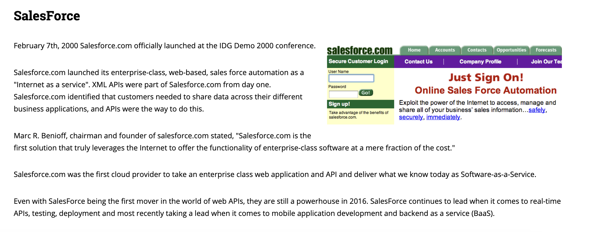

While a lot of the infrastructure and standards for APIs were developed during the same period as the earlier web history, what really made APIs start to take off in the mid-2000s was the emergence of **Web 2.0**.


Web 2.0 was a term coined by Tim O'Reilly in 2004 to describe a new era of the web that was more interactive and user-driven. This era saw the rise of social media platforms like Facebook, YouTube, and Twitter, which allowed users to create and share content online. These platforms started to have massive databases of user-generated content, and so to access this data, they needed to develop APIs.

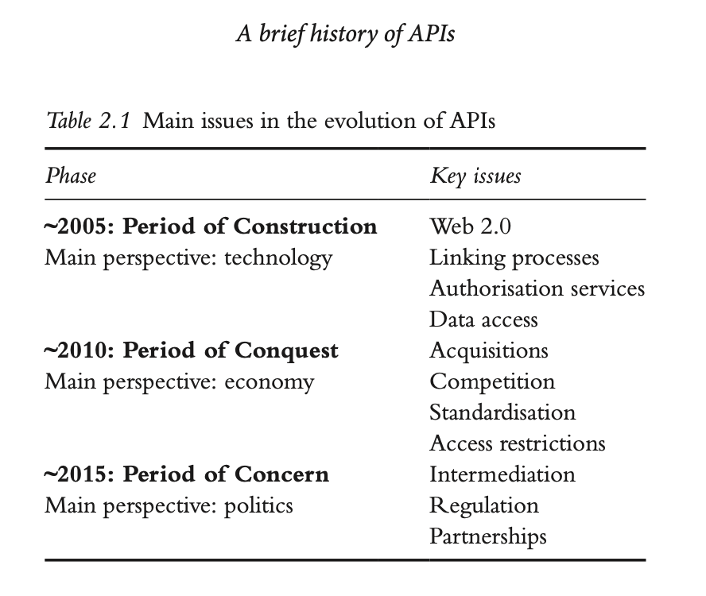

The figure above comes from the chapter “A Brief History of APIs" by Jakob Jünger. Jünger argues that while the early 2000s were important for popularizing the idea of "mashups" (combining data from multiple sources), the mid-2000s saw the rise of social media APIs. Facebook, YouTube, and Twitter all introduced APIs that allowed developers to build applications that integrated social media data. For example, YouTube's API allowed developers to upload videos and access analytics data, while Facebook's API allowed developers to build applications that integrated with the Facebook platform, specifically their Social Graph API, which allowed developers to access data about users and their connections.[^2]


The growth in these platforms led to third-party applications built on their APIs. For example, [TweetDeck](https://en.wikipedia.org/wiki/TweetDeck){target="_blank"} used Twitter's API to let people manage multiple accounts and schedule posts before Twitter purchased it in 2011. This era was characterized by proliferation of third-party applications and a push for standardization. Google and others attempted to standardize API interactions through initiatives such as OpenSocial, but most platforms retained unique APIs and increasingly strict control over data access. Part of this shift followed growing privacy concerns, especially the 2018 revelations that Cambridge Analytica had harvested data from millions of Facebook users without their consent and used it to target political advertisements during the 2016 US presidential election. In the aftermath, many platforms restricted their APIs, leading computational social scientist Deen Freelon to describe a "post-API age."[^3]

Understanding this history is helpful because it gives us a sense of the many users of APIs, as summarized in the table below:

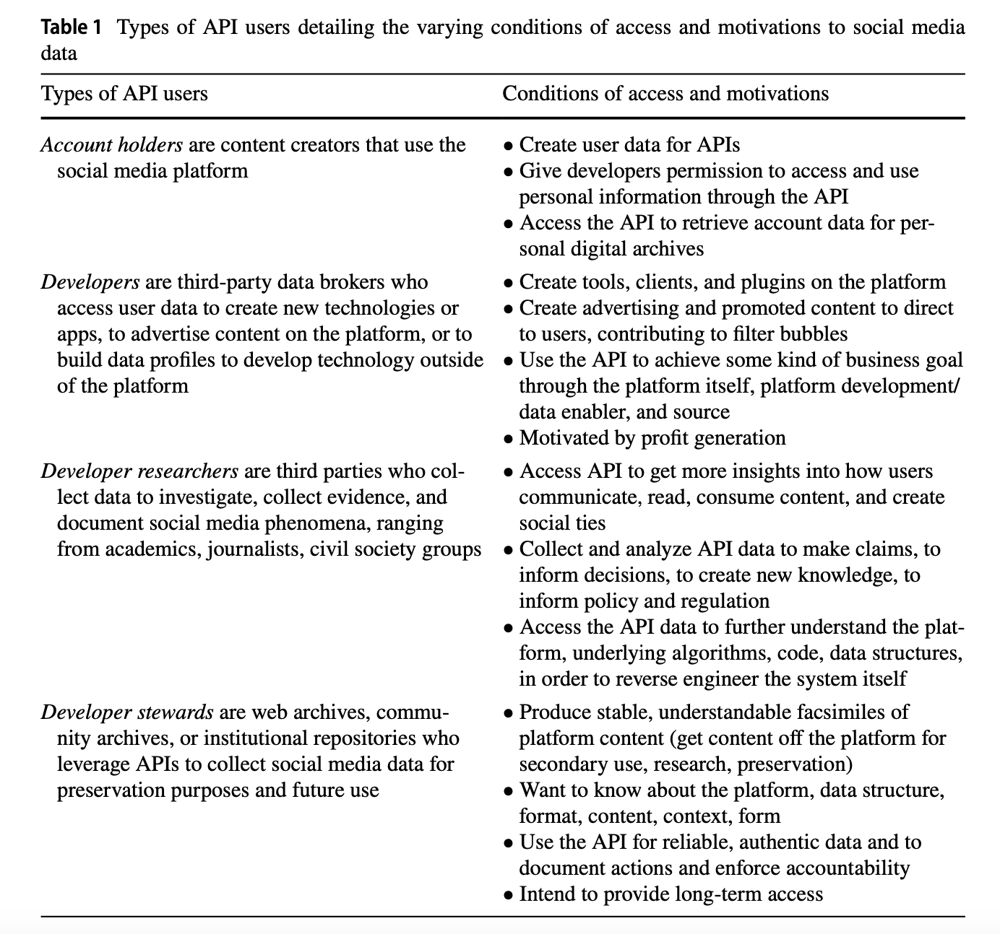

This table comes from Amelia Acker and Adam Kreisberg's article “Social Media Data Archives in an API-Driven World” which explores how APIs are limiting access to social media data and the implications of this for archiving and research; a topic we've discussed in class.[^4] You'll notice in this table they identify a number of different users of APIs, including **individual account holders** on a platform (so if you've ever tried to export your social media data for example), **developers** who build applications that use APIs, **developer researchers** who use APIs to study these platforms, and lastly, **developer stewards** who are often archivists and preservation specialists who use APIs to collect and preserve data. While these groupings are not definitive or exhaustive, they give us a sense of the many different users of APIs and the many different ways APIs are used. However, it is critical to understand that very few APIs are designed to be used by this many different groups of users, and that instead the majority of APIs are designed to be used by a single group of users, often developers building applications since that is the most profitable use of APIs.

## From Web Scraping to MediaWiki APIs

We will begin with the same `requests` library we used for web scraping. The difference is what the server returns and how we work with it:

| Workflow | Request | Response | How we select data |
|---|---|---|---|
| Web scraping | Webpage URL | HTML text | BeautifulSoup and HTML elements |
| API request | API endpoint and parameters | Usually JSON | Dictionary keys and list indexes |

In your `is310-coding-assignments` repository, create a folder called `api-getting-data`, then create a script inside it called `first_api_script.py`. We will use this script as we move across several APIs and Python libraries.

For this example, we are going to work with the *Lord of the Rings* Fandom wiki [https://lotr.fandom.com/wiki/Main_Page](https://lotr.fandom.com/wiki/Main_Page){target="_blank"}. Fandom wikis are fan-created knowledge bases devoted to popular culture. Many grew rapidly beginning in the mid-2000s, turning the interpretive and organizational labor of fan communities into large collections of structured cultural information. *Wookieepedia*, the *Star Wars* wiki, began in 2005 and became one of the best-known examples [https://en.wikipedia.org/wiki/Wookieepedia](https://en.wikipedia.org/wiki/Wookieepedia){target="_blank"}.

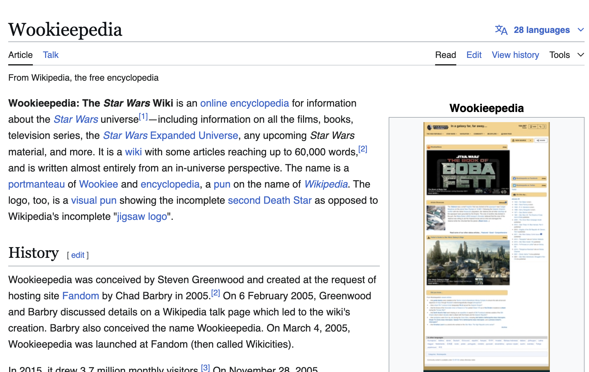

These sites are useful for thinking about APIs because the information visible on a wiki page is already highly structured: pages have titles, categories, links, revision histories, and identifiers. Rather than extracting those elements from rendered HTML, we can ask the wiki software to return them directly.

There is also a practical reason to use the API. A request for the rendered Fandom page may receive a `403 Forbidden` because the website uses automated bot protection. Because Fandom wikis run MediaWiki software, the *Lord of the Rings* wiki offers a MediaWiki **API**:

```python
import requests

HEADERS = {
	"User-Agent": "is310-course/1.0 (https://YOUR-USERNAME.github.io; YOUR_NETID@illinois.edu)"
}

response = requests.get("https://lotr.fandom.com/api.php", params={
	"action": "query",
	"list": "categorymembers",
	"cmtitle": "Category:Canon_characters_in_The_Rings_of_Power",
	"cmtype": "page",
	"cmlimit": "max",
	"format": "json",
}, headers=HEADERS, timeout=15)

print(response.status_code)
```

In this code block, we first import the requests library. We then define a set of headers including a `User-Agent` header to identify our script and provide contact information. This pattern is a common requirement for APIs, as it allows the server to track usage and contact developers if necessary. We then make a GET request to the Fandom API endpoint. We have the following parameters:

- `action=query`: This specifies that we want to perform a query action.
- `list=categorymembers`: This specifies that we want to retrieve a list of members of a category.
- `cmtitle=Category:Canon_characters_in_The_Rings_of_Power`: This specifies the title of the category we want to query.
- `cmtype=page`: This specifies that we want to retrieve pages, not subcategories.
- `cmlimit=max`: This specifies that we want to retrieve all members of the category.
- `format=json`: This specifies that we want the response in JSON format.

When this lesson was checked in October 2026, this returned `200`. The same platform that blocked an automated request for the rendered `/wiki/Main_Page` made structured wiki content available through `/api.php`.

This first request gives us the basic API workflow: send a request to an endpoint, receive structured data, and use the response's organization to locate what we need. There is no single structure shared by every API, however. Each API defines its own endpoints, parameters, response schema, access rules, and limits, which is why reading its documentation is part of working with its data.

### The MediaWiki Action API

To understand the MediaWiki Action API, we need to understand the history of Wikipedia and its underlying software.

[](https://en.wikipedia.org/wiki/History_of_Wikipedia){target="_blank"}

Wikipedia launched in January 2001 as an experiment connected to **Nupedia**, an earlier free encyclopedia whose articles went through a slower expert-review process. The first Wikipedia ran on **UseModWiki**, existing open-source wiki software written in Perl. Rather than using a database, UseModWiki stored pages as individual text files on the server. That was sufficient for an experimental website, but Wikipedia quickly accumulated more articles, revisions, contributors, and readers than the original software had been designed to manage.

In response, Wikipedia contributors developed a new CMS specifically for the project. This software was written in **PHP** and used a **MySQL database**, allowing the site to manage its growing collection of pages and introduce Wikipedia-specific features such as namespaces, talk pages, contribution histories, and watchlists. The English-language Wikipedia adopted this database-backed software in 2002, and it was officially named **MediaWiki** in 2003. That same year, the nonprofit **Wikimedia Foundation** was created to support Wikipedia and the growing family of related projects. You can read more about the history of MediaWiki at [https://www.mediawiki.org/wiki/MediaWiki_history](https://www.mediawiki.org/wiki/MediaWiki_history){target="_blank"}.

Today, **MediaWiki** is the open-source software that runs Wikipedia, Wiktionary, Wikisource, Wikidata, Fandom wikis, and many independent wikis. **Wikimedia** refers to the nonprofit movement and foundation that operates Wikipedia and related projects; it is not the name of the software.

The Action API provides a documented interface through which programs can ask MediaWiki for selected parts of that underlying structure.

[](https://www.mediawiki.org/wiki/API){target="_blank"}

Most publicly accessible MediaWiki sites expose an Action API at a predictable location — `/w/api.php` on Wikimedia's own sites and `/api.php` on many others:

- English Wikipedia: [https://en.wikipedia.org/w/api.php](https://en.wikipedia.org/w/api.php){target="_blank"}
- Wikisource: [https://en.wikisource.org/w/api.php](https://en.wikisource.org/w/api.php){target="_blank"}
- LOTR Fandom wiki: [https://lotr.fandom.com/api.php](https://lotr.fandom.com/api.php){target="_blank"}

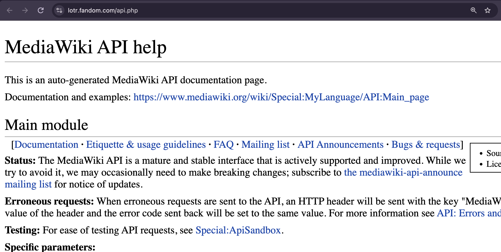

If you open any of those in a browser, you'll get an interactive sandbox where you can build and test queries without writing any Python, which is a very good way to explore before you commit to code. The full reference lives at [https://www.mediawiki.org/wiki/API:Main_page](https://www.mediawiki.org/wiki/API:Main_page){target="_blank"}.

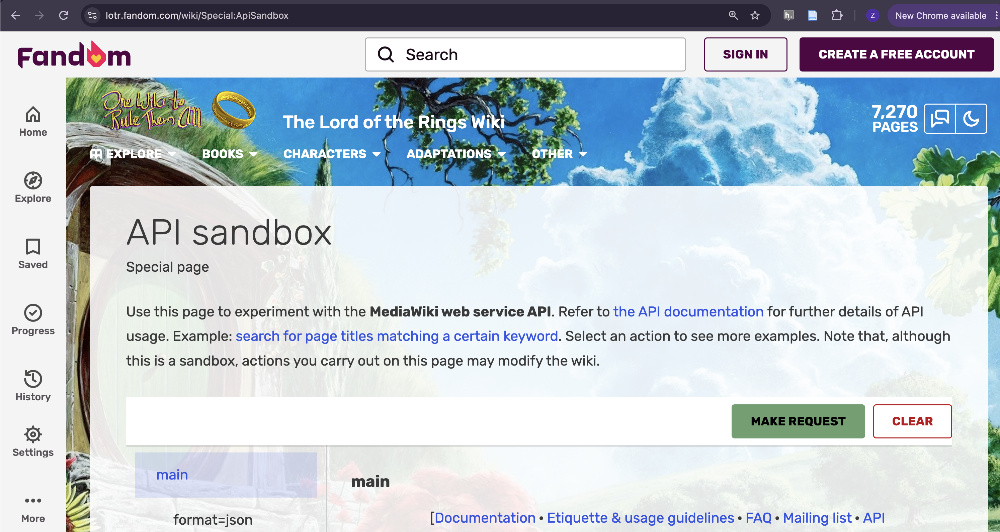

The LOTR Fandom API does not require an API key for these examples. We will still send a descriptive `User-Agent` that identifies our script and provides contact information, just as we did when scraping Tolkien Gateway. Other MediaWiki hosts may have different requirements, so always check the host's documentation and policies.

```python
import requests

API_URL = "https://lotr.fandom.com/api.php"
HEADERS = {"User-Agent": "is310-course/1.0 (https://YOUR-USERNAME.github.io; YOUR_NETID@illinois.edu)"}
```

Notice this is the *same* practice we adopted for scraping Tolkien Gateway where identify yourself honestly and give someone a way to contact you. 

### Structuring an API Query

An API request often has two parts:

- The **endpoint** is the URL where the API receives requests. For the LOTR Fandom wiki, that is `https://lotr.fandom.com/api.php`.
- **Parameters** are named options that describe what we want the API to do. Each parameter has a key and a value, such as `action=query` or `format=json`.

In a URL, parameters appear after a question mark (`?`) and are joined with ampersands (`&`):

```text
https://lotr.fandom.com/api.php?action=query&format=json
```


We could construct that URL ourselves, but Python's `requests` library lets us store the parameters in a dictionary and pass it through `params=`. This is easier to read and lets `requests` safely encode spaces and punctuation for us.

The first parameter, `action`, tells MediaWiki which broad operation to perform. Setting `action=query` means that we want to **read structured information** from the wiki rather than edit a page or upload a file. Here, *query* does not mean our full research question, nor does it mean we are writing SQL. It means we are using the part of the Action API designed to retrieve data.

Our next parameter, `list=categorymembers`, says what information we want: a list of the pages assigned to a category. Let's ask for the members of a category:

::: {.callout-note collapse="true" title="How does MediaWiki organize queries?"}
MediaWiki divides `action=query` into three main families of modules:

- `prop` retrieves properties of specified pages, such as their links, categories, revisions, or language versions.
- `list` produces lists of records, such as pages in a category, recent changes, search results, or user contributions.
- `meta` retrieves information about the wiki or current user rather than a particular page.

Our request uses the `categorymembers` module from the `list` family. Parameters that configure this module begin with `cm`: `cmtitle` identifies the category, `cmtype` selects the kinds of members to return, and `cmlimit` controls how many results may be returned. These prefixes help MediaWiki distinguish parameters belonging to different modules.
:::

```python
params = {
	"action": "query",
	"list": "categorymembers",
	"cmtitle": "Category:Canon_characters_in_The_Rings_of_Power",
	"cmtype": "page",
	"cmlimit": "max",
	"format": "json",
}

response = requests.get(API_URL, params=params, headers=HEADERS, timeout=15)
if response.status_code != 200:
	raise RuntimeError(f"API request failed: {response.status_code}")
data = response.json()

for page in data["query"]["categorymembers"]:
	print(page["title"])
```

```bash
Amandil
Anárion
Ar-Pharazôn
Tom Bombadil
Celeborn
...
```

A few things to notice here, because they generalize to most APIs you'll meet:

- We're passing parameters as a **dictionary** to `params=` rather than gluing them onto the URL with `?` and `&` by hand. `requests` builds the URL and correctly encodes spaces, punctuation, and other characters used inside query values.
- The prefixed parameters (`cmtitle`, `cmtype`, `cmlimit`) belong to the `categorymembers` module. MediaWiki uses short prefixes to keep modules from colliding, so when you read documentation for `list=langlinks` you'll see `ll`-prefixed parameters instead.
- `format=json` explicitly requests machine-readable JSON rather than a browser-oriented representation.

### Extending Our Scraping Question: What Counts as Attention?

In the web scraping lesson, we asked how Tolkien Gateway distributes **editorial attention** across literary and adaptation characters. We counted words, characters, total links, and unique links on each page. We can now calculate the same measures for the LOTR Fandom wiki and add another relationship that MediaWiki exposes directly: links to corresponding pages in other language editions.

This lets us compare two fan communities while keeping our measurements consistent:

| Metric | How We Calculate It |
|---|---|
| Word count | Split the visible article text at whitespace |
| Character count | Count the characters in the visible article text |
| Internal links | Count every qualifying internal wiki-link occurrence |
| Unique internal links | Count each internal wiki destination once |
| Language links | Count corresponding pages reported by MediaWiki |

: Measurements collected from each Fandom character page {.striped .hover}

None of these values is simply "popularity." Together, they describe how extensively a page has been written, connected internally, and linked across Fandom's language editions.

#### Getting a Parsed Page From the API

So far we have used `action=query` to request structured information about pages. MediaWiki also provides `action=parse`, which asks the server to process one wiki page and return selected parts of it. We will request three properties:

- `text` returns the page's rendered HTML.
- `links` returns the internal wiki pages referenced by the article.
- `langlinks` returns connections to corresponding pages in other language editions.

These options are documented in MediaWiki's [`action=parse` documentation](https://www.mediawiki.org/wiki/API:Parsing_wikitext){target="_blank"}. MediaWiki generates this documentation from the API module itself, and individual installations expose their own version through `action=help`. For this specific wiki, see the [LOTR Fandom API help for the `parse` module](https://lotr.fandom.com/api.php?action=help&modules=parse){target="_blank"}. The site-specific help is useful because MediaWiki installations can run different versions and extensions, so the options supported by one wiki may not be identical to those supported by another.

::: {.callout-tip collapse="true" title="Finding API documentation on another MediaWiki site"}
If a site runs MediaWiki, try adding one of these paths to its domain:

- `/api.php?action=help` lists the Action API's general help.
- `/api.php?action=help&modules=parse` documents `action=parse`.
- `/api.php?action=help&modules=query` documents `action=query`.

Many installations also provide a visual sandbox at `/wiki/Special:ApiSandbox`, where you can select an action and construct a request interactively.
:::

Because the API returns rendered HTML in `text`, we can use BeautifulSoup's `get_text()` just as we did in the scraping lesson:

```python
from bs4 import BeautifulSoup

def analyze_fandom_page(title):
	response = requests.get(API_URL, params={
		"action": "parse",
		"page": title,
		"prop": "text|links|langlinks",
		"format": "json",
	}, headers=HEADERS, timeout=15)

	if response.status_code != 200:
		print(f"Could not retrieve {title}: {response.status_code}")
		return None

	data = response.json()
	if "error" in data:
		print(f"Could not parse {title}: {data['error']['info']}")
		return None

	page = data["parse"]
	html = page["text"]["*"]
	soup = BeautifulSoup(html, "html.parser")
	article_text = soup.get_text(" ", strip=True)

	internal_links = []
	for link in soup.find_all("a", href=True):
		href = link["href"]
		if href.startswith("/wiki/") and "#" not in href:
			internal_links.append(href)

	unique_internal_links = []
	for href in internal_links:
		if href not in unique_internal_links:
			unique_internal_links.append(href)

	return {
		"character": page["title"],
		"word_count": len(article_text.split()),
		"character_count": len(article_text),
		"internal_link_count": len(internal_links),
		"unique_internal_link_count": len(unique_internal_links),
		"language_link_count": len(page.get("langlinks", [])),
}
```

The line `"prop": "text|links|langlinks"` asks the `parse` action to return three properties in one response. MediaWiki uses the pipe character (`|`) to separate multiple requested values. This is equivalent to saying: return the rendered page text **and** its internal links **and** its language links. This approach does not mean that these values are being combined into one string; each appears under its own key in the JSON response.

The relevant part of the response has a structure like this:

```json
{
	"parse": {
		"title": "Galadriel",
		"pageid": 171,
		"text": {
			"*": "<div class=\"mw-parser-output\">...</div>"
		},
		"links": [...],
		"langlinks": [...]
	}
}
```

We first save the object under `"parse"` as `page`. The expression `page["text"]` then retrieves the nested dictionary containing the rendered text. Within that dictionary, MediaWiki uses the literal key `"*"` for the HTML string, so `page["text"]["*"]` retrieves the HTML itself. The asterisk is not a Python wildcard here; it is simply the name of a dictionary key chosen by MediaWiki's default JSON response format.

The text and link logic deliberately matches our scraper. We count repeated internal links in `internal_links`, then build a second list containing each destination once. The new `language_link_count` comes from structured MediaWiki data rather than from searching the rendered HTML ourselves.

#### Comparing Character Pages

Now we can run the same function on a literary character and several characters created for the television adaptation:

```python
characters = ["Galadriel", "Arondir", "Halbrand", "Disa"]

for character in characters:
	result = analyze_fandom_page(character)
	if result is not None:
		print(result)
```

When checked in October 2026, the results included:

| Character | Words | Characters | All Links | Unique Links | Language Links |
|---|---:|---:|---:|---:|---:|
| Galadriel | 13,931 | 77,237 | 767 | 403 | 11 |
| Arondir | 1,788 | 10,253 | 103 | 63 | 8 |
| Halbrand | 11 | 61 | 0 | 0 | 0 |
| Disa | 531 | 2,940 | 50 | 25 | 8 |

: Sample results from the LOTR Fandom parse API {.striped .hover}

These values can change whenever Fandom editors revise the pages. That is part of what makes them cultural data rather than fixed facts.

#### How Do Two Wikis Represent Halbrand?

Halbrand gives us a useful way to compare Tolkien Gateway with the LOTR Fandom wiki. Our Tolkien Gateway scraper finds a full article devoted to Halbrand. The Fandom API finds a short **redirect page** that sends readers to the *Rings of Power* section of its Sauron article.

Because we applied the same text and internal-link calculations to both sources, we can compare their page structures directly:

| Wiki | Page type | Words | Characters | All Links | Unique Links | Language Links |
|---|---|---:|---:|---:|---:|---:|
| Tolkien Gateway | Full article | 1,410 | 8,375 | 79 | 65 | Not collected |
| LOTR Fandom | Redirect to Sauron | 11 | 61 | 0 | 0 | 0 |

: Two community wikis representing Halbrand differently, checked in October 2026 {.striped .hover}

The difference is not a failed request or merely a difference in article length. The two communities have made different **organizational claims**. Tolkien Gateway treats Halbrand as an independently documented character page. Fandom treats Halbrand as an identity located within its Sauron page.

That choice affects every measurement that follows. If we compared word counts without inspecting the pages, Fandom would appear to have almost no information about Halbrand. In reality, much of that information is organized under Sauron. The data model determines where the evidence becomes countable.

This is why outliers require interpretation. A page with eleven words may be a redirect, disambiguation page, stub, or genuinely short article. Before treating rows from two platforms as equivalent observations, we need to ask whether they represent the same kind of object.

#### What If Both Wikis Use Full Articles?

Galadriel gives us a more comparable case because both communities maintain full articles devoted to the character:

| Wiki | Page type | Words | Characters | All Links | Unique Links | Language Links |
|---|---|---:|---:|---:|---:|---:|
| Tolkien Gateway | Full article | 11,694 | 65,400 | 1,028 | 541 | Not collected |
| LOTR Fandom | Full article | 13,931 | 77,237 | 767 | 403 | 11 |

: Two full articles about Galadriel, checked in October 2026 {.striped .hover}

Fandom's Galadriel article currently contains more words and characters, while Tolkien Gateway's article contains more total and unique internal links. This is precisely why one convenient number should not stand in for "attention." Article length and network connectivity capture different editorial practices, and the rankings could change depending on which measure we privilege.

Even this comparison is not perfectly controlled. The sites may include different captions, tables, citations, templates, or interface elements inside their article containers. Their editors may also follow different conventions for when a term should become a link. Applying the same code makes the measurements reproducible, but it does not erase differences between the platforms.

::: {.callout-warning}
## What Do These Measures Mean?

The measures describe different aspects of editorial work:

- Words and characters approximate article length.
- Total and unique links describe how densely and broadly the page connects to the rest of the wiki.
- Language links show that editors connected the English page to corresponding pages in other Fandom communities.

They do not tell us how often people read the page, whether every language page contains equivalent information, or how culturally important a character is.

When interpreting the results, ask:

- Are we comparing full articles, redirects, lists, or stubs?
- Which language communities are represented by the links?
- Do corresponding pages contain similar information?
- How do Fandom's categories and redirects shape the patterns we observe?
:::

**Comparing Scraping and API Evidence**

We now have two related datasets created through different interfaces:

- Our **Tolkien Gateway scraper** downloaded rendered webpages and located their article text and links through HTML selectors.
- The **LOTR Fandom API** returned parsed page HTML, structured language links, titles, and page IDs according to MediaWiki's data model.

Using the same text and link measures makes comparison possible, but it does not make the platforms equivalent. Tolkien Gateway and the One Wiki Fandom have different communities, histories, categories, interfaces, and editorial conventions. A difference in word count could reflect interest, available evidence, page age, templates, redirect practices, or community rules. But we can see how with computation we can start to compare these two communities in ways that open up new questions about how they organize and represent the same fictional world.

## Authentication and Parameters With The One API

The One Wiki Fandom allowed us to make successful API requests without creating an account. Not every API is designed that way. We will next use *The One API* [https://the-one-api.dev/](https://the-one-api.dev/){target="_blank"} to examine public and restricted endpoints, authentication, filtering, and relationships among records. For those unfamiliar, the one in the name is a reference to the *Lord of the Rings* series, where the One Ring is the most powerful of the Rings of Power and is the central plot device of the series.


According to the documentation, "*The One API* to rule them all is a non-commercial, open-source project" and provides access to data from the *Lord of the Rings* books and movies, including characters, quotes, and books.

If we go to the about page [https://the-one-api.dev/about](https://the-one-api.dev/about){target="_blank"}, we can learn that the project was created in 2019 by Ulrike Exner and Mateusz Kikmunter, who are both developers. We can also visit the GitHub repository for the project [https://github.com/gitfrosh/lotr-api/graphs/contributors](https://github.com/gitfrosh/lotr-api/graphs/contributors){target="_blank"} to see the history of the project.

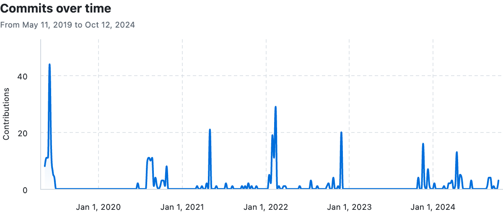

So let's try this out!

### Making an API Request

Return to `first_api_script.py`. We already imported `requests` for the Fandom MediaWiki API, so now create a variable containing the books endpoint from *The One API*:

```python
import requests

url = 'https://the-one-api.dev/v2/book'
```

**If Python says that `requests` is not installed, remember to activate your virtual environment and install the packages from the lesson requirements.**

Now how could we use this URL to get data from the API? We could use the `requests.get` method we used in the web scraping lesson. Let's try that out.

```python
response = requests.get(url)
```

How could we see that this request worked? We can print the status code of the response.

```python
print(response.status_code)
```

Hopefully we are all seeing `200` responses, but if you are seeing a `404` or `403` response, you might need to authenticate with the API. We will discuss this more in the next section, but for now, let's try to print out the response.

In our web scraping lesson, we used the `.text` method to print out the response, but for APIs, we often use the `.json()` method. Let's try that out.

```python
print(response.json())
```

You should see something like the following:

```json
{
	'docs':
		[
			{
				'_id': '5cf5805fb53e011a64671582',
				'name': 'The Fellowship Of The Ring'
			},
			{
				'_id': '5cf58077b53e011a64671583',
				'name': 'The Two Towers'
			},
			{
				'_id': '5cf58080b53e011a64671584',
				'name': 'The Return Of The King'
			}
		],
 	'total': 3,
 	'limit': 1000,
 	'offset': 0,
 	'page': 1,
 	'pages': 1
}
```

This is the data that *The One API* returned to us. Earlier in the lesson, we saw that early web APIs such as Salesforce's returned structured data as XML. As APIs became increasingly important to the interactive, browser-based services associated with Web 2.0, developers also needed convenient ways to move structured data between servers and the JavaScript running in web browsers. **JSON**, which stands for **JavaScript Object Notation**, became one influential answer.

JSON grew out of the syntax JavaScript uses to describe objects. In the early 2000s, Douglas Crockford helped popularize it as a lightweight way for web browsers and servers to exchange structured data. JSON offered a smaller format that was comparatively easy for both people and programs to read. The rise of JSON is also part of  the same history as web APIs: APIs created controlled ways to request platform data, while formats such as XML and JSON defined how that data could be represented and transmitted in the response. You can read more about the history of JSON, here:  Jay Hoffmann. “The History of JSON and the People That Created It.” HackerNoon, December 13, 2002. [https://hackernoon.com/the-history-of-json-and-the-people-that-created-it](https://hackernoon.com/the-history-of-json-and-the-people-that-created-it){target="_blank"}.


Although its name and syntax come from JavaScript, JSON is not limited to JavaScript. Its basic structures were useful across programming languages, so it became a general-purpose data-interchange format for APIs, configuration files, and stored data. 

JSON looks very similar to a Python dictionary, but they are not exactly the same thing. JSON is a **text format** with its own syntax and supported value types. When we call `response.json()`, the `requests` library parses that text and converts JSON objects into Python dictionaries and JSON arrays into Python lists. JSON uses values such as `true`, `false`, and `null`, while the corresponding Python values are `True`, `False`, and `None`.

Based on this data, we can see that *The One API* has returned data about the three books in the *Lord of the Rings* series. Each book has an `_id` and a `name`. The books themselves are returned in a list for the key `docs`, and then there are some other keys that provide information about the data that was returned, including `total`, `limit`, `offset`, `page`, and `pages`. `Total` tells us how many items were returned, `limit` tells us how many items *could be* returned per page, `offset` tells us where in the data we are (similar to indexing), `page` tells us what page we are on, and `pages` tells us how many pages of data there are.

### Restricted Endpoints and Authentication

We have already used endpoints with both the MediaWiki API and *The One API*. The endpoint is the URL through which we request a particular resource. *The One API* organizes books, characters, and quotes under different endpoint paths:

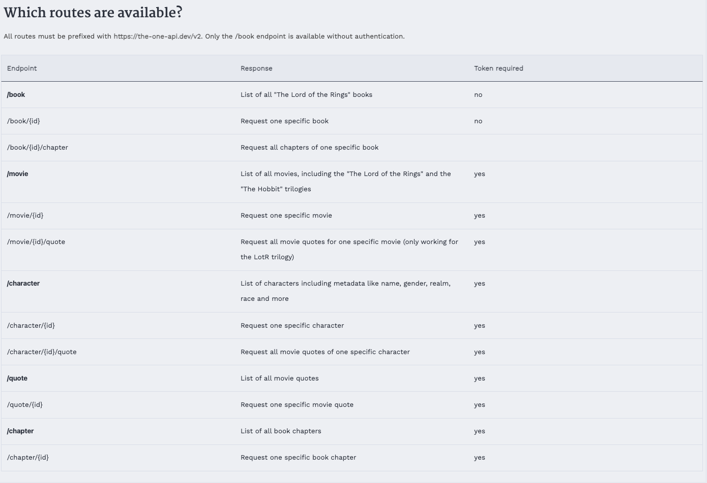

If we go to *The One API* documentation [https://the-one-api.dev/documentation#4](https://the-one-api.dev/documentation#4){target="_blank"}, we see the following table that outlines what `endpoints` exist.

The `/book` endpoint is publicly accessible, but `/character` and `/quote` require authentication. Moving between these endpoints therefore introduces a new question: not only **what data can this API return**, but also **who is permitted to request it and under what conditions?**

We can even try out that initial book endpoint in the browser which should give us the following:

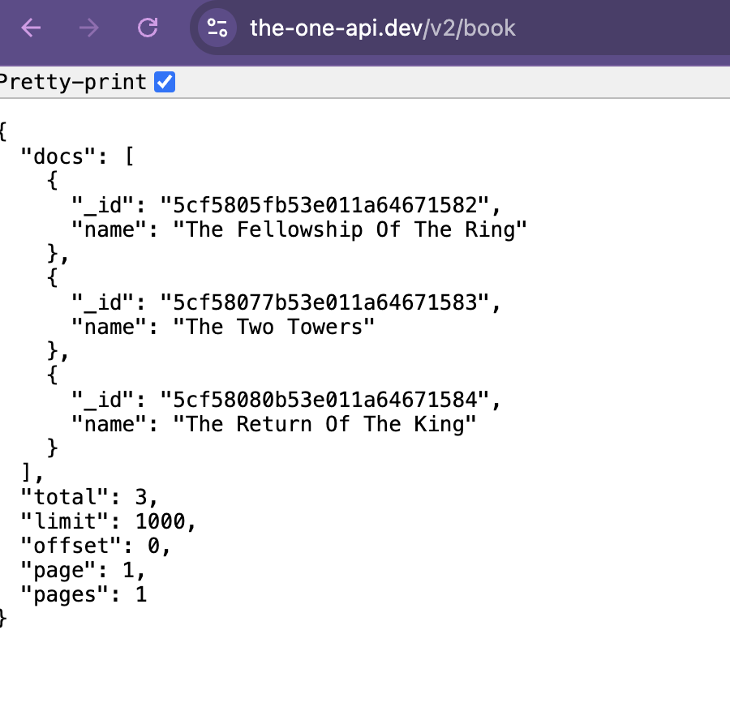

However, if we try to get characters or quotes in the browser, we will see the following:

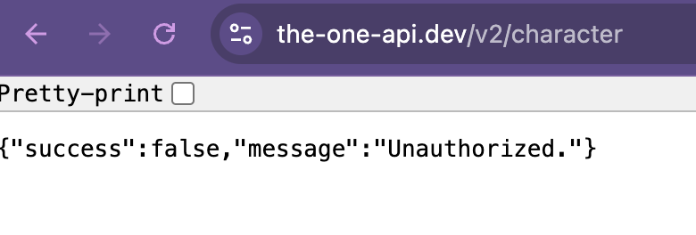

Indeed, if we update our python code we can see the exact same thing.

```python
url = 'https://the-one-api.dev/v2/character'
response = requests.get(url)
print(response.status_code)
```

This should return a `401` status code, which means that we are not **authorized** to access this data. This is because the LOTR API requires us to authenticate before we can access data about characters or quotes. This is a common feature of APIs, as it allows the API to track who is accessing their data and to limit access to certain users.

Authentication can sound intimidating but you actually do it all the time already. For example, when you login to your email, you are authenticating with a server to access your email. When you login to DUO, you are authenticating with a server to access your account. When you login to social media, you are authenticating with a server to access your account. The difference is that when you use a web browser, this is all handled automatically for you, but when you use an API, you have to do this explicitly.

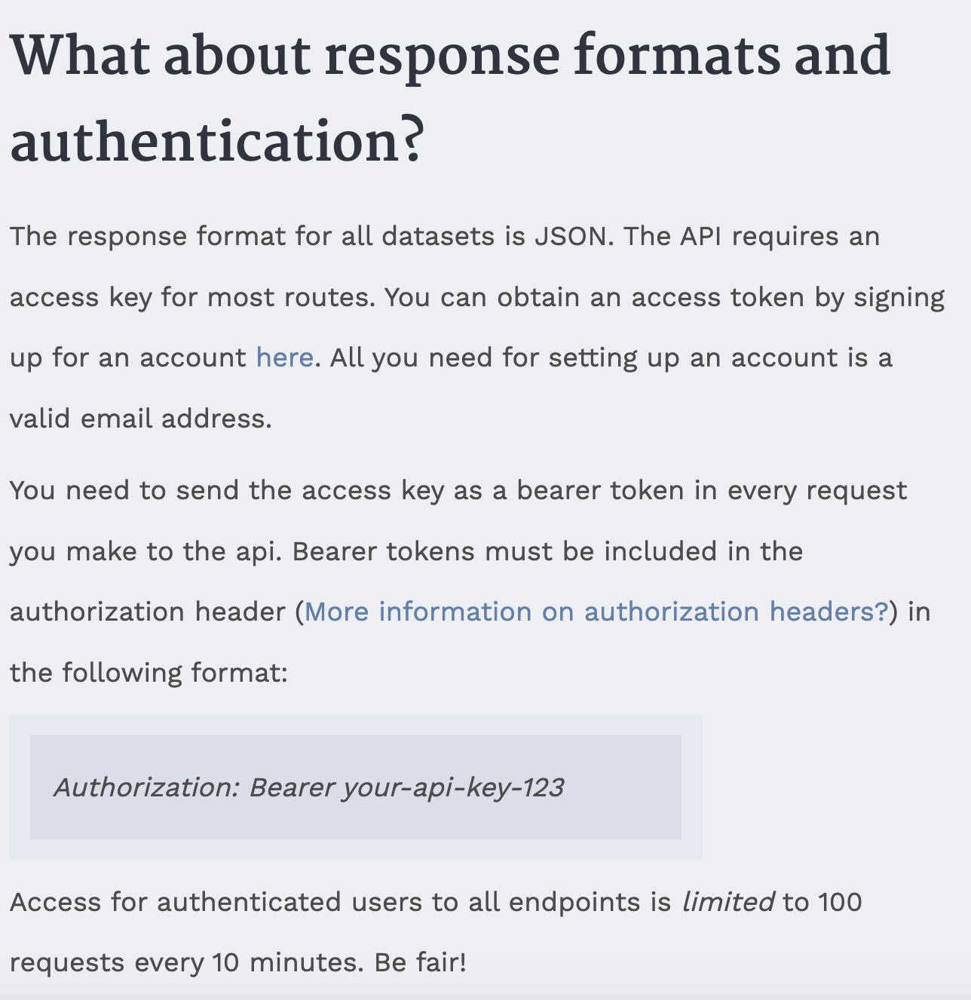

If we return to *The One API* documentation [https://the-one-api.dev/documentation#3](https://the-one-api.dev/documentation#3){target="_blank"}, we can see that we need to sign up for an account to use the API at this link [https://the-one-api.dev/sign-up](https://the-one-api.dev/sign-up){target="_blank"}.

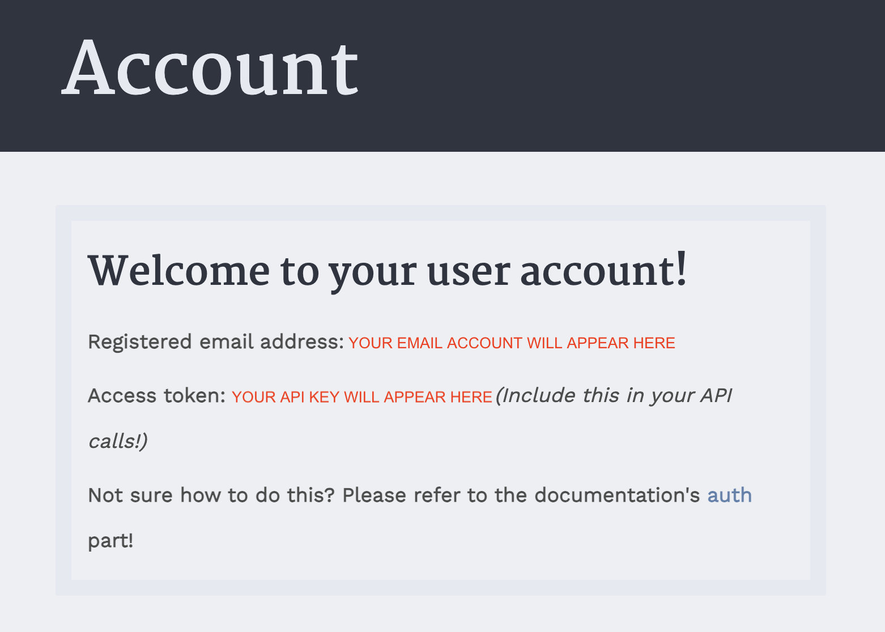

Once you have signed up and logged in, you should see the above page for your account, which will include your `API key`. This key is unique to you and is used to identify you when you make requests to the API. It's like a password, so you should keep it secret and not share it with anyone.

You should copy the key into your `first_api_script.py` and then try to get data about characters or quotes.

```python
api_key = "API KEY HERE"
url = 'https://the-one-api.dev/v2/character'
authorization_headers = {
	'Authorization': 'Bearer ' + api_key
}
```

You'll notice that we are using a new variable called `authorization_headers` that is a dictionary with a key of `'Authorization'` and a value of `'Bearer ' + api_key`. This is how we pass our key to *The One API* so that it knows who we are and that we are allowed to use their API.

Now let's update our `requests.get` method to include these headers.

```python
response = requests.get(url, headers=authorization_headers)
print(response.status_code)
```

Now we should see a `200` status code, which means that we are authorized to access this data. Before we explore this new data, we need to first understand how to store our API keys securely.

Currently, we just have our api key in a string in a variable, which is easy to use but it's not the most secure. For example, if you pushed this up to GitHub, then everyone would be able to see and use your API key. You'll notice that *The One API* says that you should limit your requests "to 100 requests every 10 minutes". However, if you shared your key, someone could easily use it and you would be locked out of the API. Even worse, if they did something illegal with your key, you could be held responsible. So rule of thumb is don't share your API key!

#### Storing API Keys

There are a number of ways to more securely store your API keys.

One option is just copying our API keys to a text file and save them there (especially because they are rarely something you can memorize), but there's also more programmatic ways to do this.

Another option is that you could store your API keys as an environment variable. Environment variables are a way to store data that is accessible to all programs running on your computer.

To create an environment variable, you open your terminal and type the following, replacing `api_key` with your API key.

For Macs/WSL:

```sh
export THE_ONE_API_KEY="YOUR_API_KEY_HERE"
```

For Windows/PowerShell:

```powershell
$env:THE_ONE_API_KEY = "YOUR_API_KEY_HERE"
```

Now you can access these environment variables in your Python script by using the `os` library.

```python
import os
the_one_api_key = os.environ['THE_ONE_API_KEY']
```

These commands set the variable only for the current terminal session, so you would need to run the appropriate command again after opening a new terminal. Persistent environment variables require editing your shell profile, but a credential-storage library is simpler for this course. Do not print API keys while testing because terminal output can be copied into screenshots, logs, or shared debugging messages.

This is a bit more work though, and one easier option is to use a Python library for storing API keys, called `apikey` [https://github.com/ulf1/apikey](https://github.com/ulf1/apikey){target="_blank"}.

In your terminal, type `python -m pip install "apikey>=0.2.4"` to install the library. Then import it into your script and write:

```python
import apikey

apikey.save("THE_ONE_API_KEY", "YOUR_API_KEY_HERE")

the_one_api_key = apikey.load("THE_ONE_API_KEY")
```

While you can use any of these options, I would recommend using the `apikey` library, as it's the most secure and the easiest to use. If you continue with programming, you will likely end up using the `.zshrc` or `.bashrc` method, but for now, the `apikey` library is the best option.

### Making API Requests

Now that we have our api key stored securely, let's try to get data about characters from *The One API*. We can do this by updating our `url` variable to include the `/character` endpoint.

```python
the_one_api_key = apikey.load("THE_ONE_API_KEY")
authorization_headers = {
	'Authorization': 'Bearer ' + the_one_api_key
}
url = 'https://the-one-api.dev/v2/character'
response = requests.get(url, headers=authorization_headers)
if response.status_code == 200:
	print(response.json())
else:
	print(response.status_code)
```

This should show a much larger amount of data, including information about all the characters from the *Lord of the Rings* series in this database. You'll notice that the data is structured in a similar way to the data about books, with a list of characters and some other information about the data that was returned.

```json
{'docs': [{'_id': '5cd99d4bde30eff6ebccfbbe',
   'name': 'Adanel',
   'wikiUrl': 'http://lotr.wikia.com//wiki/Adanel',
   'race': 'Human',
   'birth': None,
   'gender': 'Female',
   'death': None,
   'hair': None,
   'height': None,
   'realm': None,
   'spouse': 'Belemir'},
  {'_id': '5cd99d4bde30eff6ebccfbbf',
   'name': 'Adrahil I',
   'wikiUrl': 'http://lotr.wikia.com//wiki/Adrahil_I',
   'race': 'Human',
   'birth': 'Before ,TA 1944',
   'gender': 'Male',
   'death': 'Late ,Third Age',
   'hair': None,
   'height': None,
   'realm': None,
   'spouse': None},
  {'_id': '5cd99d4bde30eff6ebccfbc0',
   'name': 'Adrahil II',
   'wikiUrl': 'http://lotr.wikia.com//wiki/Adrahil_II',
...
 'total': 933,
 'limit': 1000,
 'offset': 0,
 'page': 1,
 'pages': 1}
 ```

Since the api response is in json format, we can work with it similar to working with a dictionary. For example, we can see all the keys in the response by using the `.keys()` method.

```python
response.json().keys()
```

This should show the following:

```python
dict_keys(['docs', 'total', 'limit', 'offset', 'page', 'pages'])
```

We can access the `total` key to see how many characters are in the database.

```python
response.json()['total']
```

This should return `933`, which means that there are 933 characters in the database. We can also loop through the `docs` key to see each character.

```python
for character in response.json()['docs']:
	print(character)
```

This should show a list of dictionaries, each of which contains information about a character from the *Lord of the Rings* series. You'll notice that each character has an `_id`, a `name`, a `wikiUrl`, a `race`, a `birth`, a `gender`, a `death`, a `hair`, a `height`, a `realm`, and a `spouse`.

So if we only wanted to see the data about a certain character, like Galadriel, we could loop through the characters and print out the data for Galadriel.

```python
for character in response.json()['docs']:
	if character['name'] == 'Galadriel':
		print(character)
```

Which would return the following data:

```json
{'_id': '5cd99d4bde30eff6ebccfd06', 'name': 'Galadriel', 'wikiUrl': 'http://lotr.wikia.com//wiki/Galadriel', 'race': 'Elf', 'birth': 'YT 1362', 'gender': 'Female', 'death': 'Still alive: Departed over the sea on ,September 29 ,3021', 'hair': 'Golden', 'height': 'Tall', 'realm': 'Eregion,Lothlórien,Caras Galadhon', 'spouse': 'Celeborn'}
```

This loop downloads the entire character response and then filters it locally in Python. Earlier, we learned that query parameters let us describe what we want as part of the request itself. *The One API* supports a `name` parameter, so we can ask the server to return only records matching Galadriel.

```python
url = 'https://the-one-api.dev/v2/character'
params = {"name": "Galadriel"}

response = requests.get(
	url,
	headers=authorization_headers,
	params=params,
)

print(response.url)
print(response.json())
```

The `requests` library turns that dictionary into the same URL structure we examined earlier:

```text
https://the-one-api.dev/v2/character?name=Galadriel
```

Here, `name` is the parameter's key and `Galadriel` is its value. Filtering on the server means we retrieve the record we need rather than downloading all 933 character records and searching them afterward. According to [The One API's filtering documentation](https://the-one-api.dev/documentation#5){target="_blank"}, its query parameters can also filter, sort, and paginate results.

We can pass multiple parameters in the same dictionary. For example, *The One API* uses `name!` to mean that a name should **not** match a value. Combining it with `race` asks for elves whose names are not Galadriel:

```python
params = {
	"name!": "Galadriel",
	"race": "Elf",
}

response = requests.get(
	url,
	headers=authorization_headers,
	params=params,
)

print(response.url)
print(f"Total number of elves besides Galadriel: {response.json()['total']}")
```

When represented directly in a URL, the two parameters are separated by `&`. When we use `params=`, `requests` constructs and safely encodes that query string for us.

Finally, we can also use the `id` in each data returned from the API to get more specific data. For example, if we wanted to get data about all the movie quotes of Galadriel, we could first get the id of Galadriel and then use that id to get data about her quotes.

```python
url = 'https://the-one-api.dev/v2/character?name=Galadriel'
response = requests.get(url, headers=authorization_headers)
galadriel_id = response.json()['docs'][0]['_id']
quote_url = f'https://the-one-api.dev/v2/character/{galadriel_id}/quote'
response = requests.get(quote_url, headers=authorization_headers)
print(response.json())
```

Finally, let's use the `time` library in Python so that we don't exceed the 100 requests every 10 minutes limit.

```python
import time

url = 'https://the-one-api.dev/v2/character?name=Galadriel'
response = requests.get(url, headers=authorization_headers)
galadriel_id = response.json()['docs'][0]['_id']
quote_url = f'https://the-one-api.dev/v2/character/{galadriel_id}/quote'
response = requests.get(quote_url, headers=authorization_headers)
print(response.json())
time.sleep(10)
```

Understanding how to use query parameters and how to use the `id` of data returned from an API is critical to working with APIs, as it allows you to get specific data from an API. This is especially important when working with large datasets, as it allows you to filter and sort data to get the data you need. Remember collecting all the data is not always the best option, and can actually lead to more work depending on your research question.

## From Direct Requests to API Wrappers

So far we have been using the `requests` library to make our API calls, which is usually how you should work with APIs. However, occasionally, developers will create Python libraries to work with APIs, which can make working with APIs easier. These libraries are called API wrappers, and they are essentially Python libraries that provide a set of functions to work with an API.

You can imagine if instead having to write a `requests.get` method every time you wanted to get a character and their number of quotes from *The One API*, we could instead write a Python Class that would make the request and store the data for us. This is what an API wrapper does, it abstracts the process of making requests to an API and allows you to work with the data more easily.

Indeed, a developer named Nathanial Hapeman has created one for *The One API*, which you can see here [https://pypi.org/project/nrh-lotr/0.0.3/](https://pypi.org/project/nrh-lotr/0.0.3/){target="_blank"}. If you want to try out this library, install it in your active virtual environment:

```sh
python -m pip install nrh-lotr==0.0.3
```

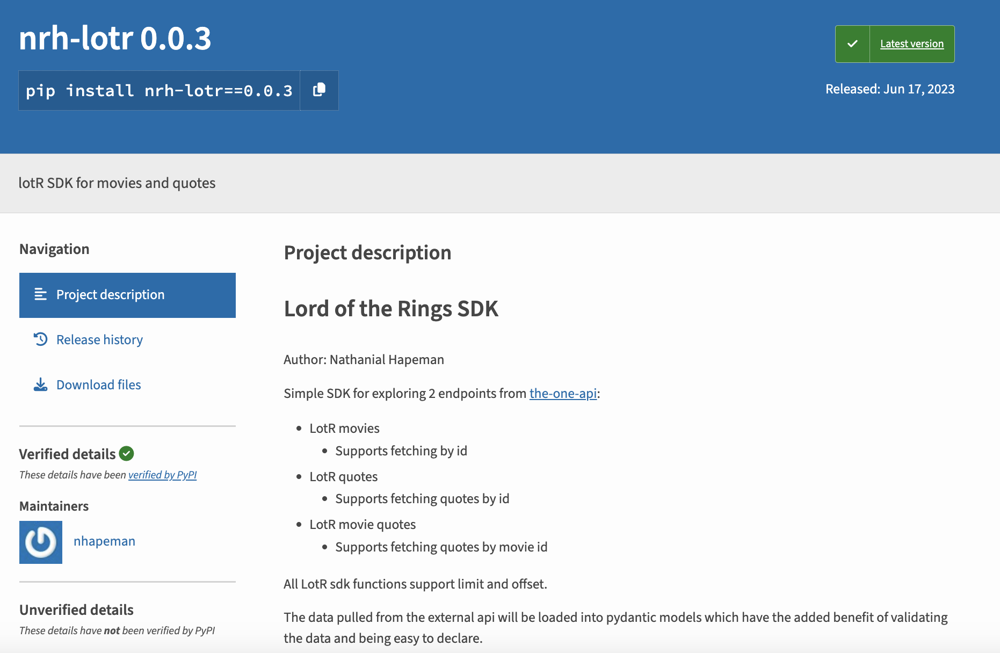

If you scroll down to `Usage` section, you can see how the developer has created a class called `LOTR` that takes your api key and then makes requests for you.

```python
import apikey
from lotr import LOTR

the_one_api_key = apikey.load("THE_ONE_API_KEY")
lotr = LOTR(the_one_api_key)
quotes = lotr.quotes(limit=5)
print(quotes)
```

This returns five quote objects. Each object exposes selected fields from the API, including the dialogue and identifiers for its movie and character. The wrapper handles the request, authentication header, response parsing, and conversion from dictionaries into Pydantic objects. That convenience also means the wrapper's assumptions about the API become part of our workflow.

We can also see how the library is organized if we inspect it after installing it:

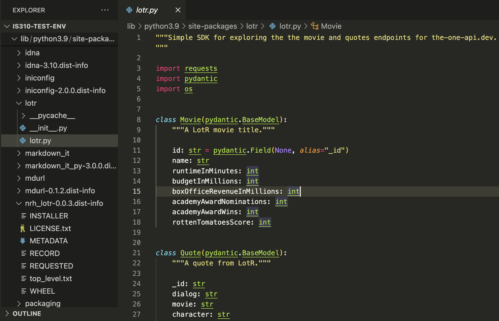

::: {.callout-important}
## When a Wrapper's Types Do Not Match the API

The `quotes()` example above works, but the wrapper's `movies()` method currently fails against the live API. Calling `lotr.movies(limit=5)` produces this validation error:

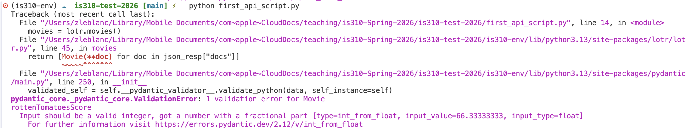

### What Went Wrong?

**Pydantic** is a data validation library that checks whether the data you receive from an API matches the types you declared in your model. When the API returned a value for `rottenTomatoesScore` of `66.33333333` (a decimal), but the model was expecting an `int` (whole number), Pydantic rejected it. You can't fit a float into an integer without losing information, so Pydantic threw a validation error.

### What Would Need to Change?

The library developer assumed Rotten Tomatoes scores would be integers, but the actual API returns percentage scores with decimal values. Inside the library's `Movie` model, those fields would need to accept decimal numbers:

```python
class Movie(pydantic.BaseModel):
    """A LotR movie title."""

    id: str = pydantic.Field(None, alias="_id")
    name: str
    runtimeInMinutes: int
    budgetInMillions: int
    boxOfficeRevenueInMillions: float # Changed from int to float
    academyAwardNominations: int
    academyAwardWins: int
    rottenTomatoesScore: float  # Changed from int to float
```

This excerpt explains the mismatch; it is **not** code to add to `first_api_script.py`. Defining another `Movie` class in our script would not change the model used internally by the installed wrapper. Proper fixes would include updating the package source, maintaining a corrected fork, or bypassing this method and requesting the `/movie` endpoint directly with `requests`. For this lesson, we will use the working `quotes()` method and treat the failing `movies()` method as evidence that wrappers need to be tested rather than trusted automatically.

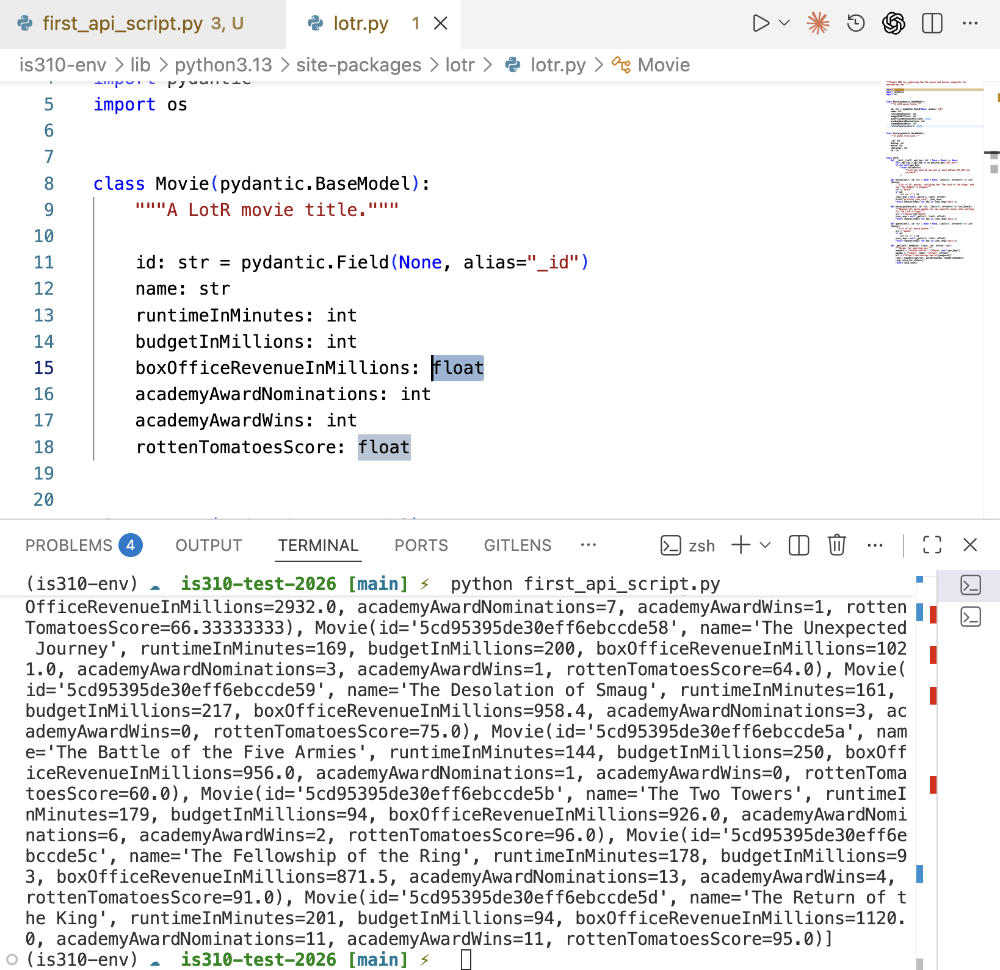

### Why This Matters

This is a great example of why **API wrappers are imperfect**. The person who wrote `nrh-lotr` made assumptions about the data that didn't match reality. This teaches us to:

- Always read the actual API documentation carefully
- Test wrapper code against real data
- Be aware that library developers may have made incorrect assumptions about data types
- Know that Pydantic validates your data to catch these mismatches early
:::

And you can see how's it making requests to the API by looking at the source code.

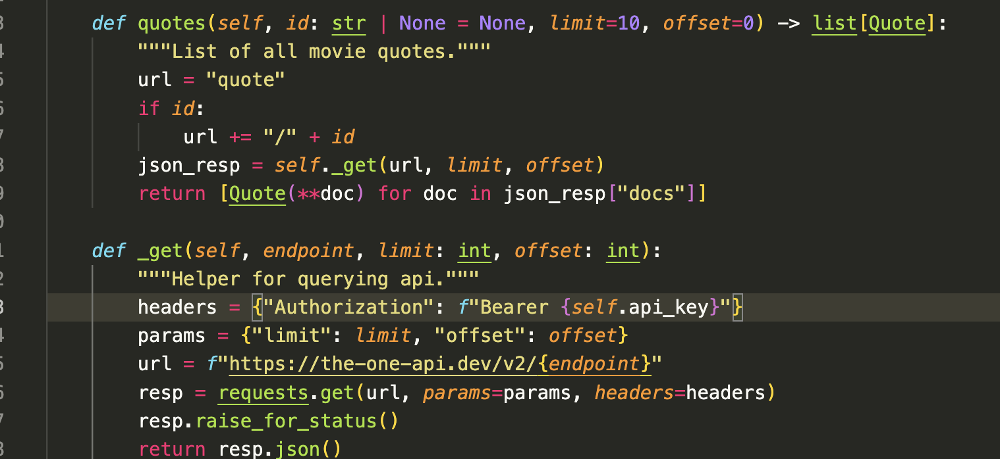

However, if you scroll down further in the documentation, you'll notice that this library only makes requests for the following endpoints:

```bash
/movie
/movie/{id}
/movie/{id}/{quote}
/quote
/quote/{id}
```

Such limited functionality means that we couldn't use this library to get data about characters or books, which is a major limitation. These types of limitations are common when working with API wrappers, as they are often created by developers who are not affiliated with the API itself and who may not have the time or resources to create a full-featured library. However, they can be a good way to get started with an API, especially if you are new to working with APIs.

## From an API Wrapper to a Collection Library

The `nrh-lotr` package is a small third-party wrapper for selected endpoints from *The One API*. The [Internet Archive](https://archive.org/){target="_blank"} provides a useful contrast: its maintained [`internetarchive` Python library](https://archive.org/developers/internetarchive/){target="_blank"} supports a cultural institution and its collections rather than one entertainment dataset.

We have already discussed the Internet Archive as a digital library, preservation institution, and argument about universal access. Here, the important question is: **what does its software treat as an archival object?**

Install the library inside your active virtual environment:

```sh
python -m pip install internetarchive
```

The package provides both a Python library and an `ia` command-line program. We will focus on three concepts exposed by the library:

- A **search result** is a compact description of something that matched a query.
- An **item** is the Archive's container for metadata and digital materials.
- A **file** is one representation stored inside an item, such as an original upload, OCR text, thumbnail, or platform-generated derivative.

### One Search, One Item, Many Files

The following workflow searches for texts with "Lord of the Rings" in the title, keeps three results, and inspects the first item:

```python
import internetarchive

search = internetarchive.search_items(
	'title:"Lord of the Rings" AND mediatype:texts',
	fields=["identifier", "title", "date"],
)

results = []
for result in search:
	results.append(result)
	if len(results) == 3:
		break

for result in results:
	print(result.get("identifier"), result.get("title"))

first_identifier = results[0]["identifier"]
item = internetarchive.get_item(first_identifier)

metadata = item.metadata
print("Title:", metadata.get("title"))
print("Creator:", metadata.get("creator"))
print("Date:", metadata.get("date"))
print("Media type:", metadata.get("mediatype"))
print("Collection:", metadata.get("collection"))
print("License:", metadata.get("licenseurl"))

for file in list(item.files)[:10]:
	print(file.name, file.metadata.get("format"))
```

The query combines a phrase search with a fielded filter. `title:"Lord of the Rings"` searches the title field, while `mediatype:texts` limits results to records classified by the Archive as texts. We stop after three records because a search may contain thousands of results, and we do not need to retrieve all of them while testing.

The identifier connects a compact search result to the fuller item. An item might represent a book, recording, software program, film, image collection, or captured website. Its files might include an original upload alongside OCR, metadata, thumbnails, and other derivatives generated by the platform.

Notice the use of `.get()` when reading metadata. Records contributed by different people and institutions do not always contain the same fields. A missing creator or license does not establish that no creator or rights holder exists; it means that information is not represented in that field in this record.

Across the APIs and libraries in this lesson, notice what each system treats as its central object:

| System | Central objects | Primary access model |
|---|---|---|
| Fandom MediaWiki | Pages, categories, and language links | Public Action API with a descriptive User-Agent |
| The One API | Books, characters, movies, quotes | Public and authenticated endpoints |
| `nrh-lotr` | Selected Python models of LOTR API records | Third-party wrapper |
| Internet Archive | Items, files, and collections | Maintained Python library and APIs |

The technical differences matter, but so do the institutional ones. Each interface reflects who maintains the data, who is expected to use it, and which forms of culture have been made retrievable.

## GETting Culture Across APIs Homework

Now that you understand how to work with APIs, it's time to experiment with some on your own. In your `api-getting-data` folder in your `is310-coding-assignments` repository, create a new script called `getting_culture.py`.

For this assignment you will work with **two APIs**: a **MediaWiki Action API**, like the LOTR Fandom API we used above, and a **second API of your own choosing**. The goal is not just to make both work, but to **compare them**, to notice that two APIs answering questions about culture can be built on very different assumptions about who is asking and why.

### Choosing Your Second API

Pick something you're actually curious about. If you need inspiration:

- [https://github.com/public-apis/public-apis](https://github.com/public-apis/public-apis){target="_blank"}
- [https://github.com/chanonroy/cool-apis](https://github.com/chanonroy/cool-apis){target="_blank"}
- [https://apilist.fun/](https://apilist.fun/){target="_blank"}
- Cultural heritage collections often have excellent APIs — the [Metropolitan Museum of Art](https://metmuseum.github.io/){target="_blank"}, the [Smithsonian](https://www.si.edu/openaccess){target="_blank"}, [Open Library](https://openlibrary.org/developers/api){target="_blank"}, and the [Digital Public Library of America](https://pro.dp.la/developers){target="_blank"}
- Or something purely for fun — SWAPI (the Star Wars API), the Pokémon API, a museum of one specific thing

You may use `requests` or a wrapper library, and your API may or may not require a key. **If it requires a key, store it using one of the methods from this lesson. Never paste it into a file you push to GitHub.**

### Requirements

- [ ] **Query a MediaWiki Action API** for something that interests you. This could be category members, language links, revisions, article extracts, or another form of wiki data you find in the documentation. You may use the LOTR Fandom wiki or another MediaWiki site whose policies permit your request. Print the response.
- [ ] **Query your second API** and print the response.
- [ ] **Connect the two.** Take a specific item from one API and look it up in the other — an artist from a museum collection and their wiki page, a book from Open Library and its entry on a literature wiki, or a fictional character and their language links. The connection does not have to be perfect. **If it fails or the match is ambiguous, that is a finding — write about it.**
- [ ] **Save your data** as JSON or CSV, with a filename that includes the API you chose. Save **only the item data**, not the full raw response. Inspect saved responses before committing them because some services include request details or credentials in returned metadata.
- [ ] **Handle errors.** Check `status_code` before parsing, and don't let one bad lookup crash the script. You are welcome to use `Rich` for nicely formatted output.

### The Comparison (the important part)

In your `README.md`, write a paragraph comparing the two APIs. Some questions worth answering:

- **What did each require of you?** A key? An account? An application explaining your purpose? A descriptive User-Agent? Nothing at all? What does that tell you about who each API expects to be talking to?
- **What are the rate limits, and what do they imply** about the scale of use the designers anticipated?
- **How is the data shaped?** Did you get clean structured JSON, or HTML you had to parse? Was it easy to get *one* thing and hard to get *many*, or the reverse? What questions does the structure make easy, and which does it quietly make hard?
- **Who runs it, and how is it funded?** A nonprofit foundation, a national government, a museum, a company, one volunteer developer? What happens to your research if it shuts down or starts charging?
- **What's missing?** Every collection reflects choices about what was worth digitizing, cataloguing, or writing about. Whose culture is well represented in each of these datasets, and whose isn't?

That last question connects back to Acker and Kreisberg on API-driven archives and to Freelon's "post-API age". You are the fourth kind of user in their table, the researcher, using infrastructure built mostly for developers. **Notice where that fit is uncomfortable.**

Finally, push both your script and the data to your GitHub repository. **Please remember to NOT include any private API keys, virtual environments, or other sensitive information!**

Once you have completed the assignment, please post a link to your `api-getting-data` folder in this GitHub discussion [https://github.com/CultureAsData-UIUC/is310-fall-2026/discussions/7](https://github.com/CultureAsData-UIUC/is310-fall-2026/discussions/7){target="_blank"}, along with a brief note about which second API you chose and why.

## Additional Resources

- Snodgrass, Eric, and Winnie Soon. “API Practices and Paradigms: Exploring the Protocological Parameters of APIs as Key Facilitators of Sociotechnical Forms of Exchange.” *First Monday*, February 1, 2019. [https://doi.org/10.5210/fm.v24i2.9553](https://doi.org/10.5210/fm.v24i2.9553){target="_blank"}.
- Kazemi, Darius. “The Land before Modern APIs – Increment: APIs.” *Increment*, August 2020. [https://qa.increment.com/apis/land-before-modern-apis/](https://qa.increment.com/apis/land-before-modern-apis/){target="_blank"}.
- Loukissas, Yanni Alexander. *All Data Are Local: Thinking Critically in a Data-Driven Society*. MIT Press, 2019.
- Go Sugimoto, "Introduction to Populating a Website with API Data," *Programming Historian* 8 (2019), [https://doi.org/10.46430/phen0086](https://doi.org/10.46430/phen0086){target="_blank"}.
- Patrick Smyth, "Creating Web APIs with Python and Flask," *Programming Historian* 7 (2018), [https://doi.org/10.46430/phen0072](https://doi.org/10.46430/phen0072){target="_blank"}.
- Jeri Wieringa, "Getting Data," *DH Bridge*, [http://curriculum.dhbridge.org/modules/module03.html](http://curriculum.dhbridge.org/modules/module03.html){target="_blank"}.
- Lauren Klein and Dan Sinykin, "Intro to APIs," *QTM340-Fall21*, [https://github.com/laurenfklein/QTM340-Fall21/blob/main/notebooks/class7-accessing-apis.ipynb](https://github.com/laurenfklein/QTM340-Fall21/blob/main/notebooks/class7-accessing-apis.ipynb){target="_blank"}.
- Melanie Walsh, "Intro to APIs," *Intro to Cultural Analytics*, [https://melaniewalsh.github.io/Intro-Cultural-Analytics/04-Data-Collection/05-What-Is-API.html](https://melaniewalsh.github.io/Intro-Cultural-Analytics/04-Data-Collection/05-What-Is-API.html){target="_blank"}.

[^1]: Lane, Kin. “The History of APIs,” *API Evangelist*, [https://history.apievangelist.com/](https://history.apievangelist.com/){target="_blank"}.
[^2]: Jakob Jünger, “A Brief History of APIs,” in *Handbook of Computational Social Science*, Volume 2, by Uwe Engel, Anabel Quan-Haase, Sunny Xun Liu, and Lars Lyberg (Taylor & Francis, 2021), [https://doi.org/10.4324/9781003025245-3](https://doi.org/10.4324/9781003025245-3){target="_blank"}.
[^3]: Freelon, Deen. “Computational Research in the Post-API Age.” *Political Communication* 35, no. 4 (October 2, 2018): 665–68. [https://doi.org/10.1080/10584609.2018.1477506](https://doi.org/10.1080/10584609.2018.1477506){target="_blank"}.
[^4]: Acker, Amelia, and Adam Kreisberg. “Social Media Data Archives in an API-Driven World.” *Archival Science* 20, no. 2 (June 1, 2020): 105–23. [https://doi.org/10.1007/s10502-019-09325-9](https://doi.org/10.1007/s10502-019-09325-9){target="_blank"}.
