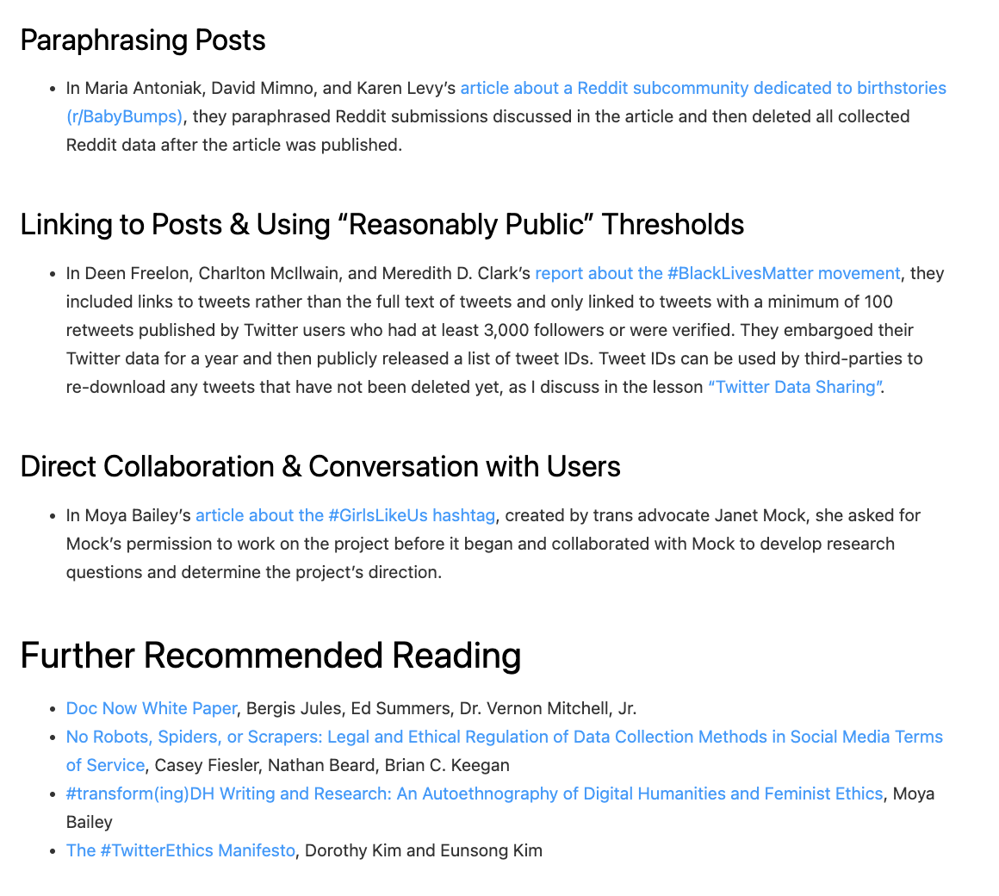
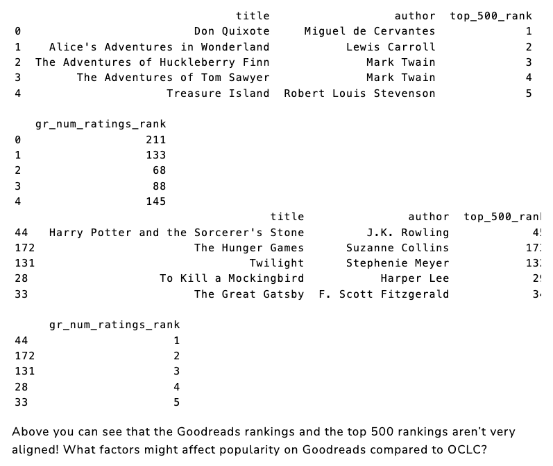
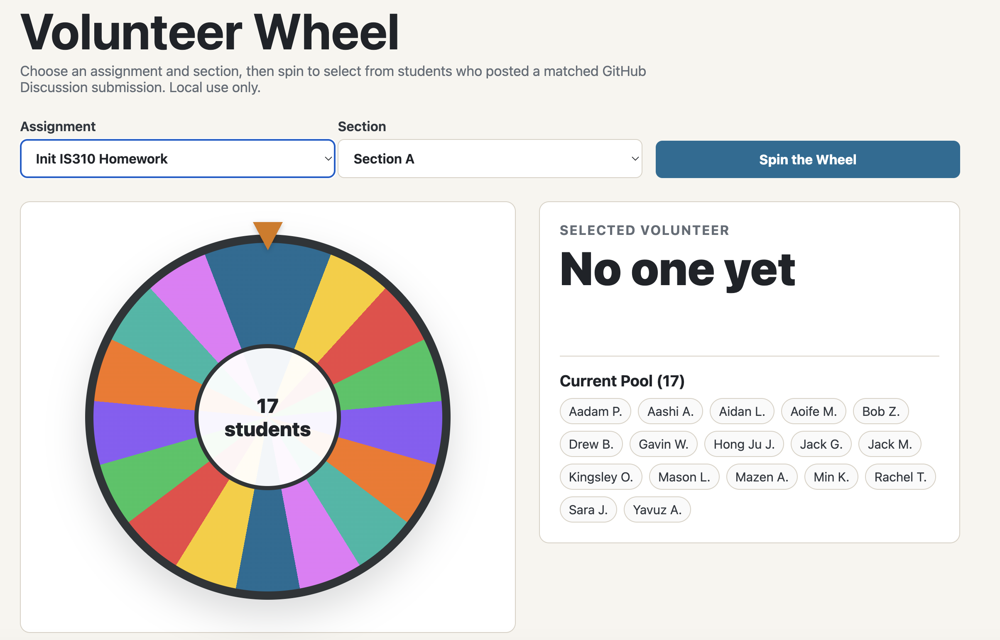

# Today's Agenda

- Discuss the assigned readings
- Review [Command Line Data Curation Homework](../materials/creating-curating-cad/04-virtual-environments.qmd#homework-command-line-data-curation){target="_blank"}.
- Complete web scraping lesson

*Any questions?*

## Who Are Melanie Walsh and Maria Antoniak?

:::: {.columns}
::: {.column width="50%" .r-fit-text}
{target="_blank"}

- Read her *Public Books* piece last week 
- Remember Cultural analytics from the Manovich reading?
- Also her textbook *Introduction to Cultural Analytics & Python*
:::
::: {.column width="50%" .r-fit-text}
{target="_blank"}

- Assistant Professor at the University of Colorado Boulder in CS, affiliated with Information Science and the Boulder NLP Group
- Specializes in natural language processing for culture, language, and social systems
- Directs the Culture, Language, and Systems (CLS) Lab. 
:::
::::

## What Is Goodreads?

*Why might we want to study Goodreads as a cultural platform? How much do we understand about this platform? What is a social media platform even?*

## Where do social media platforms come from?

*What is web 2.0?*

{target="_blank"}

## How Did Reading Become Social Media?

::: {.r-fit-text}
| Year | Platform development |
|---|---|
| 2005 | LibraryThing launches as a personal and social catalog |
| 2006 | Shelfari launches with virtual bookshelves and reader communities |
| 2007 | Goodreads launches around finding, tracking, and discussing books |
| 2008 | Amazon acquires Shelfari |
| 2013 | Amazon acquires Goodreads |
| 2016 | Shelfari is folded into Goodreads |
:::

## How did we study readers before the digital era? 

{target="_blank"}

## How Do The Authors Study Goodreads? 

*What is the value of scale? How do we transform reviews into data? How do they get this data?*

{target="_blank"}

## How do they access this data? Who is in the data? What is amateur critics?

*How does this relate to crowdsourcing and data labor?*

::: {.r-fit-text}
| Measure | Oldest | Newest | Default | All |
|---|---:|---:|---:|---:|
| Number of reviews | 42,311 | 42,657 | 42,884 | 127,855 |
| Mean review length | 54.6 words | 91.8 words | 261.2 words | 136.3 words |
| Unique users | 24,163 | 33,486 | 17,362 | 69,342 |
| Mean reviews per user | 1.75 | 1.27 | 2.47 | 1.84 |

*Summary statistics for Goodreads classics reviews*
:::

## How does the platform shape the data? How do the authors try to get around these constraints?

{target="_blank"}

## How Do They Approach Responsibly Using Goodreads Data? 

[{fig-alt="Melanie Walsh's overview of ethical approaches to collecting internet data"}](https://melaniewalsh.github.io/Intro-Cultural-Analytics/04-Data-Collection/01-User-Ethics-Legal-Concerns.html){target="_blank"}

## What is the difference between genre and tagging? 

*Where have we seen folksonomies before? What is the problem of an algorithmic echo chamber?*

{target="_blank"}

## Why Focus on Classics?

*What is the Classics Industry?*

{target="_blank"}

## What do we learn about Goodreads' Classics vs. AP and Open Syllabus?

{target="_blank"}

## What is the difference between the classics and the canon? How do they relate to each other?

*Who determines the canon? Why does it matter?*

**Can we separate reader choice from the institutions that shaped what readers encountered?**

## What is Topic Modeling? How do they use it to analyze reviews?

{target="_blank"}

## LDA Topic Modeling: How do we turn patterns of words into meaningful topics? How do we interpret the results?

## How does this relate to TikTok? Who Is Tess McNulty and what is viral content?

*What are some similar themes across the two readings? What is a cultural critic?*

:::: {.columns}
::: {.column width="50%"}
{target="_blank"}
:::
::: {.column width="50%"}

:::
::::

## What is TikTok? Who knows the history of this platform?

{target="_blank"}

## What has happened to public APIs for platforms? Why is it difficult to study what people see on social media?

:::: {.columns}
::: {.column width="50%"}
{target="_blank"}
:::
::: {.column width="50%"}
{target="_blank"}
:::
::::

## What are recommendation systems? How do they shape what users see and do?

:::: {.columns}
::: {.column width="50%"}

:::
::: {.column width="50%"}

:::
::::

## Ranking Is Not the Same as Recommending

{target="_blank"}

## How does McNulty identify what is popular on TikTok? How does she collect her data?

{target="_blank"}

## Scraping vs. APIs

{target="_blank"}

## What Does “Most Popular” Mean on TikTok?

:::: {.columns .r-fit-text}
::: {.column width="50%"}

:::
::: {.column width="50%"}

:::
::::

## Who studies social media? Why do we need a social media archive?

{target="_blank"}

## LoC Twitter Archive

{target="_blank"}

## Documenting the Now

{target="_blank"}

## Bot Traffic and Studying the Internet

## How does our dataset define popularity? 

{target="_blank"}

## Who Are Anna Preus and Aashna Sheth?

:::: {.columns}
::: {.column width="50%" .r-fit-text}
{target="_blank"}

:::
::: {.column width="50%" .r-fit-text}
{target="_blank"}

:::
::::

## What Does the Top 500 Dataset Measure? How did they collect the data?

{target="_blank"}

## How do they explore popularity? What is the relationship to Goodreads?

{target="_blank"}

## What is OCLC? What is WorldCat? How did they get started?

:::: {.columns}
::: {.column width="50%"}
{target="_blank"}
:::
::: {.column width="50%"}
{target="_blank"}
:::
::::

## What data do the authors compile? What is the problem of translations and editions?

{target="_blank"}

## How do they approach the impact of platforms or databases on their data?

{target="_blank"}

# Command Line Data Curation Homework Volunteers?

# Advanced Web Scraping

Completing [the web scraping lesson](13-scrape-on-and-off.qmd#what-changes-when-we-look-at-more-complex-sites){target="_blank"}.
