# Today's Agenda

- Discuss assigned readings
- Time permitting work in breakout groups

*Any questions?*

# Data Feminism: What is the argument of this chapter?

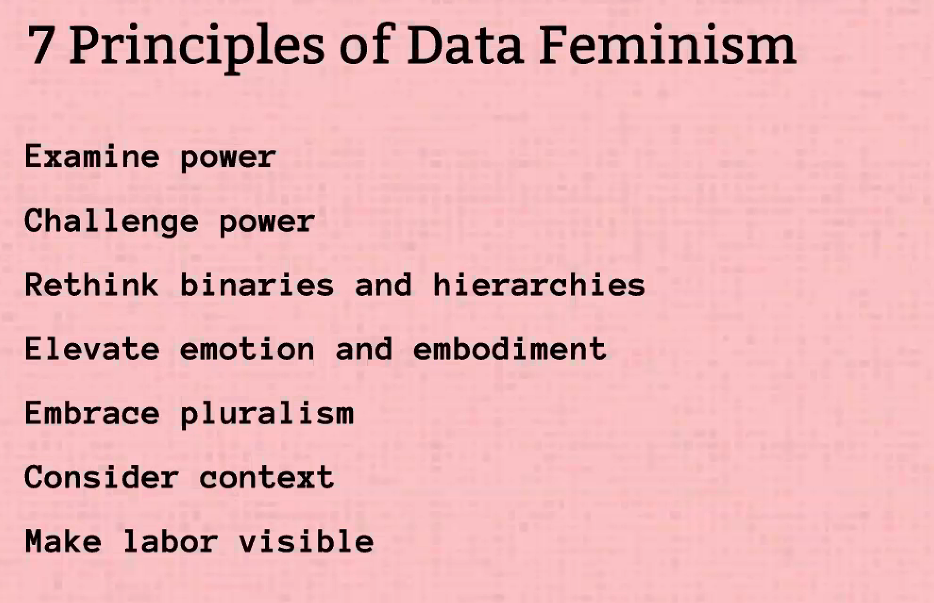{fig-alt="The seven principles of Data Feminism"}

## Where does the history of data visualization begin?

{target="_blank"}

*Does anyone recognize this visualization?*

## Who was Elizabeth Palmer Peabody and what is this chart?

{target="_blank"}

## History of Data Viz: Who has seen these charts before?

:::: {.columns}
::: {.column width="50%"}
{target="_blank"}
:::
::: {.column width="50%"}
[{fig-alt="Charles Joseph Minard's 1869 flow map of Napoleon's 1812 Russian campaign"}](https://commons.wikimedia.org/wiki/File:Minard.png){target="_blank"}
:::
::::

## History of Data Viz: Who remembers the author of these charts?

{target="_blank"}

## History of Data Viz: Who decides what is a "good" visualization?

:::: {.columns}
::: {.column width="50%"}
[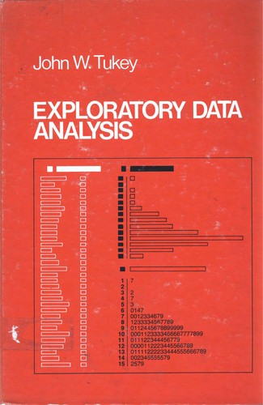{fig-alt="Cover of John Tukey's Exploratory Data Analysis" height="500"}](https://search.worldcat.org/title/03058187){target="_blank"}
:::

::: {.column width="50%"}
[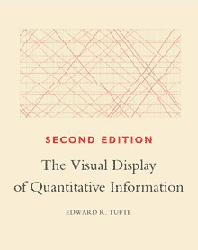{fig-alt="Cover of Edward Tufte's The Visual Display of Quantitative Information" height="500"}](https://www.edwardtufte.com/book/the-visual-display-of-quantitative-information/){target="_blank"}
:::
::::

## Should a visualization make us feel something?

{target="_blank"}

## How did Jonathan Stray detail these two graphics? What is the argument of this example?

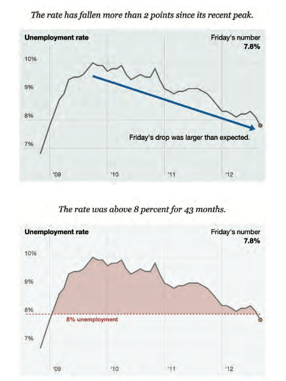

## What is the problem of distance in data visualization? What is the god trick?

:::: {.columns}
::: {.column width="50%"}
{target="_blank"}
:::
::: {.column width="50%"}
{target="_blank"}
:::
::::

## What is data visceralization? How does it relate to feminist objectivity?

## How can a visualization communicate uncertainty?

{target="_blank"}

*Is uncertainty something we see, calculate, or feel?*

## How do we select what to visualize?

{fig-alt="Coming Home to Indigenous Place Names in Canada"}

## "Isn't It Obvious?" & Lincoln Mullen: What makes a finding feel inevitable?

:::: {.columns}
::: {.column width="42%"}
{target="_blank"}
:::
::: {.column width="58%" .r-fit-text}
Historian of American religion  
Director, Roy Rosenzweig Center for History and New Media  
Creator of *America's Public Bible*
:::
::::

## Why does Mullen show a blank chart?

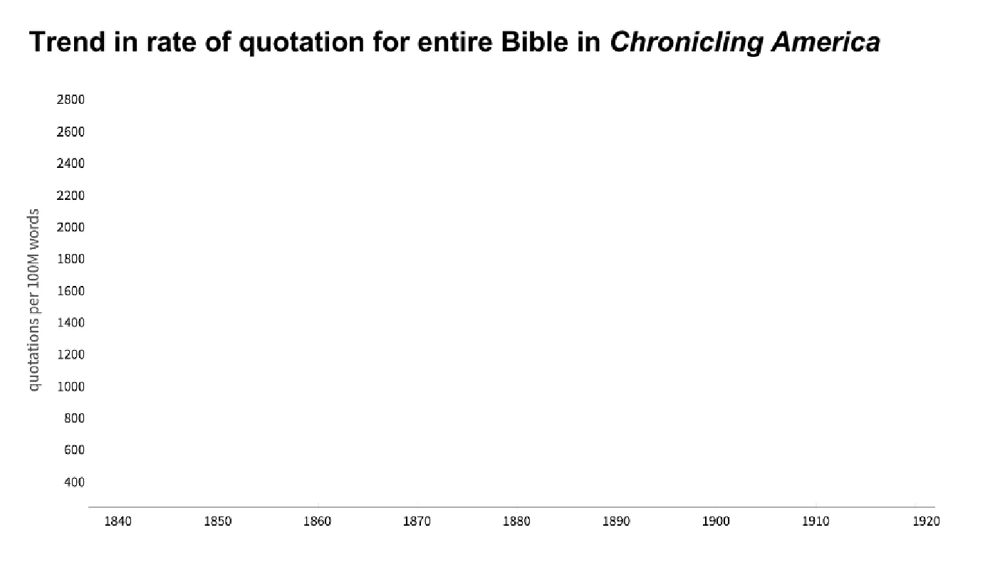{fig-alt="Blank axes for Bible quotations in newspapers"}

## Was the result obvious?

[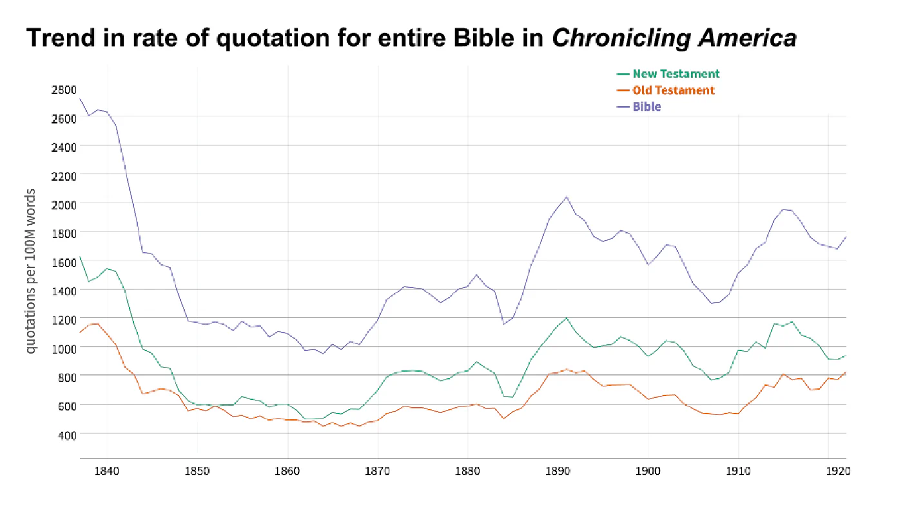](https://americaspublicbible.org/){fig-alt="Observed Bible quotation trends" target="_blank"}

## How did *America's Public Bible* turn newspapers into evidence?

[{fig-alt="Cover of America's Public Bible: A Commentary by Lincoln Mullen"}](https://americaspublicbible.org/){target="_blank"}

## Confabulation & Matthew Lincoln

:::: {.columns}
::: {.column width="50%"}
{target="_blank"}
:::
::: {.column width="50%"}
Digital art historian  
Research software engineer  
Network analysis and visualization
:::
::::

## What do these plots appear to show?

:::: {.columns}
::: {.column width="50%"}
{fig-alt="First Dutch printmaking trend"}
:::
::: {.column width="50%"}
{fig-alt="Inverted Dutch printmaking trend"}
:::
::::

## How does a museum record become a network?

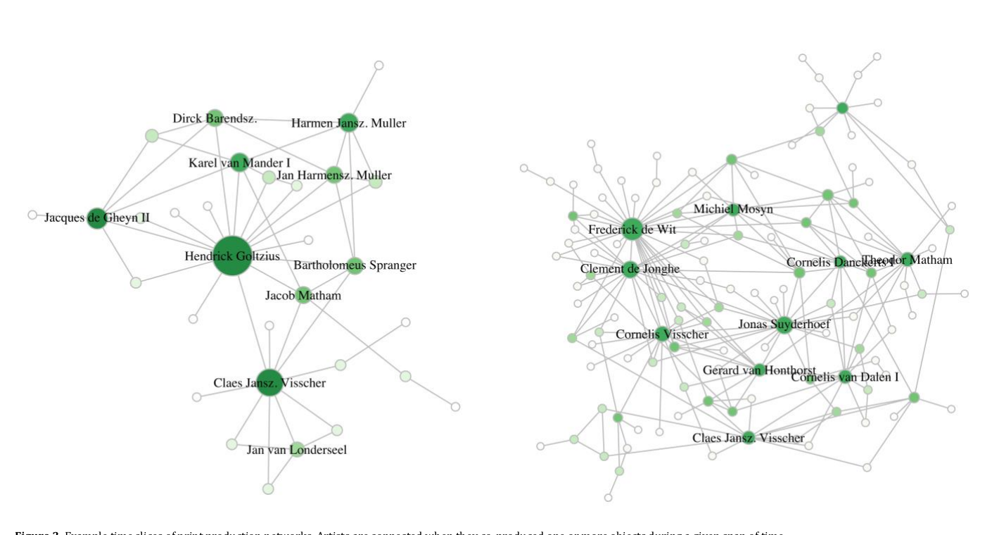{fig-alt="Two time slices of print-production networks in which artists are connected when they co-produced a surviving print" fig-align="center" height="68vh"}

## How does Lincoln measure internationalization?

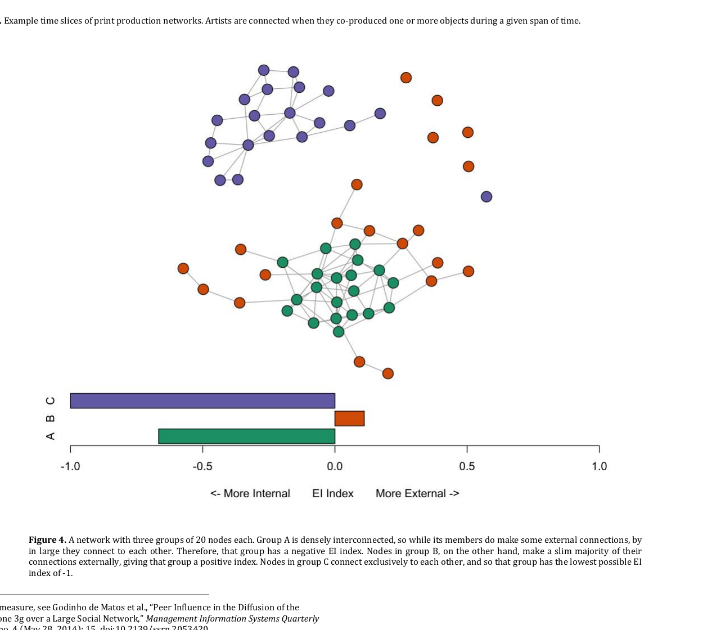{fig-alt="Example network showing how internal and external connections produce negative and positive EI index values" fig-align="center" height="68vh"}

## What did Lincoln actually find?

[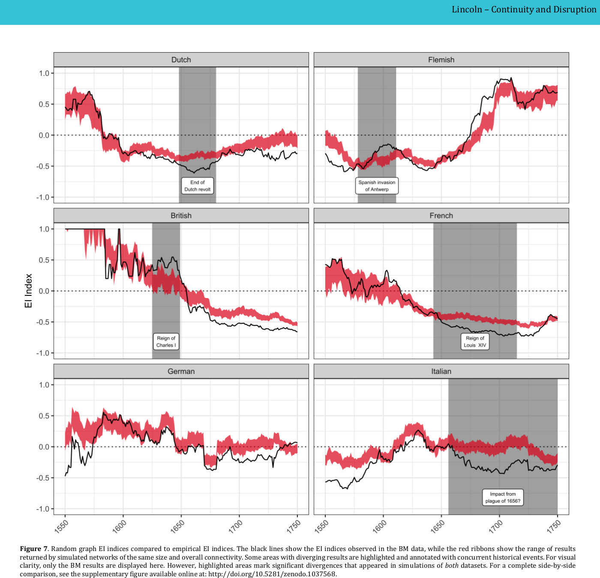](https://docs.lib.purdue.edu/cgi/viewcontent.cgi?article=1120&context=artlas){fig-alt="Six plots comparing observed and simulated domestic and international print-production networks in Dutch, Flemish, British, French, German, and Italian regions between 1550 and 1750" fig-align="center" height="72vh" width="100%" target="_blank"}

## Data Biographies & Heather Krause: How do we get to know a dataset?

:::: {.columns}
::: {.column width="50%"}
{target="_blank"}
:::
::: {.column width="50%"}
Data scientist  
Founder, Datassist and We All Count
:::
::::

## What did the first plot seem to show?

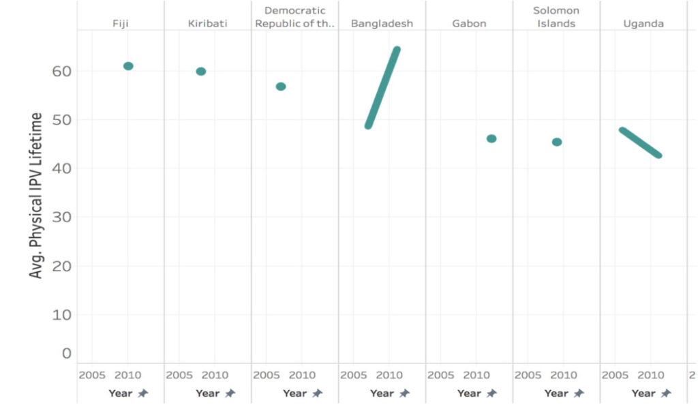{fig-alt="Initial plots of violence against women data"}

*Is this a change in the world, or a change in the data?*

## What was hidden inside one variable?

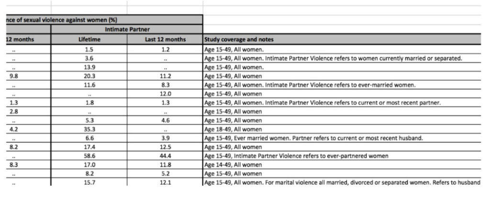{fig-alt="Different populations and collection methods combined in one variable"}

## Did violence change, or did collection change?

:::: {.columns}
::: {.column width="50%"}
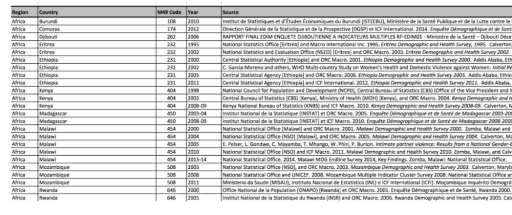{fig-alt="Incomparable data points"}
:::
::: {.column width="50%"}
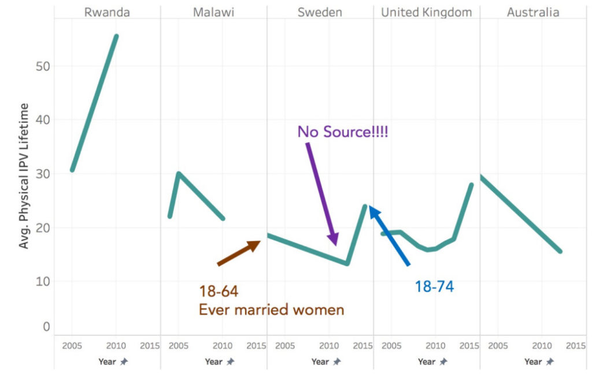{fig-alt="Rwanda data across years"}
:::
::::

## What should a dataset audit produce?

::: {.r-fit-text}
| Layer | Questions |
|---|---|
| Provenance | Who, where, when, why? |
| Structure | What does each row, field, and identifier represent? |
| Transformation | What was cleaned, merged, inferred, or excluded? |
| Coverage | Who or what is present, absent, or incomparable? |
| Interpretation | Which claims can this evidence support? |
:::

## Final Data Essay: How much should you write?

::: {.r-fit-text}
**Target: approximately 1,500 words**

**Maximum: 1,750 words**

References, captions, tables, and code do not count.
:::

## Class November 3: Please Go VOTE!

Class will be happening November 3 but it will be a technical lesson and happy to share the recording and no participation will be required. Please go vote in the midterm elections!

## Any questions? 

Time for breakout groups! Please continue working on Milestone 2 if you have not submitted it yet. If you have submitted, please continue working on your homework assignments. As a reminder, participation for group time needs to be recorded in the `group-work-log.md` file in your repository. 