# Today's Agenda

- Review remainder of scraping lesson
- Review APIs' lesson
- Review the homework

# Web Scraping Review

*Any questions before we jump in?*

## What Changes When We Look At More Complex Sites? How does a Wiki differ from Project Gutenberg?

[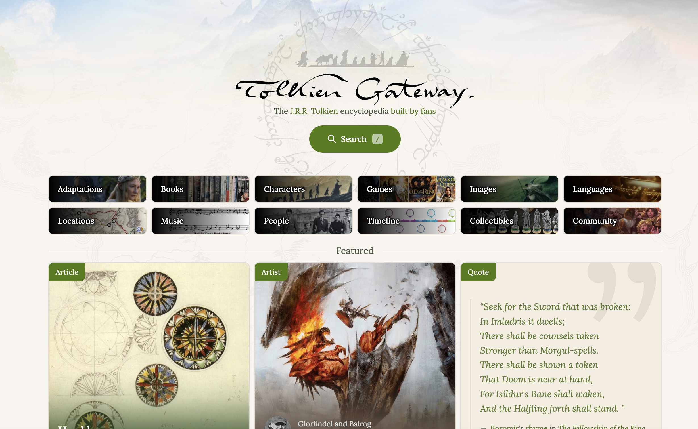](https://tolkiengateway.net/){fig-alt="Screenshot of the Tolkien Gateway homepage" target="_blank"}


## Where Did Wikis Come From?

[](https://www.wired.com/2010/03/0325wikiwikiweb-first-wiki/){target="_blank"}

**What changes when readers can also edit the webpage?**


## How Did Wikipedia Change the Scale of Wikis?

[](https://commons.wikimedia.org/wiki/File:HomePage_of_WikiPedia_on_3_March_2001.jpg){target="_blank"}


## How Did Wikis Become Cultural Infrastructures?

[](https://en.wikipedia.org/wiki/Wookieepedia){target="_blank"}

**What kinds of cultural knowledge do fan communities organize differently?**


## How Do We Know if We Can Access a Site?

. . .

[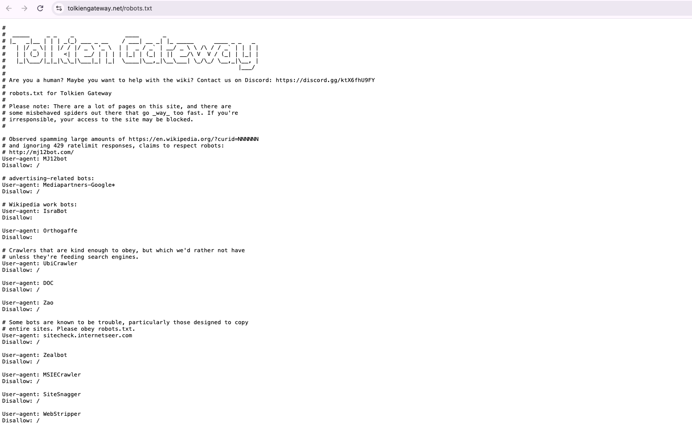](https://tolkiengateway.net/robots.txt){target="_blank"}

**What should we do when a site returns `403`, `429`, or a bot-protection page?**


## What are request headers?

*Why do we capitalize the headers variable? Why identify ourselves and deliberately make the script slower?*

```python
HEADERS = {
    "User-Agent": "is310-course-scraper/1.0 "
    "(student project; netid@illinois.edu)"
}

response = requests.get(url, headers=HEADERS, timeout=30)
time.sleep(1)
```


## What Questions Could We Ask?

[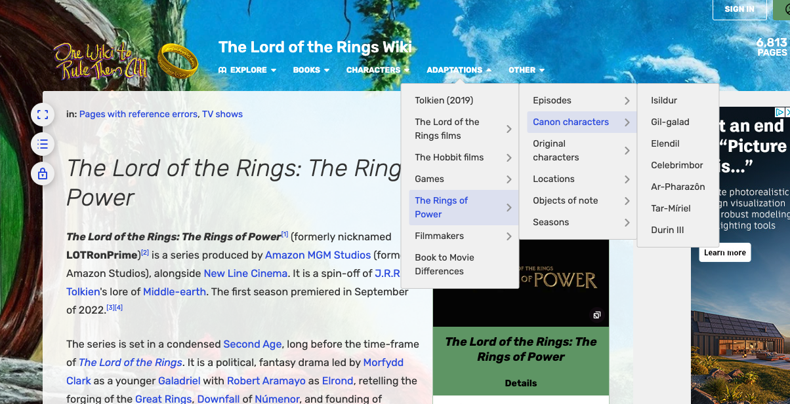{fig-alt="Promotional image for The Rings of Power"}](https://tolkiengateway.net/wiki/The_Lord_of_the_Rings:_The_Rings_of_Power){target="_blank"}


## How does the website structure what we can count?

:::: {.columns}
::: {.column width="50%"}
[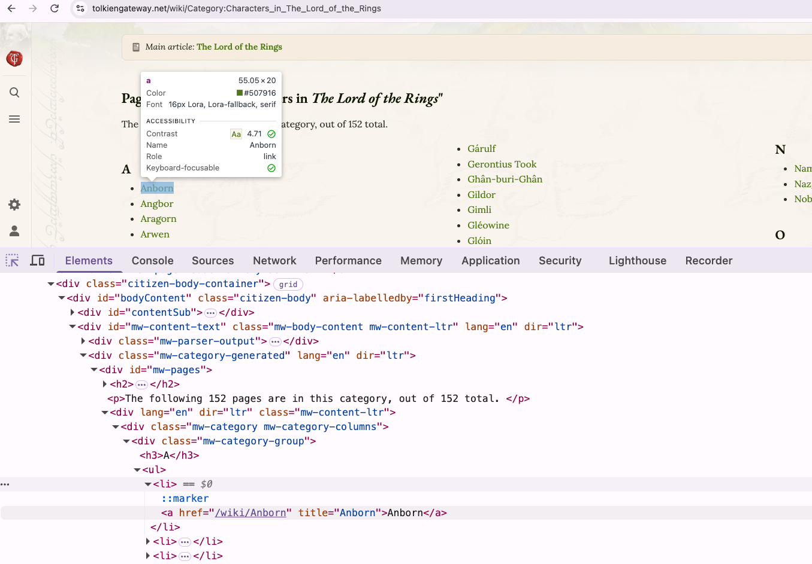{fig-alt="Tolkien Gateway category listing Lord of the Rings characters"}](https://tolkiengateway.net/wiki/Category:Characters_in_The_Lord_of_the_Rings){target="_blank"}
:::
::: {.column width="50%"}
[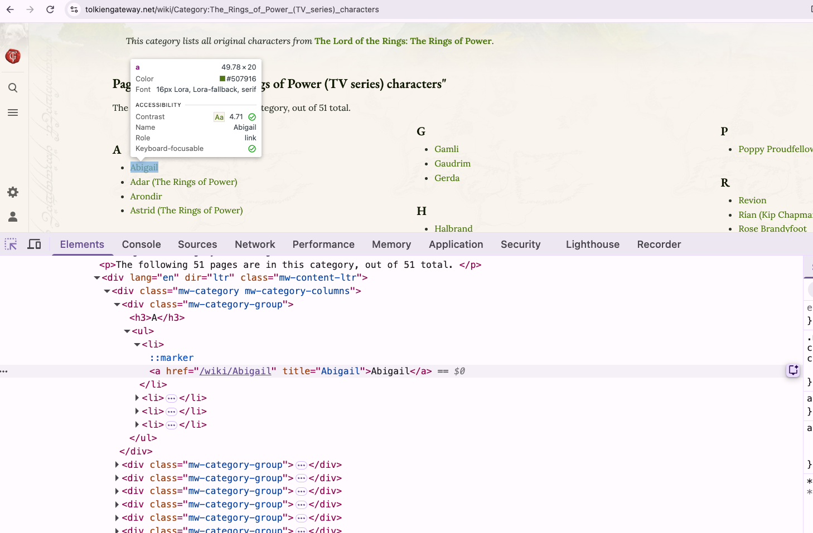{fig-alt="Tolkien Gateway category listing Rings of Power characters"}](https://tolkiengateway.net/wiki/Category:The_Rings_of_Power_(TV_series)_characters){target="_blank"}
:::
::::

**What has the wiki already decided for us?**


## How Might We Find Every Character?

{fig-alt="HTML structure of a Tolkien Gateway character category"}

```python
characters_section = category_page.find(id="mw-pages")
character_items = characters_section.find_all("li")
```


## What Part of a Character Page Should Count?

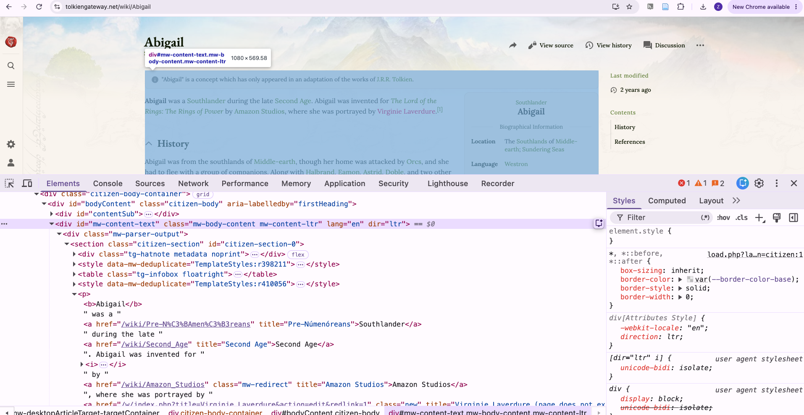{fig-alt="Developer tools showing the main article content on a Tolkien Gateway character page"}

**What would happen if we counted the entire webpage?**


## What Might Count as Attention?

| Measurement | Possible interpretation |
|---|---|
| Words | Length of documentation |
| Characters | Another measure of text extent |
| All internal links | Every connection made in the article |
| Unique internal links | Breadth of distinct wiki destinations |

**Which of these is fandom attention, and which is only a proxy? Why is attention culturally interesting?**


## Why Count All and Unique Links?

```text
Elrond, Elrond, Elrond, Galadriel, Galadriel
```

**All links:** `5`  
**Unique links:** `2`

**What different kind of page might each measure reward?**


## Who Appears in Both Worlds?

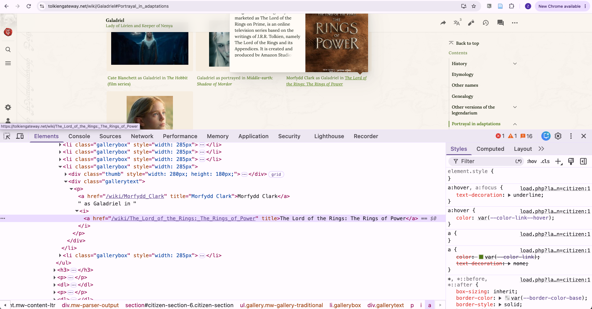{fig-alt="Tolkien Gateway HTML showing a Galadriel page link to The Rings of Power"}

**What can a link to the television series tell us about a literary character?**


## Why Break the Scraper Into Functions?

```text
fetch_soup()
scrape_characters()
get_internal_links()
analyze_character()
save_csv()
print_results_table()
main()
```

**What single responsibility does each function have?**


## What Does `main()` Make Visible?

```python
def main():
    literary_characters = ...
    adaptation_characters = ...
    all_characters = literary_characters + adaptation_characters

    results = []
    for character in all_characters:
        results.append(analyze_character(character))

    print_results_table(results)
    save_csv(results, RESULTS_OUTPUT)
```


## What Do You Notice in the Results?

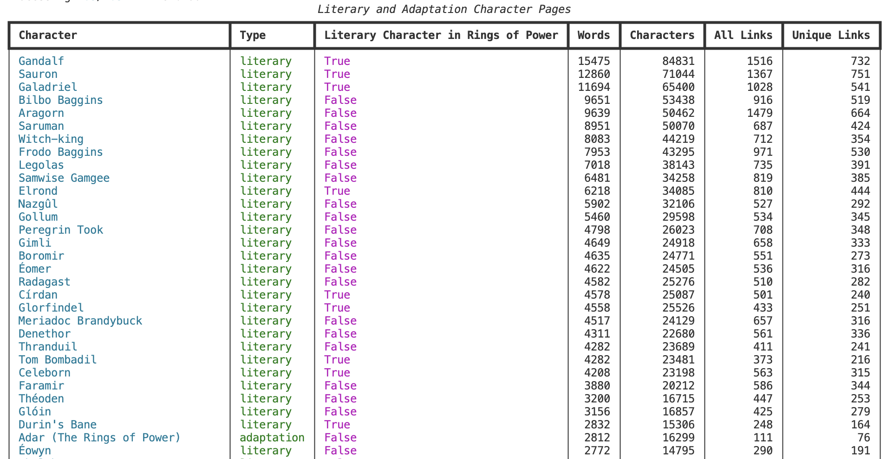{fig-alt="Rich console table of Tolkien Gateway character-page measurements"}


**Which pattern would you investigate first? What would you verify before making a claim?**


## Next Homework Assignment: Community Wikis & Web Scraping

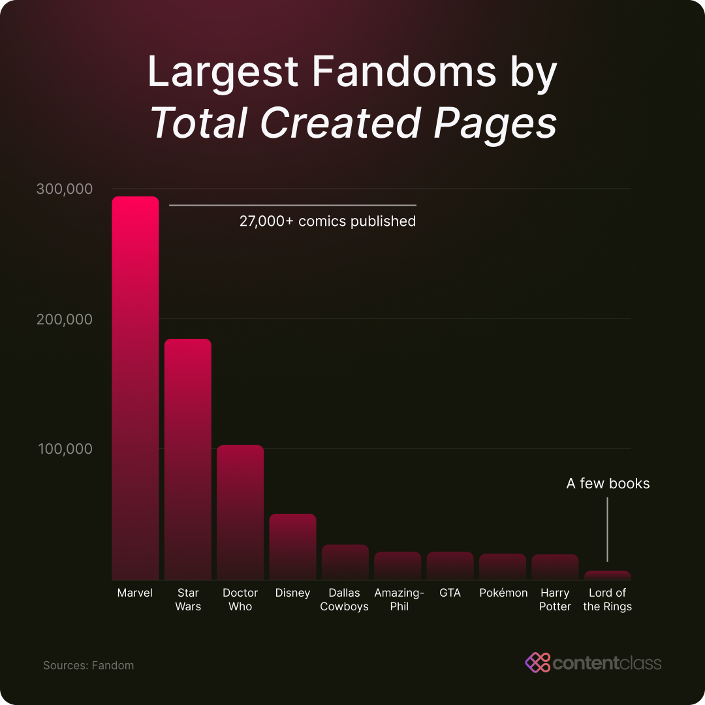{fig-alt="Examples of large fan wikis"}

## Next Homework Assignment: Community Wikis & Web Scraping

::: {.r-fit-text}
[Homework details](../materials/creating-curating-cad/05-web-scraping.qmd#community-wikis-and-web-scraping-homework){target="_blank"}

[GitHub Discussion to post link to folder](https://github.com/CultureAsData-UIUC/is310-fall-2026/discussions/6){target="_blank"}

- A question and justified choice of community wiki
- A documented `robots.txt` and access check
- A scraper using `requests` and `BeautifulSoup`
- An honest `User-Agent`, response check, and delay
- At least two levels or types of pages
- A CSV or JSON dataset
- A reflection on the gap between your metric and your concept
:::


# Cultural APIs & GETting Data

## What is an API?


## What is a database?

[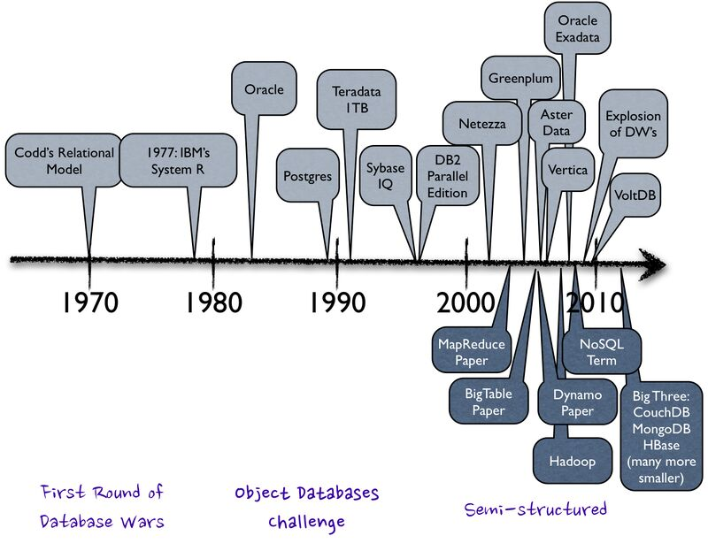](https://www.ibm.com/history/edgar-codd){target="_blank"}

*How do tabulating machines, spreadsheets, databases, and APIs connect?*


## Where do web APIs come from?

[](https://web.archive.org/web/20190722130022/https://history.apievangelist.com/){target="_blank"}


## Why are we in the Post-API Age? What has happened to APIs since 2010?

:::: {.columns}
::: {.column width="50%"}

:::
::: {.column width="50%"}
[](https://en.wikipedia.org/wiki/Cambridge_Analytica){target="_blank"}
:::
::::


## Where is the Web going? What is decentralized web infrastructure?


## What changes when we use an API? Why might we use an API over scraping?


## What happens if we try to scrape LOTR Fandom?

[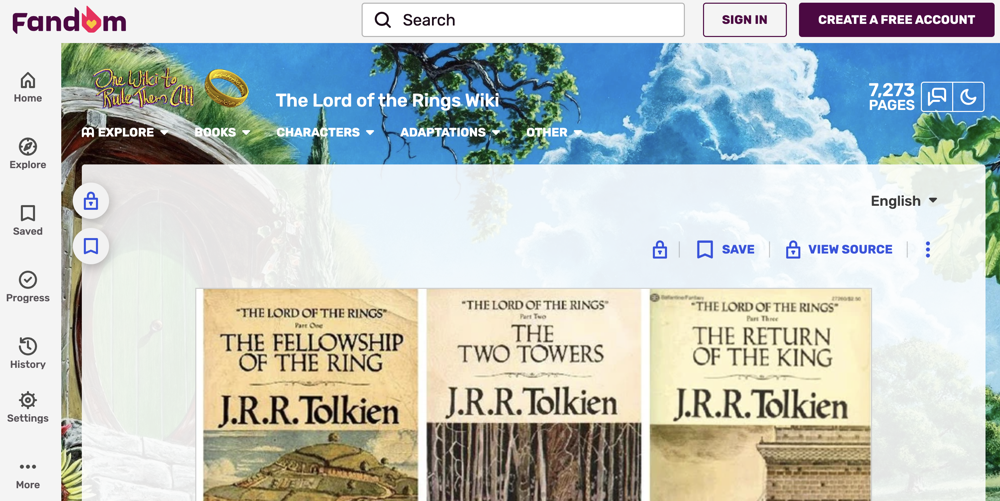](https://lotr.fandom.com/wiki/Main_Page){target="_blank"}


## What is the MediaWiki API? 

[](https://www.mediawiki.org/wiki/API){target="_blank"}


## Where is the Action API?

[](https://lotr.fandom.com/wiki/Special:ApiSandbox){target="_blank"}


## What are endpoints and parameters?


## What does `action=query` mean?

```text
https://lotr.fandom.com/api.php?action=query&format=json
```


## How do we query a category?

::: {.r-fit-text}
```python
params = {
	"action": "query",
	"list": "categorymembers",
	"cmtitle": "Category:Canon_characters_in_The_Rings_of_Power",
	"cmtype": "page",
	"cmlimit": "max",
	"format": "json",
}
response = requests.get(API_URL, params=params, headers=HEADERS, timeout=15)
```
:::


# Extending the Scraping Question

## What counts as editorial attention?

| Metric | What we count |
|---|---|
| Words and characters | Visible article text |
| All and unique links | Connections within the wiki |
| Language links | Corresponding pages reported by MediaWiki |


## What does `action=parse` return?

[](https://www.mediawiki.org/wiki/API:Parsing_wikitext){target="_blank"}

```python
"action": "parse",
"page": title,
"prop": "text|links|langlinks",
"format": "json",
```


## Why is HTML inside JSON?

```python
data = response.json()
page = data["parse"]
html = page["text"]["*"]
soup = BeautifulSoup(html, "html.parser")
article_text = soup.get_text(" ", strip=True)
```


## How do we count links?

::: {.r-fit-text}
```python
internal_links = []
for link in soup.find_all("a", href=True):
	href = link["href"]
	if href.startswith("/wiki/") and "#" not in href:
		internal_links.append(href)

unique_internal_links = []
for href in internal_links:
	if href not in unique_internal_links:
		unique_internal_links.append(href)
```
:::


## What do the pages show?

| Character | Words | All Links | Unique Links | Language Links |
|---|---:|---:|---:|---:|
| Galadriel | 13,931 | 767 | 403 | 11 |
| Arondir | 1,788 | 103 | 63 | 8 |
| Halbrand | 11 | 0 | 0 | 0 |
| Disa | 531 | 50 | 25 | 8 |


## Why does Halbrand become an outlier?

| Wiki | Page type | Words | All Links | Unique Links |
|---|---|---:|---:|---:|
| Tolkien Gateway | Full article | 1,410 | 79 | 65 |
| One Wiki | Redirect to Sauron | 11 | 0 | 0 |


## What if both sites use full articles?

| Wiki | Words | All Links | Unique Links |
|---|---:|---:|---:|
| Tolkien Gateway | 11,694 | 1,028 | 541 |
| One Wiki | 13,931 | 767 | 403 |

*Galadriel, checked October 2026*


# Authentication and The One API

[](https://the-one-api.dev/){target="_blank"}


## How do we request public book data?

```python
url = "https://the-one-api.dev/v2/book"
response = requests.get(url)

print(response.status_code)
print(response.json())
```


## What do we see and what is it?

```sh
{
    'docs':
        [
            {
                '_id': '5cf5805fb53e011a64671582',
                'name': 'The Fellowship Of The Ring'
            },
            {
                '_id': '5cf58077b53e011a64671583',
                'name': 'The Two Towers'
            },
            {
                '_id': '5cf58080b53e011a64671584',
                'name': 'The Return Of The King'
            }
        ],
    'total': 3,
    'limit': 1000,
    'offset': 0,
    'page': 1,
    'pages': 1
}
```


## Can we get all the data? What happens if we try to get characters?

. . .

[](https://the-one-api.dev/documentation#4){target="_blank"}


## How Can We Get an API Key? 

. . .

[](https://the-one-api.dev/sign-up){target="_blank"}

## How should we store API keys? What is the danger of committing credentials?

. . .

```python
import apikey

the_one_api_key = apikey.load("THE_ONE_API_KEY")
authorization_headers = {
	"Authorization": f"Bearer {the_one_api_key}"
}
```


## How do parameters filter the data?

```python
params = {"name": "Galadriel"}
response = requests.get(
	"https://the-one-api.dev/v2/character",
	headers=authorization_headers,
	params=params,
)
print(response.url)
```


## How do identifiers connect records? Why do we need to use `time.sleep()`?

```python
galadriel_id = response.json()["docs"][0]["_id"]
quote_url = f"https://the-one-api.dev/v2/character/{galadriel_id}/quote"
quote_response = requests.get(quote_url, headers=authorization_headers)
```


# API Wrappers

[](https://github.com/realpython/list-of-python-api-wrappers){target="_blank"}

## nrh-lotr: A small third-party wrapper

[](https://pypi.org/project/nrh-lotr/0.0.3/){target="_blank"}

## What does a wrapper change?

```python
from lotr import LOTR

lotr = LOTR(the_one_api_key)
quotes = lotr.quotes(limit=5)
```


## What happens when the wrapper is wrong?


## What does the wrapper omit?

```text
/movie
/movie/{id}
/movie/{id}/quote
/quote
/quote/{id}
```


## How does the Internet Archive organize culture?

[](https://archive.org/){target="_blank"}


## Search result, item, or file?

::: {.columns}
::: {.column width="33%"}
### Search result
Compact match
:::
::: {.column width="33%"}
### Item
Metadata and materials
:::
::: {.column width="33%"}
### File
One representation
:::
:::


## How do we inspect one item?

::: {.r-fit-text}
```python
import internetarchive

search = internetarchive.search_items(
	'title:"Lord of the Rings" AND mediatype:texts',
	fields=["identifier", "title", "date"],
)

results = []
for result in search:
	results.append(result)
	if len(results) == 3:
		break

item = internetarchive.get_item(results[0]["identifier"])
```
:::


## What does each interface make central?

| System | Central objects | Access model |
|---|---|---|
| MediaWiki | Pages, categories, language links | Public Action API |
| The One API | Books, characters, movies, quotes | Public and authenticated endpoints |
| `nrh-lotr` | Selected Python models | Third-party wrapper |
| Internet Archive | Items, files, collections | Maintained library and APIs |


# GETting Culture Across APIs Homework

::: {.r-fit-text}
[Homework details](../materials/creating-curating-cad/06-getting-data-apis.qmd#getting-culture-across-apis-homework){target="_blank"}

1. One **MediaWiki Action API**
2. One **second API** that interests you
3. One item connected across both
:::


## What must the script do?

- Query and print both API responses
- Connect a specific item across the APIs
- Save item data as JSON or CSV
- Check status codes and handle failed lookups
- Keep credentials out of GitHub

## What belongs in the README?

- What access did each API require?
- What do its limits imply about expected use?
- How did each structure cultural data?
- Who maintains and funds it?
- What or whom does it leave out?


## Submit the Homework

[GitHub Discussion #8](https://github.com/CultureAsData-UIUC/is310-fall-2026/discussions/8){target="_blank"}

- Link to the `api-getting-data` folder
- Name the second API
- Explain why you chose it

