# Today's Agenda

- Review web scraping homework
- Review introduction to Jupyter notebooks lesson
- Time permitting work in breakout groups
- REMINDER: Tuesday please go vote in the midterm elections! No participation will be recorded for that day and I will post the class recording on Canvas.

*Any questions?*

## Community Wikis & Web Scraping Homework


# Big Question Today: How can we explore culture as data at scale? {.r-fit-text}


## How have we run Python so far?

:::: {.columns}
::: {.column width="50%"}

```sh
python
```

**Interpreter / REPL**

:::
::: {.column width="50%"}

```sh
python script.py
```

**Python script**

:::
::::

What might we want from a third way of working?


## What is a Jupyter notebook?

[](https://jupyter.org/){target="_blank"}


## What are the origins of Jupyter notebooks?

[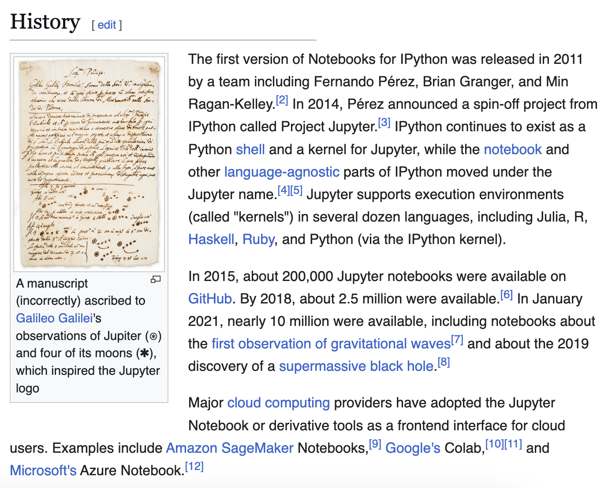](https://ipython.org/){target="_blank"}


## What are the origins of code notebooks?

:::: {.columns}
::: {.column width="50%"}
[](https://en.wikipedia.org/wiki/Literate_programming){target="_blank"}
:::
::: {.column width="50%"}
[](https://www.wolfram.com/mathematica/){target="_blank"}
:::
::::


## Why is it called Jupyter? What is the Python Data Science Ecosystem?

:::: {.columns}
::: {.column width="50%"}
[](https://docs.jupyter.org/en/latest/projects/architecture/content-architecture.html){target="_blank"}
:::
::: {.column width="50%"}
[](https://us.pycon.org/){target="_blank"}
:::
::::


## How did Jupyter become so popular? What was the notebook wars?

:::: {.columns}
::: {.column width="50%"}

:::
::: {.column width="50%"}
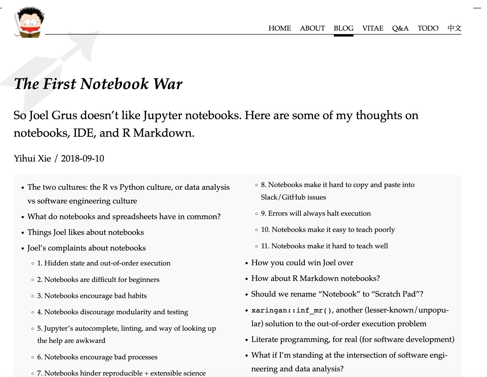
:::
::::


## How are notebooks becoming research infrastructure?

:::: {.columns}
::: {.column width="50%"}
[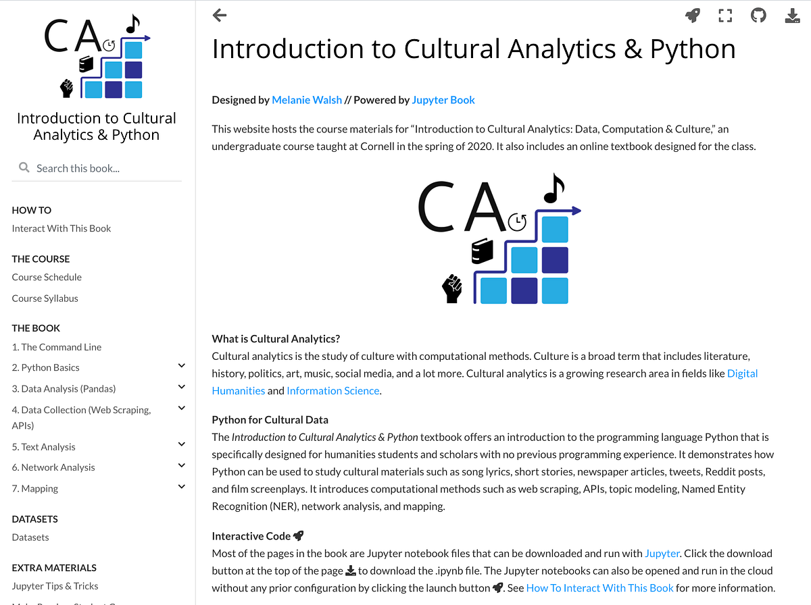](https://melaniewalsh.github.io/Intro-Cultural-Analytics/){target="_blank"}
:::
::: {.column width="50%"}
[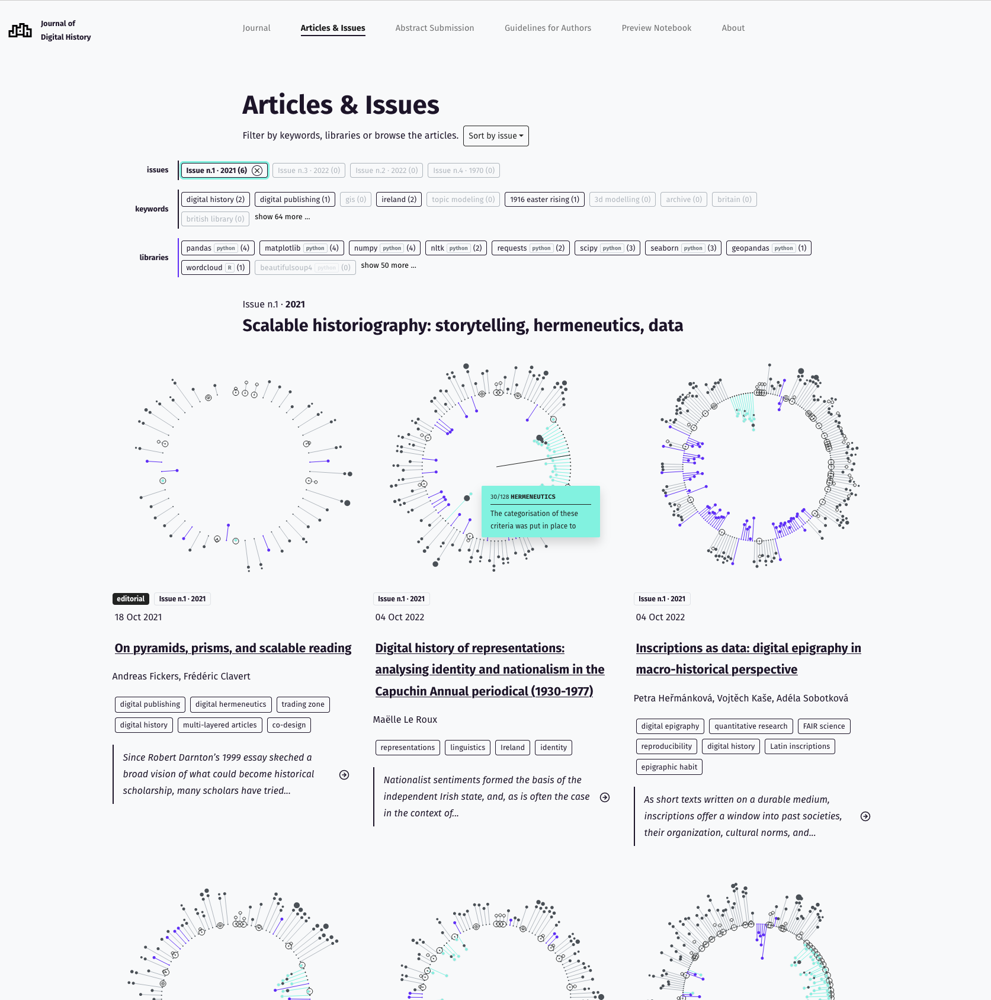](https://journalofdigitalhistory.org/en/articles/){target="_blank"}
:::
::::


## What comes after Jupyter?

:::: {.columns}
::: {.column width="50%"}
[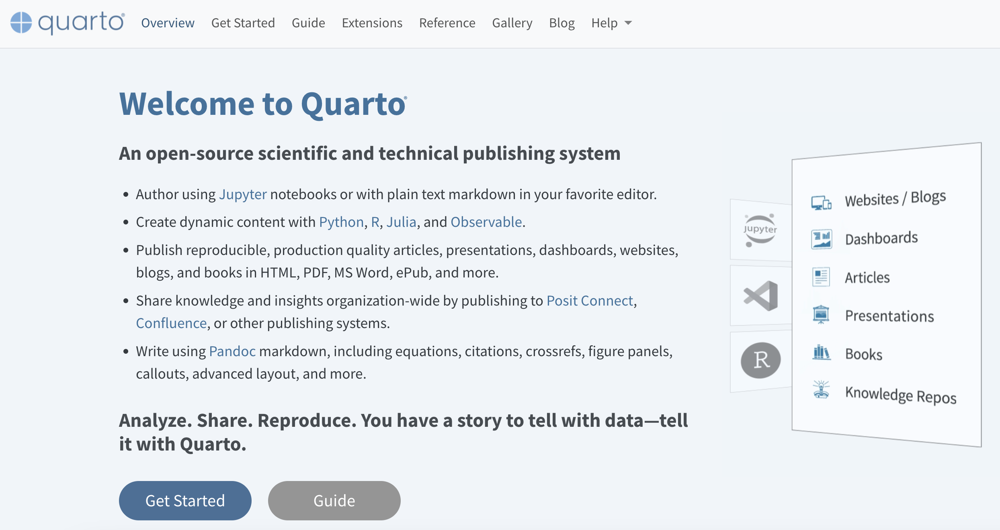](https://quarto.org/){target="_blank"}
:::
::: {.column width="50%"}
[](https://marimo.io/){target="_blank"}
:::
::::


## What should we do before installing Jupyter?

. . .

Activate the course virtual environment.

```sh
pip install notebook ipykernel pandas
```


## How can we work with Jupyter notebooks? What is the difference between VS Code vs. the browser?

[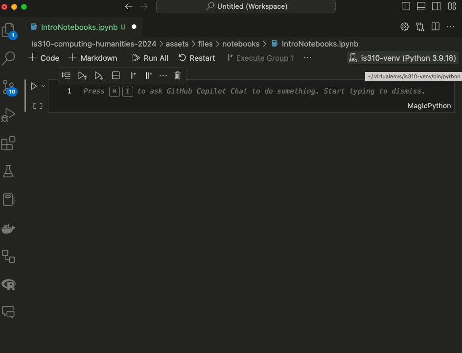](https://code.visualstudio.com/docs/datascience/jupyter-notebooks){target="_blank"}


## Which Python is actually running this notebook? What is a kernel?

**Select Kernel** → course virtual environment

```python
import sys

sys.executable
```


## What is inside an `.ipynb` file?

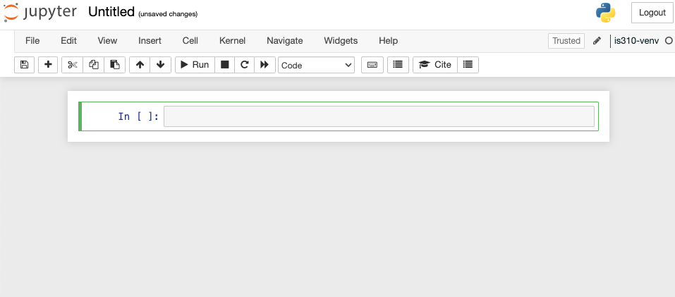


## Why should we only run notebooks we trust?

::: {.callout-warning}
Notebook cells can change files, delete data, install software, or send information over the internet.
:::


## What are the two main kinds of cells?

. . .

:::: {.columns}
::: {.column width="50%"}

```markdown
## Research Question

What patterns appear in this data?
```

**Markdown cell**

:::
::: {.column width="50%"}

```python
favorite_movies[0]
```

**Code cell**

:::
::::


## How is a notebook different from a script?

Let's try out some code!

. . .

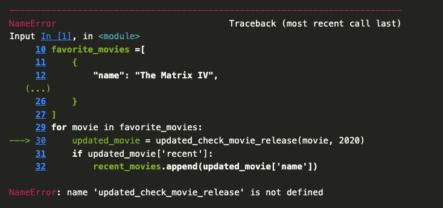


## How do we test whether a notebook will run correctly from a fresh start?

. . .

**Restart Kernel and Run All Cells**

1. Put imports and definitions before their use.
2. Run cells from top to bottom.
3. Fix hidden dependencies on old state.
4. Save the resulting notebook.


## How can we work with Data in Jupyter Notebooks? What is Pandas?

[](https://pandas.pydata.org/){target="_blank"}


## Where did Pandas come from?

:::: {.columns}
::: {.column width="50%"}
[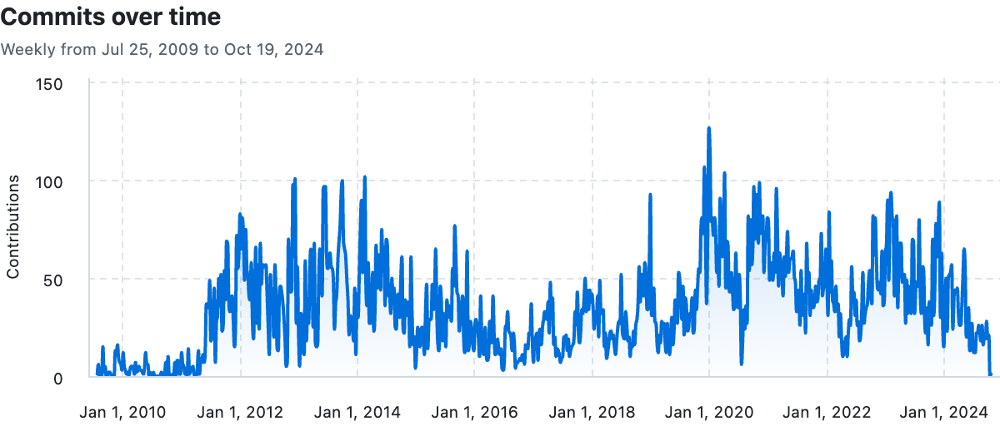](https://github.com/pandas-dev/pandas){target="_blank"}
:::
::: {.column width="50%"}
[](https://pandas.pydata.org/about/team.html){target="_blank"}
:::
::::


## How do we install, import and check the version of `pandas`?

. . .
```sh
pip install pandas
```

```python
import pandas as pd
```

```python
pd.__version__
```


## How do we get data with Pandas?

. . .

:::: {.columns}
::: {.column width="50%"}
[](https://pandas.pydata.org/docs/reference/api/pandas.read_csv.html#pandas-read-csv){target="_blank"}
:::
::: {.column width="50%"}
Let's try it out:
```python
parks_data_df = pd.read_csv('https://raw.githubusercontent.com/melaniewalsh/responsible-datasets-in-context/main/datasets/national-parks/US-National-Parks_RecreationVisits_1979-2023.csv')
# Or use the downloaded file:
# parks_data_df = pd.read_csv('US-National-Parks_RecreationVisits_1979-2023.csv')
```
:::
::::


## What is a DataFrame?

[](https://pandas.pydata.org/docs/getting_started/intro_tutorials/01_table_oriented.html){target="_blank"}


## How can we inspect or explore a DataFrame?

. . .

```python
parks_data_df.head()
```

. . .

```python
parks_data_df.sample(random_state=42)
```

. . .

```python
parks_data_df.shape
```

. . .

```python
parks_data_df.dtypes
```
. . .

```python
parks_data_df.info()
```
. . .

```python
parks_data_df.describe()
```
. . .
```python
parks_data_df.sort_values(by='RecreationVisits', ascending=False)
```
. . .
```python
parks_data_df.sort_values(by=['Year', 'RecreationVisits'], ascending=[True, False]).head(10)
```


## What are Pandas data types? Are any unique to Pandas?

. . .

| Pandas dtype | Python type | NumPy type | Usage|
|:----------:|:----------:|:----------:|:----------:|
| `str` or `string` | `str` | String array | Text values |
| `object` | Any Python object | `object_` | Mixed or arbitrary Python objects |
| `int64` | `int` | `int64` | Integer numbers |
| `float64` | `float` | `float64` | Floating-point numbers |
| `bool` | `bool` | `bool_` | True/False values |
| `datetime64` | `datetime` | `datetime64` | Date and time values |
| `timedelta64` | `timedelta` | `timedelta64` | Differences between datetimes |
| `category` | No direct equivalent | No direct equivalent | A finite set of repeated values |


## How can we check for missing or duplicate values? Why might that matter?

. . . 

```python
parks_data_df.isna().sum()
```
. . .
```python
parks_data_df.duplicated().sum()
```


## How do we select and compare parts of a DataFrame? 

*Why do one and two pairs of brackets differ?*

```python
parks_data_df['Year']
```

```python
parks_data_df[['Year']]
```


## What is a Series?

[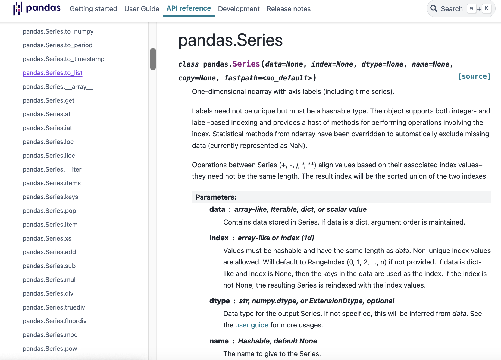](https://pandas.pydata.org/docs/reference/api/pandas.Series.html){target="_blank"}


## How do Series differ from DataFrames?

```python
parks_data_df['Year'].to_list()
```

```python
parks_data_df['Year'].unique()
```


## How do we filter rows with a condition?

. . .

```python
parks_data_df[parks_data_df['state'] == 'IL']
```


## How do we filter for several possible values?

. . .

```python
parks_data_df[parks_data_df['state'].isin(['CA', 'AK'])]
```


## What is `groupby()`?

[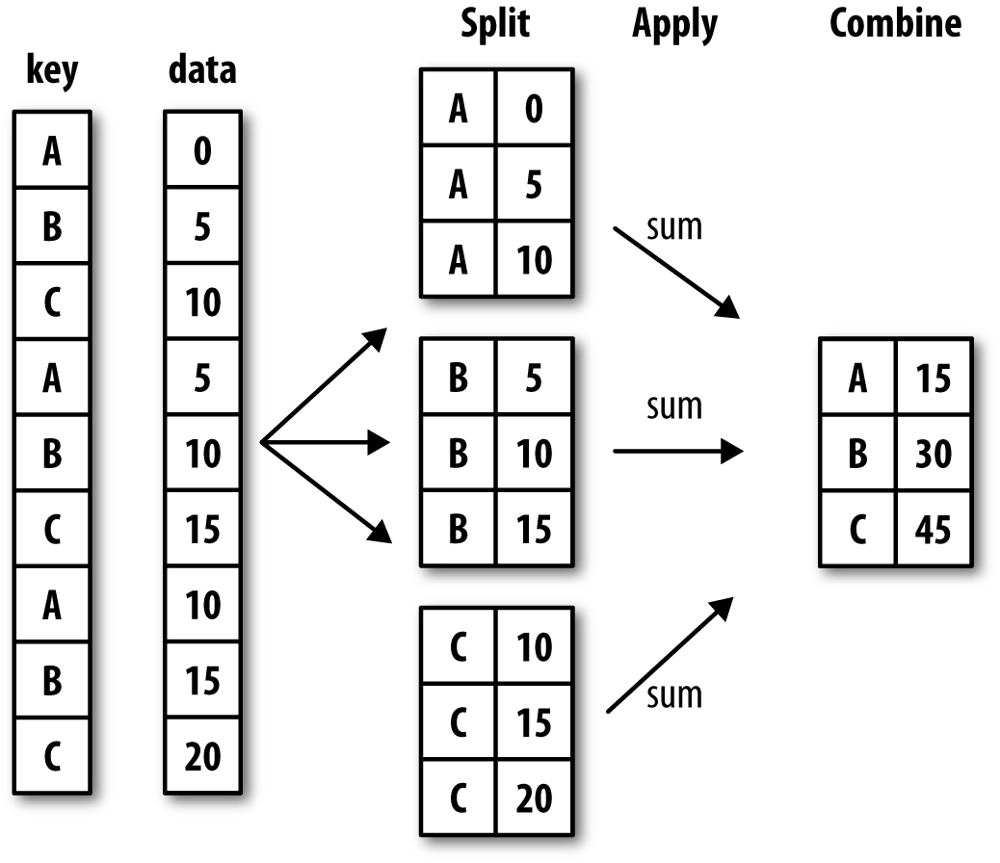](https://pandas.pydata.org/docs/user_guide/groupby.html){target="_blank"}


## Are we counting parks or rows?

```python
parks_data_df.groupby('state').size()
```

. . .

```python
parks_data_df.groupby('state')['park_name'].nunique()
```


## How do we turn the grouped result back into a table?

. . .

```python
parks_data_df.groupby('state')['park_name'].nunique().reset_index()
```

```python
parks_per_state_df = parks_data_df.groupby('state')['park_name'].nunique().reset_index()
```


## What other methods could we use to summarize parks per state?

. . .

| Pandas method | Explanation |
|:----------:|:----------:|
|`.count()`| Number of non-null observations|
|`.sum()`| Sum of values|
|`.mean()`| Mean of values|
|`.median()`| Median of values|
| `.min()` | Minimum value|
| `.max()`| Maximum value|
| `.mode()`| Mode|
| `.std()`| Sample standard deviation of values |
| `.describe()` | Compute set of summary statistics for Series or each DataFrame column|
| `.value_counts()` | Count unique values in a Series|
| `.nunique()` | Count unique values in a Series|
| `.size()` | Count number of rows in each group|


## How can we rename columns in a DataFrame?

. . .

```python
parks_per_state_df.rename(columns={'park_name': 'num_parks'})
```

```python
parks_per_state_df = parks_per_state_df.rename(columns={'park_name': 'num_parks'})
```

*How do these differ?*


## How can we add new data?

. . .

```python
new_state = pd.DataFrame({'state': ['IL'], 'num_parks': [0]})
combined_parks_per_state_df = pd.concat(
    [parks_per_state_df, new_state],
    ignore_index=True
)
```


## How can we save this data?

. . .

```python
combined_parks_per_state_df.to_csv('parks_per_state.csv', index=False)
```

*Why do we need `index=False`?*

## In-class notebook check

Create or open `NationalParksEDA.ipynb`, then:

1. Add a Markdown title and research question.
2. Import Pandas and load the National Parks data.
3. Inspect its shape, columns, data types, and missing values.
4. Filter one subset that interests you.
5. Group and aggregate the data to answer one question.
6. Explain what your result can and cannot tell us.
7. Restart the kernel and run all cells.


## What should we remember?

- A notebook is a document connected to a live kernel.
- Visible order and execution order can differ.
- Restart and run all before sharing.
- A DataFrame represents rows and columns, but their meaning comes from provenance.
- Selecting, filtering, and grouping are interpretive choices.

