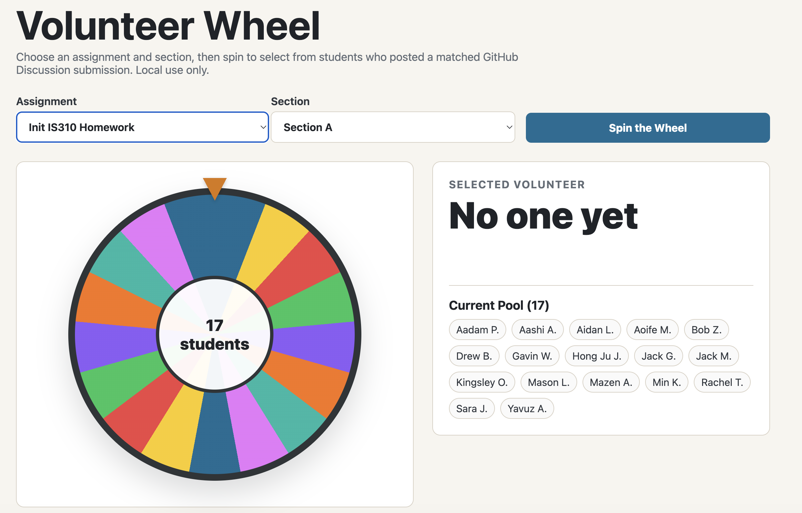
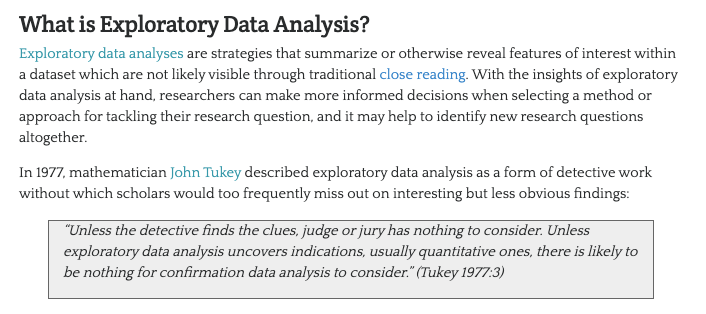
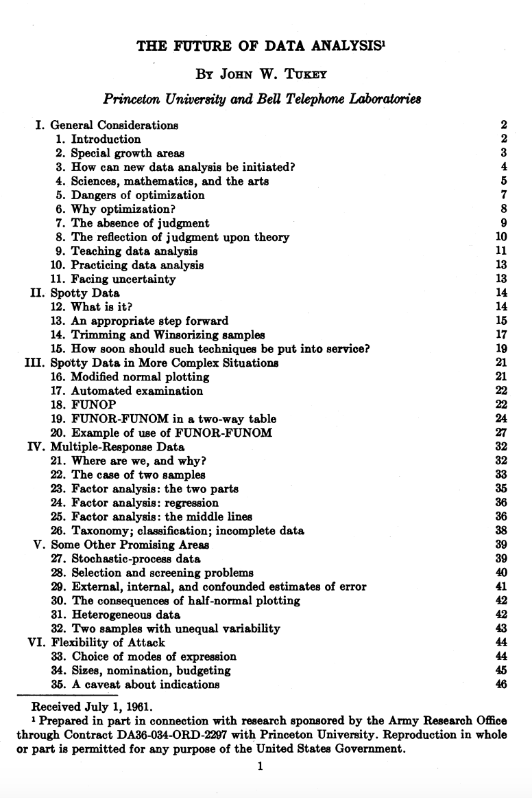
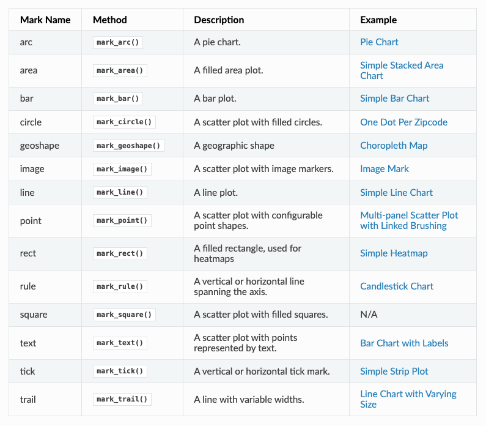
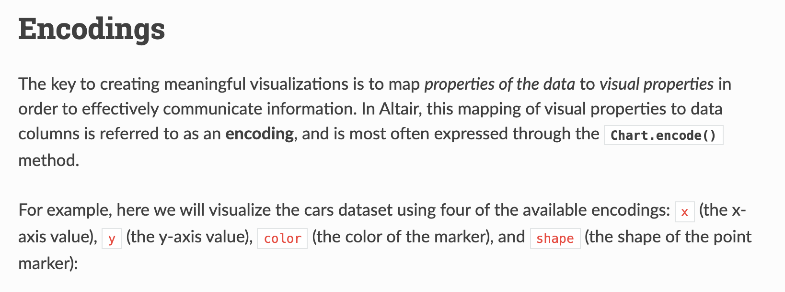
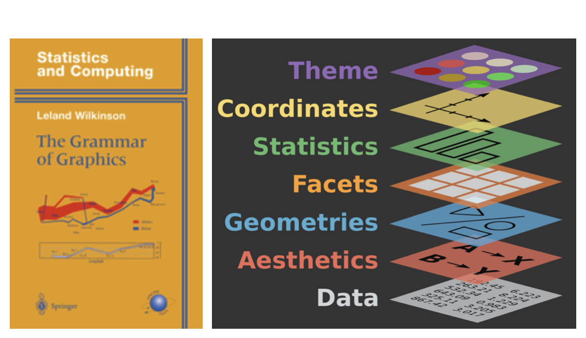
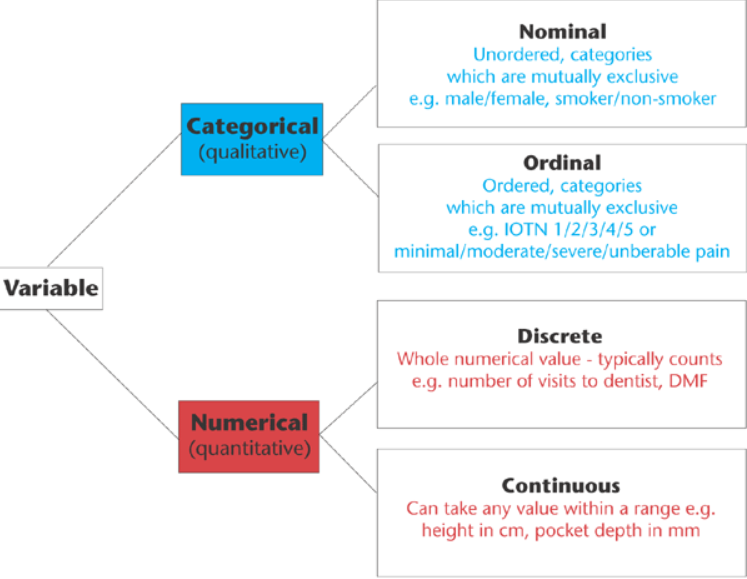
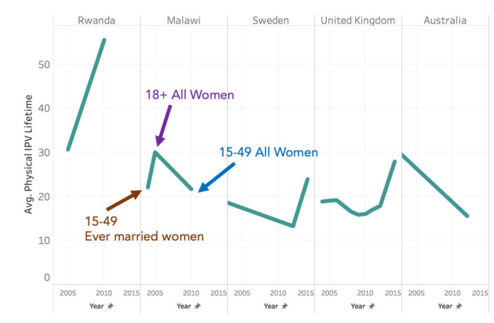

# Today's Agenda

- Review GETting Culture Across APIs homework
- Revisit exploratory data analysis with the Top 500 Novels
- Discuss assigned readings

**Milestone 2 Feedback & Grades will be updated in next 24 hours, along with participation grades. Thank you for your patience!**

*Any questions?*


## Volunteer Wheel & Homework Assignment

[](volunteer-wheel.html){target="_blank"}

## Want to follow along in a notebook?

[Download `Top500NovelsEDA.ipynb`](../assets/files/Top500NovelsEDA.ipynb){target="_blank"}

Open the notebook, select your course virtual environment as the kernel, and run each cell as we work through the lesson.


## Where did we leave off?

1. What is the average number of visits for each state?
2. What is the average number of visits for each National Park?
3. How many National Parks are there in each state?


## What else can we learn before answering a question?

[](https://www.responsible-datasets-in-context.com/posts/top-500-novels/top-500-novels.html){fig-align="center" target="_blank" width="650"}


## How do we read a TSV file?

```python
novels_df = pd.read_csv(
    "https://raw.githubusercontent.com/melaniewalsh/responsible-datasets-in-context/refs/heads/main/datasets/top-500-novels/top-500-novels-metadata_2025-01-11.tsv",
    sep="\t",
    encoding="utf-8"
)
```

*What do `sep` and `encoding` describe?*


## What is a character encoding?

:::: {.columns}
::: {.column width="50%"}

:::
::: {.column width="50%"}

:::
::::


## What is the shape of this dataset?

```python
novels_df.shape
novels_df.info()
novels_df.head()
```

*What does each method reveal?*


## What does `describe()` summarize?

```python
novels_df.describe()
```

. . .

```python
novels_df.describe(include="all")
```


## When is recorded data still missing information?

| Field | Pandas count | Common recorded value |
|---|---:|---|
| `genre` | 500 | `na` |
| `pg_eng_url` | 500 | `NA_not-pub-domain` |
| `pg_orig_url` | 64 | `unavailable` |
| `author_death` | 496 | `ALIVE` |


## Why do only 329 rows have a field of activity?

> AUTHOR_FIELD_OF_ACTIVITY: Author's primary fields of activity, according to VIAF. VIAF includes data from multiple global partner institutions, but we only collect VIAF data associated with the Library of Congress (LOC).


## What is VIAF trying to structure?

[](https://viaf.org/){fig-align="center" target="_blank" width="750"}


## What does `NaN` mean?

```python
novels_df['author_field_of_activity'].isna()
```

```python
novels_df['author_field_of_activity'].notna()
```

*What does `True` mean in each result?*


## How can Booleans filter a DataFrame?

```python
missing_activity_df = novels_df[
    novels_df['author_field_of_activity'].isna()
]
```

```python
recorded_activity_df = novels_df[
    novels_df['author_field_of_activity'].notna()
]
```


## Can missingness have a pattern?

```python
missing_activity_df['author_gender'].value_counts()
recorded_activity_df['author_gender'].value_counts()
```

```python
missing_activity_df['orig_lang'].value_counts()
recorded_activity_df['orig_lang'].value_counts()
```


# Exploratory Data Analysis

## What is EDA?

[](https://programminghistorian.org/en/lessons/sentiment-analysis){fig-align="center" target="_blank" width="750"}


## Who popularized Exploratory Data Analysis?

:::: {.columns}
::: {.column width="50%"}
[](https://projecteuclid.org/download/pdf_1/euclid.aoms/1177704711){target="_blank"}
:::
::: {.column width="50%"}

:::
::::


## What does EDA ask us to do?

- Understand structure and important variables
- Detect outliers and anomalies
- Examine missingness and coverage
- Test assumptions through summaries and visualization
- Generate questions before formal modeling


## What does a quick Pandas plot reveal?

```python
genre_counts = novels_df['genre'].value_counts()

genre_counts.plot(
    kind='bar',
    figsize=(10, 5),
    color='#4c78a8'
)
```


## Can we see library rank over time?

```python
novels_df.plot(
    x='pub_year',
    y='oclc_holdings_rank',
    kind='scatter',
    figsize=(10, 5),
    color='#4c78a8'
)
```


# Data Visualization With Altair

## Why are there so many visualization libraries?


## Where did Altair come from?

[](https://altair-viz.github.io/){fig-align="center" target="_blank" width="650"}


## How do we install and import Altair?

```sh
pip install "altair[all]"
```

```python
import altair as alt
```


## How does an Altair chart work?

```python
from altair.datasets import data

source = data.cars()

alt.Chart(source).mark_circle(size=60).encode(
    x='Horsepower',
    y='Miles_per_Gallon',
    color='Origin',
    tooltip=['Name', 'Origin', 'Horsepower', 'Miles_per_Gallon']
)
```


## What are marks and encodings?

:::: {.columns}
::: {.column width="50%"}

:::
::: {.column width="50%"}

:::
::::


## Why does Altair separate marks from encodings?

[](https://en.wikipedia.org/wiki/Grammar_of_graphics){fig-align="center" target="_blank" width="750"}


## Can Altair identify individual novels?

```python
alt.Chart(novels_df).mark_circle(size=60).encode(
    x='pub_year',
    y='top_500_rank',
    tooltip=['title', 'author', 'pub_year', 'top_500_rank']
)
```


## What do Altair's data types mean?



| Code | Type |
|---|---|
| `N` | Nominal |
| `O` | Ordinal |
| `Q` | Quantitative |
| `T` | Temporal |


## What happens if an integer year is labeled temporal?

```python
alt.Chart(novels_df).mark_circle(size=60).encode(
    x='pub_year:T',
    y='top_500_rank:Q',
    tooltip=['title', 'author', 'pub_year', 'top_500_rank']
)
```

*Why does the x-axis look wrong?*


## Why does a temporal year need conversion?

```python
novels_df['pub_year'] = pd.to_datetime(
    novels_df['pub_year'],
    errors='coerce',
    format='%Y'
)
```

```python
alt.Chart(novels_df).mark_circle(size=60).encode(
    x='pub_year:T',
    y='top_500_rank:Q',
    tooltip=['title', 'author', 'pub_year', 'top_500_rank']
)
```


## Can publication year explain missing activity metadata?

```python
novels_df['has_field_of_activity'] = (
    novels_df['author_field_of_activity'].notna()
)
```

```python
alt.Chart(novels_df).mark_circle(size=60).encode(
    x='pub_year:T',
    y='top_500_rank:Q',
    color='has_field_of_activity:N',
    tooltip=['title', 'author', 'pub_year', 'top_500_rank']
)
```


## What should we do when the dataset cannot explain its own gaps?

[](https://heatherkrause.medium.com/data-biographies-getting-to-know-your-data-better-to-achieve-better-analysis-6e35d9f8e3f2){fig-align="center" target="_blank" width="750"}


# Reshaping Metadata

## What relationships appear between genre and author activity?

```python
novels_df['author_field_of_activity'].value_counts().head(20)
```

*What is difficult about values such as `novels,fiction`?*


## How can we split compound values?

```python
novels_df['individual_author_activity'] = (
    novels_df['author_field_of_activity'].str.split(',')
)
```


## What does `explode()` change?

```python
exploded_novels_df = novels_df.explode(
    'individual_author_activity'
).copy()

print("Rows before:", len(novels_df))
print("Rows after:", len(exploded_novels_df))
```


## What happens when we visualize every category?

```python
alt.Chart(exploded_novels_df).mark_rect().encode(
    x='genre:N',
    y='individual_author_activity:N',
    color='count():Q',
    tooltip=[
        'genre:N',
        'individual_author_activity:N',
        'count():Q'
    ]
)
```


## Which rows can support this comparison?

```python
genre_activity_chart_df = exploded_novels_df[
    exploded_novels_df['genre'].notna()
    & (exploded_novels_df['genre'] != 'na')
    & exploded_novels_df['individual_author_activity'].notna()
].copy()
```


## What changes after filtering?

```python
alt.Chart(genre_activity_chart_df).mark_rect().encode(
    x='genre:N',
    y='individual_author_activity:N',
    color='count():Q',
    tooltip=[
        'genre:N',
        'individual_author_activity:N',
        'count():Q'
    ]
)
```


## Does every author contribute equally?

```python
repeated_authors_df = novels_df['author'].value_counts().reset_index()
repeated_authors_df = repeated_authors_df[
    repeated_authors_df['count'] > 1
]
```

```python
alt.Chart(repeated_authors_df).mark_bar().encode(
    x='count:Q',
    y=alt.Y('author:N', sort='-x'),
    tooltip=['author:N', 'count:Q']
)
```


## How can we reduce prolific-author effects?

```python
unique_author_activity_df = genre_activity_chart_df.drop_duplicates(
    subset=['author', 'genre', 'individual_author_activity']
)
```

```python
alt.Chart(unique_author_activity_df).mark_rect().encode(
    x='genre:N',
    y='individual_author_activity:N',
    color='count():Q',
    tooltip=['genre:N', 'individual_author_activity:N', 'count():Q']
)
```


## Which apparent patterns survive deduplication?

| Relationship | Novel-activity rows | Unique authors |
|---|---:|---:|
| Fantasy + novels | 20 | 4 |
| Thrillers + law | 11 | 2 |
| Thrillers + acting | 10 | 1 |
| Science fiction + science fiction | 12 | 7 |
| History + literature | 6 | 6 |


## What are we really comparing?

**Person-level authority metadata**

VIAF + Library of Congress records

. . .

**Work-level descriptive metadata**

Genres from OCLC's original Top 500 list


## What does “Garbage In, Garbage Out” leave out?

[](https://www.atlasobscura.com/articles/is-this-the-first-time-anyone-printed-garbage-in-garbage-out){fig-align="center" target="_blank" width="500"}


# Exploring and Visualizing Culture Homework

Choose one dataset from [Responsible Datasets in Context](https://www.responsible-datasets-in-context.com/){target="_blank"}.

1. Explore its shape and contents with Pandas.
2. Create at least one Altair chart.
3. Explain briefly what you notice.


## What matters most?

> The goal is not to use the largest number of methods or produce the most complicated chart.

. . .

**Inspect the data. Make one purposeful visualization. Explain what you notice.**


