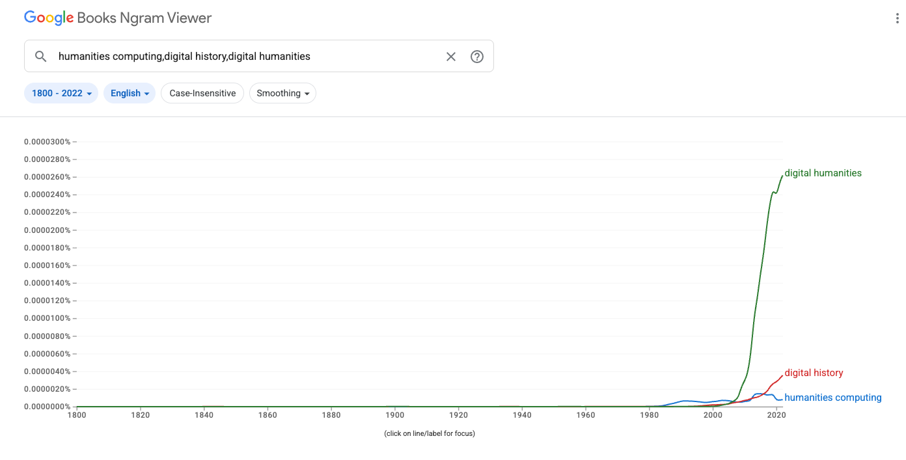
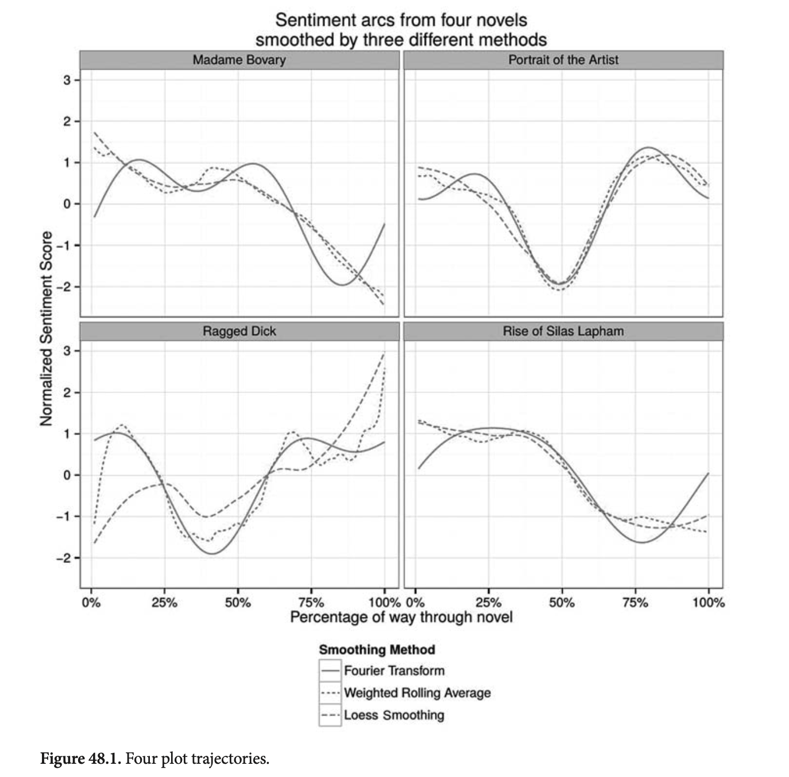
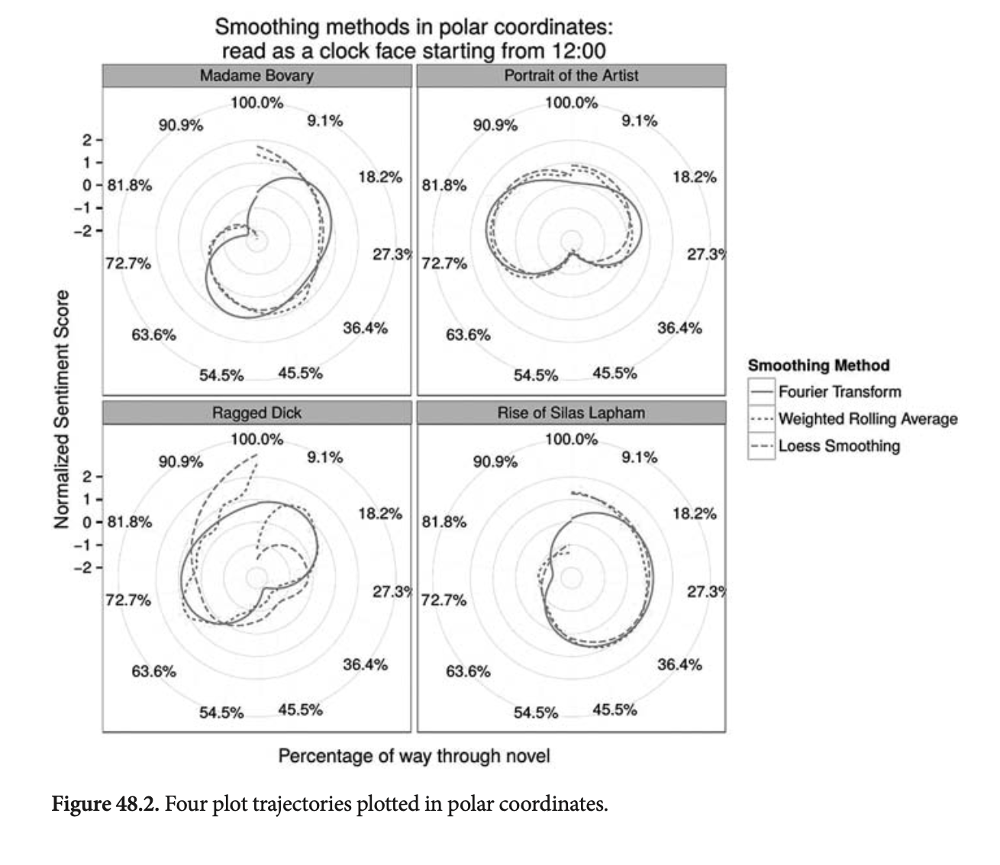
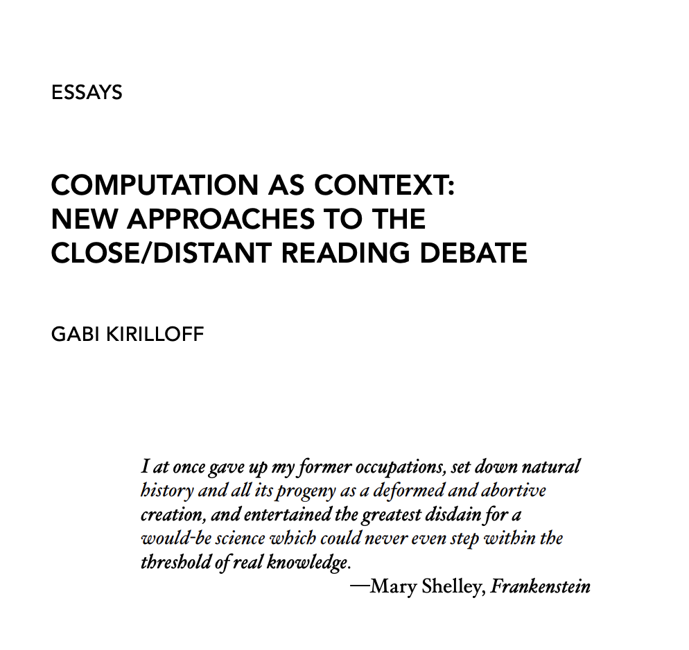

# Ted Underwood & Seven Ways

:::: {.columns}
::: {.column width="50%"}
{fig-align="center" target="_blank" width="650"}
:::
::: {.column width="50%"}
{target="_blank"}
:::
::::

## Visualize Single Text

## Choose features to represent text

*What might be lost when translation changes the words we count?*

## Distinctive vocabulary

## Find or organize works

## Model literary forms or genres

*Can the validity of a model be assessed with one standardized measure?*

## Model Social Boundaries

## Unsupervised modeling

*When does exploratory pattern-finding become confabulation?*

# Ben Schmidt & Algorithms

:::: {.columns}
::: {.column width="50%"}
{fig-align="center" target="_blank" width="650"}
:::
::: {.column width="50%"}
{target="_blank"}
:::
::::

## Models vs. Algorithms

*Can we understand a transformation without understanding how its algorithm works?*

## Sorting & Topics

:::: {.columns}
::: {.column width="50%"}

:::
::: {.column width="50%"}

:::
::::

## Algorithmic Criticism

## What was Syuzhet?

## Sentiment Analysis & Plots

:::: {.columns}
::: {.column width="50%"}
{target="_blank"}
:::
::: {.column width="50%"}
{target="_blank"}
:::
::::

## Fourier Transform

:::: {.columns}
::: {.column width="50%"}

:::
::: {.column width="50%"}

:::
::::

## The Problem with Smoothing

  
<strong>1Text</strong>“Happy and hopeful.” “Terrible news.” “Everything seemed hopeless.”

  
→

  
<strong>2Word scores</strong>Bing dictionary happy +1 · hopeful +1 terrible −1 · hopeless −1

  
→

  
<strong>3Sentence scores</strong>Add matches within each sentence: +2 · −1 · −1

  
↓ preserve narrative order

  
<strong>4Sequence</strong>[+2, −1, −1, …] Thousands of ordered sentence scores

  
→

  
<strong>5Raw graph</strong>▁▇▂▆▃▅▁ A jagged line of sentence-to-sentence variation

  
→

  
<strong>6Fourier transform</strong>Represent the sequence as slowly and rapidly changing waves

  
↓ apply a low-pass filter

  
<strong>7Retained components</strong>Keep slower waves; remove faster fluctuations

  
→

  
<strong>8Smoothed graph</strong>▁▃▆▅▂ Broader rises and falls in sentiment

  
→

  
<strong>9Interpretation</strong>A proposed “shape” of the story

## The Problem with Smoothing

## Circular Plots

## Computation As Context

{target="_blank"}

