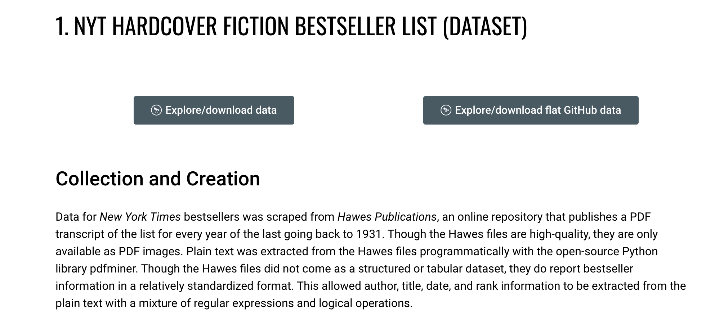
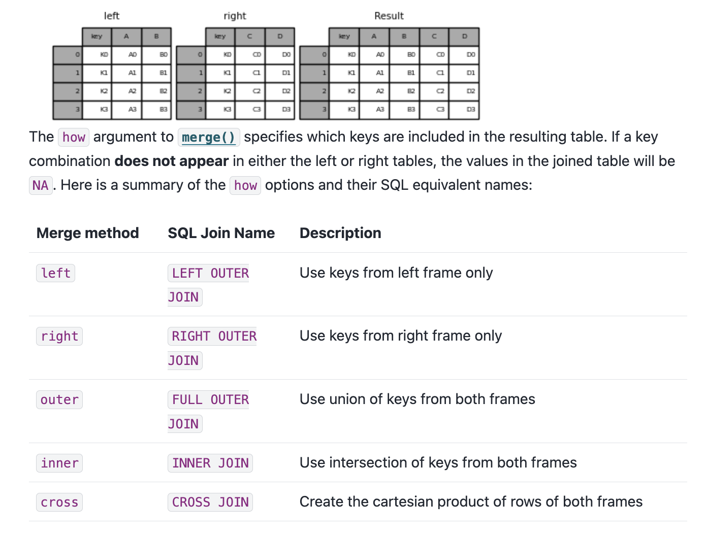
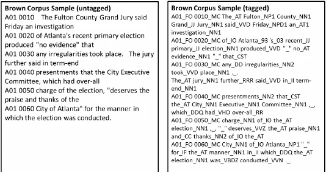
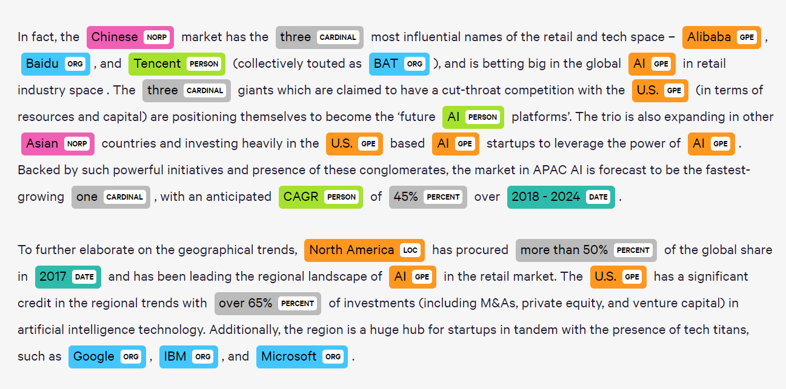
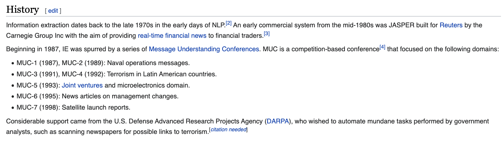
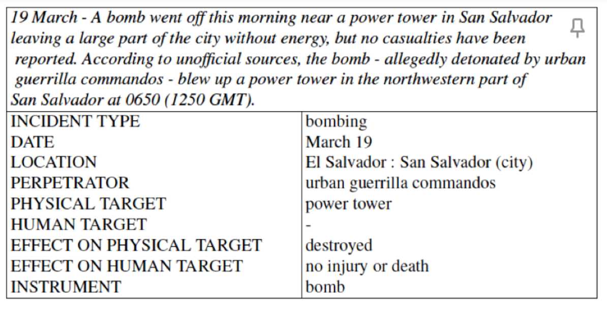
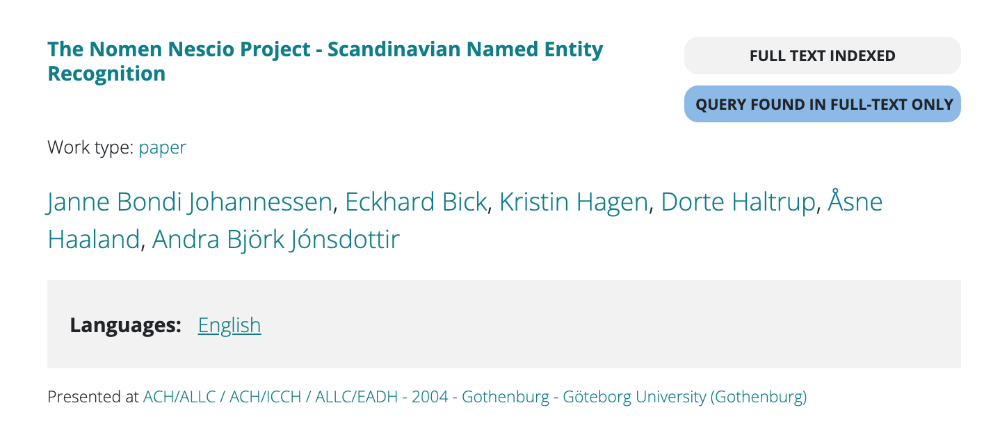

## Still Working With Top 500 Novels

[](https://www.responsible-datasets-in-context.com/posts/top-500-novels/top-500-novels.html){fig-align="center" target="_blank" width="650"}


## But also new dataset: NYT Bestsellers

[](https://data.post45.org/){fig-align="center" target="_blank" width="800"}


## What does one row represent?

[](https://data.post45.org/nyt-fiction-bestsellers-data/){fig-align="center" target="_blank" width="800"}

**One title appearing during one week**


## How can we explore the NYT dataset?

*What methods can we use to see an overview of the data? What is missing in the dataset?*


# Merging Cultural Datasets

## How do we combine two datasets in Pandas?

{fig-align="center" width="850"}

*When do two records describe the same cultural object?*


## How do we decide how to merge datasets?

*What do we need to check for merging?*

. . .

```python
set(novels_df.columns).intersection(
    set(nyt_bestsellers_df.columns)
)
```


## Why does this merge appear to work but produce no matches?

```python
merged_df = novels_df.merge(
    nyt_bestsellers_df,
    how='left',
    on=['author', 'author_viaf', 'oclc_eholdings',
        'oclc_holdings', 'oclc_owi', 'title']
)
```


## Which values actually overlap?

```python
author_is_shared = novels_df['author'].isin(
    nyt_bestsellers_df['author']
)
title_is_shared = novels_df['title'].isin(
    nyt_bestsellers_df['title']
)
```


## What can Stephen King reveal about the mismatch?

```python
novel_titles = novels_df[
    novels_df.author == "Stephen King"
].title.unique()

nyt_titles = nyt_bestsellers_df[
    nyt_bestsellers_df.author == "Stephen King"
].title.unique()
```


# String Methods & Comparison Keys

## What can Pandas do with strings?

::: {.r-fit-text}
| Method | Operation |
|---|---|
| `.str.lower()` | lowercase text |
| `.str.upper()` | uppercase text |
| `.str.capitalize()` | capitalize the first character |
| `.str.strip()` | remove surrounding whitespace |
| `.str.replace()` | replace matching text |
| `.str.split()` | split one string into a list |
| `.str.contains()` | test whether text contains a pattern |
:::


## Does capitalization solve the title mismatch?

```python
nyt_bestsellers_df = nyt_bestsellers_df.rename(
    columns={'title': 'nyt_title'}
)

nyt_bestsellers_df['title'] = (
    nyt_bestsellers_df['nyt_title'].str.capitalize()
)
```


## What happens to *Alice's Adventures in Wonderland*?

```text
Alice's Adventures in Wonderland
Alice'S Adventures In Wonderland
```

*Which differences matter for identifying the work?*


## Why preserve the original values?

```python
novels_df['title_key'] = (
    novels_df['title'].str.lower().str.strip()
)
novels_df['author_key'] = (
    novels_df['author'].str.lower().str.strip()
)
```


## Did the comparison keys reveal overlap?

```python
title_key_is_shared = novels_df['title_key'].isin(
    nyt_bestsellers_df['title_key']
)
```


# Merge Types & Research Questions

## Which records should a merge preserve?

{fig-align="center" width="750"}


## Which shared columns should become merge keys?

```python
shared_columns = list(
    set(novels_df.columns).intersection(
        set(nyt_bestsellers_df.columns)
    )
)

shared_columns.remove('author')
shared_columns.remove('title')
```


## How do the merge types change the result?

```python
inner_merge_df = novels_df.merge(
    nyt_bestsellers_df,
    how='inner',
    on=shared_columns,
    indicator=True
)
```


## What does `indicator=True` reveal?

| `_merge` value | Meaning |
|---|---|
| `left_only` | found only in the left source |
| `both` | matched across the two sources |
| `right_only` | found only in the right source |


## Which merge answers our OCLC question?

**Which OCLC Top 500 novels also appeared on the NYT list?**

. . .

```python
merged_df = novels_df.merge(
    nyt_bestsellers_df,
    how='left',
    on=shared_columns,
    suffixes=('_oclc', '_nyt')
)
```


## Did every OCLC novel appear on the NYT list?

```python
nyt_novels_df = merged_df[
    merged_df['title_nyt'].notna()
]

non_nyt_novels_df = merged_df[
    merged_df['title_nyt'].isna()
]
```


## How did the merge change the unit of observation?

**Before:** one row per OCLC novel

. . .

**After:** one row per matched novel-week appearance


## How can we visualize unique OCLC novels?

```python
oclc_publication_chart_df = merged_df[
    ['top_500_rank', 'oclc_pub_date', 'has_title_nyt']
].drop_duplicates()
```


## Why summarize before plotting 60,000 rows?

```python
nyt_appearance_chart_df = right_merge_df[
    ['year', 'in_oclc_top_500']
].value_counts().reset_index(
    name='weekly_appearances'
)
```


## What does Altair's row limit protect us from?

```python
alt.data_transformers.disable_max_rows()
```

*Why might disabling this be a poor publishing choice?*


# From Unstructured to Structured Data

## Is text already structured?

{fig-align="center" width="800"}


## What is the difference between retrieval and extraction?

:::: {.columns}
::: {.column width="50%"}
[](https://en.wikipedia.org/wiki/Information_retrieval){target="_blank"}

**Information Retrieval**
:::
::: {.column width="50%"}
[](https://en.wikipedia.org/wiki/Information_extraction){target="_blank"}

**Information Extraction**
:::
::::


## What does part-of-speech tagging add?

[](https://spacy.io/usage/linguistic-features#pos-tagging){fig-align="center" target="_blank" width="850"}


## How did grammatical text become machine-readable data?

[](https://varieng.helsinki.fi/CoRD/corpora/BROWN/tags.html){fig-align="center" target="_blank" width="850"}


## What does named entity recognition add?

[](https://spacy.io/usage/linguistic-features#named-entities){fig-align="center" target="_blank" width="850"}


## When did “named entity” become a research category?

:::: {.columns}
::: {.column width="50%"}
[](https://en.wikipedia.org/wiki/Information_extraction#History){target="_blank"}
:::
::: {.column width="50%"}
[](https://www-nlpir.nist.gov/related_projects/muc/muc_sw/muc_sw_manual.html){target="_blank"}
:::
::::


## How recent is NER in digital humanities?

[](https://dh-abstracts.library.cmu.edu/works?ordering=year&text=%22named+entity+recognition%22&conference=&work_type=){fig-align="center" target="_blank" width="850"}


# spaCy & Structuring Text

## Why are we using spaCy?

[](https://spacy.io/){fig-align="center" target="_blank" width="850"}


## What is the difference between a library and a trained pipeline?

```sh
pip install spacy
python -m spacy download en_core_web_sm
```


## What happens when we call `nlp(text)`?

::: {.r-fit-text}

**Text** → **Tokenizer** → **Pipeline components** → **Annotated document**

`"Harry Potter..."` → words and punctuation → POS, syntax, entities → `Doc`

:::


## What does spaCy return?

```python
doc = nlp("Harry Potter and the Philosopher's Stone")

type(doc)
doc[0]
doc.ents
```


## Where do spaCy's labels come from?

**Annotated examples** → **learned patterns** → **predictions for new text**

. . .

*What might change a prediction?*


## What does spaCy predict for one title?

```python
example_title = nlp(
    "Harry Potter and the Philosopher's Stone"
)
```


## How can we inspect entity predictions visually?

[](https://spacy.io/usage/visualizers){fig-align="center" target="_blank" width="850"}


# What Can the Language of Titles Tell Us?

## Why analyze titles rather than full novels?

**Only two matched novels have usable open-access Project Gutenberg text.**

. . .

Can title language distinguish OCLC holdings from NYT bestsellers?


## What should make us cautious about titles?

::: {.r-fit-text}
- Editions, translations, and platforms may use different titles.
- Punctuation, subtitles, series names, and capitalization vary.
- Different works can share a title.
- Short titles provide limited context for model predictions.
- Comparison keys improve matching while removing distinctions.
:::


## Which NYT dataset fits a title-level question?

**Weekly list:** one row per title-week appearance

. . .

**Title file:** one intended row per bestseller title


## Do comparison keys reveal duplicate records?

```python
nyt_titles_df['title_key'] = (
    nyt_titles_df['title'].str.lower().str.strip()
)
nyt_titles_df['author_key'] = (
    nyt_titles_df['author'].str.lower().str.strip()
)
```


## How do we keep one row per title-author key?

```python
nyt_titles_with_keys_df = nyt_titles_df.dropna(
    subset=['title_key', 'author_key']
)

nyt_unique_titles_df = (
    nyt_titles_with_keys_df.drop_duplicates(
        subset=['title_key', 'author_key']
    ).copy()
)
```


## How do we create three comparison groups?

```python
title_comparison_df = oclc_title_columns_df.merge(
    nyt_title_columns_df,
    how='outer',
    on=['title_key', 'author_key'],
    suffixes=('_oclc', '_nyt'),
    indicator=True
)
```


## How do we reconcile titles and dates from two sources?

```python
title_comparison_df['title'] = (
    title_comparison_df['title_oclc'].fillna(
        title_comparison_df['title_nyt']
    )
)
```


## How can we visit each DataFrame row?

```python
for index, row in title_comparison_df.head(3).iterrows():
    print(index)
    print(row['title_for_analysis'])
```


## What does `row` contain?

```python
for index, row in title_comparison_df.head(1).iterrows():
    print(type(row))
    print(row[['title_for_analysis', 'dataset_group']])
```


## How can we augment every title?

```python
title_analysis_rows = []

for index, row in title_comparison_df.iterrows():
    title = row['title_for_analysis']
    doc = nlp(title)
    # Count predicted labels and save entities
```


## What is the unit of the augmented DataFrame?

**One row per title**

. . .

**New fields:** grammatical counts and predicted entities


## How can we compare groups of different sizes?

```python
title_measure_summary_df = (
    title_analysis_df
    .groupby('dataset_group')[title_measure_columns]
    .mean()
    .round(2)
    .reset_index()
)
```


## Why does this chart require long data?

[](https://pandas.pydata.org/docs/reference/api/pandas.DataFrame.melt.html){fig-align="center" target="_blank" width="850"}


## What differs across the three title groups?

```python
alt.Chart(title_measure_long_df).mark_bar().encode(
    x='dataset_group:N',
    y='mean_count_per_title:Q',
    color='dataset_group:N',
    column='measure:N'
)
```


## Do genres cross between institutional and commercial recognition?

```python
genre_analysis_df['matched_nyt'] = (
    genre_analysis_df['dataset_group'] == 'OCLC and NYT'
).astype(int)
```


## Why compare a rate rather than only raw counts?

```python
genre_match_summary_df = genre_analysis_df.groupby(
    'genre'
).agg(
    title_count=('title', 'size'),
    nyt_match_rate=('matched_nyt', 'mean')
).reset_index()
```


## How do predictions become countable records?

```python
title_entities_df = title_analysis_df.explode(
    'entities'
)
```


## Which entity texts occur most often?

```python
top_entities_df = (
    entity_counts_df.groupby('dataset_group').head(10)
)
```


## How many titles contain a predicted person or place?

```python
focused_entity_df['has_person'] = (
    focused_entity_df['entities'].apply(has_person)
)
focused_entity_df['has_gpe'] = (
    focused_entity_df['entities'].apply(has_gpe)
)
```


## What does `.apply()` do?

```python
person_results = (
    focused_entity_df['entities'].apply(has_person)
)

person_results.head()
```


## When might we use each approach?

| Approach | What it visits | Useful here when... |
|---|---|---|
| `iterrows()` | Each full DataFrame row | One record requires several fields and several processing steps |
| `.apply()` | Each value in one Series | One reusable function transforms or tests every value in a column |


## How can one chart compare both entity types?

```python
focused_entity_long_df = focused_entity_df.melt(
    id_vars=['title', 'dataset_group', 'genre',
             'publication_year'],
    value_vars=['has_person', 'has_gpe'],
    var_name='entity_type',
    value_name='has_entity'
)
```


## What share of titles contain people or places?

```python
alt.Chart(entity_group_summary_df).mark_bar().encode(
    x='dataset_group:N',
    y='title_share:Q',
    color='dataset_group:N',
    column='entity_type:N'
)
```


## When does a percentage rest on too little data?

```python
genre_entity_chart_df = genre_entity_summary_df[
    genre_entity_summary_df['title_count'] >= 5
]
```


## How do entity predictions differ across genres?

```python
alt.Chart(genre_entity_chart_df).mark_rect().encode(
    x='entity_type:N',
    y='genre:N',
    color='title_share:Q',
    column='dataset_group:N'
)
```


## What must we audit before interpreting the charts?

```python
title_entities_df[
    title_entities_df['entity_label'].isin(
        ['PERSON', 'GPE']
    )
][
    ['dataset_group', 'title',
     'entity_text', 'entity_label']
].head(30)
```


## What changes when we compare predictions over time?

```python
temporal_entity_summary_df = temporal_entity_df.groupby(
    ['year', 'dataset_group', 'entity_type']
).agg(
    titles_with_entity=('has_entity', 'sum')
).reset_index()
```


# Quick Exercise: Try spaCy With Your Dataset

1. Choose a short-text column.
2. Process ten recorded values.
3. Inspect entity text and labels.
4. Identify one useful prediction and one uncertain prediction.
5. Write one question and one limitation.


