## What does it mean to work with culture as data in the age of AI?

Two readings today showing us very different approaches!

Let's start with [Underwood piece](https://tedunderwood.com/2024/01/05/can-language-models-predict-the-next-twist-in-a-story/){target="_blank"}...

## Reminder:What is distant reading?

> While distant reading has taught us a lot about the history of fiction, it hasn’t done much yet to explain why we keep turning pages.

:::: {.columns}
::: {.column width="50%"}

::: 
::: {.column width="50%"}

:::
::::

##

::: {.r-fit-text .column width=100%}
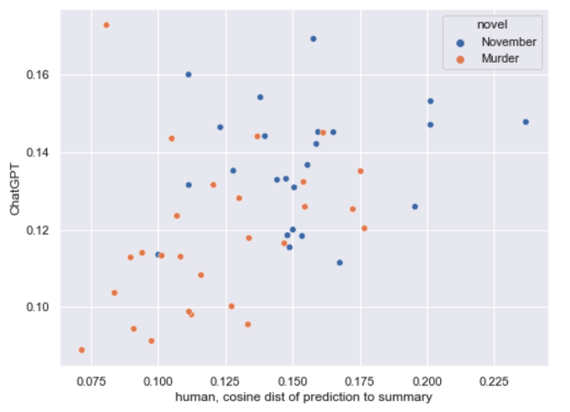
:::

How does Underwood study suspense and what makes it difficult?

## How does Underwood turn books into data for LLMs?

[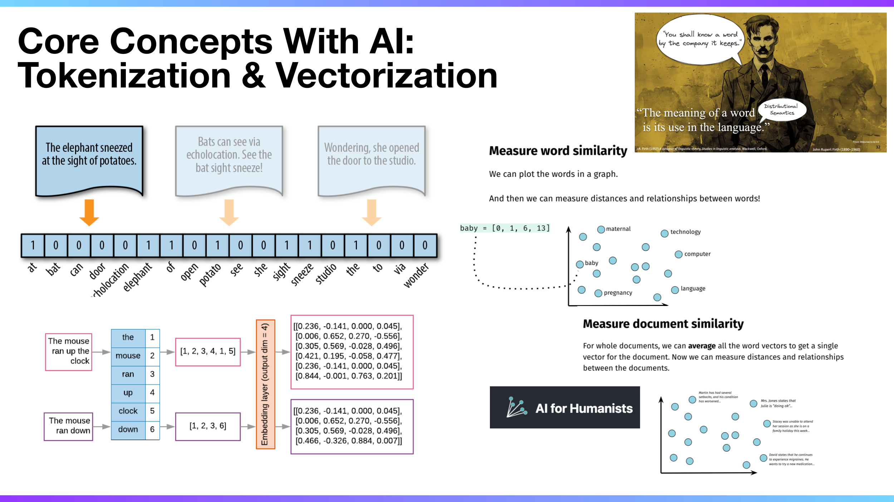](https://github.com/tedunderwood/next-twist){target="_blank"}

## How do LLMs work?

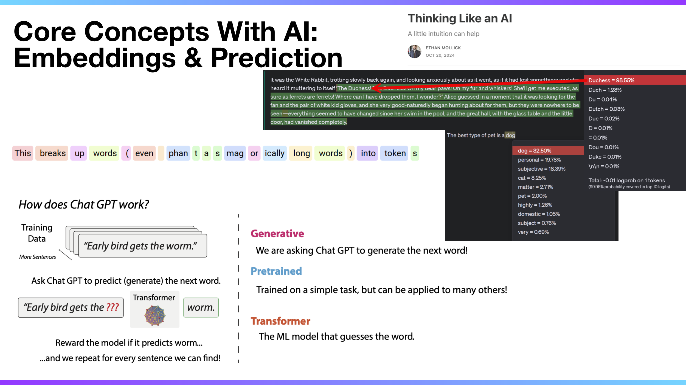

## How do LLMs work?

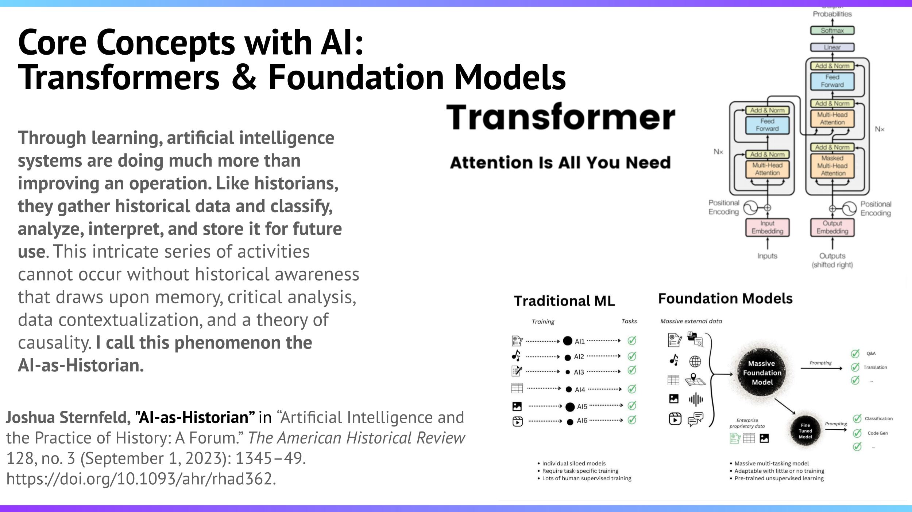

## 

:::: {.columns}
::: {.column width="50%"}

:::
::: {.column width="50%"}
{target="_blank"}
:::
::::

Why is it a problem that these models have already seen these books? How does Underwood attempt to get around this problem?

##

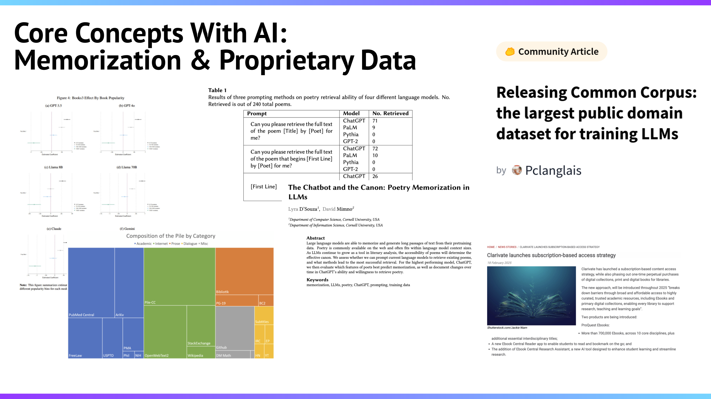

##

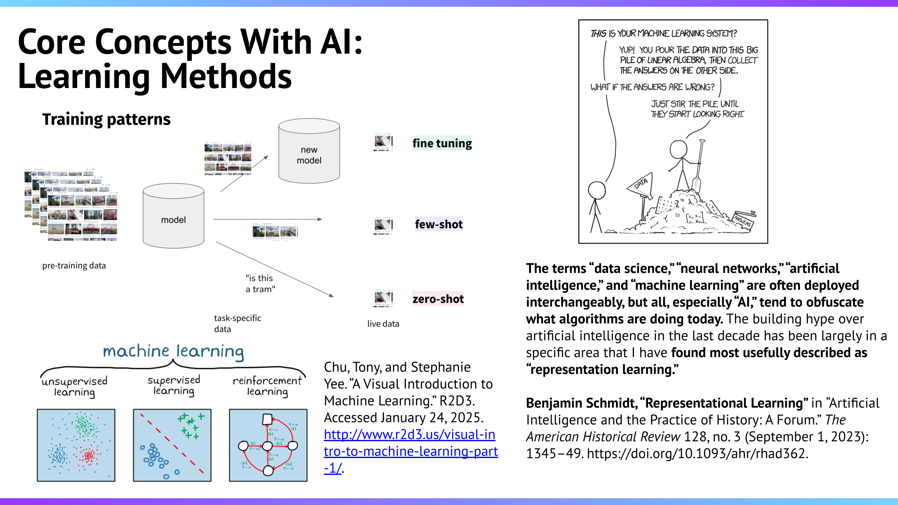

##

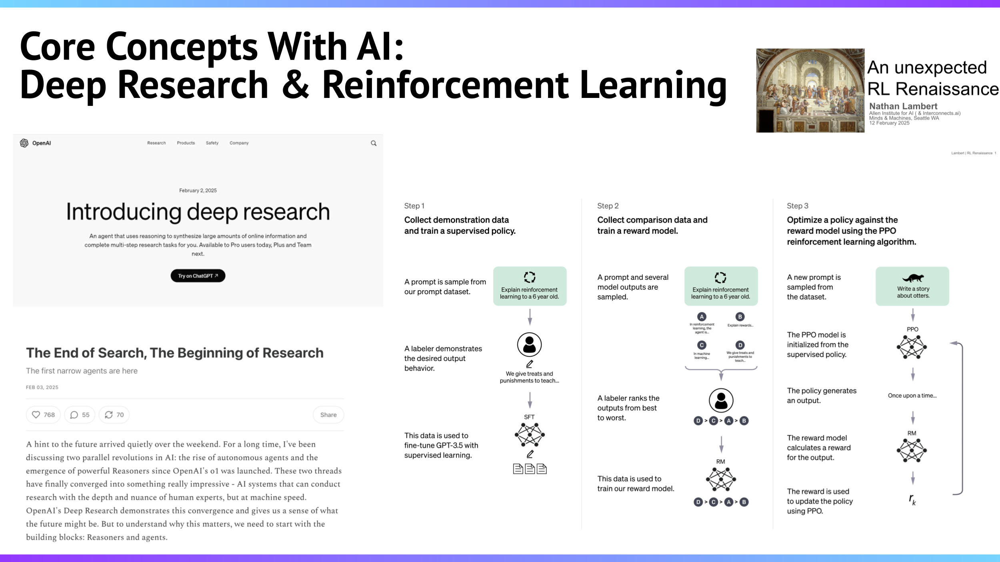

##

What does Underwood find when it comes to the Baskervilles? How is he using computation to measure LLM results?

# Let's Compare to the Sonnet or Bot Piece

:::: {.columns}
::: {.column width="50%"}
{target="_blank"}
:::
::: {.column width="50%"}

:::
::::

*Why study poetry with LLMs?*

## What is in their dataset? What do they exclude?

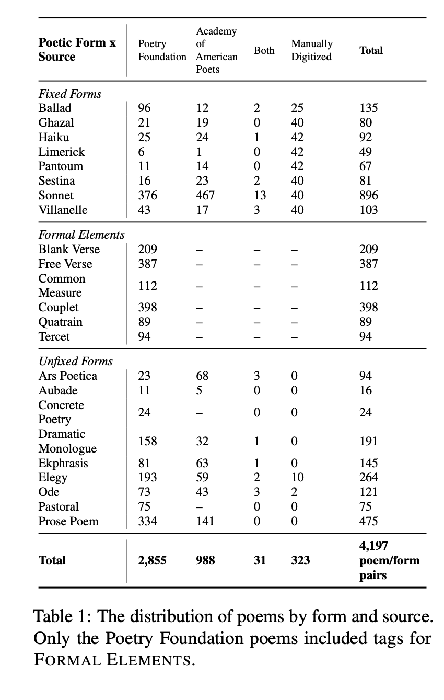

## How do they handle memorization?

:::: {.columns}
::: {.column width="50%"}
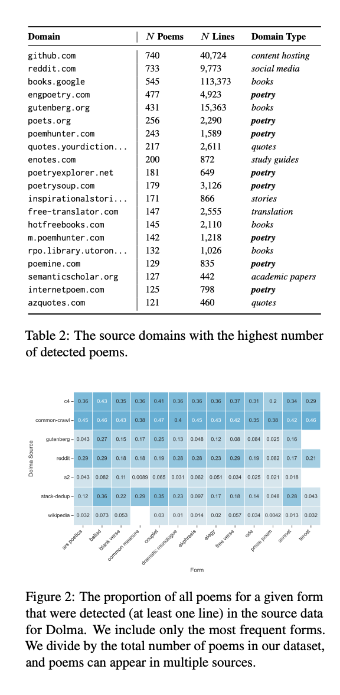
:::
::: {.column width="50%"}
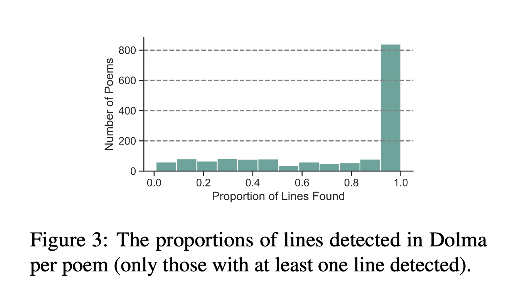
:::
::::

## What is a benchmark? Why do we need them for LLMs?

:::: {.columns}
::: {.column width="50%"}

:::
::: {.column width="50%"}
{target="_blank"}
:::
::::

## What are their results?

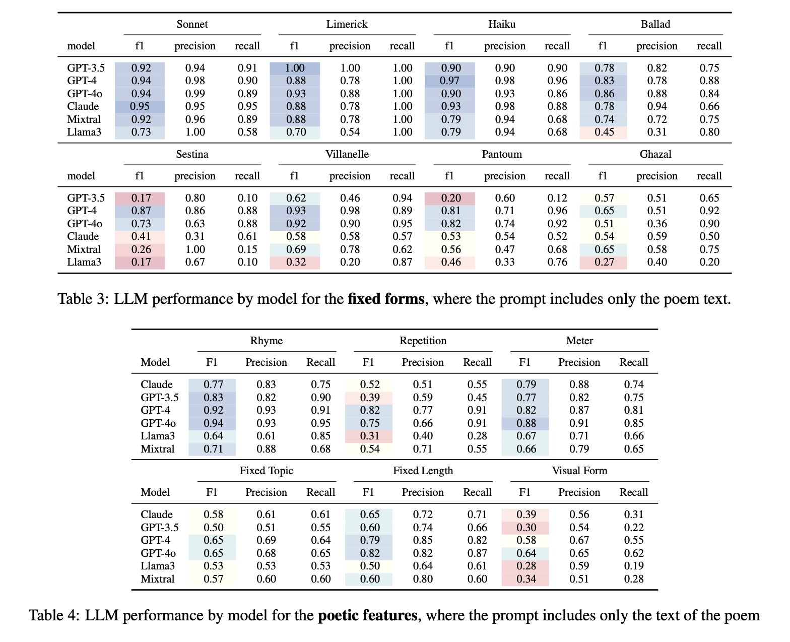

## Why does prompt type matter?

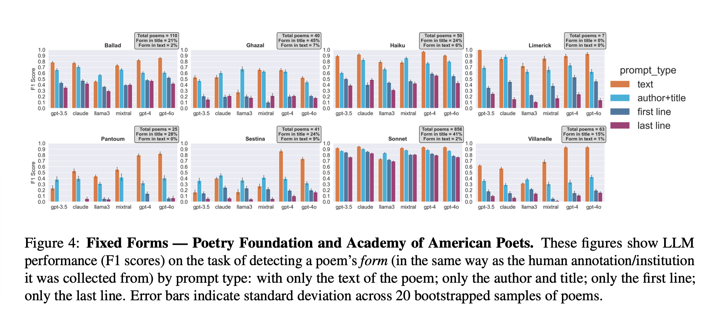

## Example Prompt

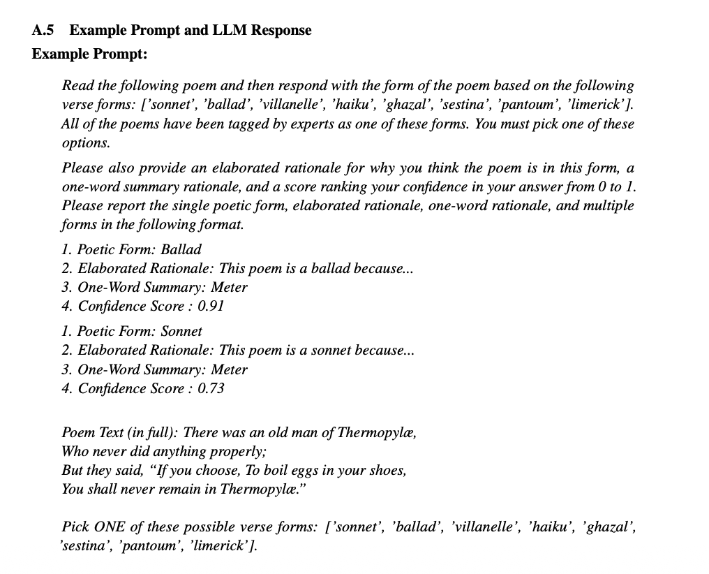

## How to prompt?

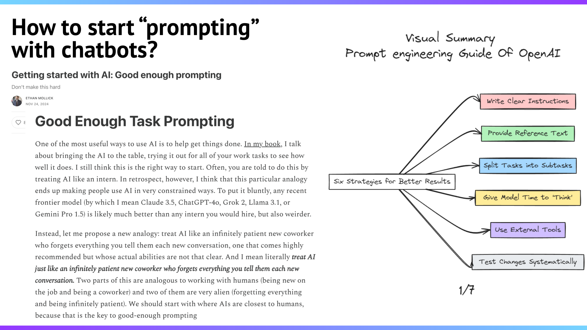

## Prompting Resources

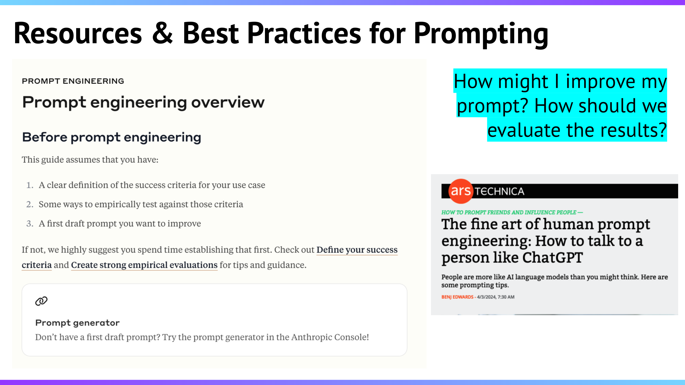

## AI for Humanists Prompt Bank

[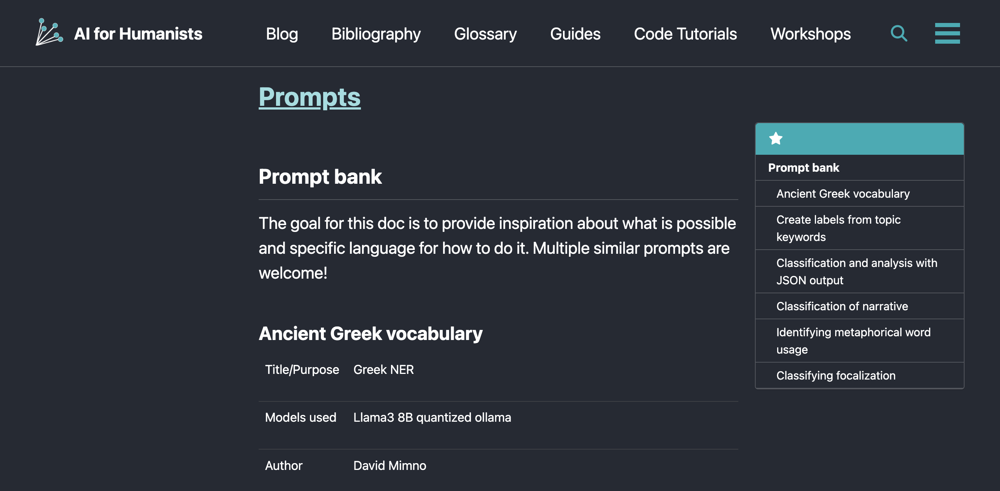](https://aiforhumanists.com/guides/prompts/){target="_blank"}

